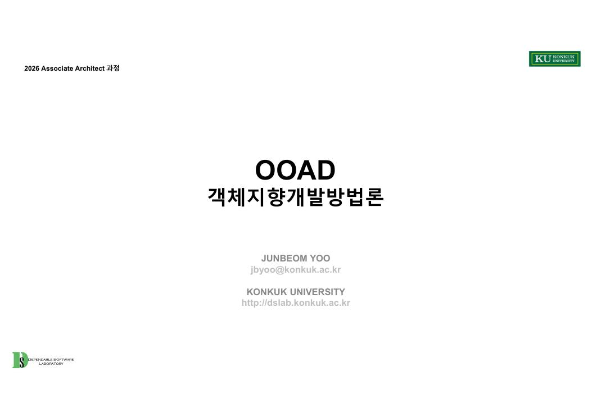
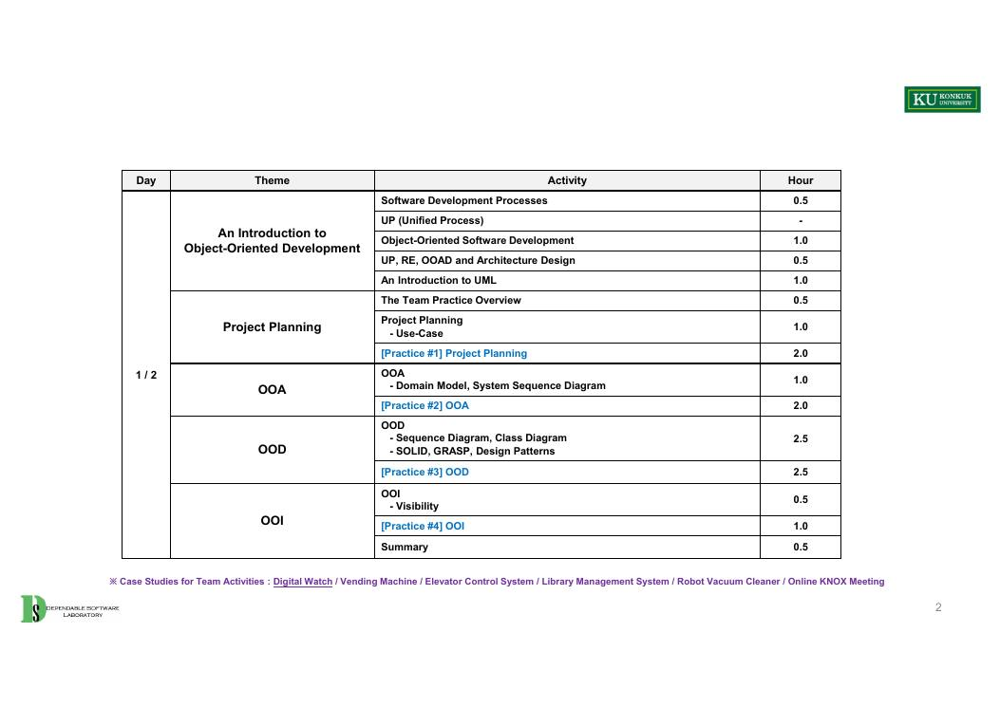
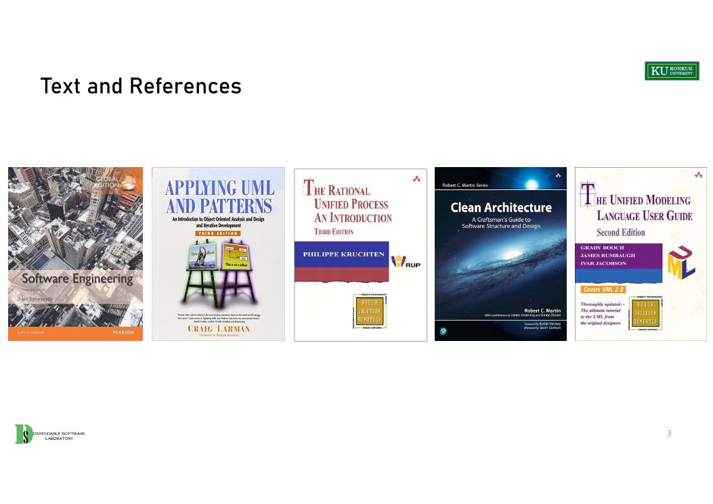

# 과정 소개

> OOAD 객체지향개발방법론 · 슬라이드 1–3 · 원본: [PDF](../../original/2026%20AA%204차%20-%20OOAD%20(20261126).pdf)

[← 목차](README.md) · [다음: Software Development Processes →](01_Software_Development_Processes.md)

## 슬라이드 목록

- [1. 2026 Associate Architect 과정](#s1)
- [2. Day · Theme · Activity · Hour](#s2)
- [3. Text and References](#s3)

---

## 1. 2026 Associate Architect 과정

OOAD  
객체지향개발방법론  

JUNBEOM YOO  
jbyoo@konkuk.ac.kr  

KONKUK UNIVERSITY  
http://dslab.konkuk.ac.kr  

---

## 2. Day · Theme · Activity · Hour

Software Development Processes · 0.5  
UP (Unified Process) · -  
An Introduction to  
Object-Oriented Software Development · 1.0  
Object-Oriented Development  
UP, RE, OOAD and Architecture Design · 0.5  
An Introduction to UML · 1.0  
The Team Practice Overview · 0.5  
Project Planning  
Project Planning · - Use-Case  
1.0  

[Practice #1] Project Planning · 2.0  

1/2 · OOA  
1.0  
OOA · - Domain Model, System Sequence Diagram  
[Practice #2] OOA · 2.0  
OOD  
- Sequence Diagram, Class Diagram · 2.5

OOD · - SOLID, GRASP, Design Patterns  

[Practice #3] OOD · 2.5  

OOI  
0.5  
- Visibility

OOI · [Practice #4] OOI · 1.0  

Summary · 0.5  

※ Case Studies for Team Activities : Digital Watch / Vending Machine / Elevator Control System / Library Management System / Robot Vacuum Cleaner / Online KNOX Meeting  

---

## 3. Text and References

---

[← 목차](README.md) · [다음: Software Development Processes →](01_Software_Development_Processes.md)
