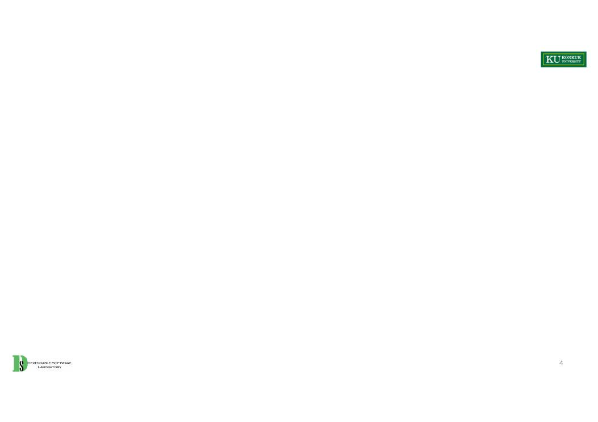
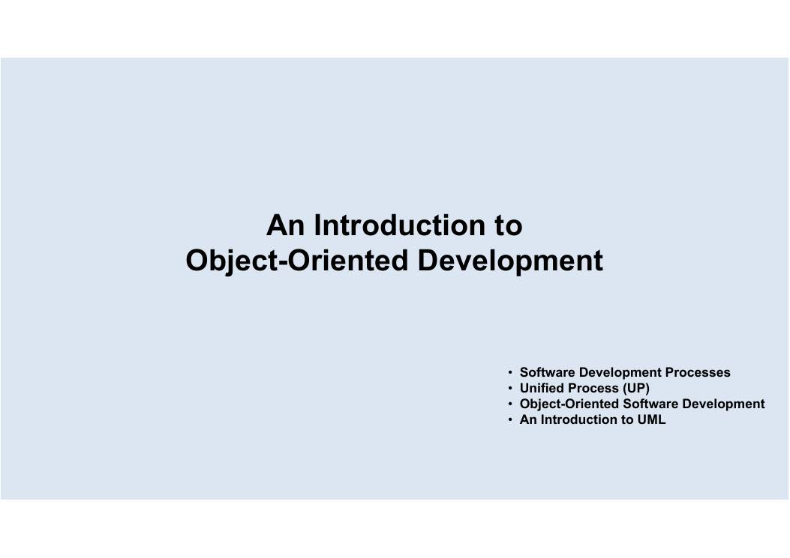
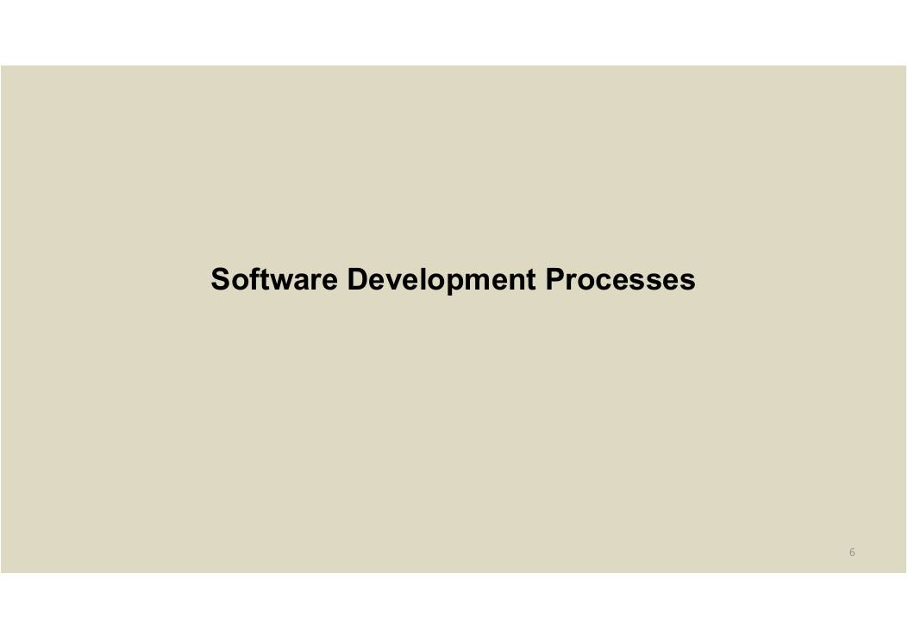
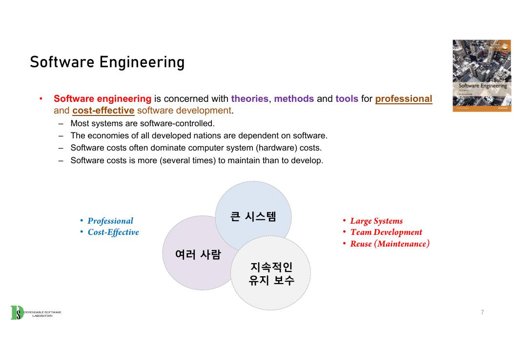
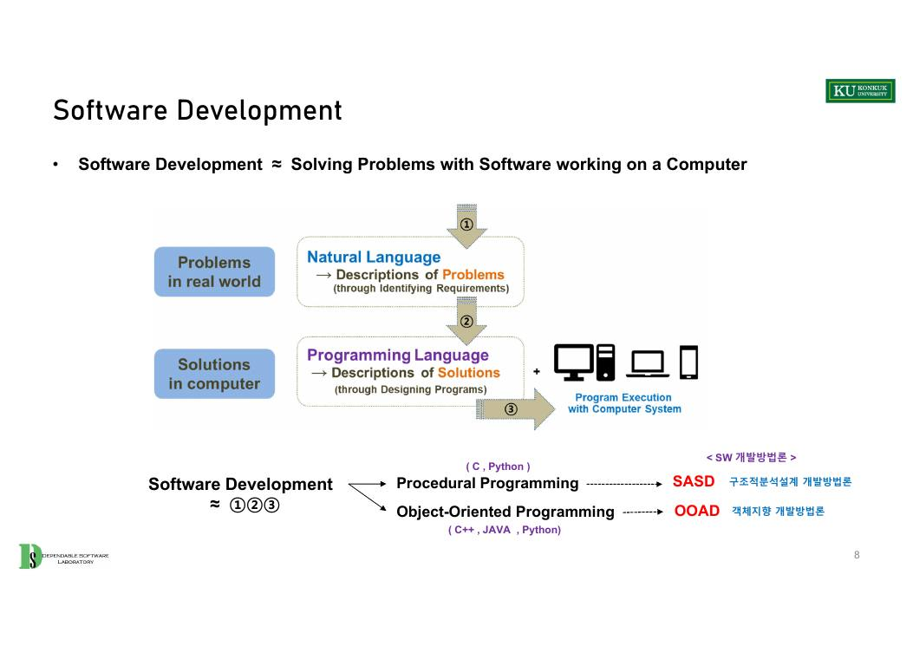
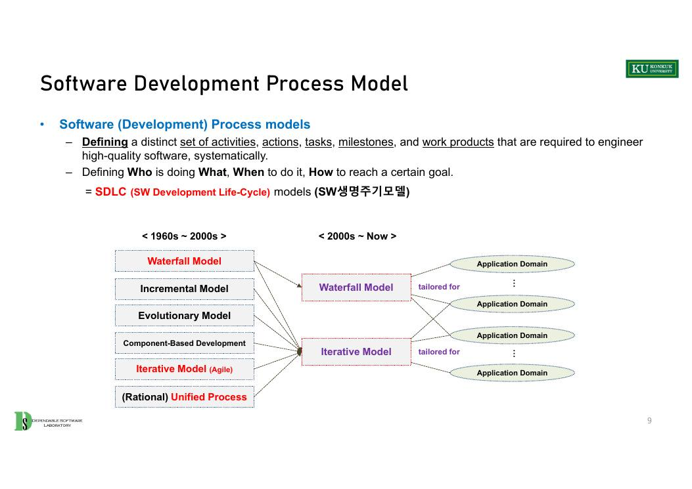
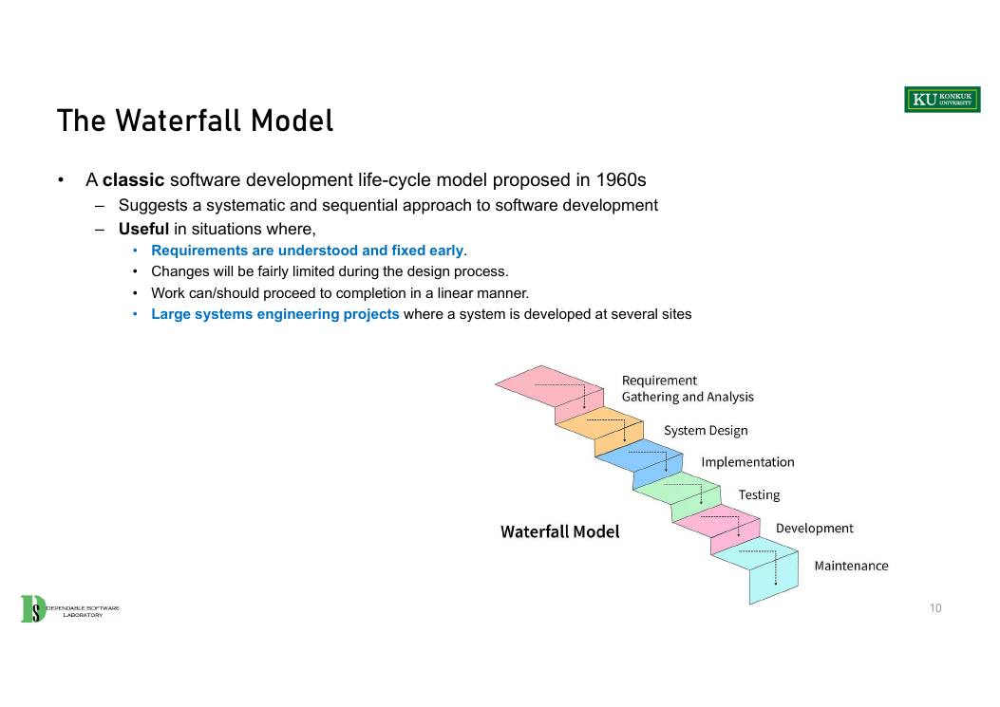
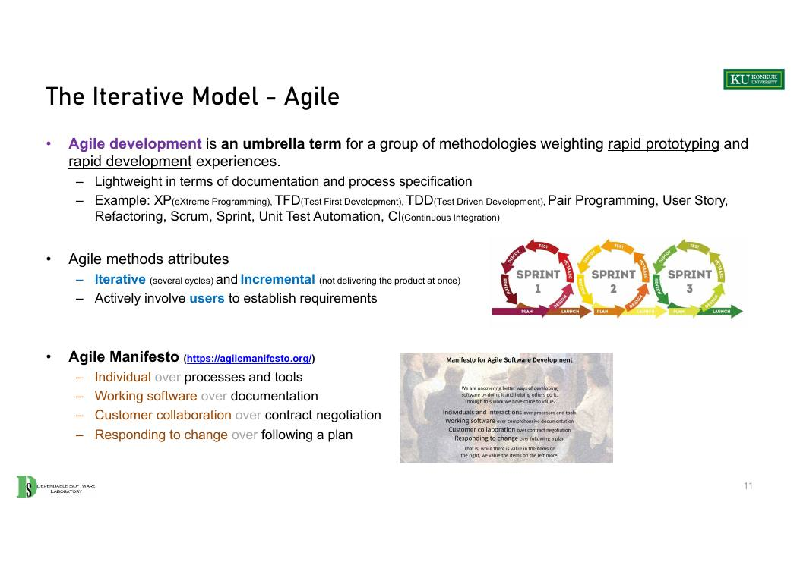
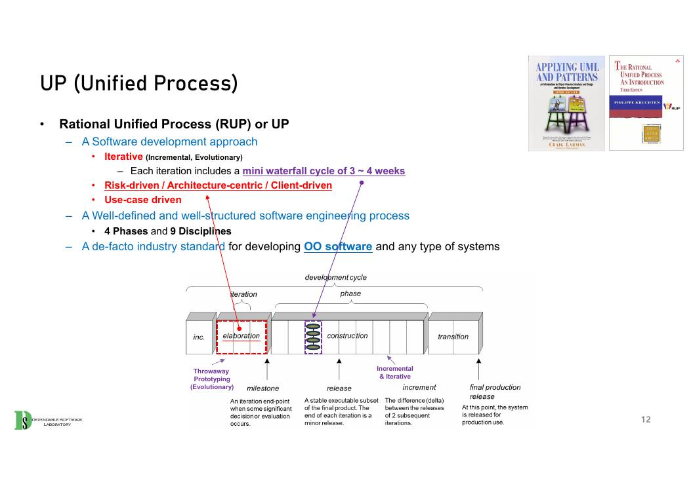

# Software Development Processes

> OOAD 객체지향개발방법론 · 슬라이드 4–13 · 원본: [PDF](../../original/2026%20AA%204차%20-%20OOAD%20(20261126).pdf)

[← 이전: 과정 소개](00_과정소개.md) · [← 목차](README.md) · [다음: UP (Unified Process) →](02_Unified_Process.md)

## 슬라이드 목록

- [4. (이미지 슬라이드)](#s4)
- [5. An Introduction to](#s5)
- [6. Software Development Processes](#s6)
- [7. Software Engineering](#s7)
- [8. Software Development](#s8)
- [9. Software Development Process Model](#s9)
- [10. The Waterfall Model](#s10)
- [11. The Iterative Model - Agile](#s11)
- [12. UP (Unified Process)](#s12)
- [13. (이미지 슬라이드)](#s13)

---

## 4. (이미지 슬라이드)

---

## 5. An Introduction to

Object-Oriented Development  

- Software Development Processes
- Unified Process (UP)
- Object-Oriented Software Development
- An Introduction to UML

---

## 6. Software Development Processes

---

## 7. Software Engineering

- Software engineering is concerned with theories, methods and tools for professional and cost-effective software development.
  - Most systems are software-controlled.
  - The economies of all developed nations are dependent on software.
  - Software costs often dominate computer system (hardware) costs.
  - Software costs is more (several times) to maintain than to develop.

    - Professional · 큰 시스템 · • Large Systems
    - Cost-Effective · • Team Development
      - Reuse (Maintenance)

여러 사람  
지속적인  
유지 보수  

---

## 8. Software Development

- Software Development ≈ Solving Problems with Software working on a Computer

&lt; SW 개발방법론 &gt;  
( C , Python )  
Software Development · Procedural Programming · SASD · 구조적분석설계 개발방법론  

≈ ①②③ · Object-Oriented Programming · OOAD · 객체지향 개발방법론  
( C++ , JAVA , Python)  

---

## 9. Software Development Process Model

- Software (Development) Process models
  - Defining a distinct set of activities, actions, tasks, milestones, and work products that are required to engineer high-quality software, systematically.
  - Defining Who is doing What, When to do it, How to reach a certain goal. = SDLC (SW Development Life-Cycle) models (SW생명주기모델)

&lt; 1960s ~ 2000s &gt; · &lt; 2000s ~ Now &gt;  

Waterfall Model · Application Domain  

…  
Incremental Model · Waterfall Model · tailored for  

Application Domain  
Evolutionary Model  
Application Domain  
Component-Based Development  
Iterative Model · tailored for  

…  
Iterative Model (Agile) · Application Domain  

(Rational) Unified Process  

---

## 10. The Waterfall Model

- A classic software development life-cycle model proposed in 1960s
  - Suggests a systematic and sequential approach to software development
  - Useful in situations where,
    - Requirements are understood and fixed early.
    - Changes will be fairly limited during the design process.
    - Work can/should proceed to completion in a linear manner.
    - Large systems engineering projects where a system is developed at several sites

---

## 11. The Iterative Model - Agile

- Agile development is an umbrella term for a group of methodologies weighting rapid prototyping and rapid development experiences.
  - Lightweight in terms of documentation and process specification
  - Example: XP(eXtreme Programming), TFD(Test First Development), TDD(Test Driven Development), Pair Programming, User Story, Refactoring, Scrum, Sprint, Unit Test Automation, CI(Continuous Integration)

- Agile methods attributes
  - Iterative (several cycles) and Incremental (not delivering the product at once)
  - Actively involve users to establish requirements

- Agile Manifesto (https://agilemanifesto.org/)
  - Individual over processes and tools
  - Working software over documentation
  - Customer collaboration over contract negotiation
  - Responding to change over following a plan

---

## 12. UP (Unified Process)

- Rational Unified Process (RUP) or UP
  - A Software development approach
    - Iterative (Incremental, Evolutionary)
      - Each iteration includes a mini waterfall cycle of 3 ~ 4 weeks
    - Risk-driven / Architecture-centric / Client-driven
    - Use-case driven
  - A Well-defined and well-structured software engineering process
    - 4 Phases and 9 Disciplines
  - A de-facto industry standard for developing OO software and any type of systems

Throwaway · Incremental  
Prototyping · &amp; Iterative  
(Evolutionary)  

---

## 13. (이미지 슬라이드)

---

[← 이전: 과정 소개](00_과정소개.md) · [← 목차](README.md) · [다음: UP (Unified Process) →](02_Unified_Process.md)
