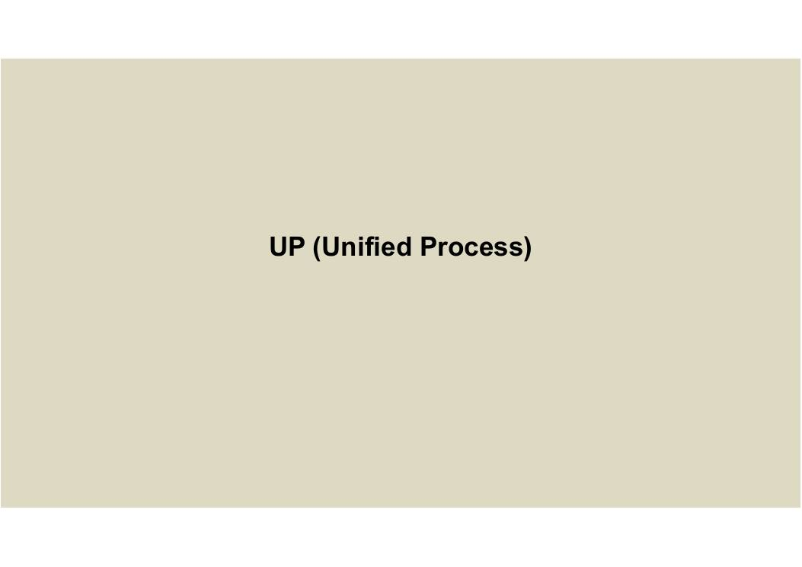
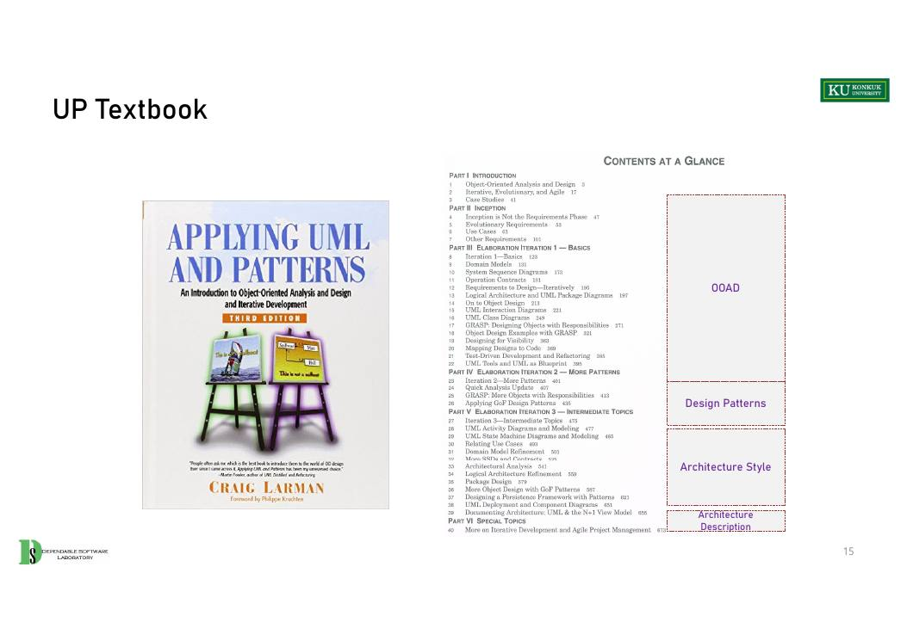
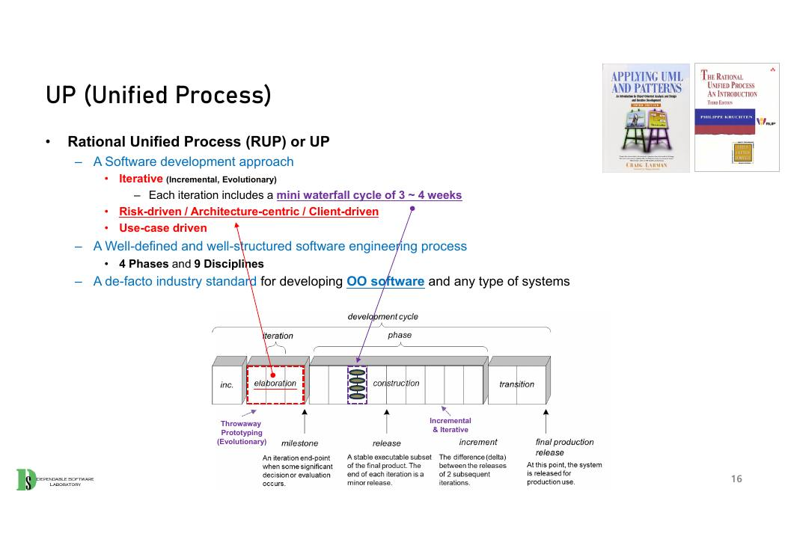
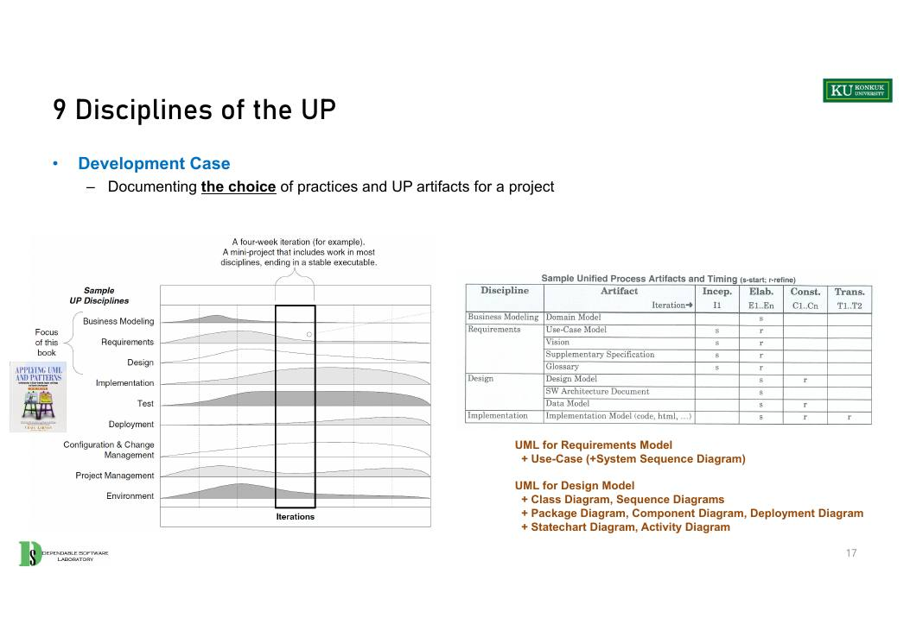
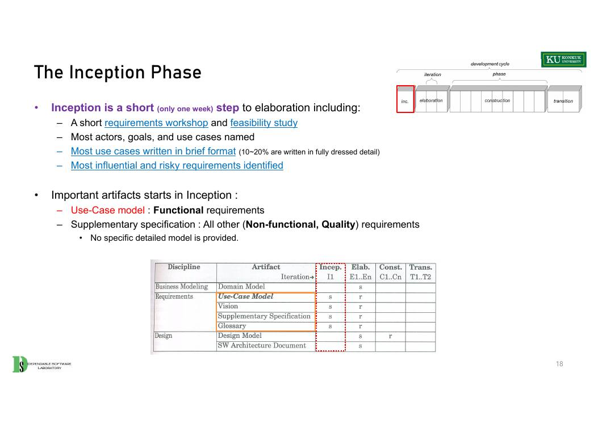
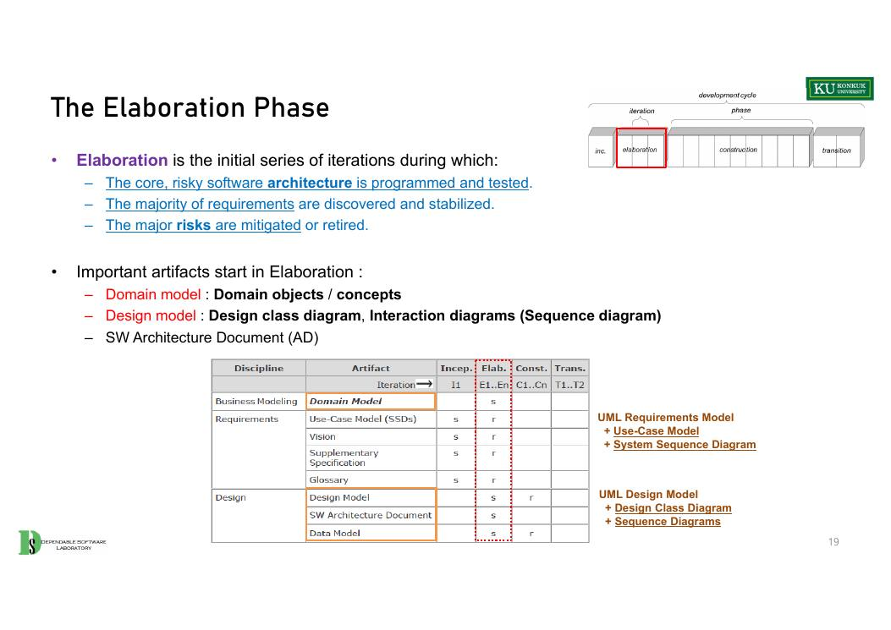
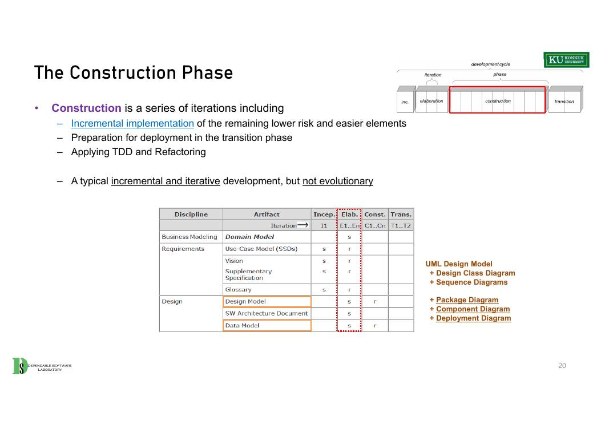
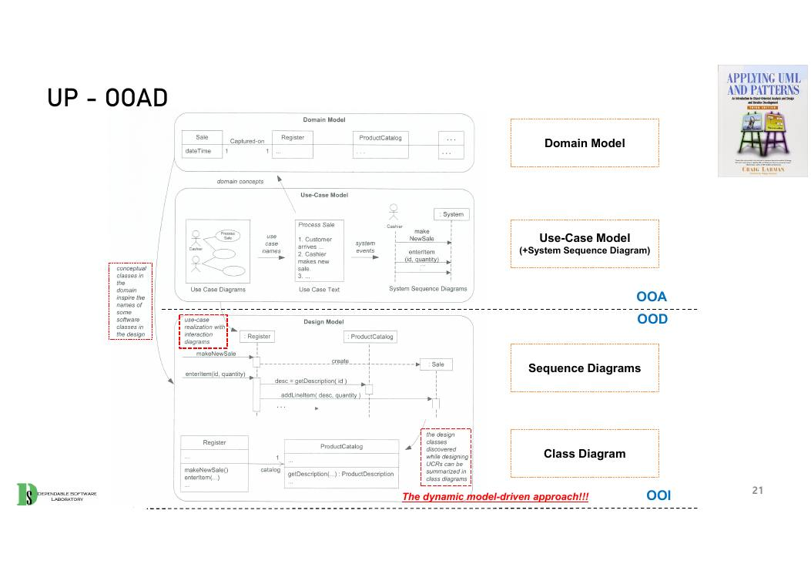

# UP (Unified Process)

> OOAD 객체지향개발방법론 · 슬라이드 14–22 · 원본: [PDF](../../original/2026%20AA%204차%20-%20OOAD%20(20261126).pdf)

[← 이전: Software Development Processes](01_Software_Development_Processes.md) · [← 목차](README.md) · [다음: Object-Oriented Software Development →](03_Object-Oriented_Software_Development.md)

## 슬라이드 목록

- [14. UP (Unified Process)](#s14)
- [15. UP Textbook](#s15)
- [16. UP (Unified Process)](#s16)
- [17. 9 Disciplines of the UP](#s17)
- [18. The Inception Phase](#s18)
- [19. The Elaboration Phase](#s19)
- [20. The Construction Phase](#s20)
- [21. UP - OOAD](#s21)
- [22. (이미지 슬라이드)](#s22)

---

## 14. UP (Unified Process)

---

## 15. UP Textbook

OOAD  

Design Patterns  

Architecture Style  

Architecture  
Description  

---

## 16. UP (Unified Process)

- Rational Unified Process (RUP) or UP
  - A Software development approach
    - Iterative (Incremental, Evolutionary)
      - Each iteration includes a mini waterfall cycle of 3 ~ 4 weeks
    - Risk-driven / Architecture-centric / Client-driven
    - Use-case driven
  - A Well-defined and well-structured software engineering process
    - 4 Phases and 9 Disciplines
  - A de-facto industry standard for developing OO software and any type of systems

Throwaway · Incremental  
Prototyping · &amp; Iterative  
(Evolutionary)  

---

## 17. 9 Disciplines of the UP

- Development Case
  - Documenting the choice of practices and UP artifacts for a project

UML for Requirements Model  
\+ Use-Case (+System Sequence Diagram)  

UML for Design Model  
\+ Class Diagram, Sequence Diagrams  
\+ Package Diagram, Component Diagram, Deployment Diagram  
\+ Statechart Diagram, Activity Diagram  

---

## 18. The Inception Phase

- Inception is a short (only one week) step to elaboration including:
  - A short requirements workshop and feasibility study
  - Most actors, goals, and use cases named
  - Most use cases written in brief format (10~20% are written in fully dressed detail)
  - Most influential and risky requirements identified

- Important artifacts starts in Inception :
  - Use-Case model : Functional requirements
  - Supplementary specification : All other (Non-functional, Quality) requirements
    - No specific detailed model is provided.

---

## 19. The Elaboration Phase

- Elaboration is the initial series of iterations during which:
  - The core, risky software architecture is programmed and tested.
  - The majority of requirements are discovered and stabilized.
  - The major risks are mitigated or retired.

- Important artifacts start in Elaboration :
  - Domain model : Domain objects / concepts
  - Design model : Design class diagram, Interaction diagrams (Sequence diagram)
  - SW Architecture Document (AD)

UML Requirements Model  
\+ Use-Case Model  
\+ System Sequence Diagram  

UML Design Model  
\+ Design Class Diagram  
\+ Sequence Diagrams  

---

## 20. The Construction Phase

- Construction is a series of iterations including
  - Incremental implementation of the remaining lower risk and easier elements
  - Preparation for deployment in the transition phase
  - Applying TDD and Refactoring

  - A typical incremental and iterative development, but not evolutionary

UML Design Model  
\+ Design Class Diagram  
\+ Sequence Diagrams  

\+ Package Diagram  
\+ Component Diagram  
\+ Deployment Diagram  

---

## 21. UP - OOAD

Domain Model  

Use-Case Model  
(+System Sequence Diagram)  

OOA  
OOD  

Sequence Diagrams  

Class Diagram  

The dynamic model-driven approach!!! · OOI  

---

## 22. (이미지 슬라이드)

---

[← 이전: Software Development Processes](01_Software_Development_Processes.md) · [← 목차](README.md) · [다음: Object-Oriented Software Development →](03_Object-Oriented_Software_Development.md)
