# Object-Oriented Software Development

> OOAD 객체지향개발방법론 · 슬라이드 23–35 · 원본: [PDF](../../original/2026%20AA%204차%20-%20OOAD%20(20261126).pdf)

[← 이전: UP (Unified Process)](02_Unified_Process.md) · [← 목차](README.md) · [다음: UP, RE, OOAD and Architecture Design →](04_UP_RE_OOAD_Architecture.md)

## 슬라이드 목록

- [23. Object-Oriented Software Development](#s23)
- [24. Software Development Methodology (SW개발방법론)](#s24)
- [25. Procedural Programming](#s25)
- [26. A Procedural Program](#s26)
- [27. Structured Analysis and Structured Design](#s27)
- [28. An Object-Oriented Programming](#s28)
- [29. Object-Oriented Program](#s29)
- [30. Object-Oriented Analysis and Design (OOAD)](#s30)
- [31. Domain Model → Design Class Diagram](#s31)
- [32. System Sequence Diagram → Sequence Diagram](#s32)
- [33. An OOAD Example – Dice Game](#s33)
- [34. UP - OOAD](#s34)
- [35. (이미지 슬라이드)](#s35)

---

## 23. Object-Oriented Software Development

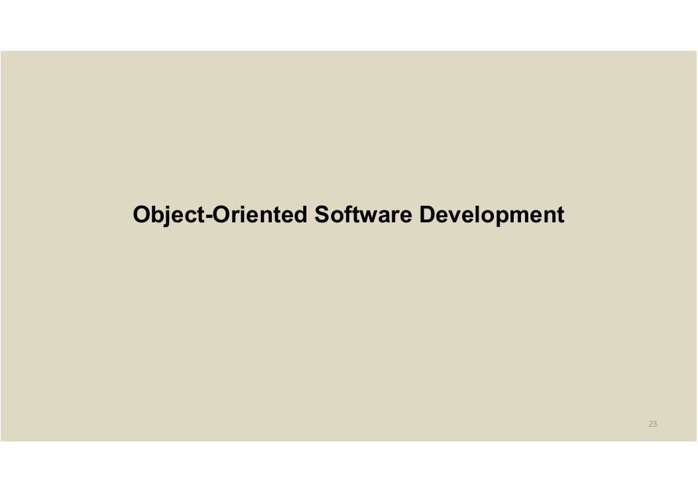

---

## 24. Software Development Methodology (SW개발방법론)

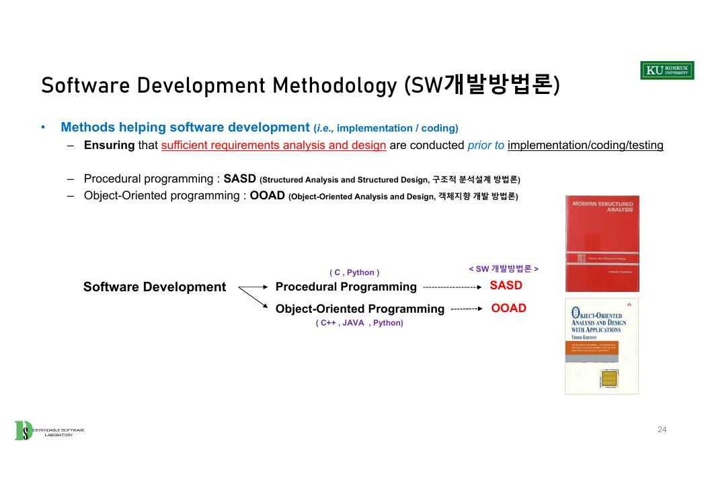

- Methods helping software development (i.e., implementation / coding)
  - Ensuring that sufficient requirements analysis and design are conducted prior to implementation/coding/testing

  - Procedural programming : SASD (Structured Analysis and Structured Design, 구조적 분석설계 방법론)
  - Object-Oriented programming : OOAD (Object-Oriented Analysis and Design, 객체지향 개발 방법론)

( C , Python ) · &lt; SW 개발방법론 &gt;  

Software Development · Procedural Programming · SASD  
Object-Oriented Programming · OOAD  
( C++ , JAVA , Python)  

---

## 25. Procedural Programming

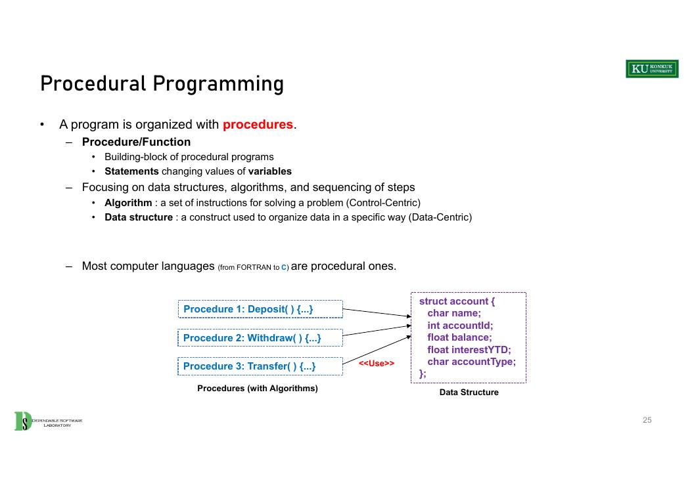

- A program is organized with procedures.
  - Procedure/Function
    - Building-block of procedural programs
    - Statements changing values of variables
  - Focusing on data structures, algorithms, and sequencing of steps
    - Algorithm : a set of instructions for solving a problem (Control-Centric)
    - Data structure : a construct used to organize data in a specific way (Data-Centric)

  - Most computer languages (from FORTRAN to C) are procedural ones.

struct account {  
Procedure 1: Deposit( ) {...} · char name;  
int accountId;  
Procedure 2: Withdraw( ) {...} · float balance;  
float interestYTD;  
Procedure 3: Transfer( ) {...} · &lt;&lt;Use&gt;&gt; · char accountType;  
};  
Procedures (with Algorithms) · Data Structure  

---

## 26. A Procedural Program

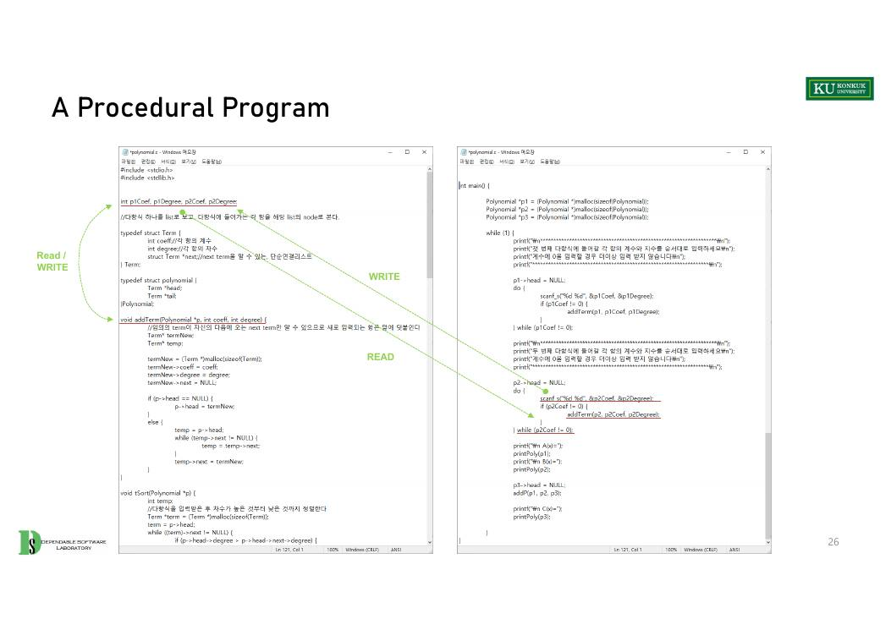

Read /  
WRITE  
WRITE  

READ  

---

## 27. Structured Analysis and Structured Design

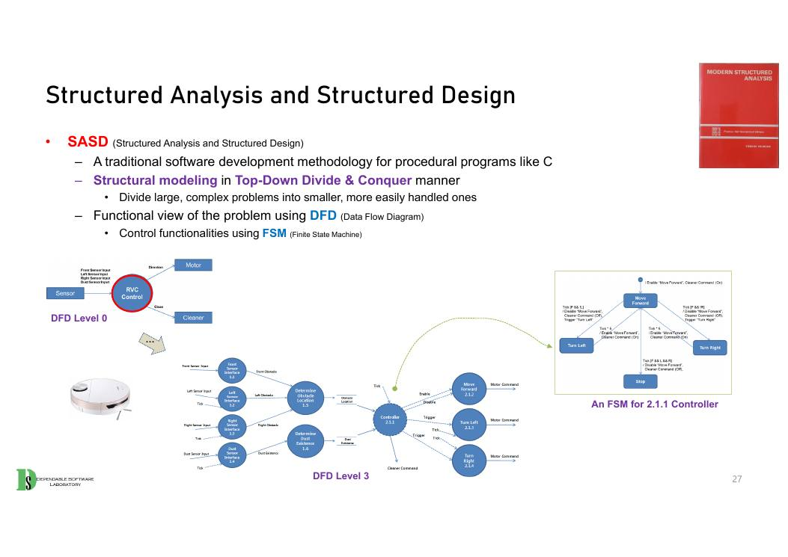

- SASD (Structured Analysis and Structured Design)
  - A traditional software development methodology for procedural programs like C
  - Structural modeling in Top-Down Divide &amp; Conquer manner
    - Divide large, complex problems into smaller, more easily handled ones
  - Functional view of the problem using DFD (Data Flow Diagram)
    - Control functionalities using FSM (Finite State Machine)

DFD Level 0  

…  

An FSM for 2.1.1 Controller  

DFD Level 3  

---

## 28. An Object-Oriented Programming

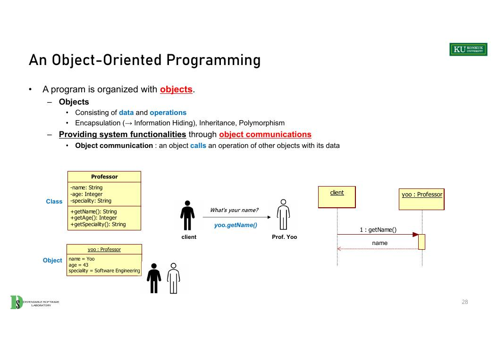

- A program is organized with objects.
  - Objects
    - Consisting of data and operations
    - Encapsulation (→ Information Hiding), Inheritance, Polymorphism
  - Providing system functionalities through object communications
    - Object communication : an object calls an operation of other objects with its data

Professor  

-name: String  
-age: Integer · client · yoo : Professor  
Class · -speciality: String  
\+getName(): String · What’s your name?  
\+getAge(): Integer  
\+getSpeciality(): String · yoo.getName()  
1 : getName()  
client · Prof. Yoo  
name  
yoo : Professor  

Object · name = Yoo  
age = 43  
speciality = Software Engineering  

---

## 29. Object-Oriented Program

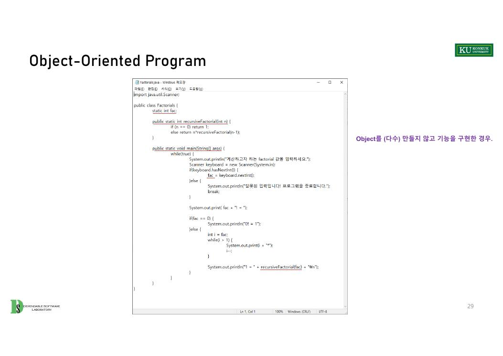

Object를 (다수) 만들지 않고 기능을 구현한 경우.  

---

## 30. Object-Oriented Analysis and Design (OOAD)

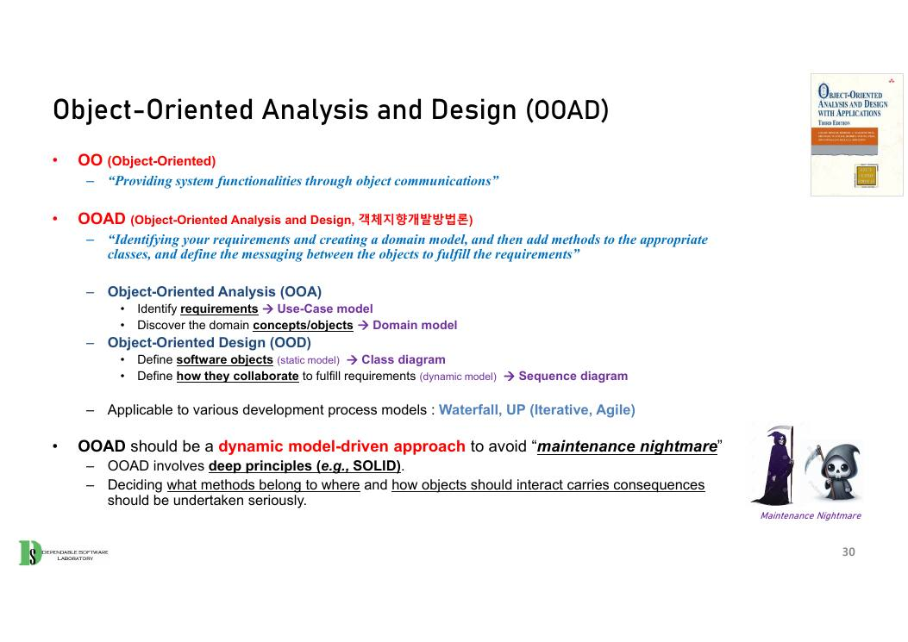

- OO (Object-Oriented)
  - “Providing system functionalities through object communications”

- OOAD (Object-Oriented Analysis and Design, 객체지향개발방법론)
  - “Identifying your requirements and creating a domain model, and then add methods to the appropriate classes, and define the messaging between the objects to fulfill the requirements”

  - Object-Oriented Analysis (OOA)
    - Identify requirements → Use-Case model
    - Discover the domain concepts/objects → Domain model
  - Object-Oriented Design (OOD)
    - Define software objects (static model) → Class diagram
    - Define how they collaborate to fulfill requirements (dynamic model) → Sequence diagram

  - Applicable to various development process models : Waterfall, UP (Iterative, Agile)

- OOAD should be a dynamic model-driven approach to avoid “maintenance nightmare”
  - OOAD involves deep principles (e.g., SOLID).
  - Deciding what methods belong to where and how objects should interact carries consequences should be undertaken seriously. Maintenance Nightmare

---

## 31. Domain Model → Design Class Diagram

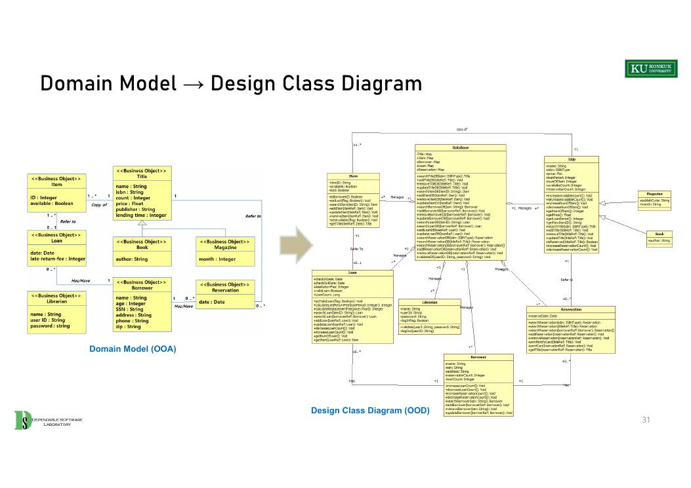

Domain Model (OOA)  

Design Class Diagram (OOD)  

---

## 32. System Sequence Diagram → Sequence Diagram

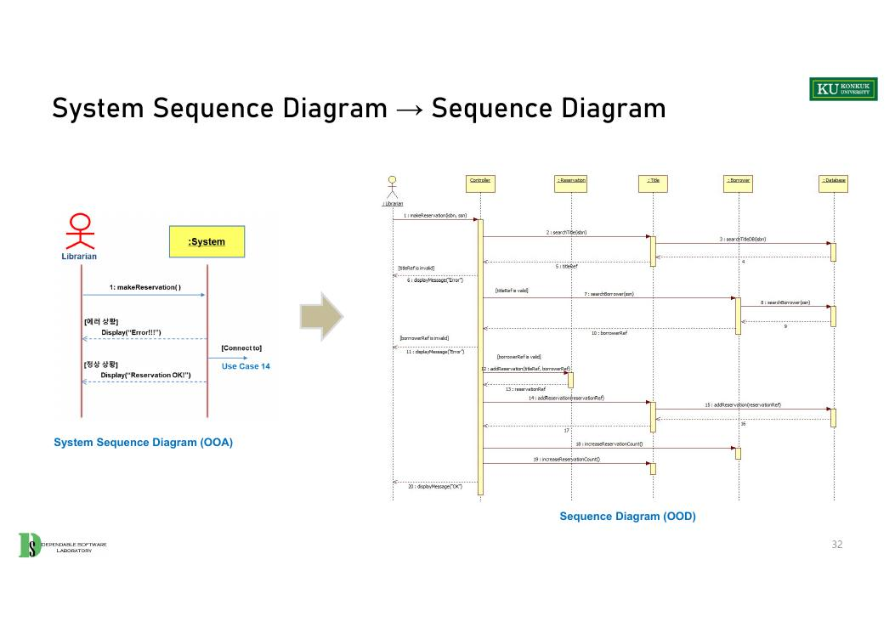

System Sequence Diagram (OOA)  

Sequence Diagram (OOD)  

---

## 33. An OOAD Example – Dice Game

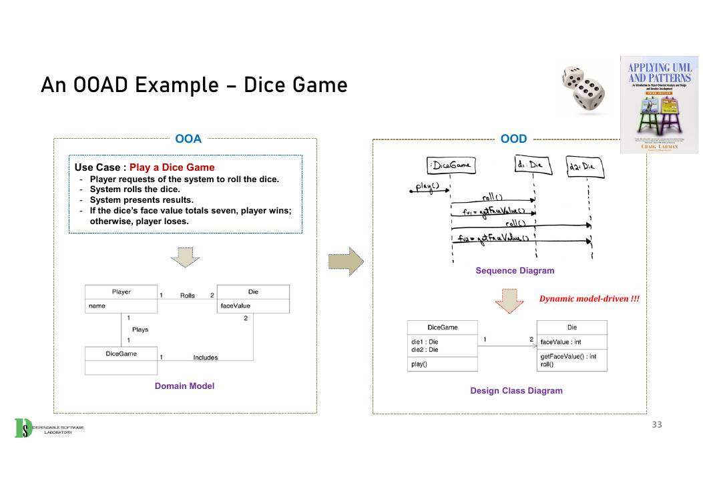

OOA · OOD  

Use Case : Play a Dice Game  
- Player requests of the system to roll the dice.
- System rolls the dice.
- System presents results.
- If the dice’s face value totals seven, player wins; otherwise, player loses.

Sequence Diagram  

Dynamic model-driven !!!  

Domain Model · Design Class Diagram  

---

## 34. UP - OOAD

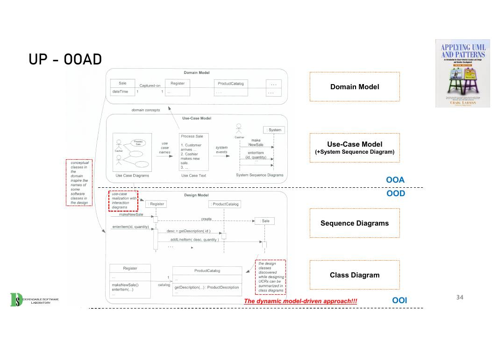

Domain Model  

Use-Case Model  
(+System Sequence Diagram)  

OOA  
OOD  

Sequence Diagrams  

Class Diagram  

The dynamic model-driven approach!!! · OOI  

---

## 35. (이미지 슬라이드)

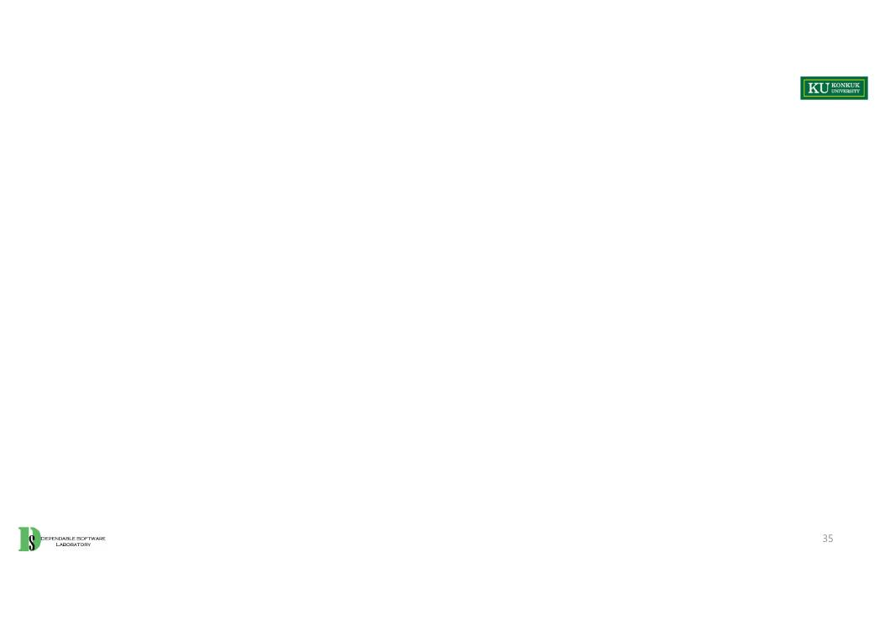

---

[← 이전: UP (Unified Process)](02_Unified_Process.md) · [← 목차](README.md) · [다음: UP, RE, OOAD and Architecture Design →](04_UP_RE_OOAD_Architecture.md)
