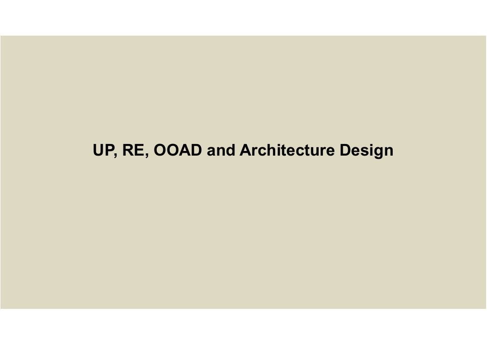
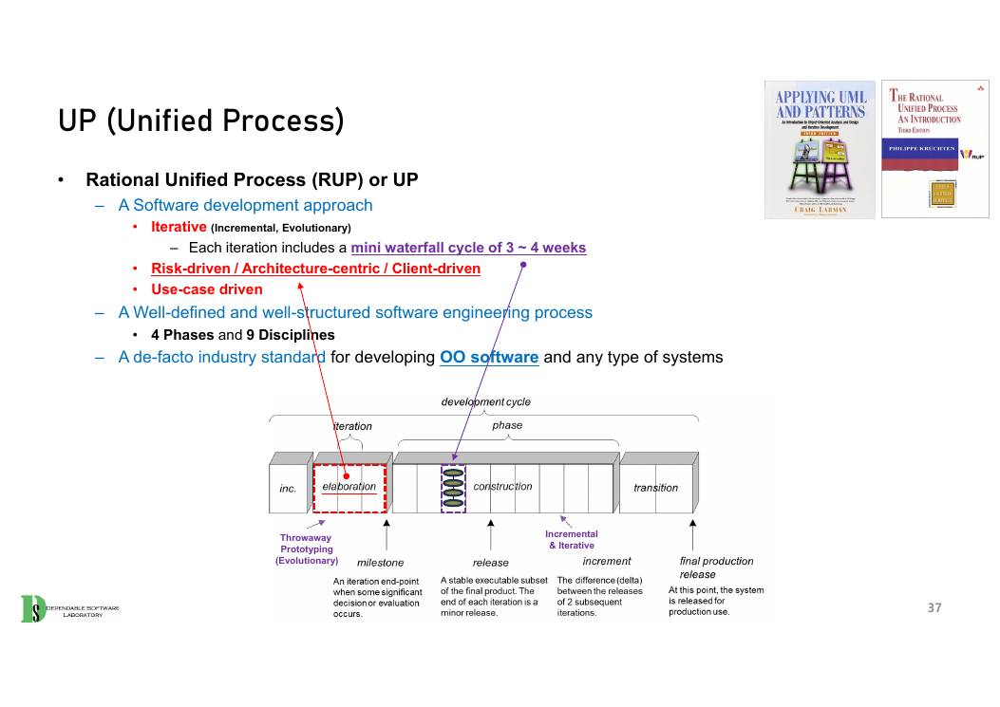
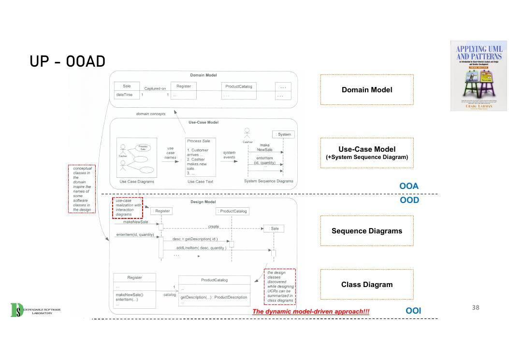
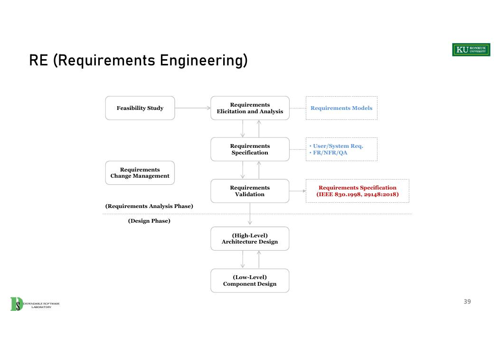
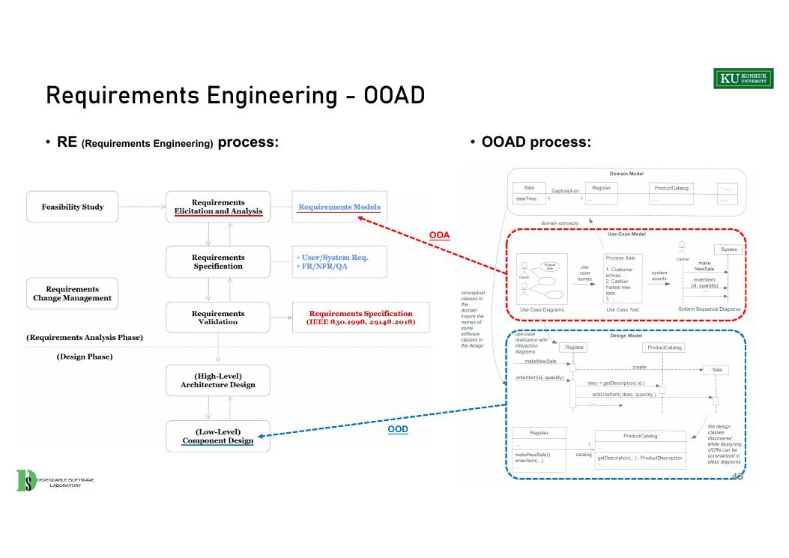
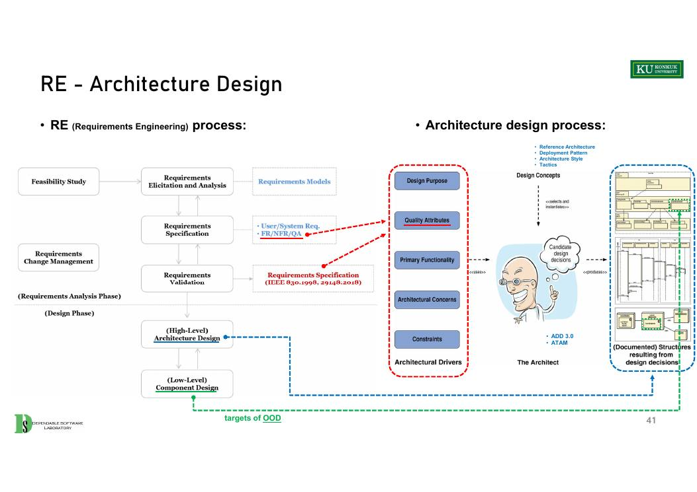
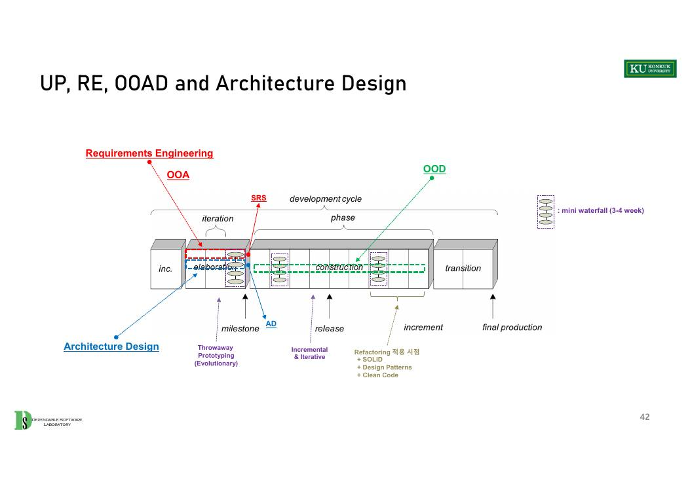
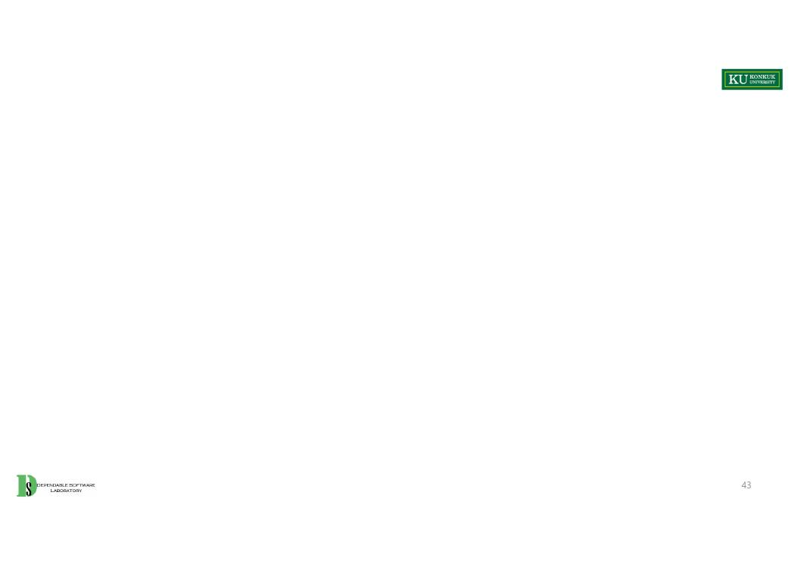

# UP, RE, OOAD and Architecture Design

> OOAD 객체지향개발방법론 · 슬라이드 36–43 · 원본: [PDF](../../original/2026%20AA%204차%20-%20OOAD%20(20261126).pdf)

[← 이전: Object-Oriented Software Development](03_Object-Oriented_Software_Development.md) · [← 목차](README.md) · [다음: An Introduction to UML →](05_Introduction_to_UML.md)

## 슬라이드 목록

- [36. UP, RE, OOAD and Architecture Design](#s36)
- [37. UP (Unified Process)](#s37)
- [38. UP - OOAD](#s38)
- [39. RE (Requirements Engineering)](#s39)
- [40. Requirements Engineering - OOAD](#s40)
- [41. RE - Architecture Design](#s41)
- [42. UP, RE, OOAD and Architecture Design](#s42)
- [43. (이미지 슬라이드)](#s43)

---

## 36. UP, RE, OOAD and Architecture Design

---

## 37. UP (Unified Process)

- Rational Unified Process (RUP) or UP
  - A Software development approach
    - Iterative (Incremental, Evolutionary)
      - Each iteration includes a mini waterfall cycle of 3 ~ 4 weeks
    - Risk-driven / Architecture-centric / Client-driven
    - Use-case driven
  - A Well-defined and well-structured software engineering process
    - 4 Phases and 9 Disciplines
  - A de-facto industry standard for developing OO software and any type of systems

Throwaway · Incremental  
Prototyping · &amp; Iterative  
(Evolutionary)  

---

## 38. UP - OOAD

Domain Model  

Use-Case Model  
(+System Sequence Diagram)  

OOA  
OOD  

Sequence Diagrams  

Class Diagram  

The dynamic model-driven approach!!! · OOI  

---

## 39. RE (Requirements Engineering)

Requirements  
Feasibility Study · Requirements Models  
Elicitation and Analysis  

Requirements · • User/System Req.  
Specification · • FR/NFR/QA  

Requirements  
Change Management  

Requirements · Requirements Specification  
Validation · (IEEE 830.1998, 29148:2018)  

(Requirements Analysis Phase)  

(Design Phase)  

(High-Level)  
Architecture Design  

(Low-Level)  
Component Design  

---

## 40. Requirements Engineering - OOAD

- RE (Requirements Engineering) process: · • OOAD process:

OOA  

OOD  

---

## 41. RE - Architecture Design

- RE (Requirements Engineering) process: · • Architecture design process:
  - Reference Architecture
  - Deployment Pattern
  - Architecture Style
  - Tactics

    - ADD 3.0
    - ATAM

targets of OOD  

---

## 42. UP, RE, OOAD and Architecture Design

Requirements Engineering  
OOD  
OOA  

SRS  
: mini waterfall (3-4 week)  

AD  

Architecture Design · Throwaway · Incremental · Refactoring 적용 시점  
Prototyping · &amp; Iterative · + SOLID  
(Evolutionary)  
\+ Design Patterns  
\+ Clean Code  

---

## 43. (이미지 슬라이드)

---

[← 이전: Object-Oriented Software Development](03_Object-Oriented_Software_Development.md) · [← 목차](README.md) · [다음: An Introduction to UML →](05_Introduction_to_UML.md)
