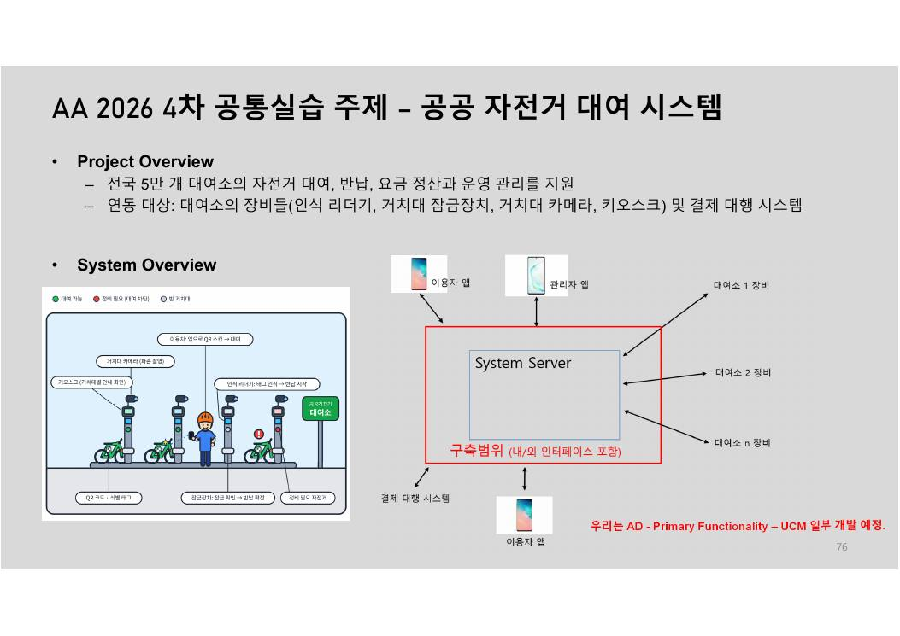
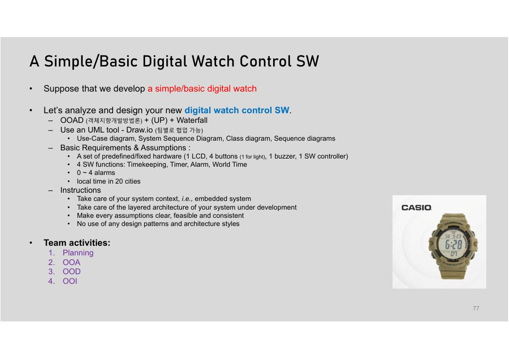
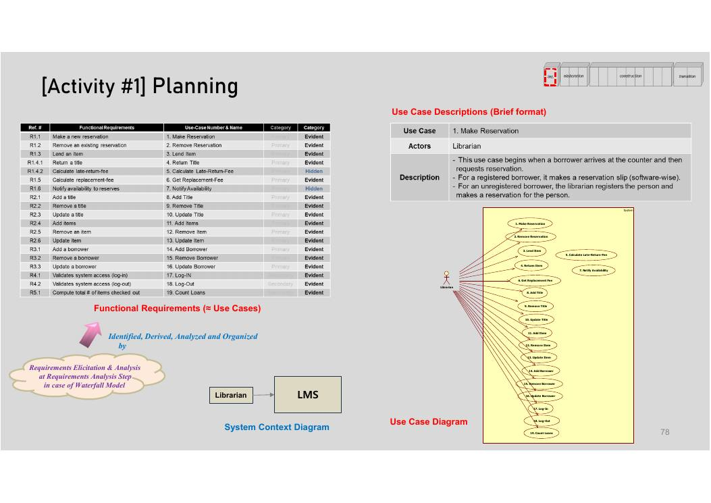
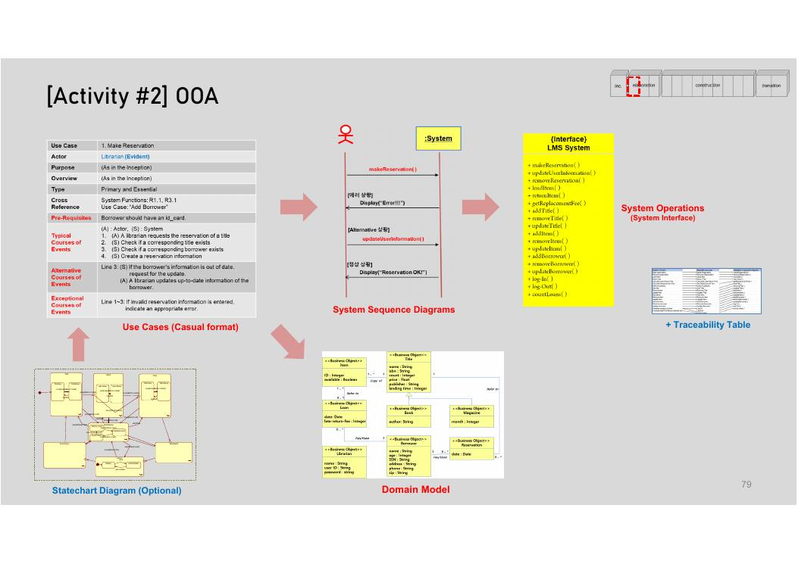
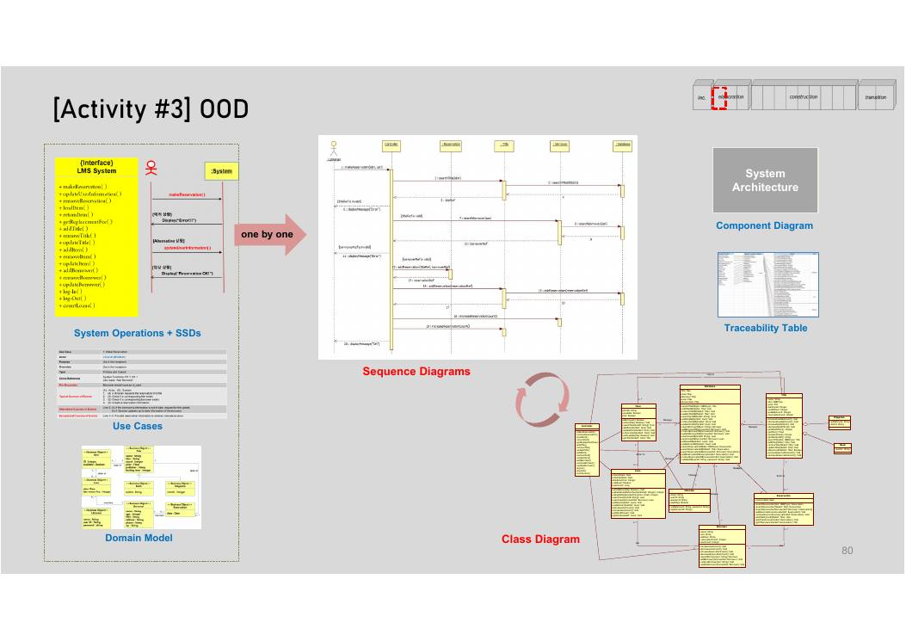
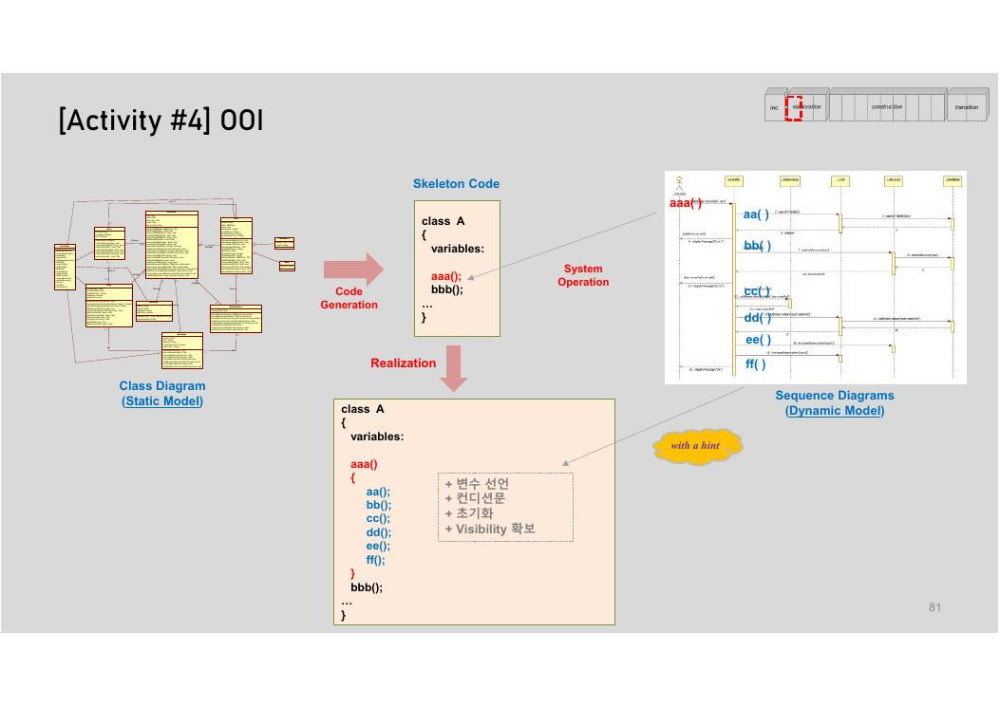
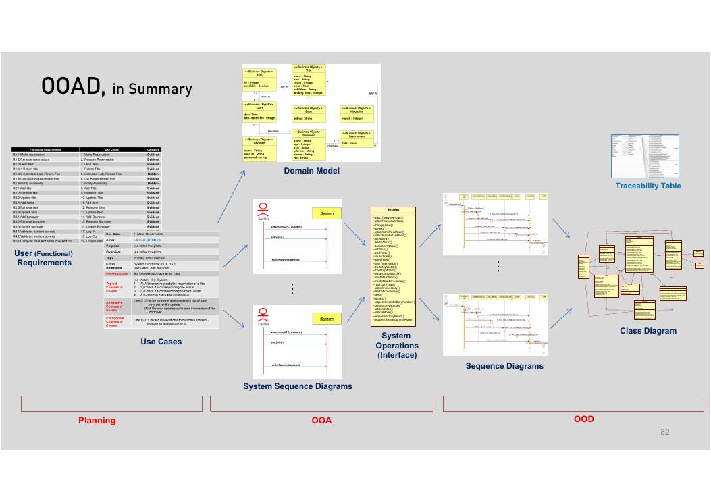

# The Team Practice Overview

> OOAD 객체지향개발방법론 · 슬라이드 75–83 · 원본: [PDF](../../original/2026%20AA%204차%20-%20OOAD%20(20261126).pdf)

[← 이전: An Introduction to UML](05_Introduction_to_UML.md) · [← 목차](README.md) · [다음: Practice #1 Project Planning – Use Cases →](07_Practice1_Project_Planning_Use_Cases.md)

## 슬라이드 목록

- [75. The Team Practice Overview](#s75)
- [76. AA 2026 4차 공통실습 주제 – 공공 자전거 대여 시스템](#s76)
- [77. A Simple/Basic Digital Watch Control SW](#s77)
- [78. [Activity #1] Planning](#s78)
- [79. [Activity #2] OOA](#s79)
- [80. [Activity #3] OOD](#s80)
- [81. [Activity #4] OOI](#s81)
- [82. OOAD, in Summary](#s82)
- [83. (이미지 슬라이드)](#s83)

---

## 75. The Team Practice Overview

---

## 76. AA 2026 4차 공통실습 주제 – 공공 자전거 대여 시스템

- Project Overview
  - 전국 5만 개 대여소의 자전거 대여, 반납, 요금 정산과 운영 관리를 지원
  - 연동 대상: 대여소의 장비들(인식 리더기, 거치대 잠금장치, 거치대 카메라, 키오스크) 및 결제 대행 시스템

- System Overview

우리는 AD - Primary Functionality – UCM 일부 개발 예정.  

---

## 77. A Simple/Basic Digital Watch Control SW

- Suppose that we develop a simple/basic digital watch

- Let’s analyze and design your new digital watch control SW.
  - OOAD (객체지향개발방법론) + (UP) + Waterfall
  - Use an UML tool - Draw.io (팀별로 협업 가능)
    - Use-Case diagram, System Sequence Diagram, Class diagram, Sequence diagrams
  - Basic Requirements &amp; Assumptions :
    - A set of predefined/fixed hardware (1 LCD, 4 buttons (1 for light), 1 buzzer, 1 SW controller)
    - 4 SW functions: Timekeeping, Timer, Alarm, World Time
    - 0 ~ 4 alarms
    - local time in 20 cities
  - Instructions
    - Take care of your system context, i.e., embedded system
    - Take care of the layered architecture of your system under development
    - Make every assumptions clear, feasible and consistent
    - No use of any design patterns and architecture styles

- Team activities:

1\. · Planning  
2\. · OOA  
3\. · OOD  
4\. · OOI  

---

## 78. [Activity #1] Planning

Use Case Descriptions (Brief format)  

System  

1\. Make Reservation  

2\. Remove Reservation  

3\. Lend Item  
5\. Calculate Late-Return-Fee  

4\. Retuen Item  
7\. Notify Availability  

6\. Get Replacement Fee  

Librarian  
8\. Add Title  

Functional Requirements (≈ Use Cases) · 9. Remove Title  

10\. Update Title  

11\. Add Item  
Identified, Derived, Analyzed and Organized  
by · 12. Remove Item  

13\. Update Item  

Requirements Elicitation &amp; Analysis · 14. Add Borrower  

at Requirements Analysis Step  
in case of Waterfall Model · 15. Remove Borrower  

Librarian · LMS · 16. Update Borrower  

17\. Log-In  

Use Case Diagram · 18. Log-Out  

System Context Diagram · 19. Count Loans  

---

## 79. [Activity #2] OOA

System Operations  
(System Interface)  

System Sequence Diagrams  
Use Cases (Casual format) · + Traceability Table  

Time · Alarm · Timer  

TimeView · TimeSetup · TimerView · TimerSetup  
AlarmView · AlarmSetup  
LongPress[Button=mode] · LongPress[Button=mode]  
LongPress[Button=mode]  
press[Button=mode] · press[Button=mode]  
finishAll  
finishAll  
finishAll  

move[not activated]  
press[Button=All]  
press[Button=All]  
selctMode  
press[Button=All]  
selctMode  
selectMode[if exis] · GlobalSetUp  
factory reset  
press[button=next]  
modeActivation  
press[button=next]  
moveToMode  
press[button=next]  

Anniversary · StopWatch  
selecMode[if exist]  
press[Button=All]  

Lottery  
save  

Display · Set Reminder  

Set reminder  

Statechart Diagram (Optional) · Domain Model  

---

## 80. [Activity #3] OOD

System  
Architecture  

Component Diagram  
one by one  

Traceability Table  
System Operations + SSDs  

Sequence Diagrams · copy of  

Database  
1  
-Title: Map  
\+Item: Map · Title  
\+Borrower: Map  
1..\* · +Loan: Map · +name: String  
\+Reservation: Map · +isbn: ISBNType  
\+price: Flot  
Item · +searchTitleDB(isbn: ISBNType): Title · +loanPeriod: Integer  
\+addTtileDB(titleRef: Title): Void · +numOfItem: Integer  
\+itemID: String · +removeTitleDB(titleRef: Title): Void  
\+available: Boolean · +availalbeCount: Integer  
\+updateTitleDB(titleRef: Title): Void · +reservationCount: Integer  
\+lost: Boolean · +searchItemDB(itemID: String): Item  
\+addItemDB(itemRef: Item): Void · Magazine  
\+isBorrowed(): Boolean · Manages · +increaseAvailableCount(): Void  
\+removeItemDB(itemRef: Item): Void · +decreaseAvailableCount(): Void  

Use Cases  
\+setLost(flag: Boolean): Void · 1 · \* · +publishCycle: String  
\+searchItem(itemID: String): Item · +updateItemDV(itemRef: Item): Void · +increaseNumOfItem(): Void · +month: String  
Controller · \* · 1  
\+addItem(itemRef: Item): Void · +searchBorrowerDB(ssn: String): Borrower · Manages · +decreaseNumOfItem(): Void  
\+updateItem(itemRef: Item): Void · +addBorrowerDB(borrowerRef: Borrower): Void · +getNumOfItem(): Integer  
\+mkaeReservation() · +removeItem(itemRef: Item): Void · +removeBorrowerDB(borrowerRef: Borrower): Void · +getPrice(): Float  
\+removeReservation() · +setAvailable(flag: Boolean): Void · +updateBorrowerDB(borrowerRef: Borrower): Void · +getLoanPeriod(): Integer  
\+LendItem() · +getTitle(itemRef: Item): Title · +searchLoanDB(itemID: String): Loan · +getNewItemID(): String  
\+returnItem() · +searchLoanDB(borrwerRef: Borrower): Loan · +searchTitle(isbn: ISBNType): Title  
\+getReplacementFee() · +addLoanDB(loanRef: Loan): Void · +addTitle(titleRef: Title): Void  
\+addTitle() · 1 · +updateLoanDB(loanRef: Loan): Void · +removeTitle(titleRef: Title): Void · Book  
\+removeTitle() · +searchReservationDB(isbn: ISBNType): Reservation · +updateTitle(titleRef: Title): Void  
\+updateTitle() · +searchReservationDB(titleRef: Title): Reservation · +isReserved(titleRef: Title): Boolean · +author: String  
\+addItem() · +searchReservationDB(borrowerRef: Borrower): Resrvation[] · +increaseReservationCount(): Void  
\+removeItem() · Refer To · +addReservationDB(reservationRef: Reservation): Void · +decreaseReservationCount(): Void  
\+updateItem() · 1 +removeReservationDB(reservationrRef: Reservation): Void  
Manages · +validateDB(userID: String, password: String): Void  
\+addBorrower()  
\+removeBorrower() · 1  
\+updateBorrower() · 0..1  
\* · 1 · 1  
\+log-In() · Manages  
\+1  
\+log-Out() · Loan  
\+countLoans()  
\+checkInDate: Date · Manages · Refer to  
\+checkOutDate: Date  
\+lateReturnFee: Integer  
\+validLoan: Boolean  
\+LoanCount: Long · \*  

\+setValidLoan(flag: Boolean): Void · 0..\*  
Librarian  
\+calculateLateReturnFee(loanPeriod: Integer): Integer · +\*  
\+calculateReplacementFee(price: Float): Integer · +name: String · Manages  
Reservation  
\+searchLoan(itemID: String): Loan · +userId: String  
\+searchLoan(borrowerRef: Borrower): Loan · +password: String · +reserveDate: Date  
\+addLoan(loanRef: Loan): Void · +logInFlag: Boolean  
\+searchReservation(isbn: ISBNType): Reservation  
\+updateLoan(loanRef: Loan): Void  
\+validate(userI: String, password: String) · +searchReservation(titleRef: Title): Reservation  
\+decreaseLoanCount(): Void  
\+logOut(userID: String) · +searchReservation(borrowerRef: Borrower): Reservation[]  
\+increaseLoanCount(): Void  
\+addReservation(reservationRef: Reservation): Void  
\+getNumOfLoan(): Void  
\+removeReservation(reservationRef: Reservation): Void  
\+getItem(LoanRef: Loan): Item  
\+printNotifyCard(titleRef: Title): Void  
\+printCard(resrvationRef: Reservation): Void  
\*  
0..\* · +getTitle(reservationRef: Reservation): Title  

Borrower  
0..\*  
\+name: String  

Domain Model  
\+ssn: String  

Class Diagram · Has  
\+address: String  
\+reservationCount: Integer  
\+loanCount: Integer  
\+increaseLoanCount(): Void · Has  

1 · +decreaseLoanCount(): Void · 1  
\+increaseReservationCount(): Void  
\+decreaseReservationCount(): Void  
\+searchBorrower(ssn: String): Borrower  
\+addBorrower(borrowerRef: Borrower): Void  
\+removeBorrower(ssn: String): Void  
\+updateBorrower(borrwerRef: Borrower): Void  

---

## 81. [Activity #4] OOI

Skeleton Code  
copy of  

aaa( )  
Database  
1  

aa( )  
class A  
-Title: Map  
\+Item: Map · Title  
\+Borrower: Map  
1..\* · +Loan: Map · +name: String  
\+Reservation: Map · +isbn: ISBNType  
\+price: Flot  
Item · +searchTitleDB(isbn: ISBNType): Title  

{  
\+loanPeriod: Integer  
\+addTtileDB(titleRef: Title): Void · +numOfItem: Integer  
\+itemID: String · +removeTitleDB(titleRef: Title): Void  
\+available: Boolean · +availalbeCount: Integer  
\+updateTitleDB(titleRef: Title): Void · +reservationCount: Integer  
\+lost: Boolean · +searchItemDB(itemID: String): Item  
Magazine  

bb( )  
\+isBorrowed(): Boolean · +addItemDB(itemRef: Item): Void · +increaseAvailableCount(): Void  
Manages  
\+setLost(flag: Boolean): Void · +removeItemDB(itemRef: Item): Void · 1 · +decreaseAvailableCount(): Void · +publishCycle: String  
\*  

variables:  
\+searchItem(itemID: String): Item · +updateItemDV(itemRef: Item): Void · +increaseNumOfItem(): Void · +month: String  
Controller · \* · 1  
\+addItem(itemRef: Item): Void · +searchBorrowerDB(ssn: String): Borrower · Manages · +decreaseNumOfItem(): Void  
\+updateItem(itemRef: Item): Void · +addBorrowerDB(borrowerRef: Borrower): Void · +getNumOfItem(): Integer  
\+mkaeReservation() · +removeItem(itemRef: Item): Void · +removeBorrowerDB(borrowerRef: Borrower): Void · +getPrice(): Float  
\+removeReservation() · +setAvailable(flag: Boolean): Void · +updateBorrowerDB(borrowerRef: Borrower): Void · +getLoanPeriod(): Integer  
\+LendItem() · +getTitle(itemRef: Item): Title · +searchLoanDB(itemID: String): Loan · +getNewItemID(): String  
\+returnItem() · +searchLoanDB(borrwerRef: Borrower): Loan · +searchTitle(isbn: ISBNType): Title  
\+getReplacementFee() · +addLoanDB(loanRef: Loan): Void · +addTitle(titleRef: Title): Void  
\+addTitle() · 1 · +updateLoanDB(loanRef: Loan): Void · +removeTitle(titleRef: Title): Void · Book  

System  
\+removeTitle() · +searchReservationDB(isbn: ISBNType): Reservation · +updateTitle(titleRef: Title): Void  
\+updateTitle() · +searchReservationDB(titleRef: Title): Reservation · +isReserved(titleRef: Title): Boolean · +author: String  
\+addItem() · +searchReservationDB(borrowerRef: Borrower): Resrvation[] · +increaseReservationCount(): Void  

aaa();  
\+removeItem() · Refer To · +addReservationDB(reservationRef: Reservation): Void · +decreaseReservationCount(): Void  
\+updateItem() · 1 +removeReservationDB(reservationrRef: Reservation): Void  
Manages · +validateDB(userID: String, password: String): Void  
\+addBorrower()  

Operation  
\+removeBorrower() · 1  
\+updateBorrower() · 0..1  
\* · 1 · 1  
\+log-In() · Manages  
\+1  

bbb();  
\+log-Out()  

cc( )  
Loan  

Code  
\+countLoans()  
\+checkInDate: Date · Manages · Refer to  
\+checkOutDate: Date  
\+lateReturnFee: Integer  
\+validLoan: Boolean  
\+LoanCount: Long · \*  

\+setValidLoan(flag: Boolean): Void  
\+calculateLateReturnFee(loanPeriod: Integer): Integer  
\+calculateReplacementFee(price: Float): Integer  
\+searchLoan(itemID: String): Loan  
\+searchLoan(borrowerRef: Borrower): Loan  
\+name: String  
\+userId: String  
Librarian  

\+password: String  
Manages  
\+\*  

\+reserveDate: Date  
0..\*  

Reservation  
Generation · …  
} · dd( )  
\+addLoan(loanRef: Loan): Void · +logInFlag: Boolean  
\+searchReservation(isbn: ISBNType): Reservation  
\+updateLoan(loanRef: Loan): Void  
\+validate(userI: String, password: String) · +searchReservation(titleRef: Title): Reservation  
\+decreaseLoanCount(): Void  
\+logOut(userID: String) · +searchReservation(borrowerRef: Borrower): Reservation[]  
\+increaseLoanCount(): Void  
\+addReservation(reservationRef: Reservation): Void  
\+getNumOfLoan(): Void  
\+removeReservation(reservationRef: Reservation): Void  
\+getItem(LoanRef: Loan): Item  
\+printNotifyCard(titleRef: Title): Void  
\+printCard(resrvationRef: Reservation): Void  
\*  
0..\* · +getTitle(reservationRef: Reservation): Title  

ee( )  
Borrower  
0..\*  
\+name: String  
\+ssn: String  
\+address: String  
\+reservationCount: Integer  
\+loanCount: Integer  
Has  
\+increaseLoanCount(): Void · Has  
1 · +decreaseLoanCount(): Void · 1  
\+increaseReservationCount(): Void  
\+decreaseReservationCount(): Void  

Realization · ff( )  
\+searchBorrower(ssn: String): Borrower  
\+addBorrower(borrowerRef: Borrower): Void  
\+removeBorrower(ssn: String): Void  
\+updateBorrower(borrwerRef: Borrower): Void  

Class Diagram  
(Static Model) · Sequence Diagrams  
class A · (Dynamic Model)  
{  
variables:  
with a hint  
aaa()  
{  
\+ 변수 선언  
aa();  
bb(); · + 컨디션문  
cc(); · + 초기화  
dd(); · + Visibility 확보  
ee();  
ff();  
}  
bbb();  
…  
}  

---

## 82. OOAD, in Summary

Domain Model  
Traceability Table  

System  

\+selectTimeViewMode()  
\+selectTimeSetupMode()  
\+changeValue()  
\+goNext()  
\+selectAlarmViewMode() · copy of  

\+selectAlarmSetUpMode() · Database  

\+addAlarm() · -Title: Map  
\+Item: Map  
1  

Title  

\+deleteAlarm() · 1. .\*  
\+Borrower: Map  
\+Loan: Map  
\+Reservation: Map  
\+name: String  
\+isbn: ISBNType  

\+clearAlarmNotice() · +itemID: String  
Item · +searchTitleDB(isbn: ISBNType): Title  
\+addTtileDB(titleRef: Title): Void  
\+price: Flot  
\+loanPeriod: Integer  
\+numOfItem: Integer  

\+setValue()  
\+removeTitleDB(titleRef: Title): Void · +availalbeCount: Integer  

User (Functional)  
\+available: Boolean · +updateTitleDB(titleRef: Title): Void  
\+lost: Boolean · +reservationCount: Integer  
\+searchItemDB(itemID: String): Item  
Magazine  

\+startTimer() · +isBorrowed(): Boolean · +addItemDB(itemRef: Item): Void · +increaseAvailableCount(): Void  
Manages  
\+setLost(flag: Boolean): Void · +removeItemDB(itemRef: Item): Void · 1 · +decreaseAvailableCount(): Void · +publishCycle: String  
\*  
\+searchItem(itemID: String): Item · +updateItemDV(itemRef: Item): Void · +increaseNumOfItem(): Void · +month: String  
Controller · \* · 1  

\+pauseTimer() · +addItem(itemRef: Item): Void · +searchBorrowerDB(ssn: String): Borrower · Manages · +decreaseNumOfItem(): Void  
\+updateItem(itemRef: Item): Void · +addBorrowerDB(borrowerRef: Borrower): Void · +getNumOfItem(): Integer  
\+mkaeReservation() · +removeItem(itemRef: Item): Void · +removeBorrowerDB(borrowerRef: Borrower): Void · +getPrice(): Float  

\+resetTimer()  
\+updateBorrowerDB(borrowerRef: Borrower): Void  

Requirements  
\+removeReservation() · +setAvailable(flag: Boolean): Void · +getLoanPeriod(): Integer  
\+LendItem() · +getTitle(itemRef: Item): Title · +searchLoanDB(itemID: String): Loan · +getNewItemID(): String  

…  
\+returnItem() · +searchLoanDB(borrwerRef: Borrower): Loan · +searchTitle(isbn: ISBNType): Title  

\+clearTimerNotice()  
\+getReplacementFee() · +addLoanDB(loanRef: Loan): Void · +addTitle(titleRef: Title): Void  
\+addTitle() · 1 · +updateLoanDB(loanRef: Loan): Void · +removeTitle(titleRef: Title): Void · Book  
\+removeTitle() · +searchReservationDB(isbn: ISBNType): Reservation · +updateTitle(titleRef: Title): Void  

\+startStopWatch()  
\+updateTitle() · +searchReservationDB(titleRef: Title): Reservation · +isReserved(titleRef: Title): Boolean · +author: String  
\+addItem() · +searchReservationDB(borrowerRef: Borrower): Resrvation[] · +increaseReservationCount(): Void  
\+removeItem() · Refer To · +addReservationDB(reservationRef: Reservation): Void · +decreaseReservationCount(): Void  

\+stopStopWatch() · 1 +removeReservationDB(reservationrRef: Reservation): Void  
\+updateItem()  
Manages · +validateDB(userID: String, password: String): Void  
\+addBorrower()  
\+removeBorrower() · 1  

\+restartStopSwatch()  
\+updateBorrower() · 0..1  
\* · 1 · 1  
\+log-In() · Manages  
\+1  
\+log-Out() · Loan  

\+resetStopWatch()  
\+countLoans()  
\+checkInDate: Date · Manages · Refer to  
\+checkOutDate: Date  

\+createNewAnniversary()  
\+lateReturnFee: Integer  
\+validLoan: Boolean  
\+LoanCount: Long · \*  

… · +inputDateTime() · +setValidLoan(flag: Boolean): Void · 0..\*  
Librarian  
\+calculateLateReturnFee(loanPeriod: Integer): Integer · +\*  
\+calculateReplacementFee(price: Float): Integer · +name: String · Manages  

\+selectAnniversary()  
Reservation  
\+searchLoan(itemID: String): Loan · +userId: String  
\+searchLoan(borrowerRef: Borrower): Loan · +password: String · +reserveDate: Date  
\+addLoan(loanRef: Loan): Void · +logInFlag: Boolean  

\+deleteAnniversary() · +updateLoan(loanRef: Loan): Void  
\+decreaseLoanCount(): Void  
\+increaseLoanCount(): Void  
\+validate(userI: String, password: String)  
\+logOut(userID: String)  
\+searchReservation(isbn: ISBNType): Reservation  
\+searchReservation(titleRef: Title): Reservation  
\+searchReservation(borrowerRef: Borrower): Reservation[]  

\+alert() · +getNumOfLoan(): Void  
\+getItem(LoanRef: Loan): Item  
\+addReservation(reservationRef: Reservation): Void  
\+removeReservation(reservationRef: Reservation): Void  
\+printNotifyCard(titleRef: Title): Void  

\+dismiss() · 0..\*  
\*  
\+printCard(resrvationRef: Reservation): Void  
\+getTitle(reservationRef: Reservation): Title  

\+requestCreateLotteryNumber() · +name: String  
Borrower  
0.. \*  

\+saveLotteryNumber()  
\+ssn: String  
\+address: String  
\+reservationCount: Integer  

\+setReminder()  
\+loanCount: Integer  
Has  
\+increaseLoanCount(): Void · Has  
1 · +decreaseLoanCount(): Void · 1  

\+select4Mode() · +increaseReservationCount(): Void  
\+decreaseReservationCount(): Void  
\+searchBorrower(ssn: String): Borrower  

\+requestFactoryReset() · +addBorrower(borrowerRef: Borrower): Void  
\+removeBorrower(ssn: String): Void  
\+updateBorrower(borrwerRef: Borrower): Void  

\+requestChangeCurrentMode()  

Class Diagram  
System  
Use Cases · Operations  
(Interface)  
Sequence Diagrams  

System Sequence Diagrams  

Planning · OOA · OOD  

---

## 83. (이미지 슬라이드)

---

[← 이전: An Introduction to UML](05_Introduction_to_UML.md) · [← 목차](README.md) · [다음: Practice #1 Project Planning – Use Cases →](07_Practice1_Project_Planning_Use_Cases.md)
