# Practice #1 Project Planning – Use Cases

> OOAD 객체지향개발방법론 · 슬라이드 84–96 · 원본: [PDF](../../original/2026%20AA%204차%20-%20OOAD%20(20261126).pdf)

[← 이전: The Team Practice Overview](06_Team_Practice_Overview.md) · [← 목차](README.md) · [다음: Practice #2 OOA – System Sequence Diagram, Domain Model →](08_Practice2_OOA_SSD_Domain_Model.md)

## 슬라이드 목록

- [84. Practice #1](#s84)
- [85. A Simple/Basic Digital Watch Control SW](#s85)
- [86. [Activity #1] Planning](#s86)
- [87. A Basic Digital Watch Control SW](#s87)
- [88. Use Case Modeling - Examples](#s88)
- [89. Use Cases](#s89)
- [90. Use Cases](#s90)
- [91. Use Case Diagram](#s91)
- [92. 3 Common Formats of Use Case](#s92)
- [93. Example: Process Sale, Fully Dressed Style](#s93)
- [94. (이미지 슬라이드)](#s94)
- [95. Guideline for Use Cases](#s95)
- [96. (이미지 슬라이드)](#s96)

---

## 84. Practice #1

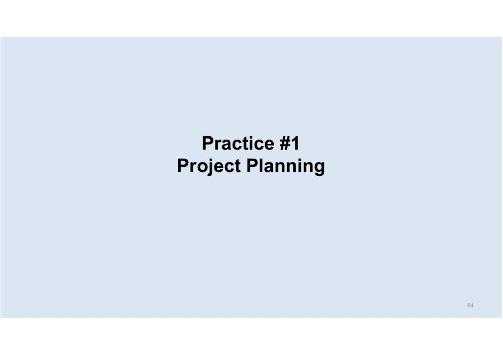

Project Planning  

---

## 85. A Simple/Basic Digital Watch Control SW

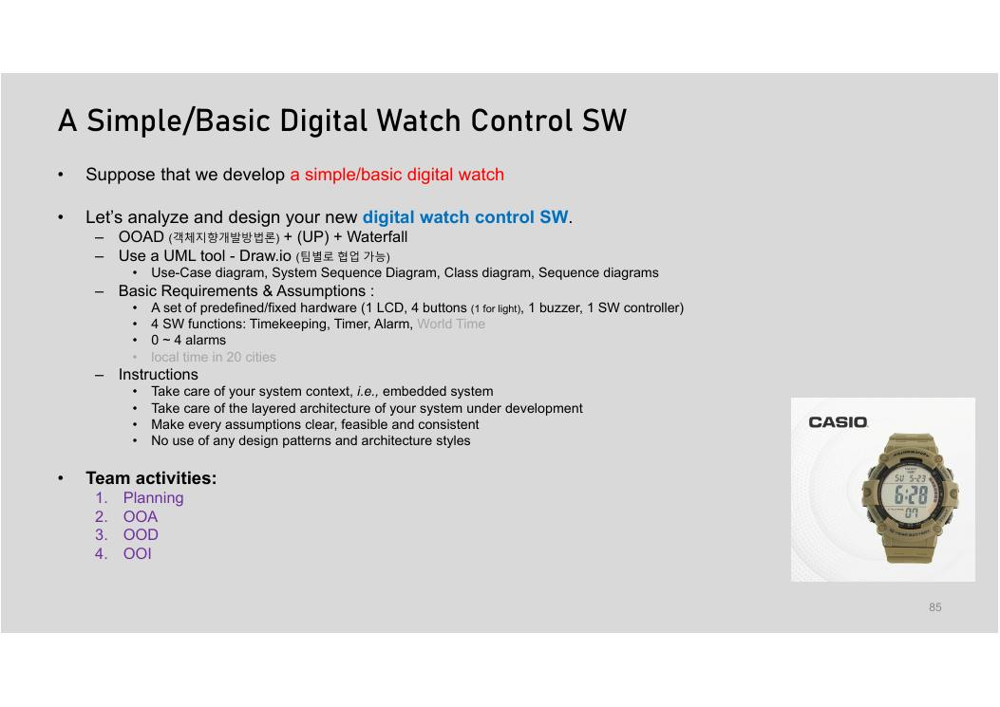

- Suppose that we develop a simple/basic digital watch

- Let’s analyze and design your new digital watch control SW.
  - OOAD (객체지향개발방법론) + (UP) + Waterfall
  - Use a UML tool - Draw.io (팀별로 협업 가능)
    - Use-Case diagram, System Sequence Diagram, Class diagram, Sequence diagrams
  - Basic Requirements &amp; Assumptions :
    - A set of predefined/fixed hardware (1 LCD, 4 buttons (1 for light), 1 buzzer, 1 SW controller)
    - 4 SW functions: Timekeeping, Timer, Alarm, World Time
    - 0 ~ 4 alarms
    - local time in 20 cities
  - Instructions
    - Take care of your system context, i.e., embedded system
    - Take care of the layered architecture of your system under development
    - Make every assumptions clear, feasible and consistent
    - No use of any design patterns and architecture styles

- Team activities:

1\. · Planning  
2\. · OOA  
3\. · OOD  
4\. · OOI  

---

## 86. [Activity #1] Planning

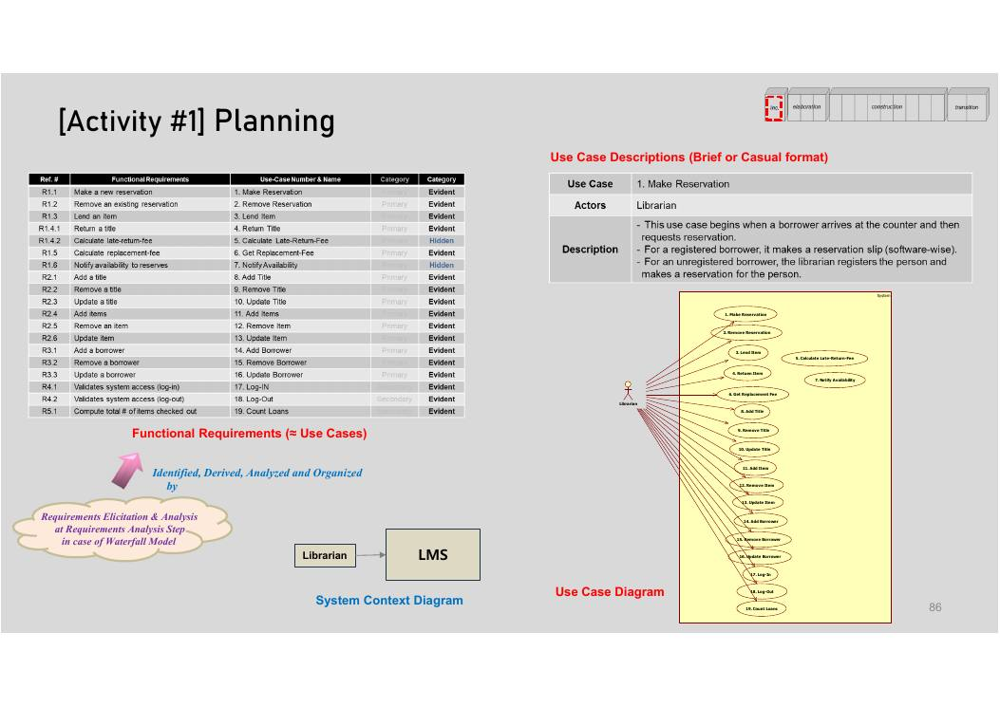

Use Case Descriptions (Brief or Casual format)  

System  

1\. Make Reservation  

2\. Remove Reservation  

3\. Lend Item  
5\. Calculate Late-Return-Fee  

4\. Retuen Item  
7\. Notify Availability  

6\. Get Replacement Fee  

Librarian  
8\. Add Title  

Functional Requirements (≈ Use Cases) · 9. Remove Title  

10\. Update Title  

11\. Add Item  
Identified, Derived, Analyzed and Organized  
by · 12. Remove Item  

13\. Update Item  

Requirements Elicitation &amp; Analysis · 14. Add Borrower  

at Requirements Analysis Step  
in case of Waterfall Model · 15. Remove Borrower  

Librarian · LMS · 16. Update Borrower  

17\. Log-In  

Use Case Diagram · 18. Log-Out  

System Context Diagram · 19. Count Loans  

---

## 87. A Basic Digital Watch Control SW

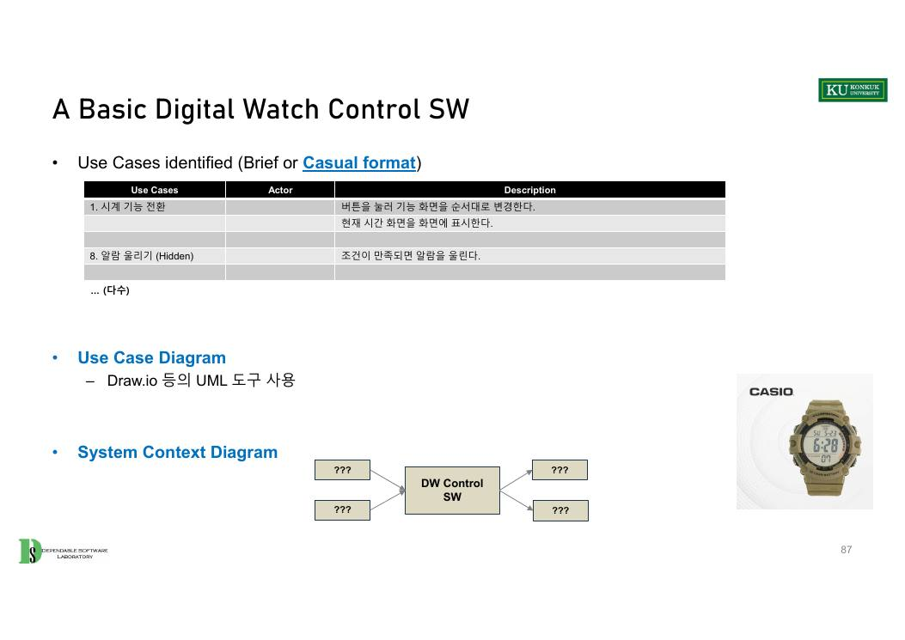

- Use Cases identified (Brief or Casual format)

Use Cases · Actor · Description  
1\. 시계 기능 전환 · 버튼을 눌러 기능 화면을 순서대로 변경한다.  
현재 시간 화면을 화면에 표시한다.  

8\. 알람 울리기 (Hidden) · 조건이 만족되면 알람을 울린다.  

… (다수)  

- Use Case Diagram
  - Draw.io 등의 UML 도구 사용

- System Context Diagram

??? · ???  
DW Control  
SW  
??? · ???  

---

## 88. Use Case Modeling - Examples

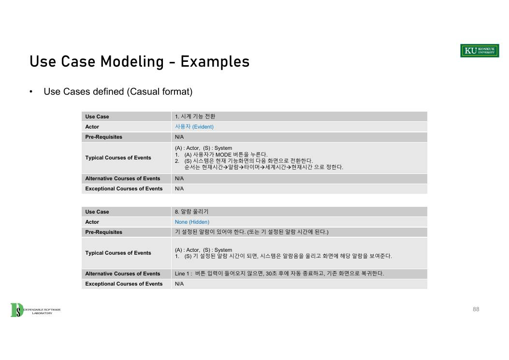

- Use Cases defined (Casual format)

Use Case · 1. 시계 기능 전환  
Actor · 사용자 (Evident)  
Pre-Requisites · N/A  

(A) : Actor, (S) : System  
1\. (A) 사용자가 MODE 버튼을 누른다.  
Typical Courses of Events  
2\. (S) 시스템은 현재 기능화면의 다음 화면으로 전환한다.  
순서는 현재시간→알람→타이머→세계시간→현재시간 으로 정한다.  

Alternative Courses of Events · N/A  
Exceptional Courses of Events · N/A  

Use Case · 8. 알람 울리기  
Actor · None (Hidden)  
Pre-Requisites · 기 설정된 알람이 있어야 한다. (또는 기 설정된 알람 시간에 된다.)  

(A) : Actor, (S) : System  
Typical Courses of Events  
1\. (S) 기 설정된 알람 시간이 되면, 시스템은 알람음을 울리고 화면에 해당 알람을 보여준다.  

Alternative Courses of Events · Line 1 : 버튼 입력이 들어오지 않으면, 30초 후에 자동 종료하고, 기존 화면으로 복귀한다.  
Exceptional Courses of Events · N/A  

---

## 89. Use Cases

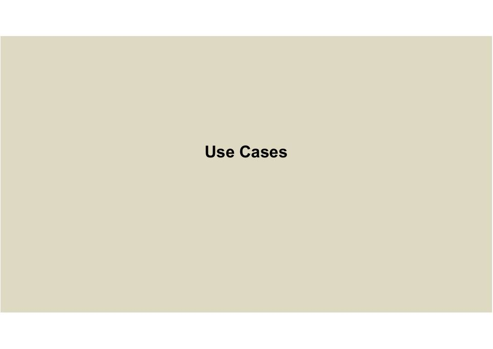

---

## 90. Use Cases

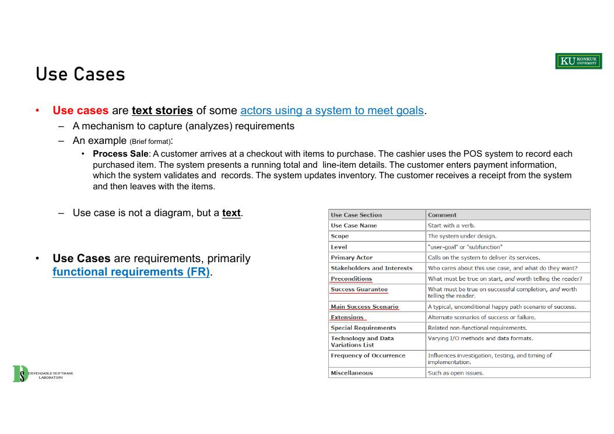

- Use cases are text stories of some actors using a system to meet goals.
  - A mechanism to capture (analyzes) requirements
  - An example (Brief format):
    - Process Sale: A customer arrives at a checkout with items to purchase. The cashier uses the POS system to record each purchased item. The system presents a running total and line-item details. The customer enters payment information, which the system validates and records. The system updates inventory. The customer receives a receipt from the system and then leaves with the items.

  - Use case is not a diagram, but a text.

- Use Cases are requirements, primarily functional requirements (FR).

---

## 91. Use Case Diagram

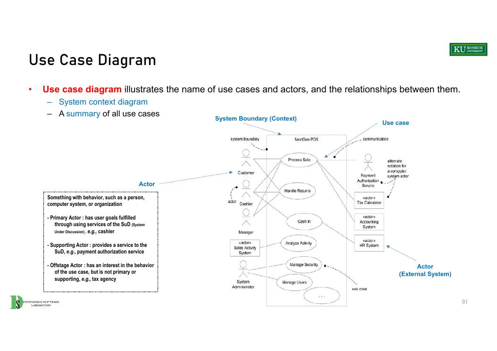

- Use case diagram illustrates the name of use cases and actors, and the relationships between them.
  - System context diagram
  - A summary of all use cases System Boundary (Context) Use case

Actor  

Something with behavior, such as a person,  
computer system, or organization  

  - Primary Actor : has user goals fulfilled through using services of the SuD (System Under Discussion) , e.g., cashier

  - Supporting Actor : provides a service to the SuD, e.g., payment authorization service

  - Offstage Actor : has an interest in the behavior · Actor

of the use case, but is not primary or · (External System)  
supporting, e.g., tax agency  

---

## 92. 3 Common Formats of Use Case

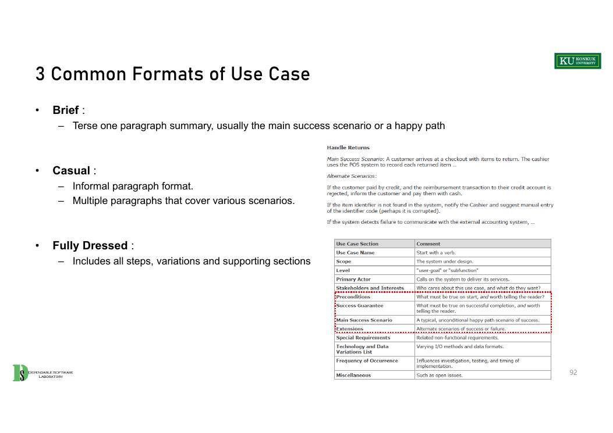

- Brief :
  - Terse one paragraph summary, usually the main success scenario or a happy path

- Casual :
  - Informal paragraph format.
  - Multiple paragraphs that cover various scenarios.

- Fully Dressed :
  - Includes all steps, variations and supporting sections

---

## 93. Example: Process Sale, Fully Dressed Style

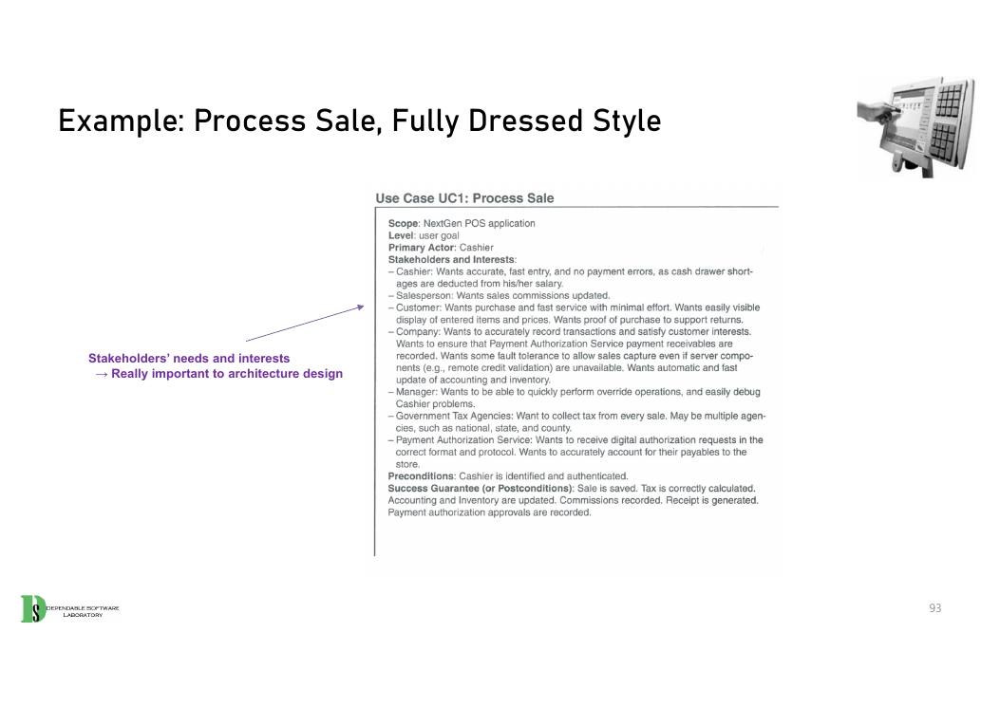

Stakeholders’ needs and interests  
→ Really important to architecture design  

---

## 94. (이미지 슬라이드)

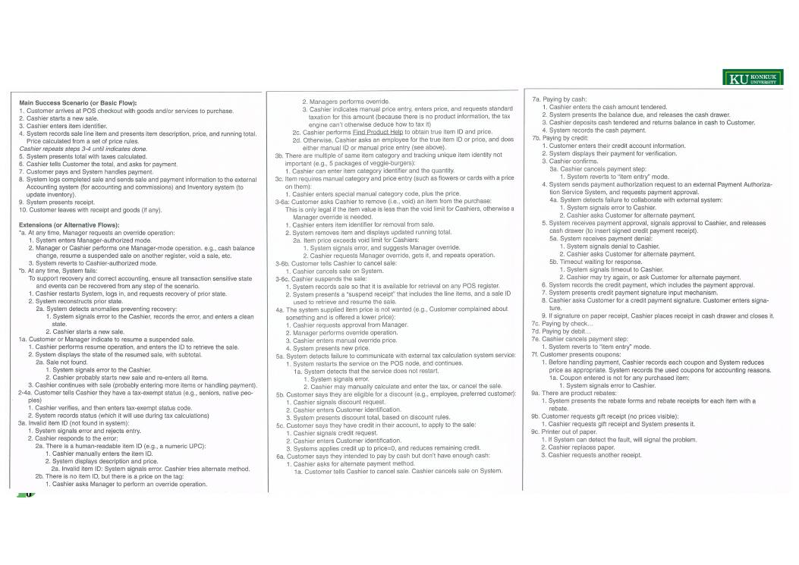

---

## 95. Guideline for Use Cases

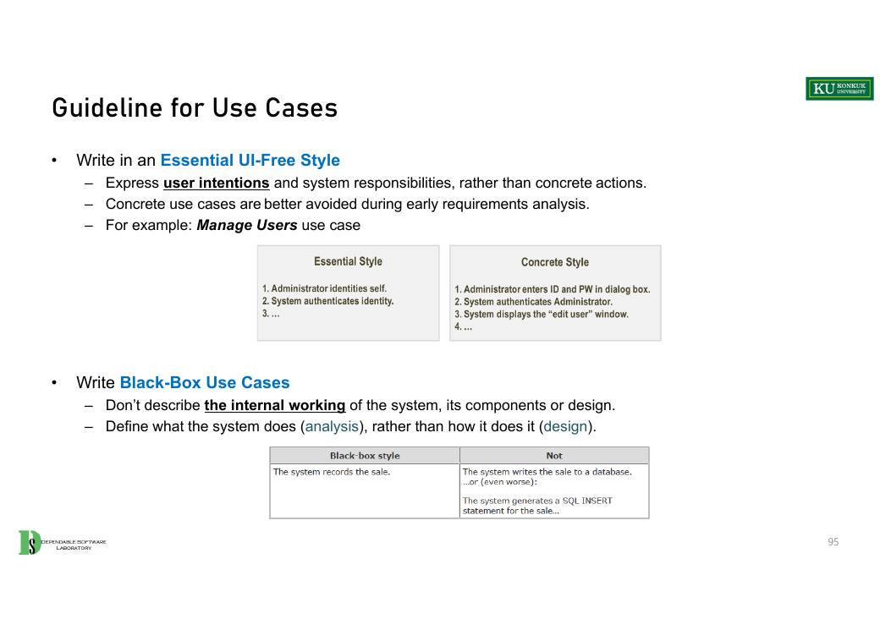

- Write in an Essential UI-Free Style
  - Express user intentions and system responsibilities, rather than concrete actions.
  - Concrete use cases are better avoided during early requirements analysis.
  - For example: Manage Users use case

- Write Black-Box Use Cases
  - Don’t describe the internal working of the system, its components or design.
  - Define what the system does (analysis), rather than how it does it (design).

---

## 96. (이미지 슬라이드)

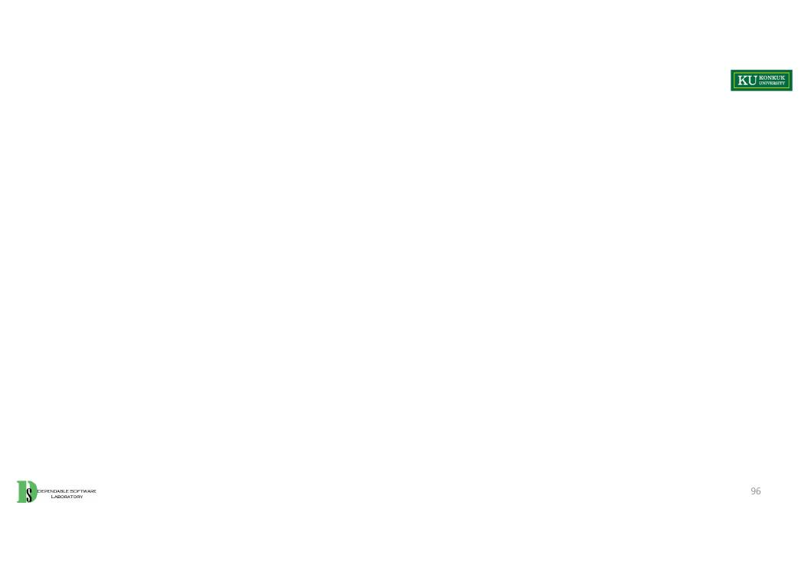

---

[← 이전: The Team Practice Overview](06_Team_Practice_Overview.md) · [← 목차](README.md) · [다음: Practice #2 OOA – System Sequence Diagram, Domain Model →](08_Practice2_OOA_SSD_Domain_Model.md)
