# Practice #2 OOA – System Sequence Diagram, Domain Model

> OOAD 객체지향개발방법론 · 슬라이드 97–111 · 원본: [PDF](../../original/2026%20AA%204차%20-%20OOAD%20(20261126).pdf)

[← 이전: Practice #1 Project Planning – Use Cases](07_Practice1_Project_Planning_Use_Cases.md) · [← 목차](README.md) · [다음: Practice #3 OOD – Sequence Diagram →](09_Practice3_OOD_Sequence_Diagram.md)

## 슬라이드 목록

- [97. Practice #2](#s97)
- [98. [Activity #2] OOA](#s98)
- [99. System Sequence Diagram](#s99)
- [100. System Sequence Diagram](#s100)
- [101. System Operation](#s101)
- [102. Guidelines for SSD](#s102)
- [103. The Relationship to Other Artifacts](#s103)
- [104. (이미지 슬라이드)](#s104)
- [105. Domain Model](#s105)
- [106. Domain Model](#s106)
- [107. Why Create a Domain Model?](#s107)
- [108. How to Create a Domain Model](#s108)
- [109. Guidelines for Domain Model](#s109)
- [110. The Relationship to Other Artifacts](#s110)
- [111. (이미지 슬라이드)](#s111)

---

## 97. Practice #2

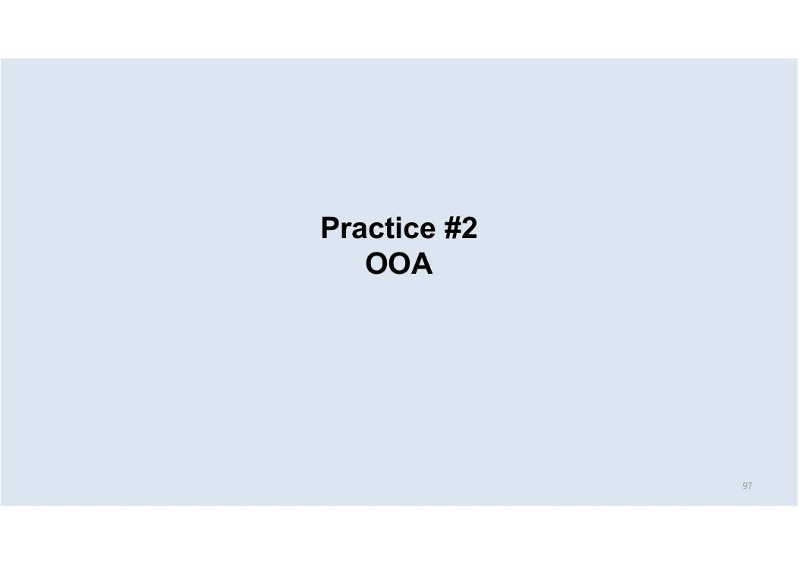

OOA  

---

## 98. [Activity #2] OOA

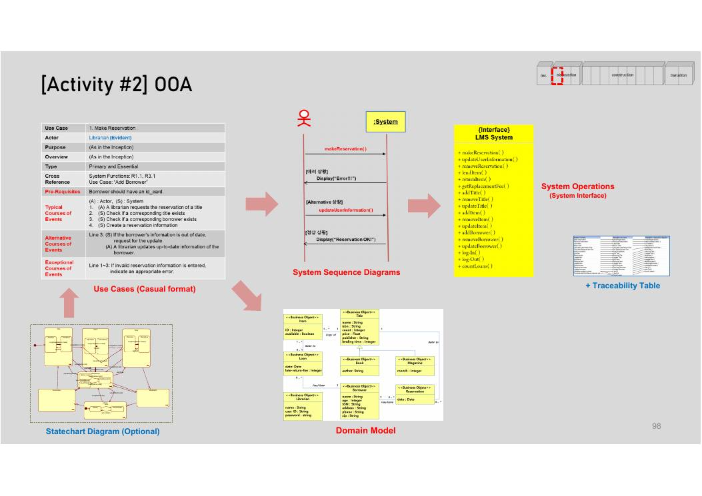

System Operations  
(System Interface)  

System Sequence Diagrams  

Use Cases (Casual format) · + Traceability Table  

Time · Alarm · Timer  

TimeView · TimeSetup · TimerView · TimerSetup  
AlarmView · AlarmSetup  
LongPress[Button=mode] · LongPress[Button=mode]  
LongPress[Button=mode]  
press[Button=mode] · press[Button=mode]  
finishAll  
finishAll  
finishAll  

move[not activated]  
press[Button=All]  
press[Button=All]  
selctMode  
press[Button=All]  
selctMode  
selectMode[if exis] · GlobalSetUp  
factory reset  
press[button=next]  
modeActivation  
press[button=next]  
moveToMode  
press[button=next]  

Anniversary · StopWatch  
selecMode[if exist]  
press[Button=All]  

Lottery  
save  

Display · Set Reminder  

Set reminder  

Statechart Diagram (Optional) · Domain Model  

---

## 99. System Sequence Diagram

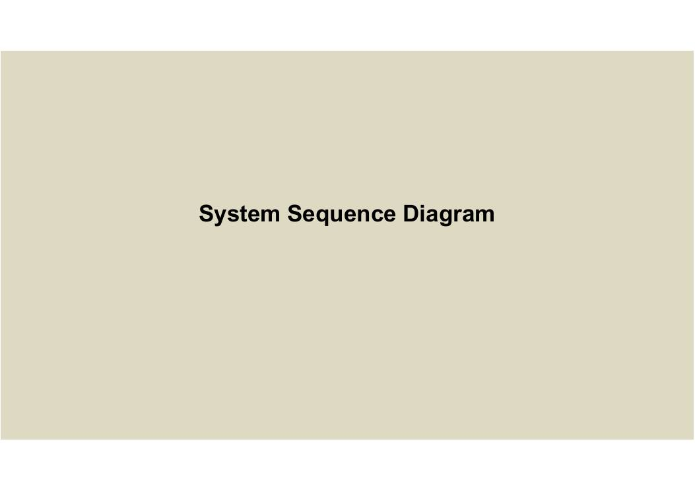

---

## 100. System Sequence Diagram

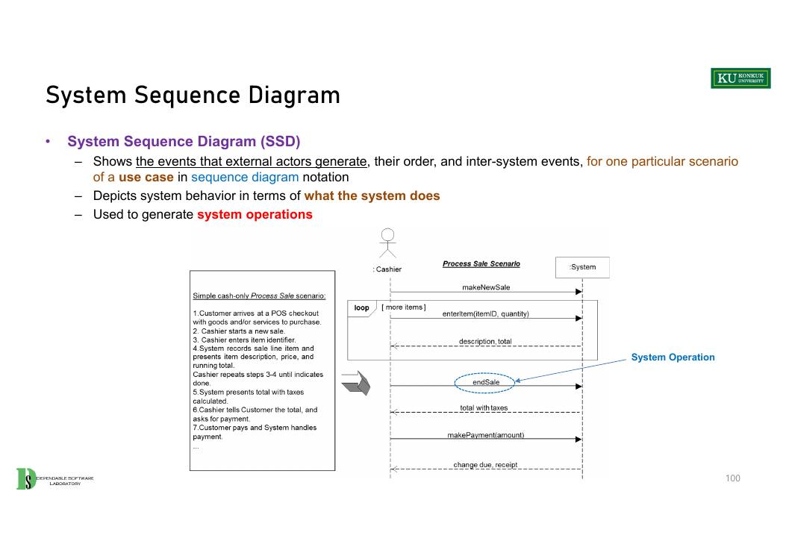

- System Sequence Diagram (SSD)
  - Shows the events that external actors generate, their order, and inter-system events, for one particular scenario of a use case in sequence diagram notation
  - Depicts system behavior in terms of what the system does
  - Used to generate system operations

System Operation  

---

## 101. System Operation

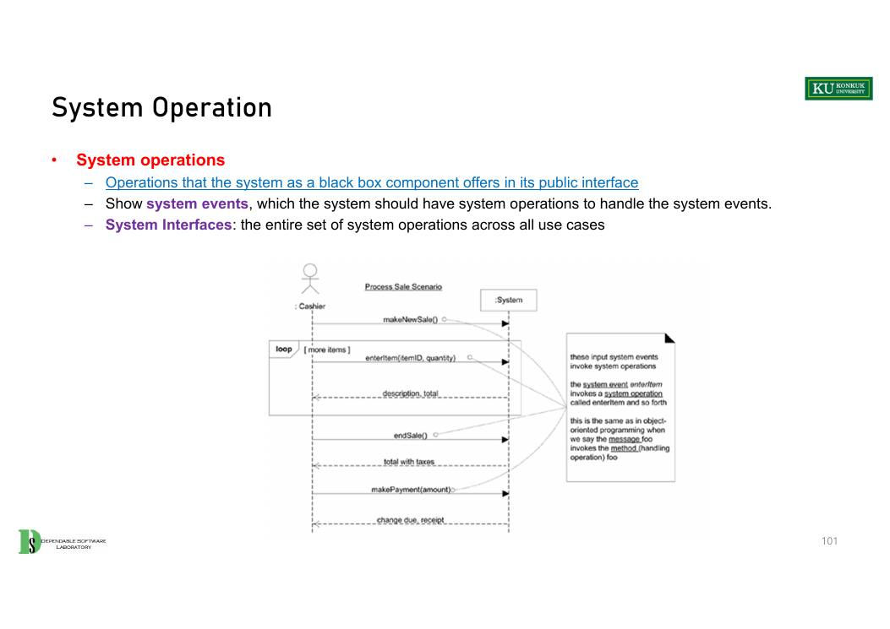

- System operations
  - Operations that the system as a black box component offers in its public interface
  - Show system events, which the system should have system operations to handle the system events.
  - System Interfaces: the entire set of system operations across all use cases

---

## 102. Guidelines for SSD

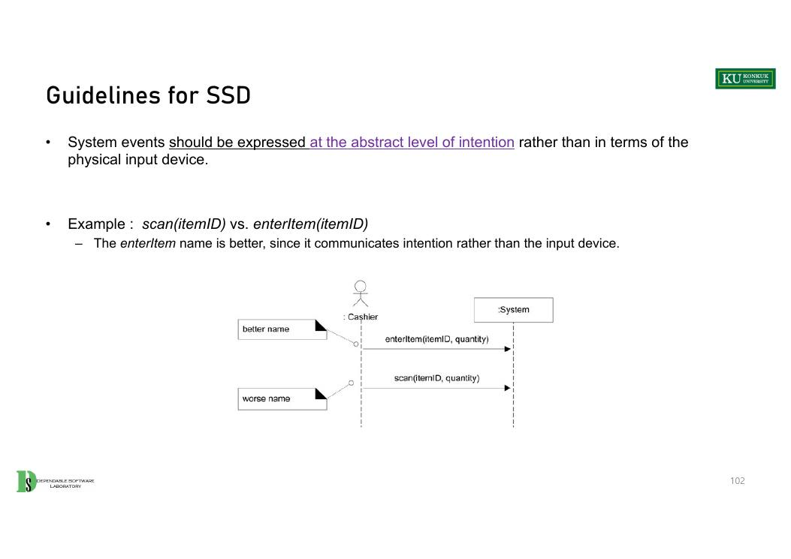

- System events should be expressed at the abstract level of intention rather than in terms of the physical input device.

- Example : scan(itemID) vs. enterItem(itemID)
  - The enterItem name is better, since it communicates intention rather than the input device.

---

## 103. The Relationship to Other Artifacts

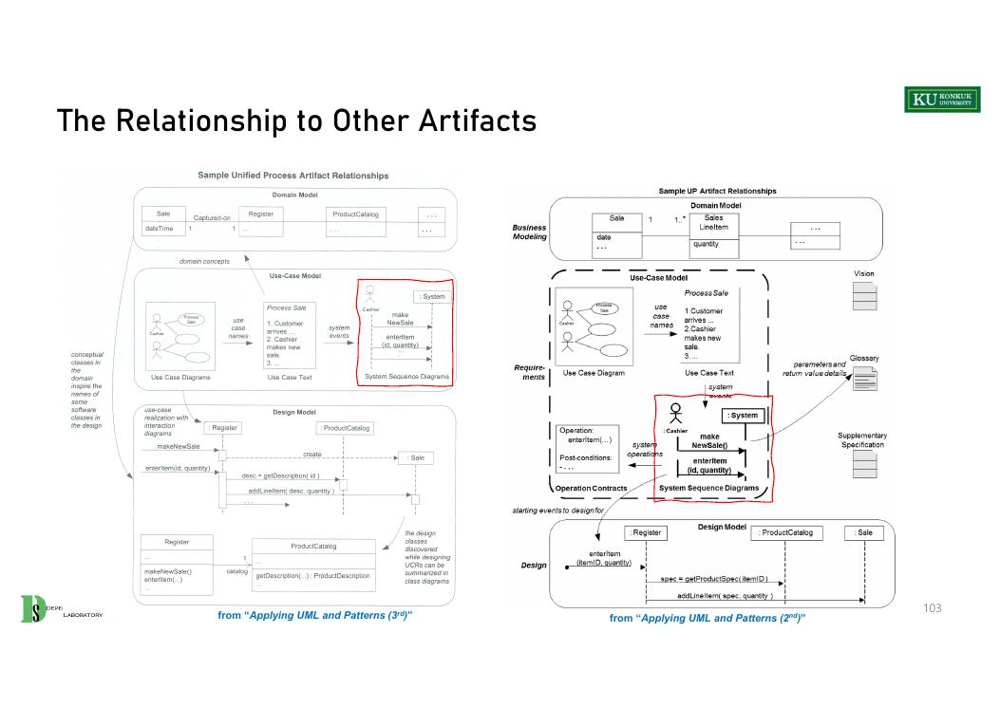

from “Applying UML and Patterns (3rd)” · from “Applying UML and Patterns (2nd)”  

---

## 104. (이미지 슬라이드)

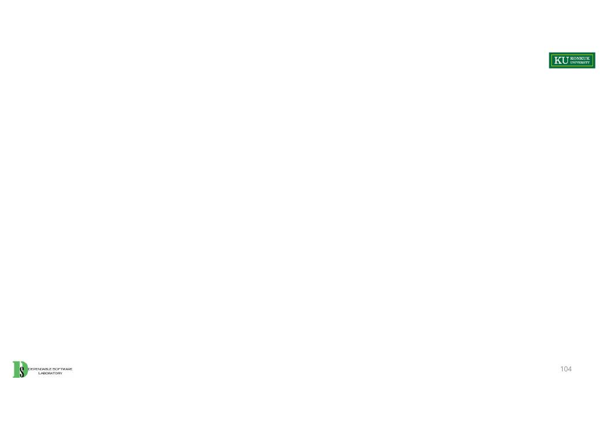

---

## 105. Domain Model

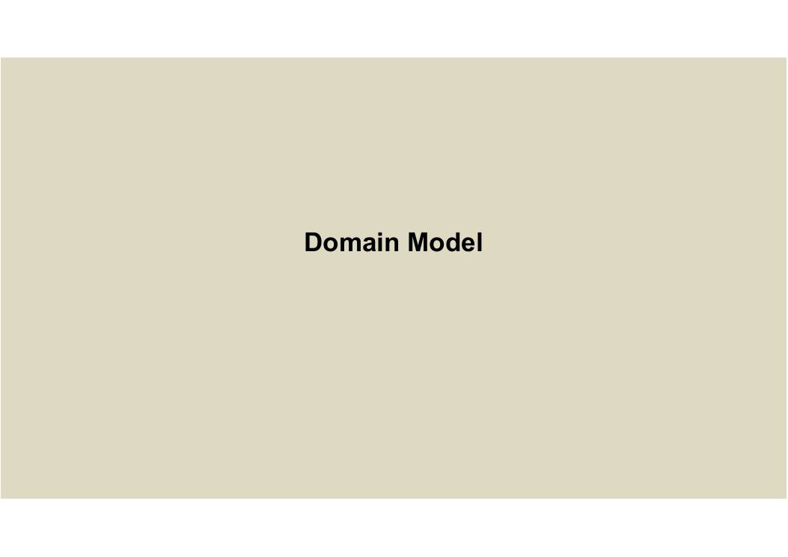

---

## 106. Domain Model

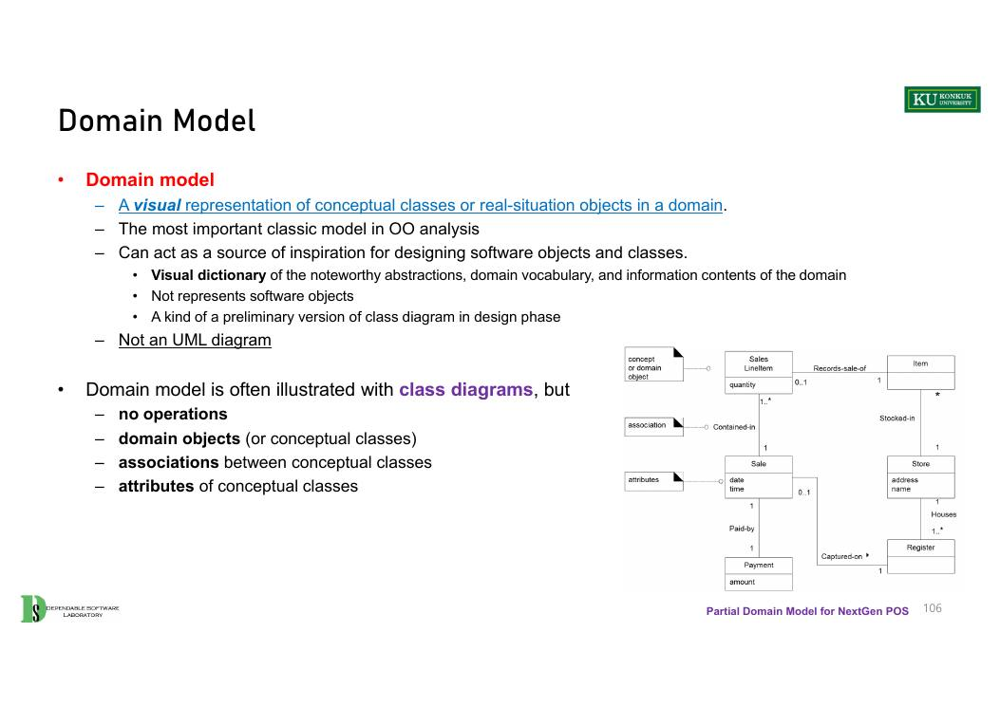

- Domain model
  - A visual representation of conceptual classes or real-situation objects in a domain.
  - The most important classic model in OO analysis
  - Can act as a source of inspiration for designing software objects and classes.
    - Visual dictionary of the noteworthy abstractions, domain vocabulary, and information contents of the domain
    - Not represents software objects
    - A kind of a preliminary version of class diagram in design phase
  - Not an UML diagram

- Domain model is often illustrated with class diagrams, but
  - no operations
  - domain objects (or conceptual classes)
  - associations between conceptual classes
  - attributes of conceptual classes

Partial Domain Model for NextGen POS  

---

## 107. Why Create a Domain Model?

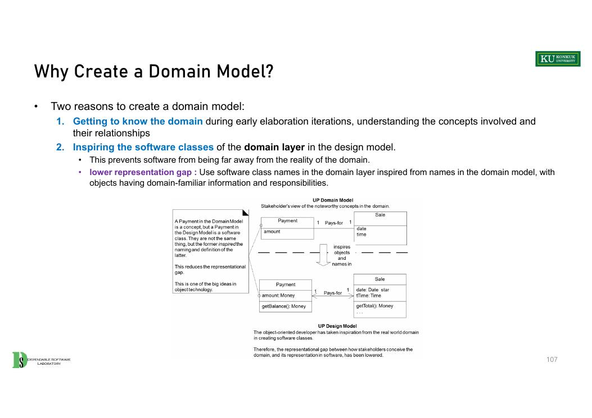

- Two reasons to create a domain model: 1. Getting to know the domain during early elaboration iterations, understanding the concepts involved and their relationships 2. Inspiring the software classes of the domain layer in the design model.
  - This prevents software from being far away from the reality of the domain.
  - lower representation gap : Use software class names in the domain layer inspired from names in the domain model, with objects having domain-familiar information and responsibilities.

---

## 108. How to Create a Domain Model

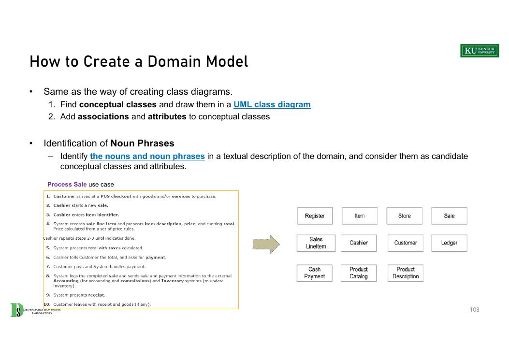

- Same as the way of creating class diagrams. 1. Find conceptual classes and draw them in a UML class diagram 2. Add associations and attributes to conceptual classes

- Identification of Noun Phrases
  - Identify the nouns and noun phrases in a textual description of the domain, and consider them as candidate conceptual classes and attributes.

Process Sale use case  

---

## 109. Guidelines for Domain Model

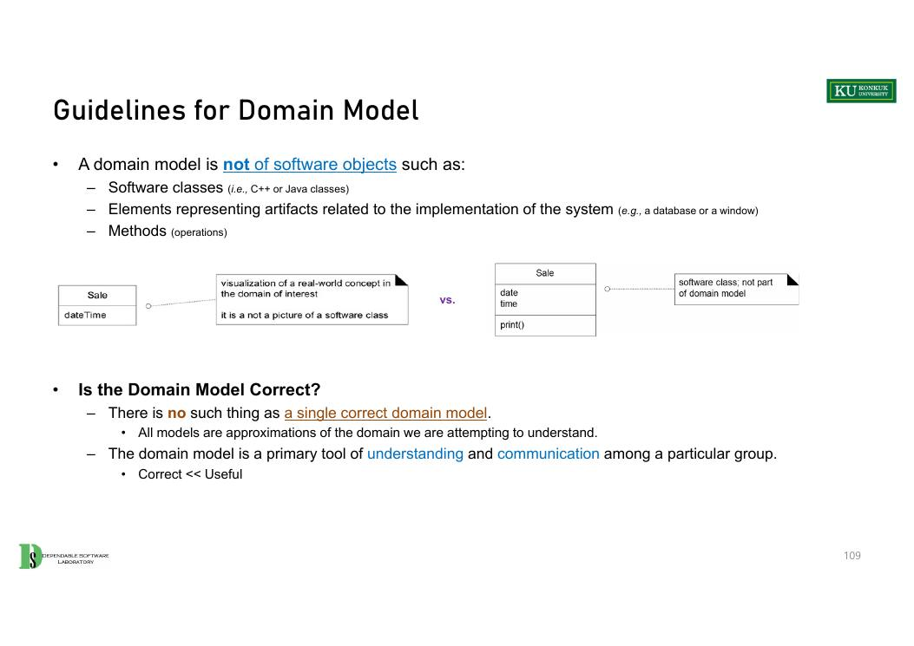

- A domain model is not of software objects such as:
  - Software classes (i.e., C++ or Java classes)
  - Elements representing artifacts related to the implementation of the system (e.g., a database or a window)
  - Methods (operations)

vs.  

- Is the Domain Model Correct?
  - There is no such thing as a single correct domain model.
    - All models are approximations of the domain we are attempting to understand.
  - The domain model is a primary tool of understanding and communication among a particular group.
    - Correct &lt;&lt; Useful

---

## 110. The Relationship to Other Artifacts

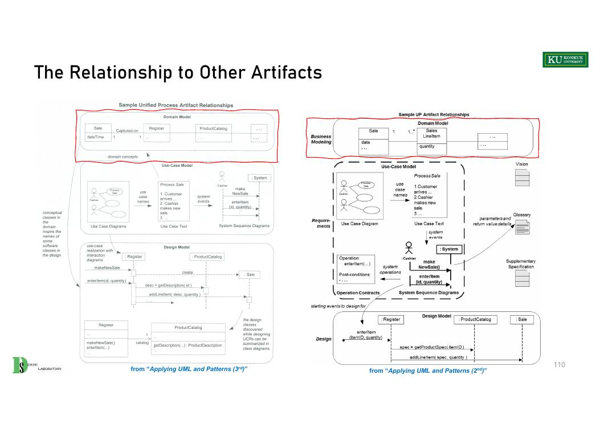

from “Applying UML and Patterns (3rd)” · from “Applying UML and Patterns (2nd)”  

---

## 111. (이미지 슬라이드)

---

[← 이전: Practice #1 Project Planning – Use Cases](07_Practice1_Project_Planning_Use_Cases.md) · [← 목차](README.md) · [다음: Practice #3 OOD – Sequence Diagram →](09_Practice3_OOD_Sequence_Diagram.md)
