# OOD – SOLID

> OOAD 객체지향개발방법론 · 슬라이드 181–214 · 원본: [PDF](../../original/2026%20AA%204차%20-%20OOAD%20(20261126).pdf)

[← 이전: OOD – Class Diagram](10_OOD_Class_Diagram.md) · [← 목차](README.md) · [다음: OOD – GRASP, Design Patterns →](12_OOD_GRASP_Design_Patterns.md)

## 슬라이드 목록

- [181. SOLID](#s181)
- [182. RC Martin’s OO Design Principles - SOLID](#s182)
- [183. SOLID](#s183)
- [184. 1\. The Single Responsibility Principle (SRP)](#s184)
- [185. SRP Example 1: Original Design](#s185)
- [186. SRP Example 1: Better Design](#s186)
- [187. SRP Example 2: Original Design](#s187)
- [188. SRP Example 2: Improved Design](#s188)
- [189. SRP Example 2: Better Design](#s189)
- [190. 2\. The Open Closed Principle (OCP)](#s190)
- [191. Abstraction is the Key](#s191)
- [192. OCP Example 1: Original Design](#s192)
- [193. OCP Example 1: Better Design](#s193)
- [194. OCP Example 2: Original Design](#s194)
- [195. OCP Example 2: Better Design](#s195)
- [196. Anticipating Future Changes](#s196)
- [197. 3\. The Liskov Substitution Principle (LSP)](#s197)
- [198. LSP Example: Original Design](#s198)
- [199. LSP Example: First Approach](#s199)
- [200. LSP Example: Second Approach](#s200)
- [201. LSP Example: Second Approach](#s201)
- [202. LSP Example: Answer](#s202)
- [203. The Liskov Substitution Principle](#s203)
- [204. 4\. The Interface Segregation Principle (ISP)](#s204)
- [205. ISP Example: Original Design](#s205)
- [206. ISP Example: Better Design](#s206)
- [207. 5\. The Dependency Inversion Principle (DIP)](#s207)
- [208. Reminder - Procedural Design](#s208)
- [209. The Dependency Inversion Principle](#s209)
- [210. The Dependency Inversion Principle](#s210)
- [211. The Dependency Inversion Principle](#s211)
- [212. The Dependency Inversion Principle](#s212)
- [213. SOLID Summary](#s213)
- [214. (이미지 슬라이드)](#s214)

---

## 181. SOLID

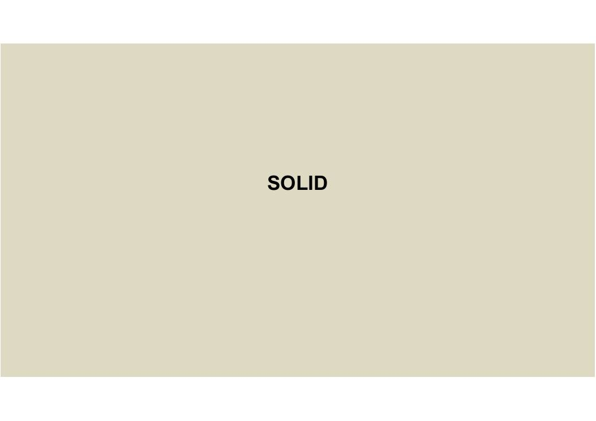

---

## 182. RC Martin’s OO Design Principles - SOLID

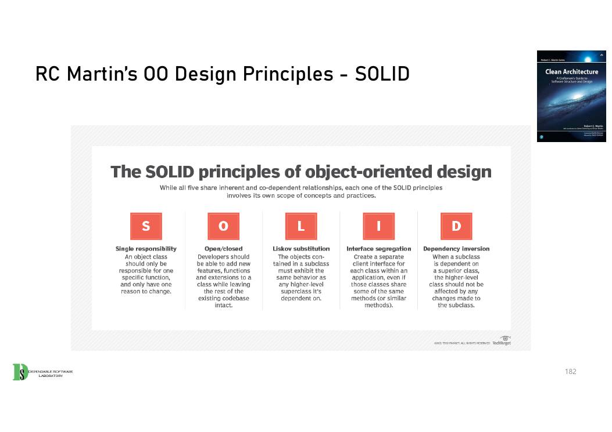

---

## 183. SOLID

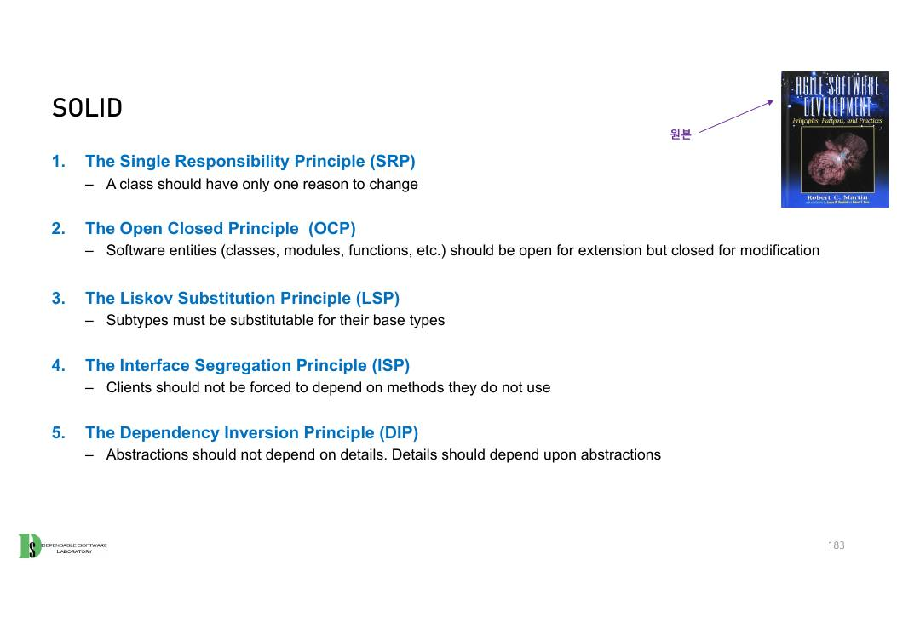

원본  

1\. · The Single Responsibility Principle (SRP)  
- A class should have only one reason to change

2\. · The Open Closed Principle (OCP)  
- Software entities (classes, modules, functions, etc.) should be open for extension but closed for modification

3\. · The Liskov Substitution Principle (LSP)  
- Subtypes must be substitutable for their base types

4\. · The Interface Segregation Principle (ISP)  
- Clients should not be forced to depend on methods they do not use

5\. · The Dependency Inversion Principle (DIP)  
- Abstractions should not depend on details. Details should depend upon abstractions

---

## 184. 1\. The Single Responsibility Principle (SRP)

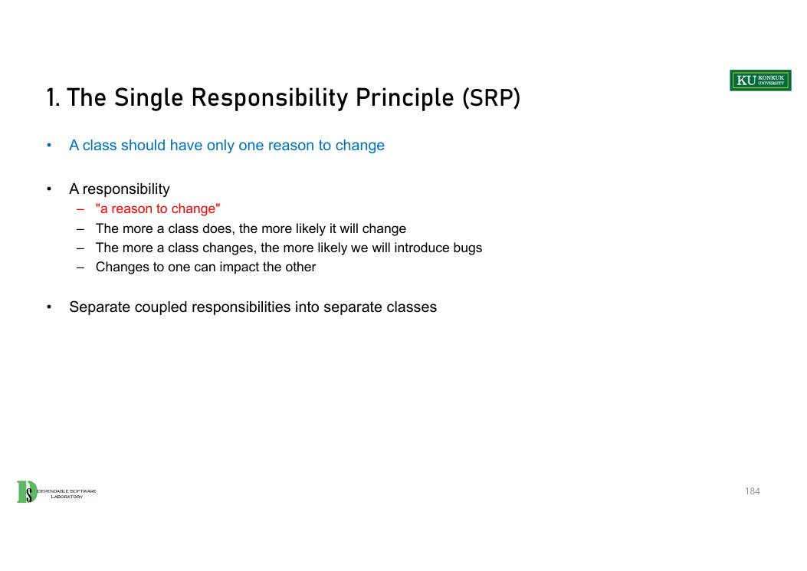

- A class should have only one reason to change

- A responsibility
  - "a reason to change"
  - The more a class does, the more likely it will change
  - The more a class changes, the more likely we will introduce bugs
  - Changes to one can impact the other

- Separate coupled responsibilities into separate classes

---

## 185. SRP Example 1: Original Design

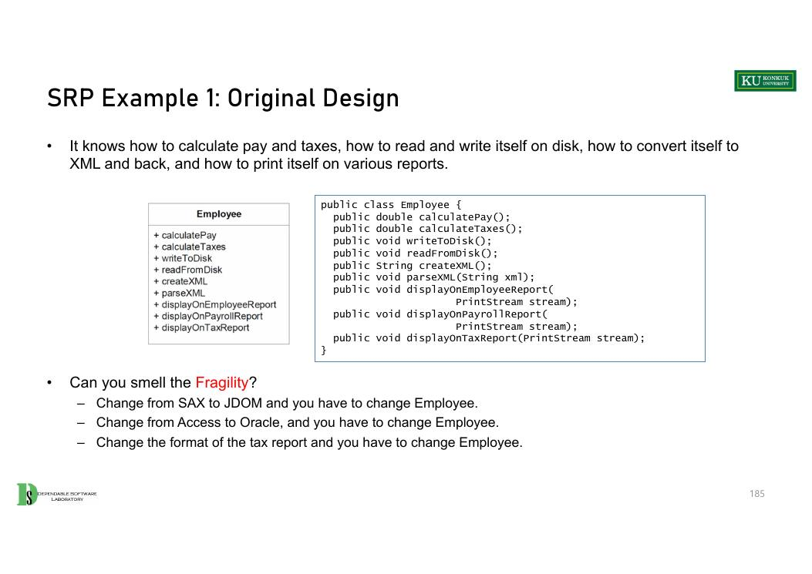

- It knows how to calculate pay and taxes, how to read and write itself on disk, how to convert itself to XML and back, and how to print itself on various reports.

public class Employee {  
public double calculatePay();  
public double calculateTaxes();  
public void writeToDisk();  
public void readFromDisk();  
public String createXML();  
public void parseXML(String xml);  
public void displayOnEmployeeReport(  
PrintStream stream);  
public void displayOnPayrollReport(  
PrintStream stream);  
public void displayOnTaxReport(PrintStream stream);  
}  

- Can you smell the Fragility?
  - Change from SAX to JDOM and you have to change Employee.
  - Change from Access to Oracle, and you have to change Employee.
  - Change the format of the tax report and you have to change Employee.

---

## 186. SRP Example 1: Better Design

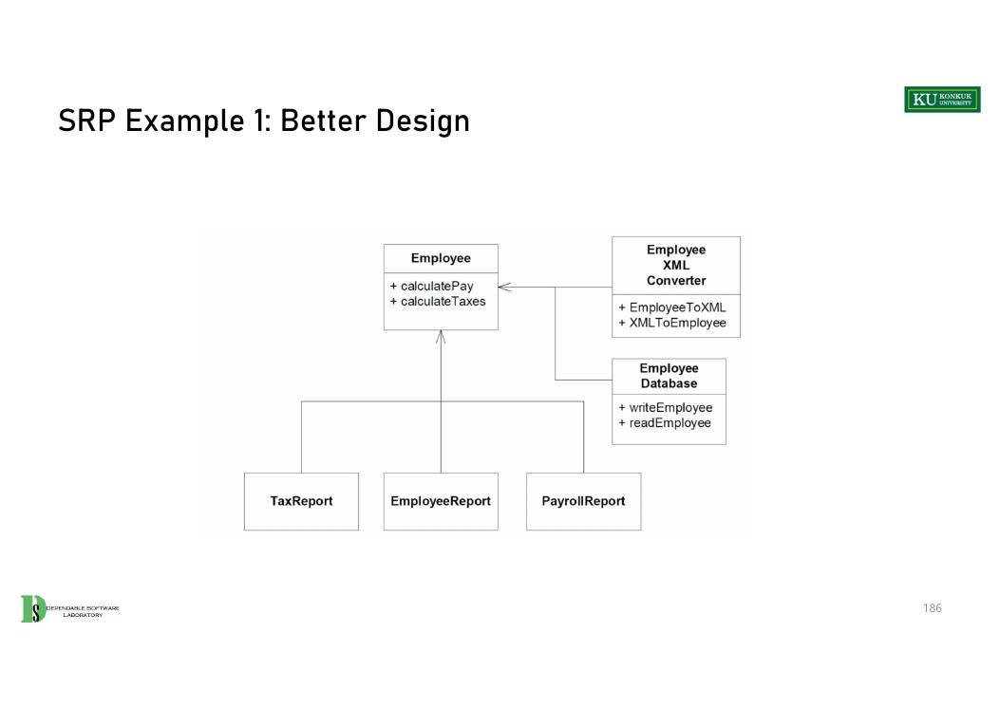

---

## 187. SRP Example 2: Original Design

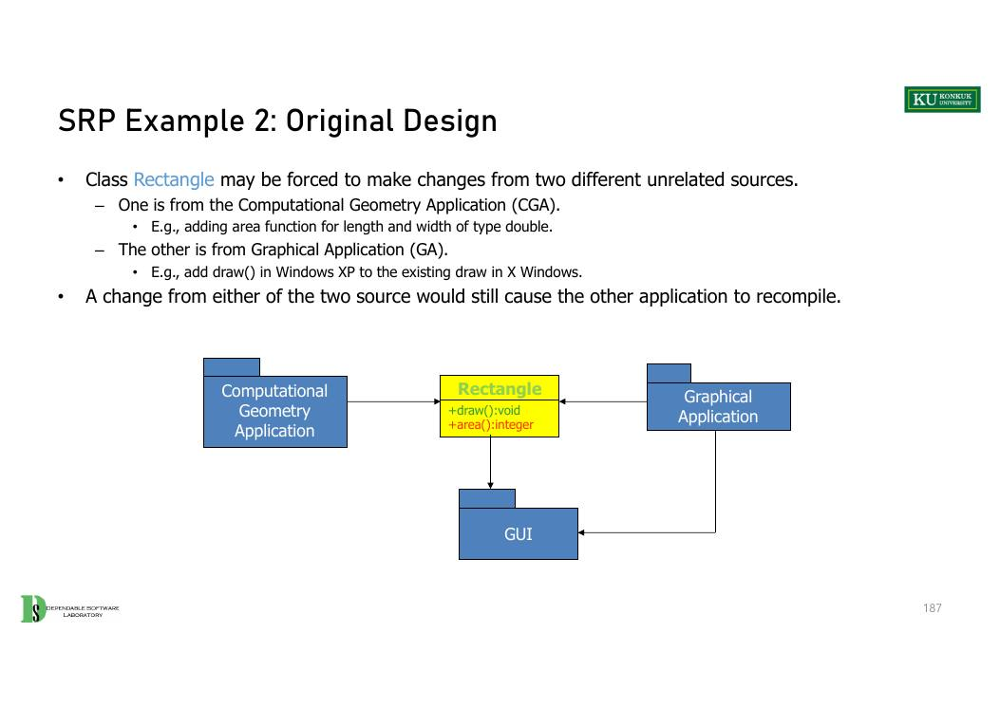

- Class Rectangle may be forced to make changes from two different unrelated sources.
  - One is from the Computational Geometry Application (CGA).
    - E.g., adding area function for length and width of type double.
  - The other is from Graphical Application (GA).
    - E.g., add draw() in Windows XP to the existing draw in X Windows.
- A change from either of the two source would still cause the other application to recompile.

Computational · Rectangle · Graphical  
Geometry · +draw():void  
Application  
\+area():integer  
Application  

GUI  

---

## 188. SRP Example 2: Improved Design

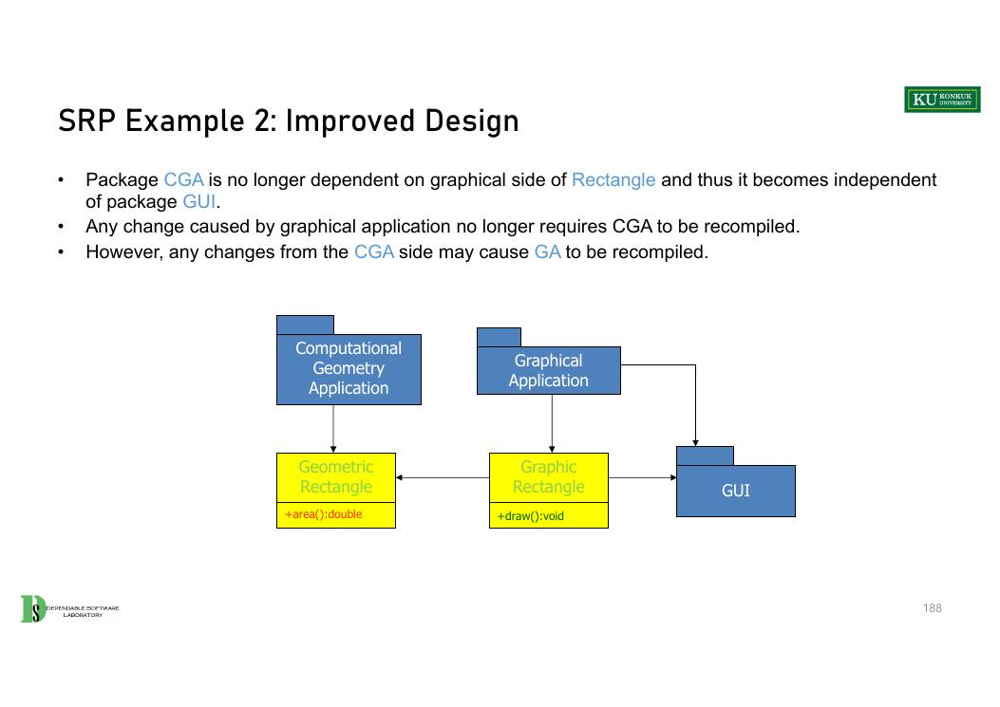

- Package CGA is no longer dependent on graphical side of Rectangle and thus it becomes independent of package GUI.
- Any change caused by graphical application no longer requires CGA to be recompiled.
- However, any changes from the CGA side may cause GA to be recompiled.

Computational  
Geometry · Graphical  
Application · Application  

Geometric · Graphic  
Rectangle · Rectangle · GUI  
\+area():double · +draw():void  

---

## 189. SRP Example 2: Better Design

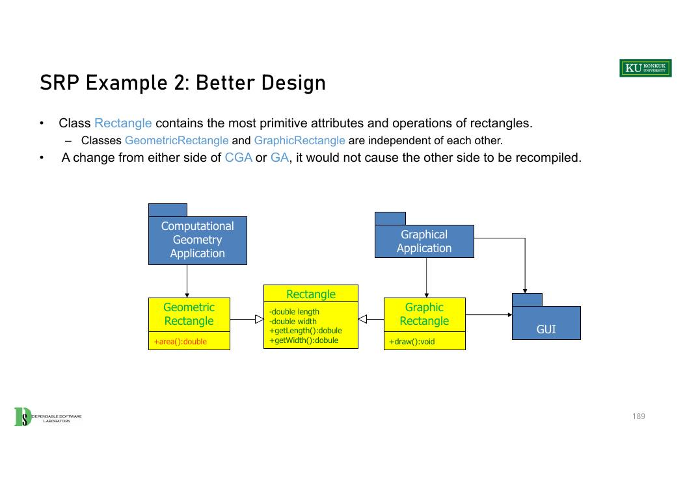

- Class Rectangle contains the most primitive attributes and operations of rectangles.
  - Classes GeometricRectangle and GraphicRectangle are independent of each other.
- A change from either side of CGA or GA, it would not cause the other side to be recompiled.

Computational  
Geometry · Graphical  
Application · Application  

Rectangle  
Geometric · -double length · Graphic  
Rectangle · -double width · Rectangle  
\+getLength():dobule · GUI  
\+area():double · +getWidth():dobule · +draw():void  

---

## 190. 2\. The Open Closed Principle (OCP)

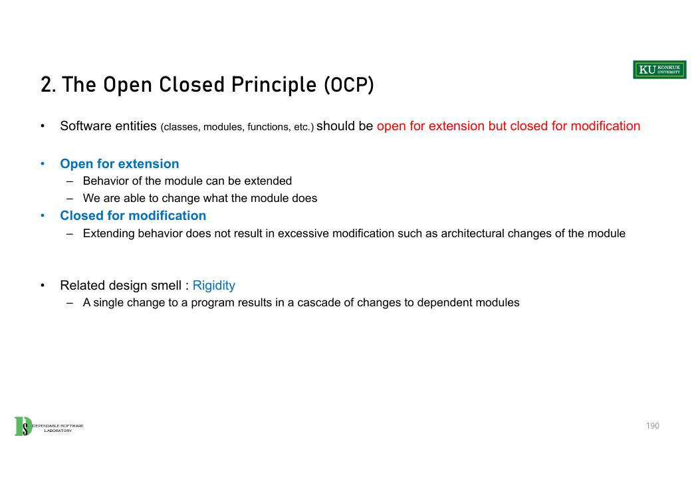

- Software entities (classes, modules, functions, etc.) should be open for extension but closed for modification

- Open for extension
  - Behavior of the module can be extended
  - We are able to change what the module does
- Closed for modification
  - Extending behavior does not result in excessive modification such as architectural changes of the module

- Related design smell : Rigidity
  - A single change to a program results in a cascade of changes to dependent modules

---

## 191. Abstraction is the Key

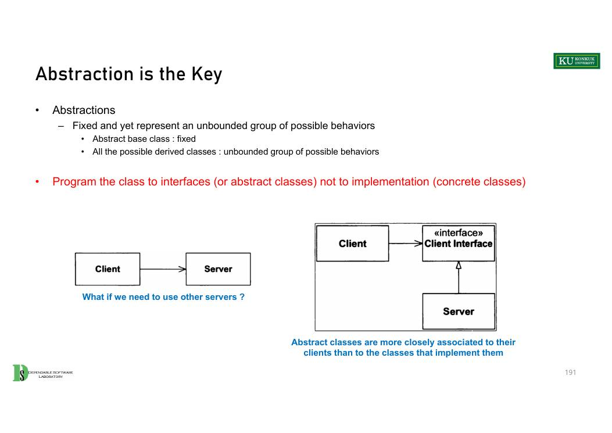

- Abstractions
  - Fixed and yet represent an unbounded group of possible behaviors
    - Abstract base class : fixed
    - All the possible derived classes : unbounded group of possible behaviors

- Program the class to interfaces (or abstract classes) not to implementation (concrete classes)

What if we need to use other servers ?  

Abstract classes are more closely associated to their  
clients than to the classes that implement them  

---

## 192. OCP Example 1: Original Design

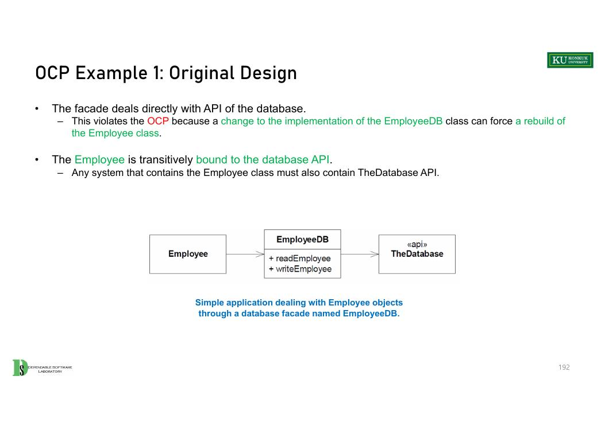

- The facade deals directly with API of the database.
  - This violates the OCP because a change to the implementation of the EmployeeDB class can force a rebuild of the Employee class.

- The Employee is transitively bound to the database API.
  - Any system that contains the Employee class must also contain TheDatabase API.

Simple application dealing with Employee objects  
through a database facade named EmployeeDB.  

---

## 193. OCP Example 1: Better Design

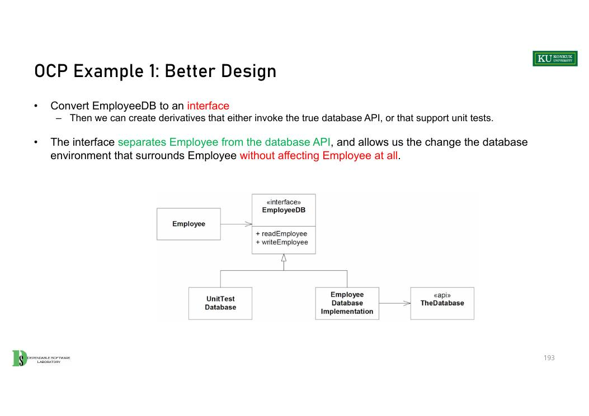

- Convert EmployeeDB to an interface
  - Then we can create derivatives that either invoke the true database API, or that support unit tests.

- The interface separates Employee from the database API, and allows us the change the database environment that surrounds Employee without affecting Employee at all.

---

## 194. OCP Example 2: Original Design

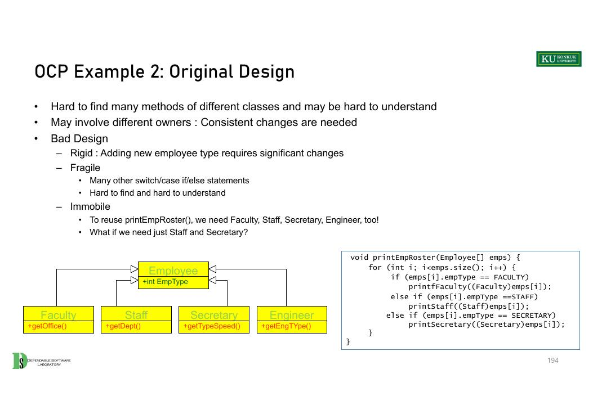

- Hard to find many methods of different classes and may be hard to understand
- May involve different owners : Consistent changes are needed
- Bad Design
  - Rigid : Adding new employee type requires significant changes
  - Fragile
    - Many other switch/case if/else statements
    - Hard to find and hard to understand
  - Immobile
    - To reuse printEmpRoster(), we need Faculty, Staff, Secretary, Engineer, too!
    - What if we need just Staff and Secretary?

void printEmpRoster(Employee[] emps) {  
for (int i; i&lt;emps.size(); i++) {  
Employee · if (emps[i].empType == FACULTY)  
\+int EmpType  
printfFaculty((Faculty)emps[i]);  
else if (emps[i].empType ==STAFF)  
printStaff((Staff)emps[i]);  
Faculty · Staff · Secretary · Engineer · else if (emps[i].empType == SECRETARY)  
\+getOffice() · +getDept() · +getTypeSpeed() · +getEngTYpe() · printSecretary((Secretary)emps[i]);  
}  
}  

---

## 195. OCP Example 2: Better Design

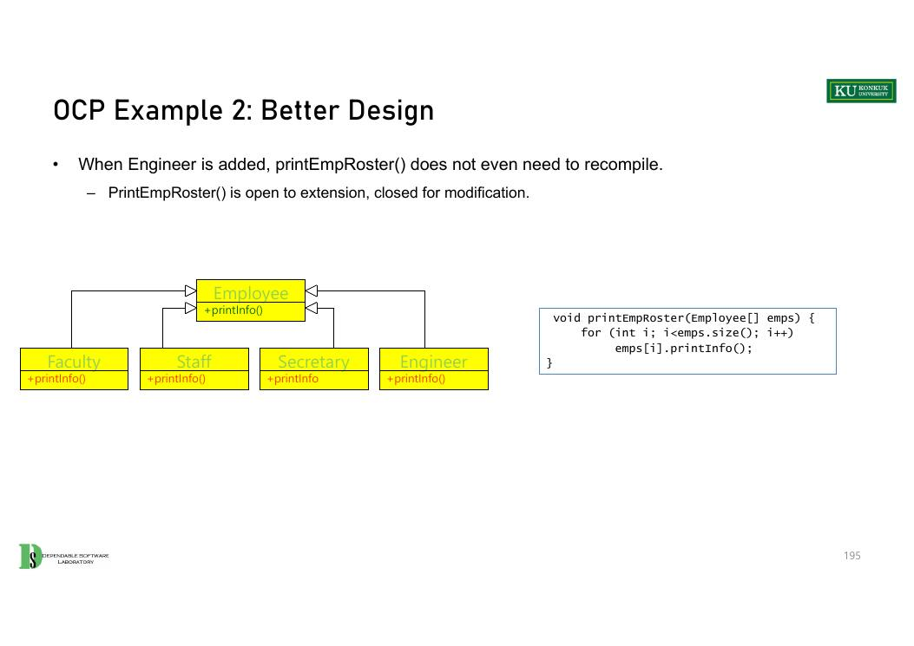

- When Engineer is added, printEmpRoster() does not even need to recompile.
  - PrintEmpRoster() is open to extension, closed for modification.

Employee  
\+printInfo()  
void printEmpRoster(Employee[] emps) {  
for (int i; i&lt;emps.size(); i++)  
emps[i].printInfo();  
Faculty · Staff · Secretary · Engineer · }  
\+printInfo() · +printInfo() · +printInfo · +printInfo()  

---

## 196. Anticipating Future Changes

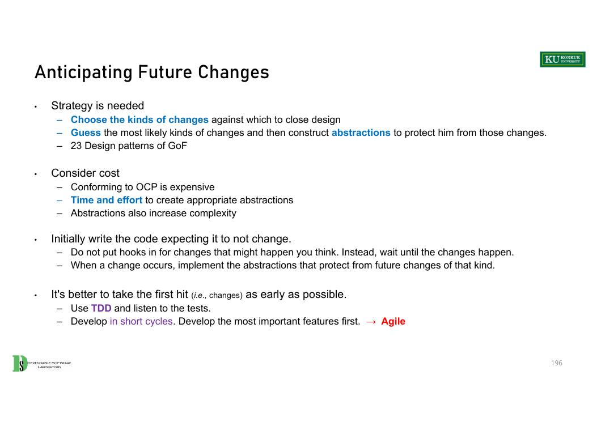

- Strategy is needed
  - Choose the kinds of changes against which to close design
  - Guess the most likely kinds of changes and then construct abstractions to protect him from those changes.
  - 23 Design patterns of GoF

- Consider cost
  - Conforming to OCP is expensive
  - Time and effort to create appropriate abstractions
  - Abstractions also increase complexity

- Initially write the code expecting it to not change.
  - Do not put hooks in for changes that might happen you think. Instead, wait until the changes happen.
  - When a change occurs, implement the abstractions that protect from future changes of that kind.

- It's better to take the first hit (i.e., changes) as early as possible.
  - Use TDD and listen to the tests.
  - Develop in short cycles. Develop the most important features first. → Agile

---

## 197. 3\. The Liskov Substitution Principle (LSP)

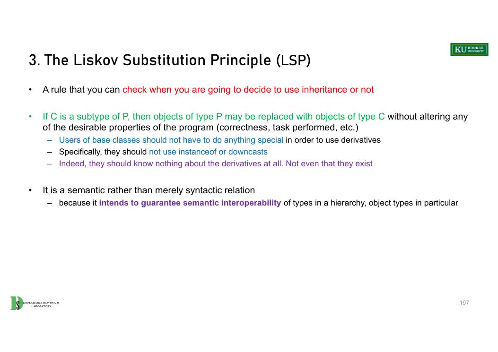

- A rule that you can check when you are going to decide to use inheritance or not

- If C is a subtype of P, then objects of type P may be replaced with objects of type C without altering any of the desirable properties of the program (correctness, task performed, etc.)
  - Users of base classes should not have to do anything special in order to use derivatives
  - Specifically, they should not use instanceof or downcasts
  - Indeed, they should know nothing about the derivatives at all. Not even that they exist

- It is a semantic rather than merely syntactic relation
  - because it intends to guarantee semantic interoperability of types in a hierarchy, object types in particular

---

## 198. LSP Example: Original Design

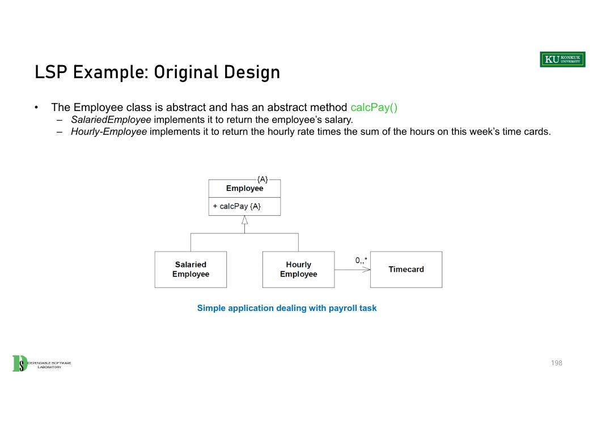

- The Employee class is abstract and has an abstract method calcPay()
  - SalariedEmployee implements it to return the employee’s salary.
  - Hourly-Employee implements it to return the hourly rate times the sum of the hours on this week’s time cards.

Simple application dealing with payroll task  

---

## 199. LSP Example: First Approach

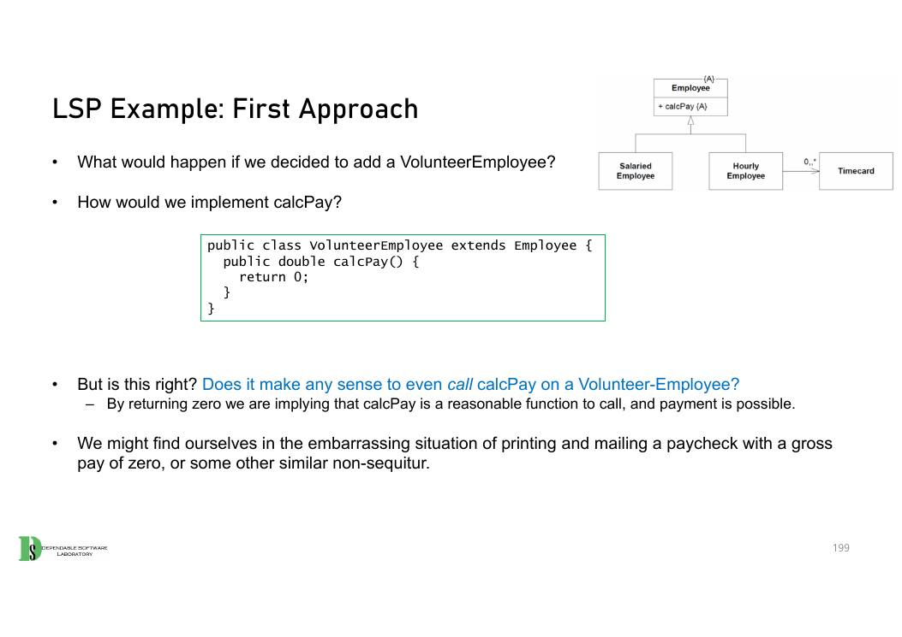

- What would happen if we decided to add a VolunteerEmployee?

- How would we implement calcPay?

public class VolunteerEmployee extends Employee {  
public double calcPay() {  
return 0;  
}  
}  

- But is this right? Does it make any sense to even call calcPay on a Volunteer-Employee?
  - By returning zero we are implying that calcPay is a reasonable function to call, and payment is possible.

- We might find ourselves in the embarrassing situation of printing and mailing a paycheck with a gross pay of zero, or some other similar non-sequitur.

---

## 200. LSP Example: Second Approach

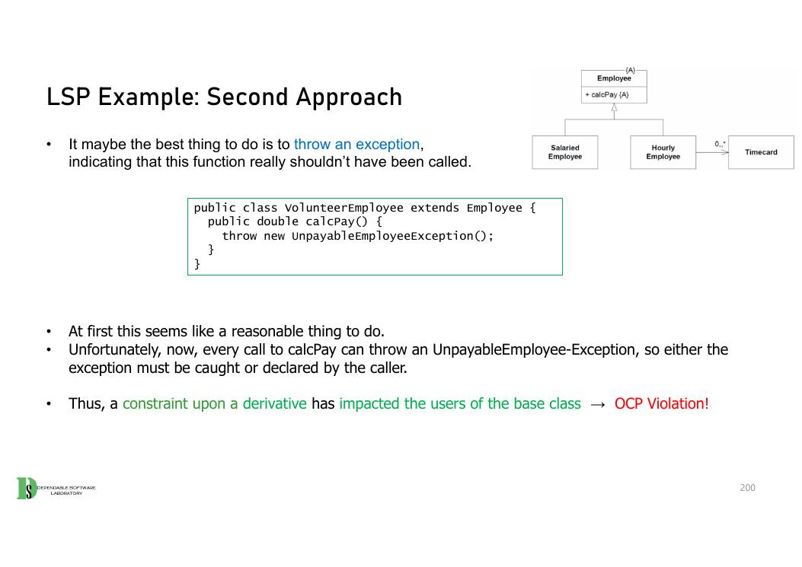

- It maybe the best thing to do is to throw an exception, indicating that this function really shouldn’t have been called.

public class VolunteerEmployee extends Employee {  
public double calcPay() {  
throw new UnpayableEmployeeException();  
}  
}  

- At first this seems like a reasonable thing to do.
- Unfortunately, now, every call to calcPay can throw an UnpayableEmployee-Exception, so either the exception must be caught or declared by the caller.

- Thus, a constraint upon a derivative has impacted the users of the base class → OCP Violation!

---

## 201. LSP Example: Second Approach

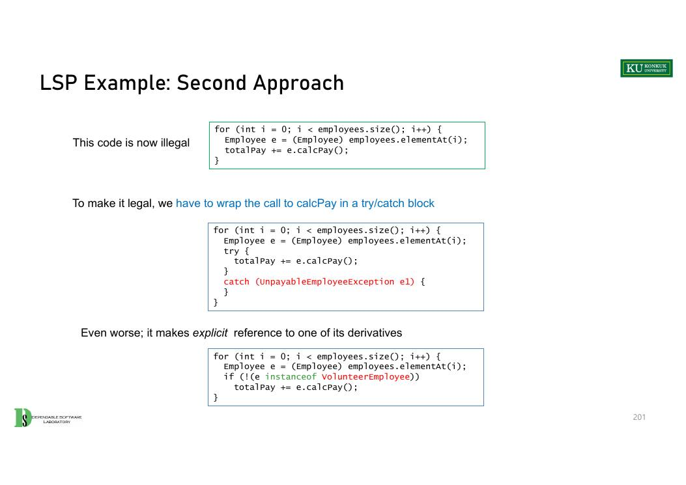

for (int i = 0; i &lt; employees.size(); i++) {  
This code is now illegal · Employee e = (Employee) employees.elementAt(i);  
totalPay += e.calcPay();  
}  

To make it legal, we have to wrap the call to calcPay in a try/catch block  

for (int i = 0; i &lt; employees.size(); i++) {  
Employee e = (Employee) employees.elementAt(i);  
try {  
totalPay += e.calcPay();  
}  
catch (UnpayableEmployeeException e1) {  
}  
}  

Even worse; it makes explicit reference to one of its derivatives  
for (int i = 0; i &lt; employees.size(); i++) {  
Employee e = (Employee) employees.elementAt(i);  
if (!(e instanceof VolunteerEmployee))  
totalPay += e.calcPay();  
}  

---

## 202. LSP Example: Answer

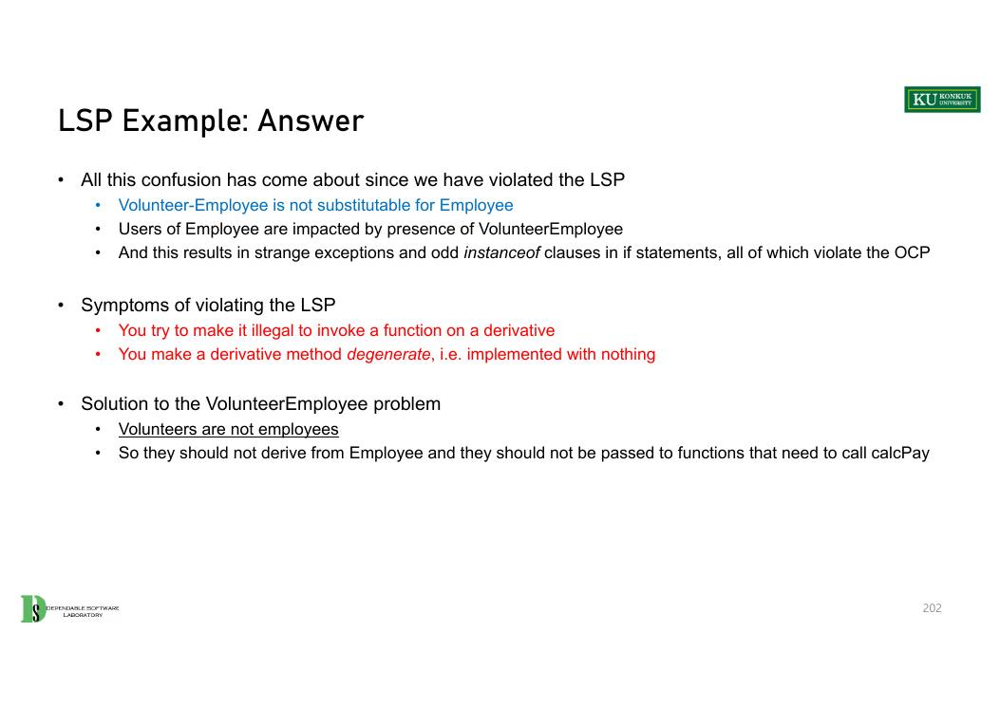

- All this confusion has come about since we have violated the LSP
  - Volunteer-Employee is not substitutable for Employee
  - Users of Employee are impacted by presence of VolunteerEmployee
  - And this results in strange exceptions and odd instanceof clauses in if statements, all of which violate the OCP

- Symptoms of violating the LSP
  - You try to make it illegal to invoke a function on a derivative
  - You make a derivative method degenerate, i.e. implemented with nothing

- Solution to the VolunteerEmployee problem
  - Volunteers are not employees
  - So they should not derive from Employee and they should not be passed to functions that need to call calcPay

---

## 203. The Liskov Substitution Principle

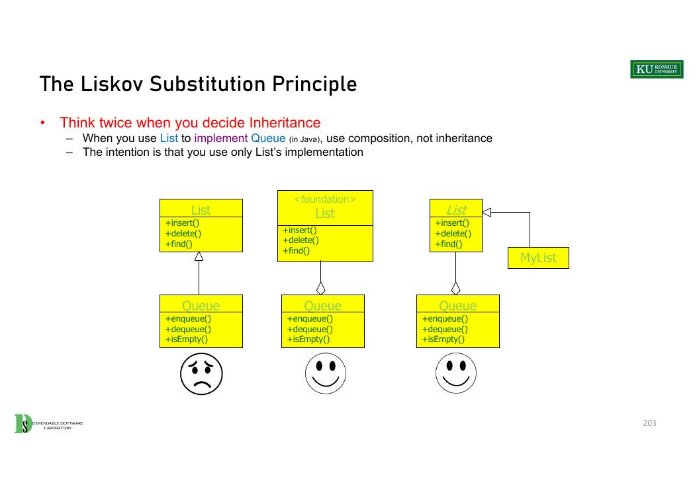

- Think twice when you decide Inheritance
  - When you use List to implement Queue (in Java), use composition, not inheritance
  - The intention is that you use only List’s implementation

&lt;foundation&gt;  
List · List · List  
\+insert() · +insert()  
\+delete() · +insert() · +delete()  
\+find() · +delete() · +find()  
\+find()  
MyList  

Queue · Queue · Queue  
\+enqueue() · +enqueue() · +enqueue()  
\+dequeue() · +dequeue() · +dequeue()  
\+isEmpty() · +isEmpty() · +isEmpty()  

---

## 204. 4\. The Interface Segregation Principle (ISP)

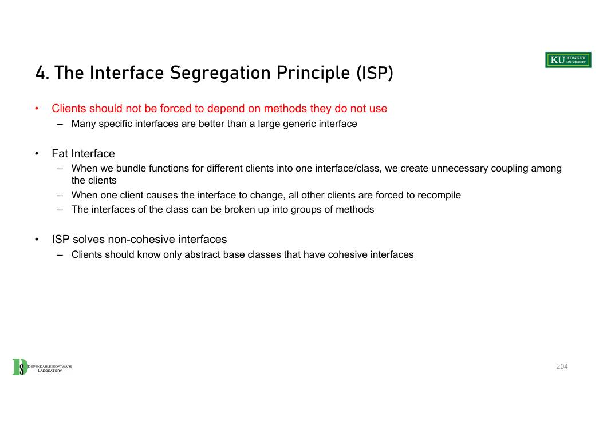

- Clients should not be forced to depend on methods they do not use
  - Many specific interfaces are better than a large generic interface

- Fat Interface
  - When we bundle functions for different clients into one interface/class, we create unnecessary coupling among the clients
  - When one client causes the interface to change, all other clients are forced to recompile
  - The interfaces of the class can be broken up into groups of methods

- ISP solves non-cohesive interfaces
  - Clients should know only abstract base classes that have cohesive interfaces

---

## 205. ISP Example: Original Design

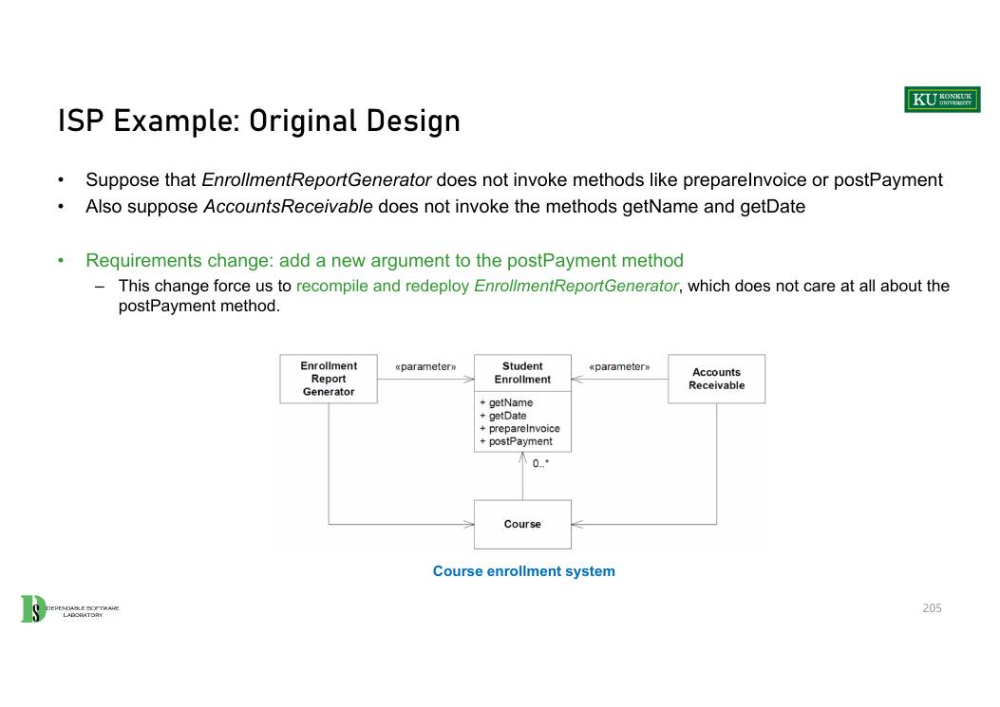

- Suppose that EnrollmentReportGenerator does not invoke methods like prepareInvoice or postPayment
- Also suppose AccountsReceivable does not invoke the methods getName and getDate

- Requirements change: add a new argument to the postPayment method
  - This change force us to recompile and redeploy EnrollmentReportGenerator, which does not care at all about the postPayment method.

Course enrollment system  

---

## 206. ISP Example: Better Design

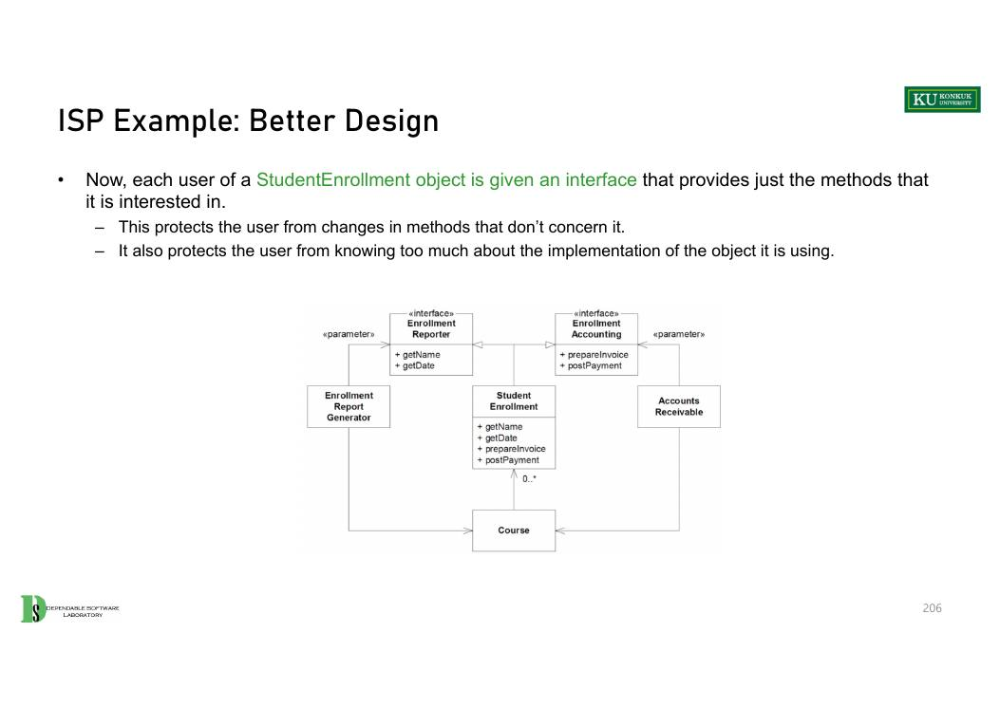

- Now, each user of a StudentEnrollment object is given an interface that provides just the methods that it is interested in.
  - This protects the user from changes in methods that don’t concern it.
  - It also protects the user from knowing too much about the implementation of the object it is using.

---

## 207. 5\. The Dependency Inversion Principle (DIP)

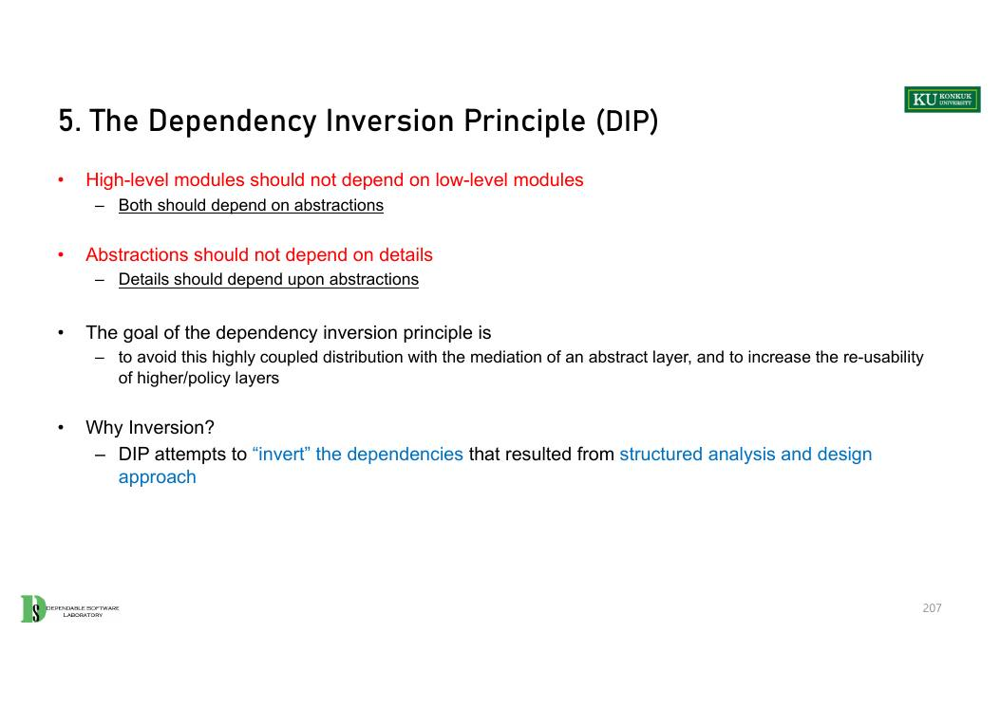

- High-level modules should not depend on low-level modules
  - Both should depend on abstractions

- Abstractions should not depend on details
  - Details should depend upon abstractions

- The goal of the dependency inversion principle is
  - to avoid this highly coupled distribution with the mediation of an abstract layer, and to increase the re-usability of higher/policy layers

- Why Inversion?
  - DIP attempts to “invert” the dependencies that resulted from structured analysis and design approach

---

## 208. Reminder - Procedural Design

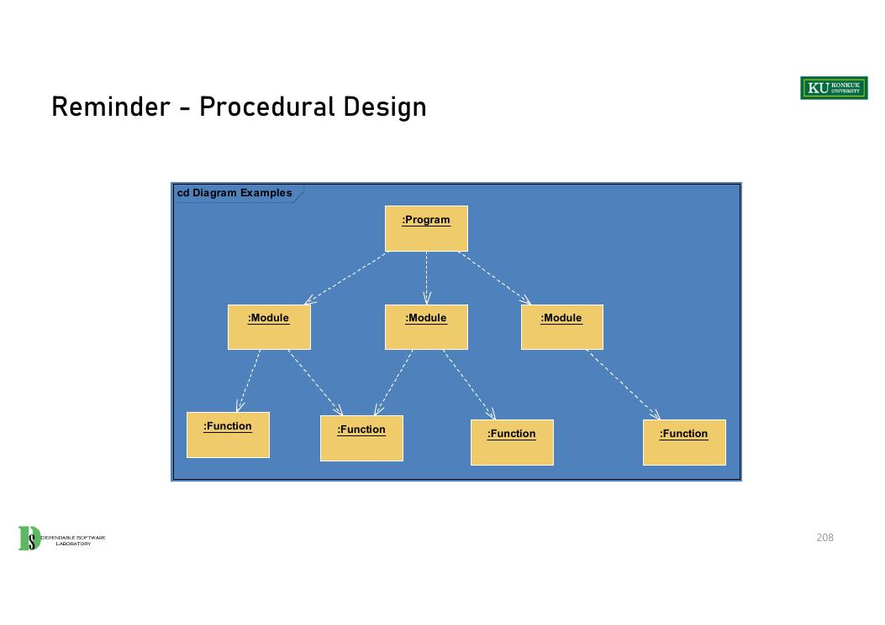

cd Diagram Examples  

:Program  

:Module · :Module · :Module  

:Function · :Function · :Function · :Function  

---

## 209. The Dependency Inversion Principle

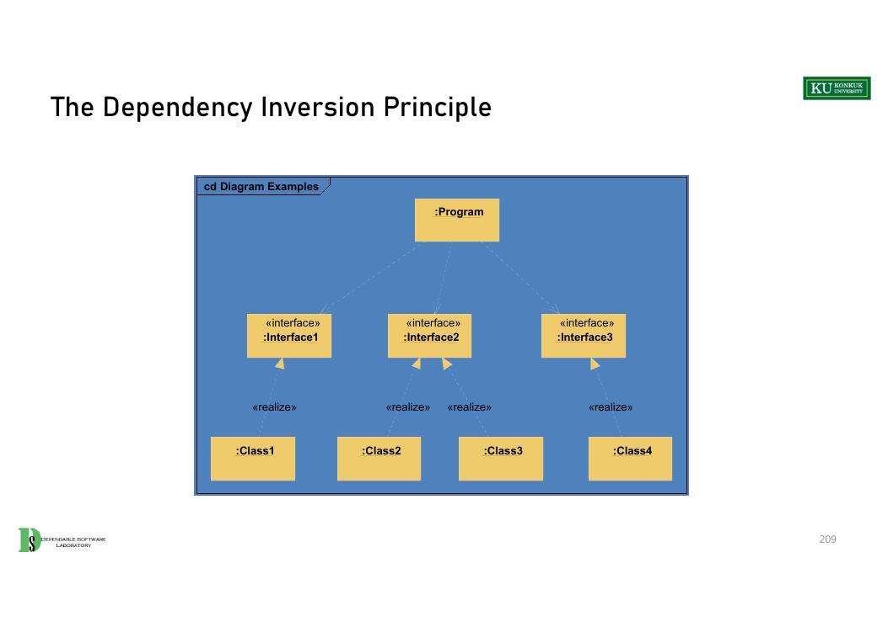

cd Diagram Examples  

:Program  

«interface» · «interface» · «interface»  
:Interface1 · :Interface2 · :Interface3  

«realize» · «realize» · «realize» · «realize»  

:Class1 · :Class2 · :Class3 · :Class4  

---

## 210. The Dependency Inversion Principle

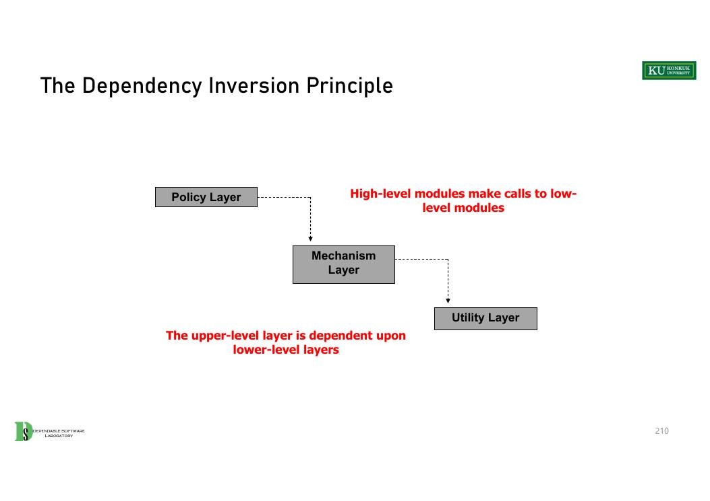

Policy Layer · High-level modules make calls to low-  
level modules  

Mechanism  
Layer  

Utility Layer  
The upper-level layer is dependent upon  
lower-level layers  

---

## 211. The Dependency Inversion Principle

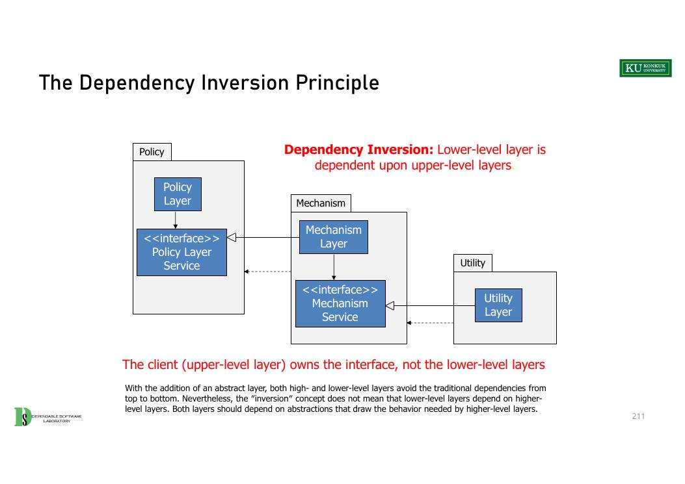

Policy · Dependency Inversion: Lower-level layer is  
dependent upon upper-level layers.  
Policy  
Layer · Mechanism  

Mechanism  
&lt;&lt;interface&gt;&gt; · Layer  
Policy Layer  
Service · Utility  

&lt;&lt;interface&gt;&gt;  
Mechanism · Utility  
Service · Layer  

The client (upper-level layer) owns the interface, not the lower-level layers  
With the addition of an abstract layer, both high- and lower-level layers avoid the traditional dependencies from  
top to bottom. Nevertheless, the ″inversion″ concept does not mean that lower-level layers depend on higher-  
level layers. Both layers should depend on abstractions that draw the behavior needed by higher-level layers.  

---

## 212. The Dependency Inversion Principle

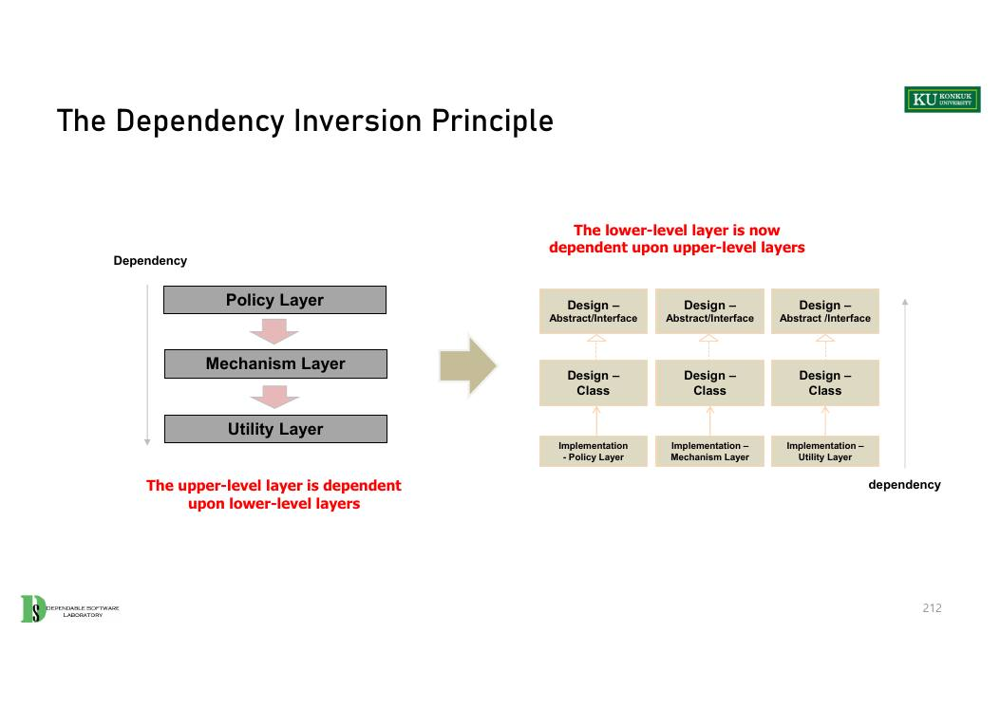

The lower-level layer is now  
dependent upon upper-level layers  
Dependency  

Policy Layer · Design – · Design – · Design –  
Abstract/Interface · Abstract/Interface · Abstract /Interface  

Mechanism Layer  
Design – · Design – · Design –  
Class · Class · Class  

Utility Layer  
Implementation · Implementation – · Implementation –  
- Policy Layer · Mechanism Layer · Utility Layer

The upper-level layer is dependent · dependency  
upon lower-level layers  

---

## 213. SOLID Summary

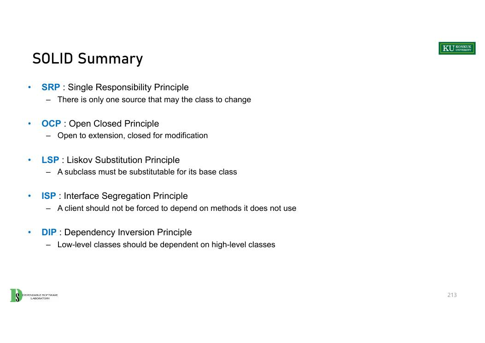

- SRP : Single Responsibility Principle
  - There is only one source that may the class to change

- OCP : Open Closed Principle
  - Open to extension, closed for modification

- LSP : Liskov Substitution Principle
  - A subclass must be substitutable for its base class

- ISP : Interface Segregation Principle
  - A client should not be forced to depend on methods it does not use

- DIP : Dependency Inversion Principle
  - Low-level classes should be dependent on high-level classes

---

## 214. (이미지 슬라이드)

---

[← 이전: OOD – Class Diagram](10_OOD_Class_Diagram.md) · [← 목차](README.md) · [다음: OOD – GRASP, Design Patterns →](12_OOD_GRASP_Design_Patterns.md)
