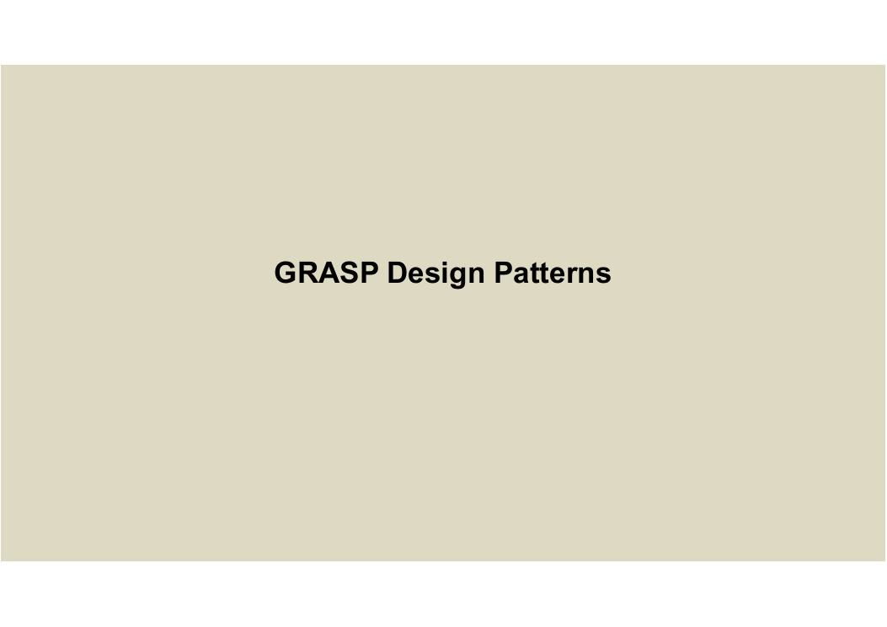
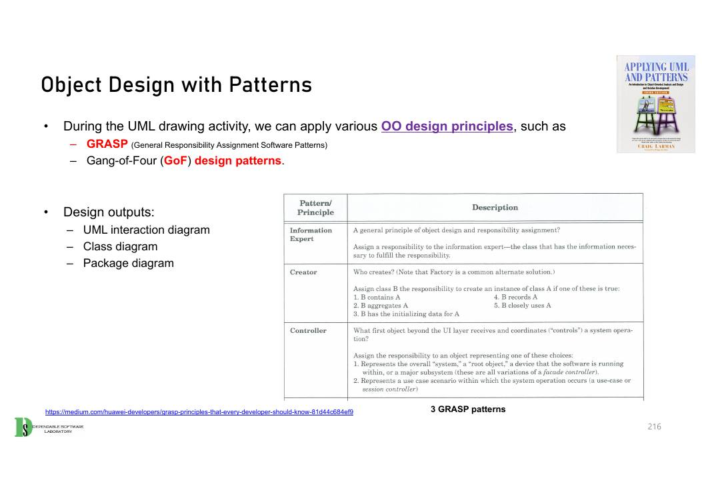
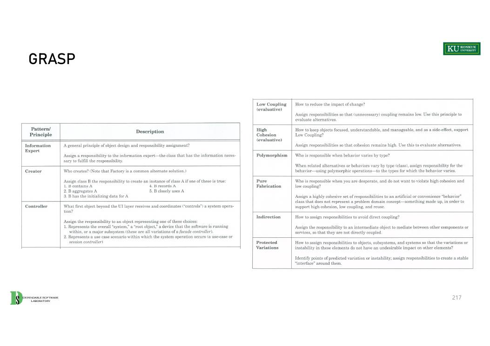
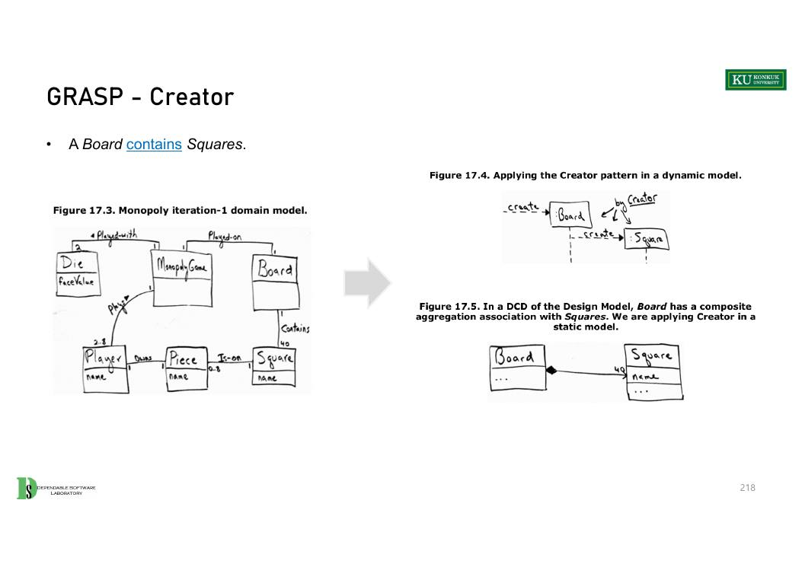
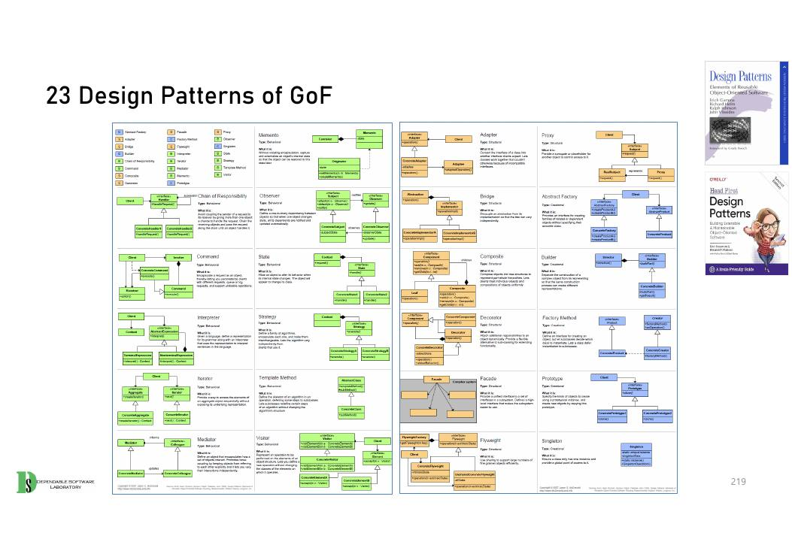

# OOD – GRASP, Design Patterns

> OOAD 객체지향개발방법론 · 슬라이드 215–220 · 원본: [PDF](../../original/2026%20AA%204차%20-%20OOAD%20(20261126).pdf)

[← 이전: OOD – SOLID](11_OOD_SOLID.md) · [← 목차](README.md) · [다음: Practice #4 OOI – Visibility, Mapping Designs to Code →](13_Practice4_OOI.md)

## 슬라이드 목록

- [215. GRASP Design Patterns](#s215)
- [216. Object Design with Patterns](#s216)
- [217. GRASP](#s217)
- [218. GRASP - Creator](#s218)
- [219. 23 Design Patterns of GoF](#s219)
- [220. (이미지 슬라이드)](#s220)

---

## 215. GRASP Design Patterns

---

## 216. Object Design with Patterns

- During the UML drawing activity, we can apply various OO design principles, such as
  - GRASP (General Responsibility Assignment Software Patterns)
  - Gang-of-Four (GoF) design patterns.

- Design outputs:
  - UML interaction diagram
  - Class diagram
  - Package diagram

https://medium.com/huawei-developers/grasp-principles-that-every-developer-should-know-81d44c684ef9 · 3 GRASP patterns  

---

## 217. GRASP

---

## 218. GRASP - Creator

- A Board contains Squares.

---

## 219. 23 Design Patterns of GoF

---

## 220. (이미지 슬라이드)

---

[← 이전: OOD – SOLID](11_OOD_SOLID.md) · [← 목차](README.md) · [다음: Practice #4 OOI – Visibility, Mapping Designs to Code →](13_Practice4_OOI.md)
