# Practice #4 OOI – Visibility, Mapping Designs to Code

> OOAD 객체지향개발방법론 · 슬라이드 221–242 · 원본: [PDF](../../original/2026%20AA%204차%20-%20OOAD%20(20261126).pdf)

[← 이전: OOD – GRASP, Design Patterns](12_OOD_GRASP_Design_Patterns.md) · [← 목차](README.md) · [다음: OOAD Summary →](14_OOAD_Summary.md)

## 슬라이드 목록

- [221. Practice #4](#s221)
- [222. [Activity #4] OOI](#s222)
- [223. Designing for Visibility](#s223)
- [224. Visibility between Objects](#s224)
- [225. Visibility](#s225)
- [226. 1\. Attribute Visibility](#s226)
- [227. 2\. Parameter Visibility](#s227)
- [228. Parameter to Attribute Visibility](#s228)
- [229. 3\. Local Visibility](#s229)
- [230. 4\. Global Visibility](#s230)
- [231. (이미지 슬라이드)](#s231)
- [232. Mapping Designs to Code](#s232)
- [233. Mapping Designs to Code](#s233)
- [234. Creating Class Definitions from DCDs](#s234)
- [235. enterItem()](#s235)
- [236. Order of Implementation](#s236)
- [237. Example: the NextGen POS Program Solution](#s237)
- [238. public class Register](#s238)
- [239. Example: POS Domain Model Packages](#s239)
- [240. (이미지 슬라이드)](#s240)
- [241. Deployment View of POS](#s241)
- [242. (이미지 슬라이드)](#s242)

---

## 221. Practice #4

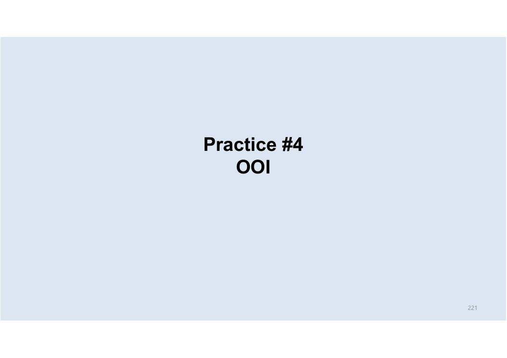

OOI  

---

## 222. [Activity #4] OOI

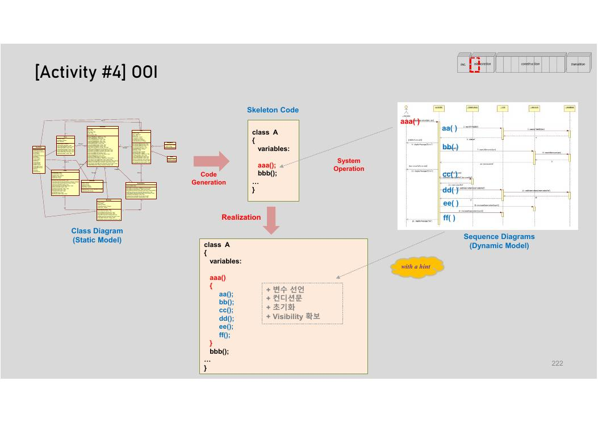

Skeleton Code  
copy of  

aaa( )  
Database  
1  

aa( )  
class A  
-Title: Map  
\+Item: Map · Title  
\+Borrower: Map  
1..\* · +Loan: Map · +name: String  
\+Reservation: Map · +isbn: ISBNType  
\+price: Flot  
Item · +searchTitleDB(isbn: ISBNType): Title  

{  
\+loanPeriod: Integer  
\+addTtileDB(titleRef: Title): Void · +numOfItem: Integer  
\+itemID: String · +removeTitleDB(titleRef: Title): Void  
\+available: Boolean · +availalbeCount: Integer  
\+updateTitleDB(titleRef: Title): Void · +reservationCount: Integer  
\+lost: Boolean · +searchItemDB(itemID: String): Item  
Magazine  

bb( )  
\+isBorrowed(): Boolean · +addItemDB(itemRef: Item): Void · +increaseAvailableCount(): Void  
Manages  
\+setLost(flag: Boolean): Void · +removeItemDB(itemRef: Item): Void · 1 · +decreaseAvailableCount(): Void · +publishCycle: String  
\*  

variables:  
\+searchItem(itemID: String): Item · +updateItemDV(itemRef: Item): Void · +increaseNumOfItem(): Void · +month: String  
Controller · \* · 1  
\+addItem(itemRef: Item): Void · +searchBorrowerDB(ssn: String): Borrower · Manages · +decreaseNumOfItem(): Void  
\+updateItem(itemRef: Item): Void · +addBorrowerDB(borrowerRef: Borrower): Void · +getNumOfItem(): Integer  
\+mkaeReservation() · +removeItem(itemRef: Item): Void · +removeBorrowerDB(borrowerRef: Borrower): Void · +getPrice(): Float  
\+removeReservation() · +setAvailable(flag: Boolean): Void · +updateBorrowerDB(borrowerRef: Borrower): Void · +getLoanPeriod(): Integer  
\+LendItem() · +getTitle(itemRef: Item): Title · +searchLoanDB(itemID: String): Loan · +getNewItemID(): String  
\+returnItem() · +searchLoanDB(borrwerRef: Borrower): Loan · +searchTitle(isbn: ISBNType): Title  
\+getReplacementFee() · +addLoanDB(loanRef: Loan): Void · +addTitle(titleRef: Title): Void  
\+addTitle() · 1 · +updateLoanDB(loanRef: Loan): Void · +removeTitle(titleRef: Title): Void · Book  

System  
\+removeTitle() · +searchReservationDB(isbn: ISBNType): Reservation · +updateTitle(titleRef: Title): Void  
\+updateTitle() · +searchReservationDB(titleRef: Title): Reservation · +isReserved(titleRef: Title): Boolean · +author: String  
\+addItem() · +searchReservationDB(borrowerRef: Borrower): Resrvation[] · +increaseReservationCount(): Void  

aaa();  
\+removeItem() · Refer To · +addReservationDB(reservationRef: Reservation): Void · +decreaseReservationCount(): Void  
\+updateItem() · 1 +removeReservationDB(reservationrRef: Reservation): Void  
Manages · +validateDB(userID: String, password: String): Void  
\+addBorrower()  

Operation  
\+removeBorrower() · 1  
\+updateBorrower() · 0..1  
\* · 1 · 1  
\+log-In() · Manages  
\+1  

bbb();  
\+log-Out()  

cc( )  
Loan  

Code  
\+countLoans()  
\+checkInDate: Date · Manages · Refer to  
\+checkOutDate: Date  
\+lateReturnFee: Integer  
\+validLoan: Boolean  
\+LoanCount: Long · \*  

\+setValidLoan(flag: Boolean): Void  
\+calculateLateReturnFee(loanPeriod: Integer): Integer  
\+calculateReplacementFee(price: Float): Integer  
\+searchLoan(itemID: String): Loan  
\+searchLoan(borrowerRef: Borrower): Loan  
\+name: String  
\+userId: String  
Librarian  

\+password: String  
Manages  
\+\*  

\+reserveDate: Date  
0..\*  

Reservation  
Generation · …  
} · dd( )  
\+addLoan(loanRef: Loan): Void · +logInFlag: Boolean  
\+searchReservation(isbn: ISBNType): Reservation  
\+updateLoan(loanRef: Loan): Void  
\+validate(userI: String, password: String) · +searchReservation(titleRef: Title): Reservation  
\+decreaseLoanCount(): Void  
\+logOut(userID: String) · +searchReservation(borrowerRef: Borrower): Reservation[]  
\+increaseLoanCount(): Void  
\+addReservation(reservationRef: Reservation): Void  
\+getNumOfLoan(): Void  
\+removeReservation(reservationRef: Reservation): Void  
\+getItem(LoanRef: Loan): Item  
\+printNotifyCard(titleRef: Title): Void  
\+printCard(resrvationRef: Reservation): Void  
\*  
0..\* · +getTitle(reservationRef: Reservation): Title  

ee( )  
Borrower  
0..\*  
\+name: String  
\+ssn: String  
\+address: String  
\+reservationCount: Integer  
\+loanCount: Integer  
Has  
\+increaseLoanCount(): Void · Has  
1 · +decreaseLoanCount(): Void · 1  
\+increaseReservationCount(): Void  
\+decreaseReservationCount(): Void  

Realization · ff( )  
\+searchBorrower(ssn: String): Borrower  
\+addBorrower(borrowerRef: Borrower): Void  
\+removeBorrower(ssn: String): Void  
\+updateBorrower(borrwerRef: Borrower): Void  

Class Diagram  
(Static Model) · Sequence Diagrams  
class A · (Dynamic Model)  
{  
variables:  
with a hint  
aaa()  
{  
\+ 변수 선언  
aa();  
bb(); · + 컨디션문  
cc(); · + 초기화  
dd(); · + Visibility 확보  
ee();  
ff();  
}  
bbb();  
…  
}  

---

## 223. Designing for Visibility

---

## 224. Visibility between Objects

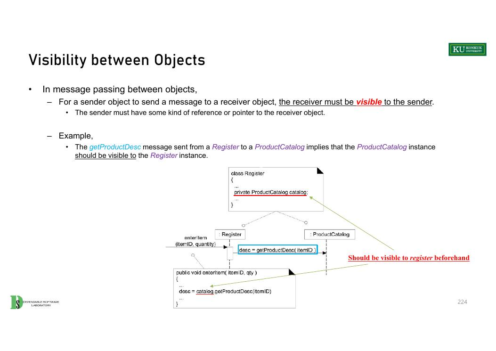

- In message passing between objects,
  - For a sender object to send a message to a receiver object, the receiver must be visible to the sender.
    - The sender must have some kind of reference or pointer to the receiver object.

  - Example,
    - The getProductDesc message sent from a Register to a ProductCatalog implies that the ProductCatalog instance should be visible to the Register instance.

Should be visible to register beforehand  

---

## 225. Visibility

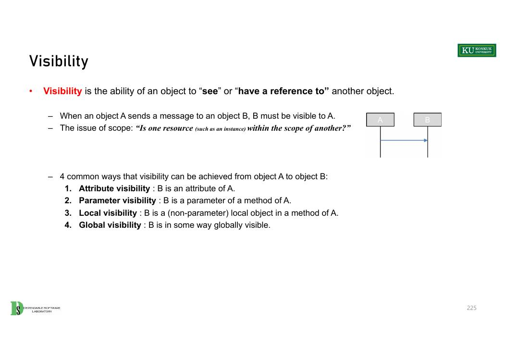

- Visibility is the ability of an object to “see” or “have a reference to” another object.

  - When an object A sends a message to an object B, B must be visible to A.
  - The issue of scope: “Is one resource (such as an instance) within the scope of another?”

  - 4 common ways that visibility can be achieved from object A to object B: 1. Attribute visibility : B is an attribute of A. 2. Parameter visibility : B is a parameter of a method of A. 3. Local visibility : B is a (non-parameter) local object in a method of A. 4. Global visibility : B is in some way globally visible.

---

## 226. 1\. Attribute Visibility

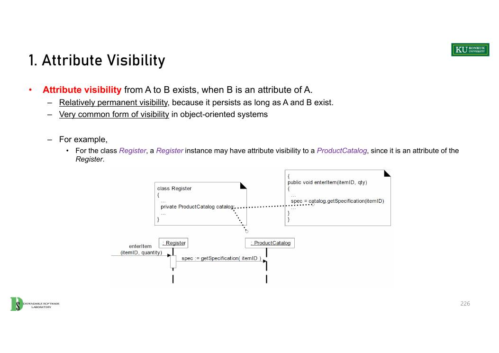

- Attribute visibility from A to B exists, when B is an attribute of A.
  - Relatively permanent visibility, because it persists as long as A and B exist.
  - Very common form of visibility in object-oriented systems

  - For example,
    - For the class Register, a Register instance may have attribute visibility to a ProductCatalog, since it is an attribute of the Register.

---

## 227. 2\. Parameter Visibility

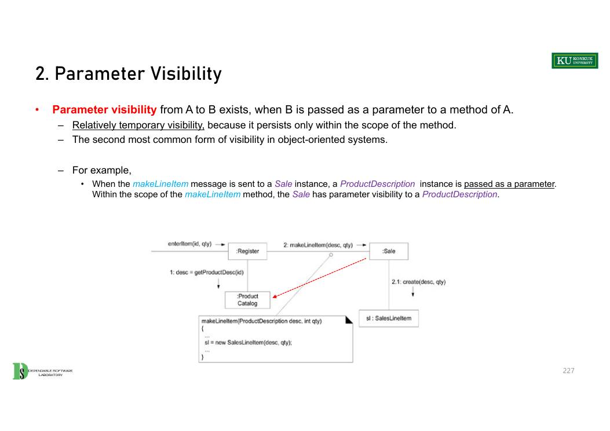

- Parameter visibility from A to B exists, when B is passed as a parameter to a method of A.
  - Relatively temporary visibility, because it persists only within the scope of the method.
  - The second most common form of visibility in object-oriented systems.

  - For example,
    - When the makeLineItem message is sent to a Sale instance, a ProductDescription instance is passed as a parameter. Within the scope of the makeLineItem method, the Sale has parameter visibility to a ProductDescription.

---

## 228. Parameter to Attribute Visibility

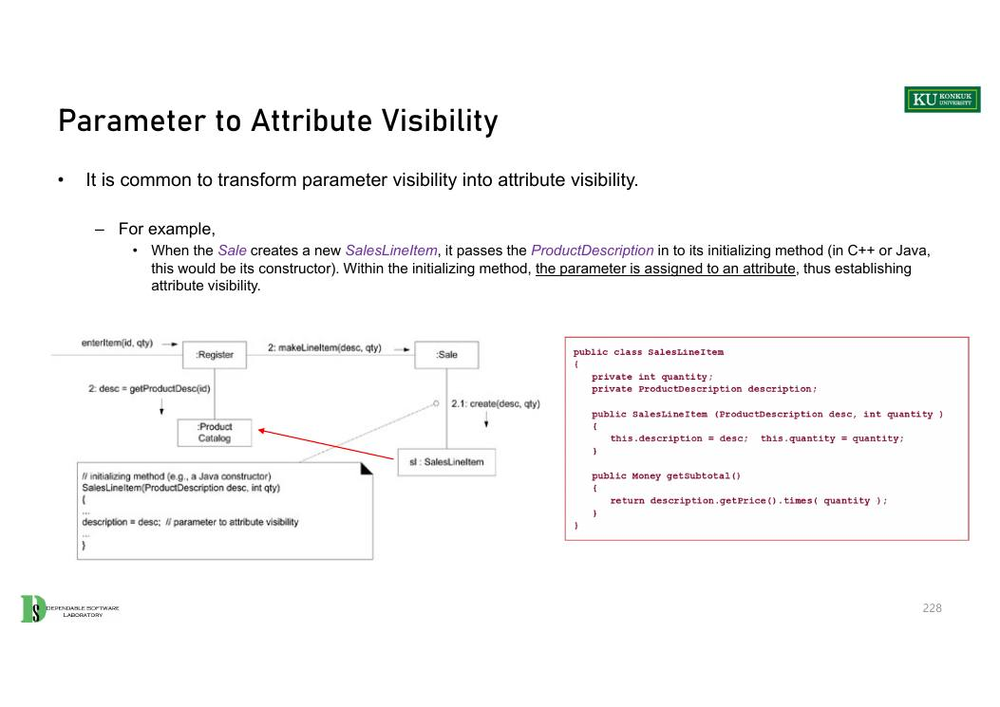

- It is common to transform parameter visibility into attribute visibility.

  - For example,
    - When the Sale creates a new SalesLineItem, it passes the ProductDescription in to its initializing method (in C++ or Java, this would be its constructor). Within the initializing method, the parameter is assigned to an attribute, thus establishing attribute visibility.

---

## 229. 3\. Local Visibility

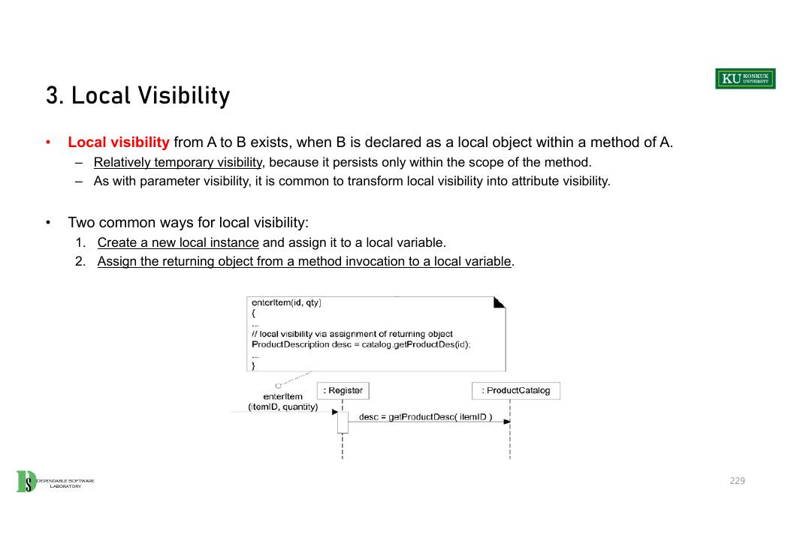

- Local visibility from A to B exists, when B is declared as a local object within a method of A.
  - Relatively temporary visibility, because it persists only within the scope of the method.
  - As with parameter visibility, it is common to transform local visibility into attribute visibility.

- Two common ways for local visibility: 1. Create a new local instance and assign it to a local variable. 2. Assign the returning object from a method invocation to a local variable.

---

## 230. 4\. Global Visibility

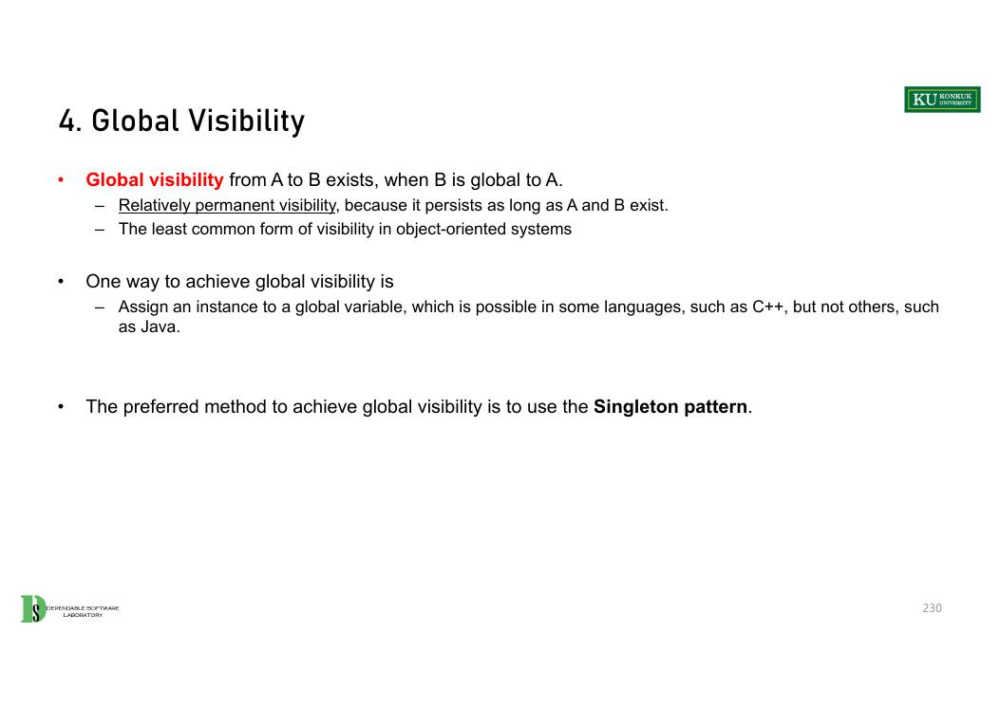

- Global visibility from A to B exists, when B is global to A.
  - Relatively permanent visibility, because it persists as long as A and B exist.
  - The least common form of visibility in object-oriented systems

- One way to achieve global visibility is
  - Assign an instance to a global variable, which is possible in some languages, such as C++, but not others, such as Java.

- The preferred method to achieve global visibility is to use the Singleton pattern.

---

## 231. (이미지 슬라이드)

---

## 232. Mapping Designs to Code

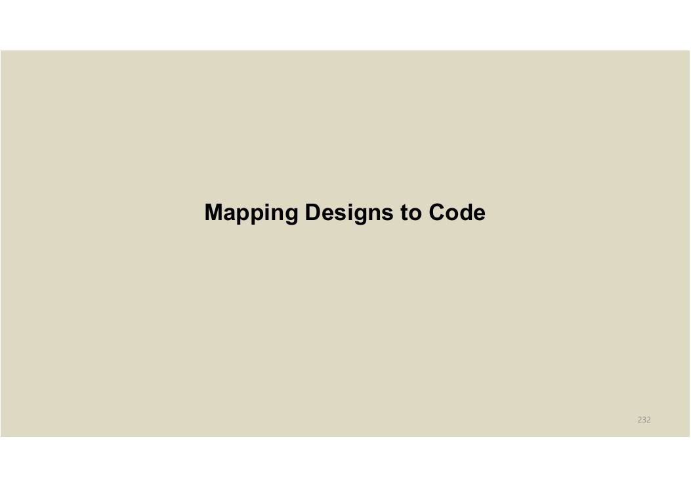

---

## 233. Mapping Designs to Code

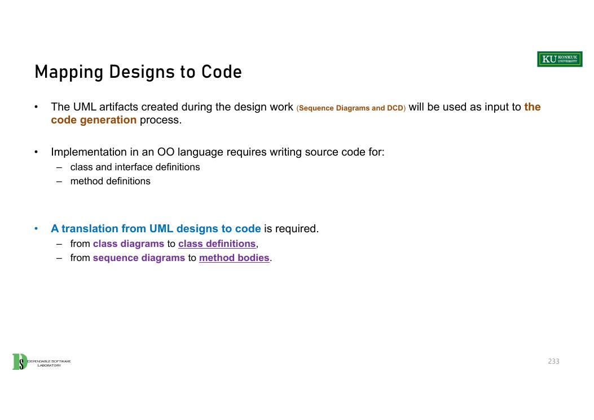

- The UML artifacts created during the design work (Sequence Diagrams and DCD) will be used as input to the code generation process.

- Implementation in an OO language requires writing source code for:
  - class and interface definitions
  - method definitions

- A translation from UML designs to code is required.
  - from class diagrams to class definitions,
  - from sequence diagrams to method bodies.

---

## 234. Creating Class Definitions from DCDs

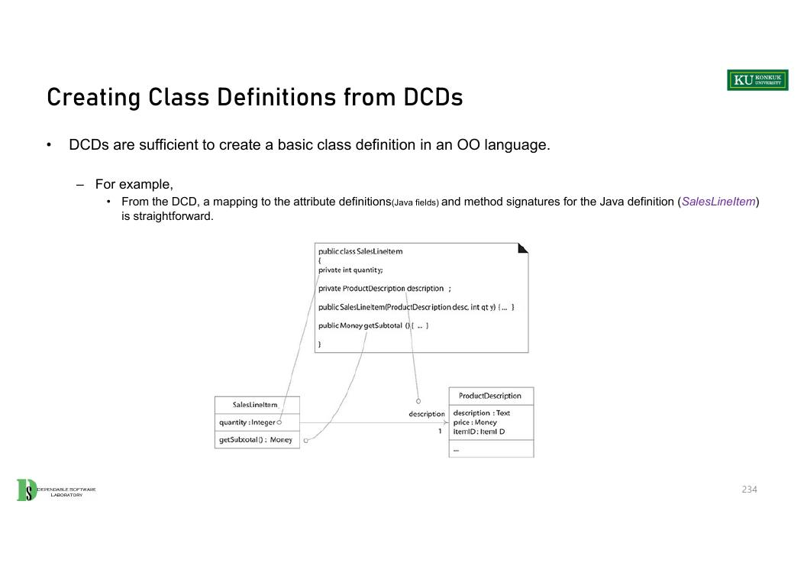

- DCDs are sufficient to create a basic class definition in an OO language.

  - For example,
    - From the DCD, a mapping to the attribute definitions(Java fields) and method signatures for the Java definition (SalesLineItem) is straightforward.

---

## 235. enterItem()

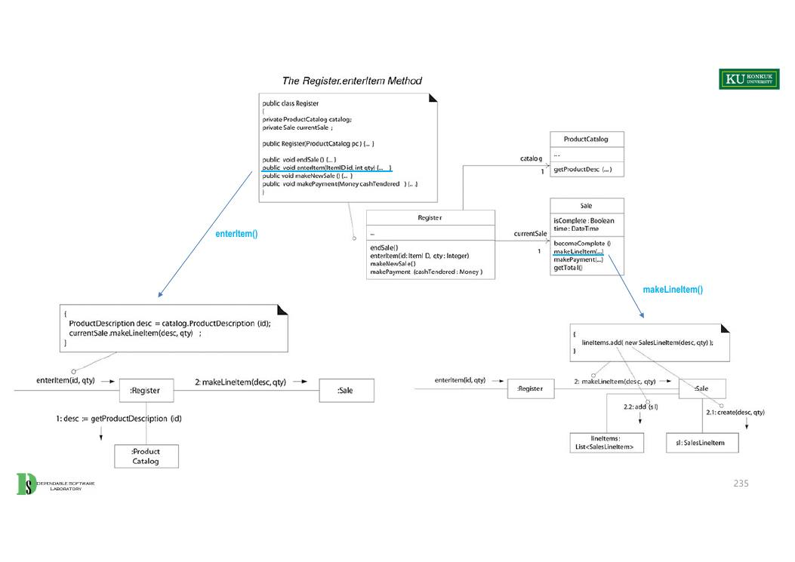

makeLineItem()  

---

## 236. Order of Implementation

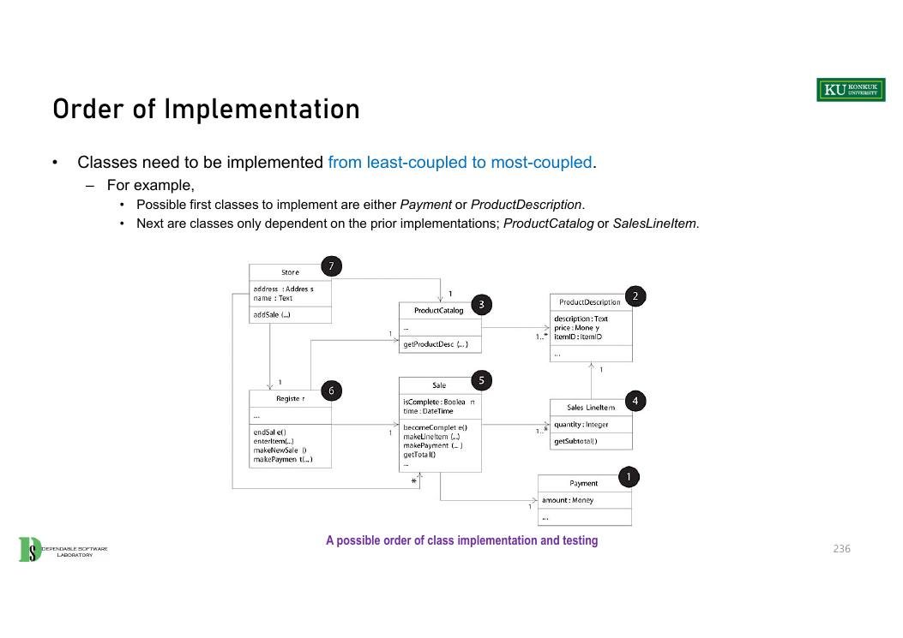

- Classes need to be implemented from least-coupled to most-coupled.
  - For example,
    - Possible first classes to implement are either Payment or ProductDescription.
    - Next are classes only dependent on the prior implementations; ProductCatalog or SalesLineItem.

A possible order of class implementation and testing  

---

## 237. Example: the NextGen POS Program Solution

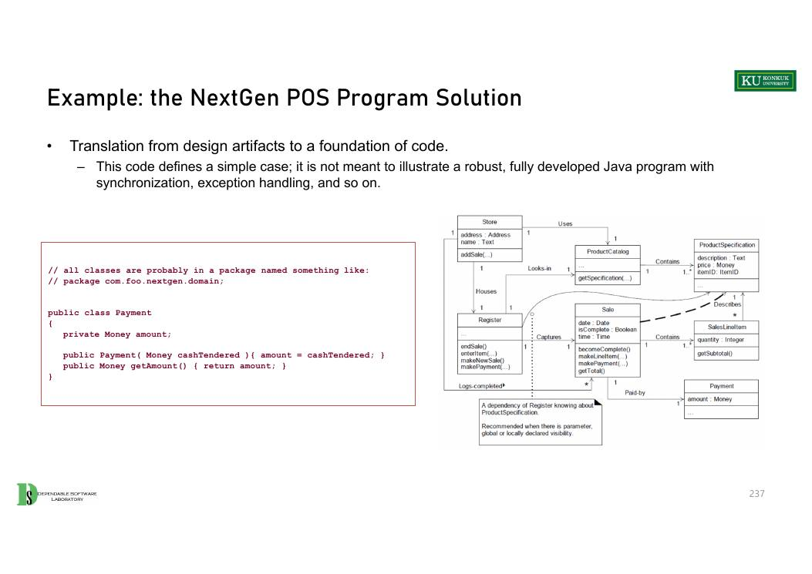

- Translation from design artifacts to a foundation of code.
  - This code defines a simple case; it is not meant to illustrate a robust, fully developed Java program with synchronization, exception handling, and so on.

// all classes are probably in a package named something like:  
// package com.foo.nextgen.domain;  

public class Payment  
{  
private Money amount;  

public Payment( Money cashTendered ){ amount = cashTendered; }  
public Money getAmount() { return amount; }  
}  

---

## 238. public class Register

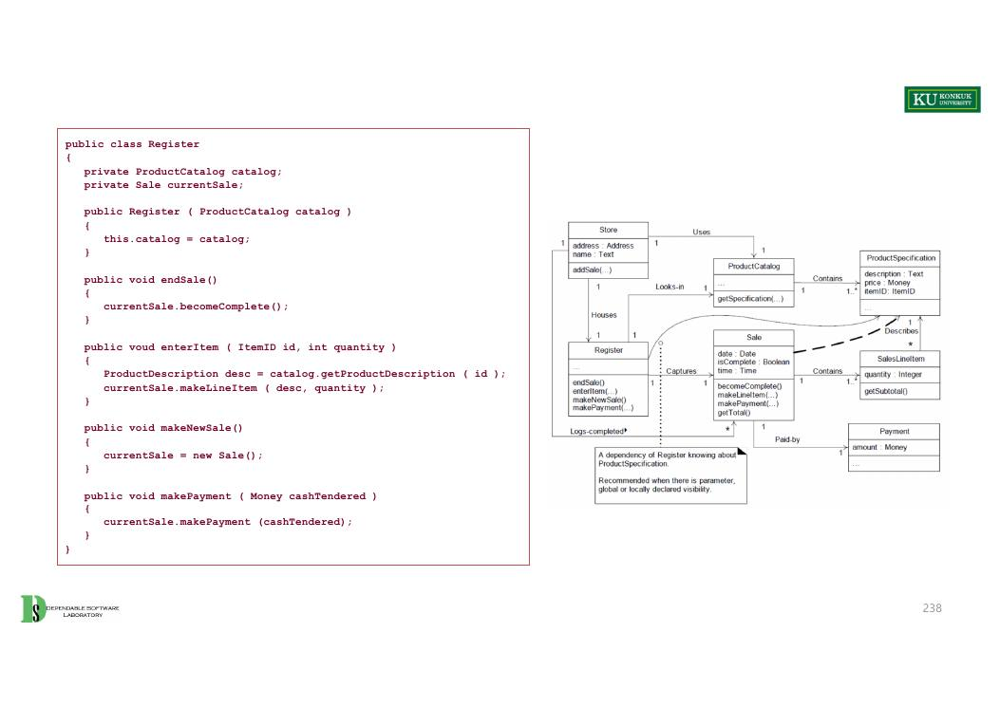

{  
private ProductCatalog catalog;  
private Sale currentSale;  

public Register ( ProductCatalog catalog )  
{  
this.catalog = catalog;  
}  

public void endSale()  
{  
currentSale.becomeComplete();  
}  

public voud enterItem ( ItemID id, int quantity )  
{  
ProductDescription desc = catalog.getProductDescription ( id );  
currentSale.makeLineItem ( desc, quantity );  
}  

public void makeNewSale()  
{  
currentSale = new Sale();  
}  

public void makePayment ( Money cashTendered )  
{  
currentSale.makePayment (cashTendered);  
}  
}  

---

## 239. Example: POS Domain Model Packages

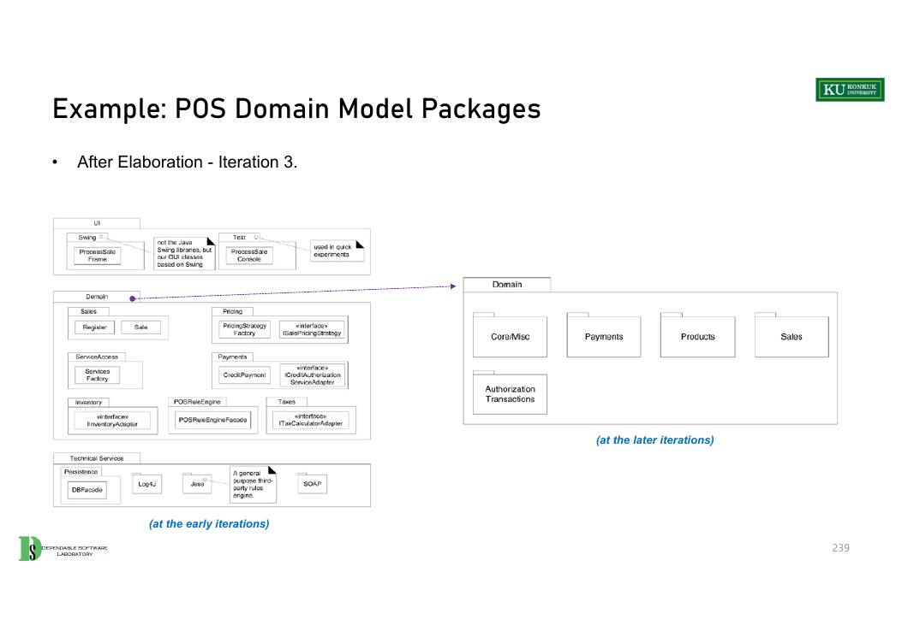

- After Elaboration - Iteration 3.

(at the later iterations)  

(at the early iterations)  

---

## 240. (이미지 슬라이드)

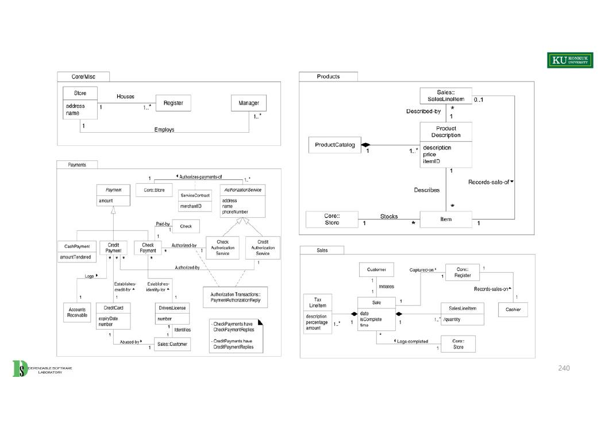

---

## 241. Deployment View of POS

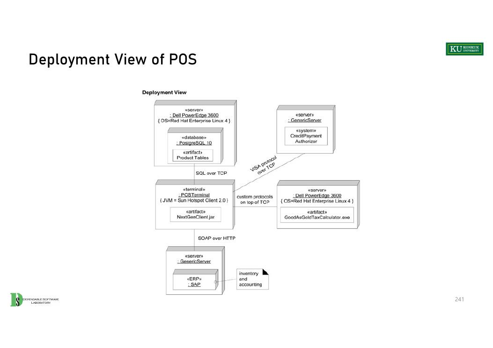

---

## 242. (이미지 슬라이드)

---

[← 이전: OOD – GRASP, Design Patterns](12_OOD_GRASP_Design_Patterns.md) · [← 목차](README.md) · [다음: OOAD Summary →](14_OOAD_Summary.md)
