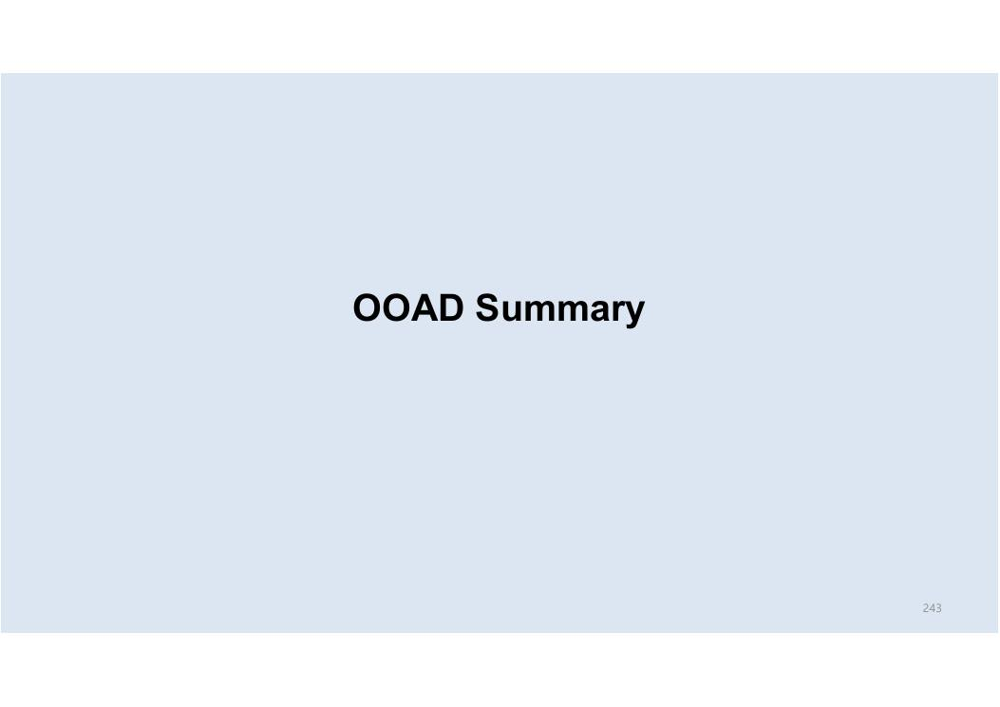
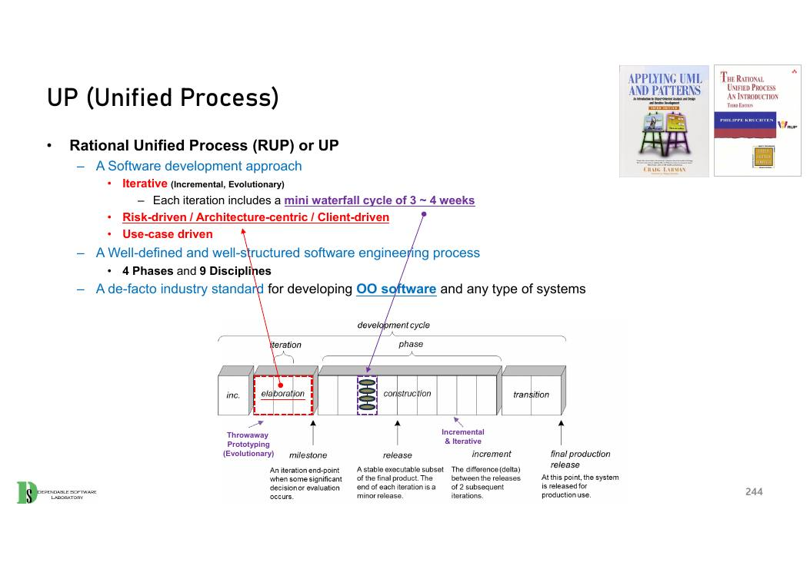
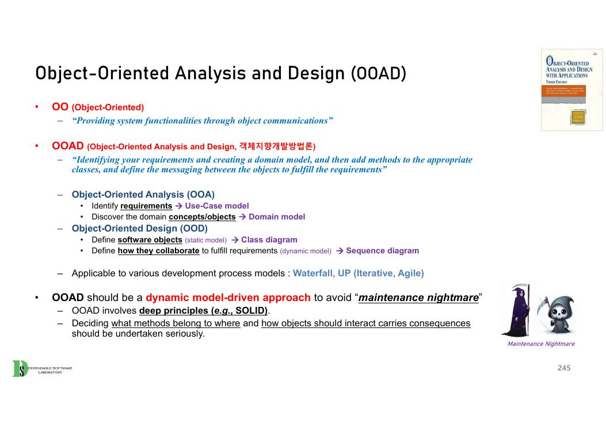
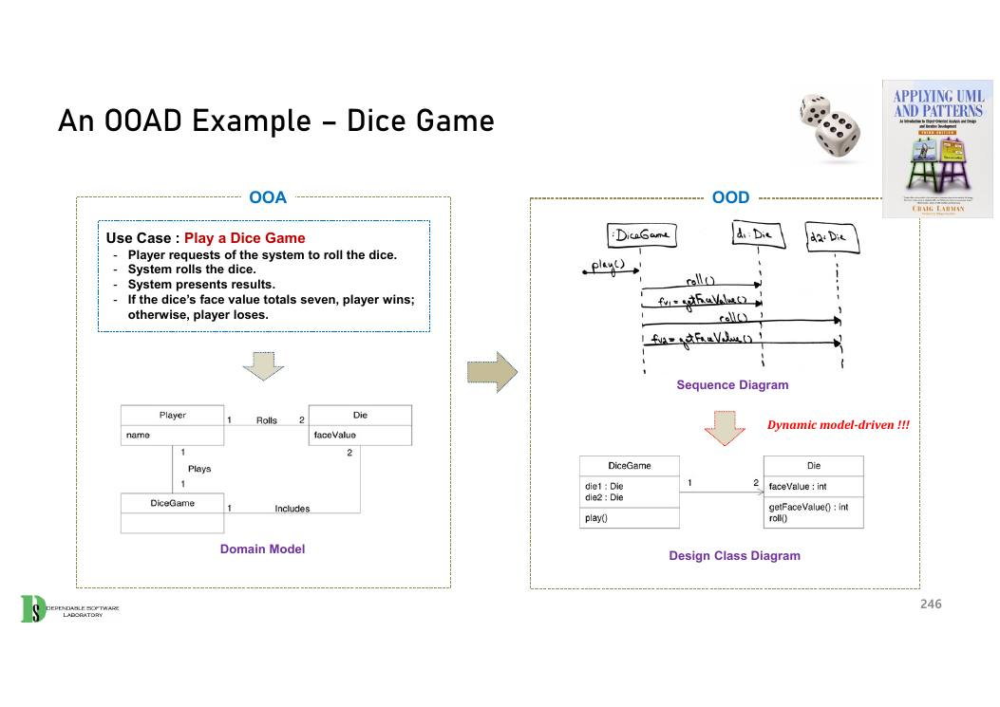
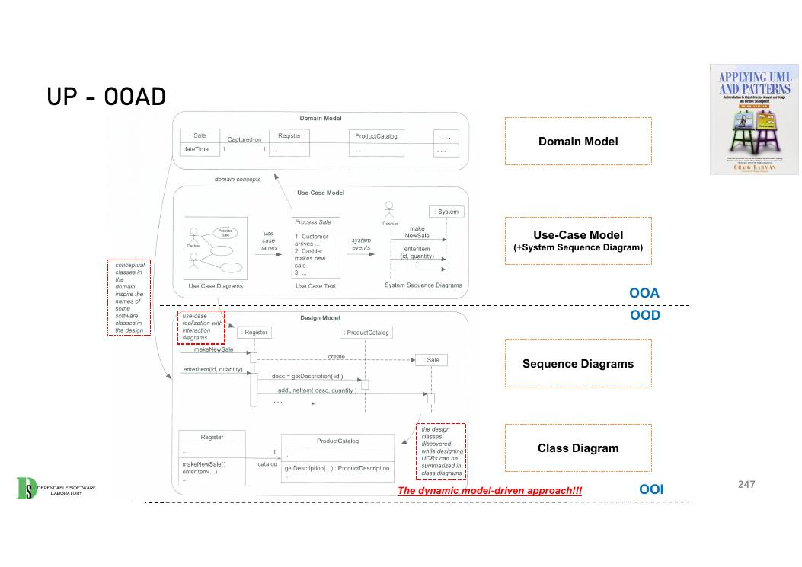
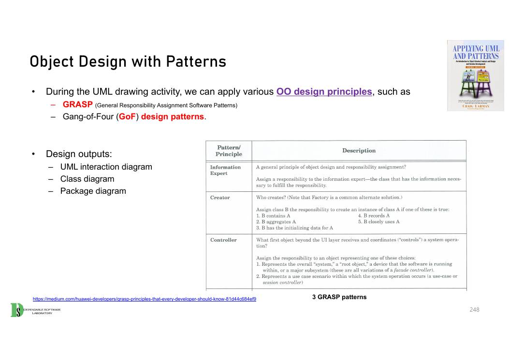
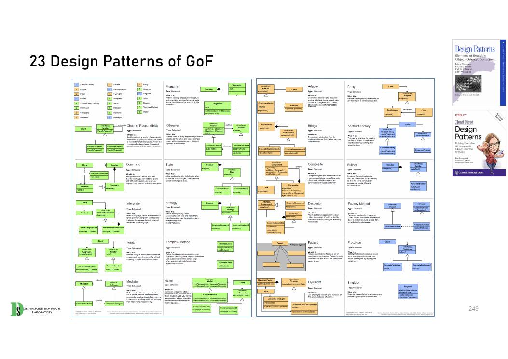
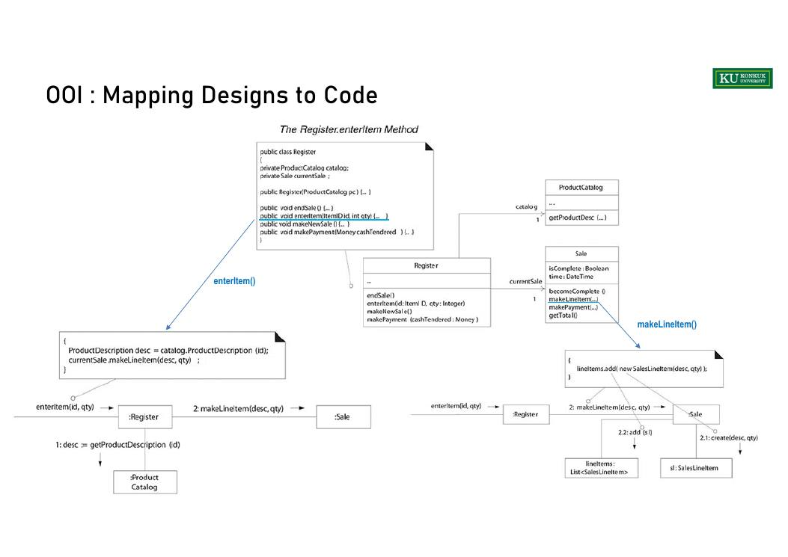
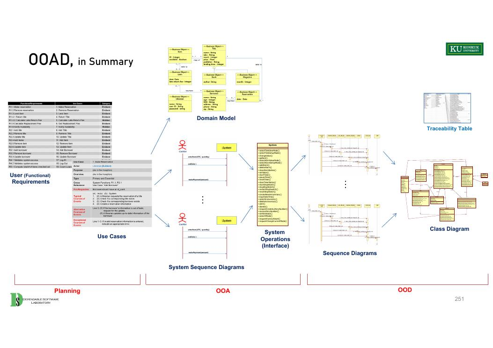

# OOAD Summary

> OOAD 객체지향개발방법론 · 슬라이드 243–252 · 원본: [PDF](../../original/2026%20AA%204차%20-%20OOAD%20(20261126).pdf)

[← 이전: Practice #4 OOI – Visibility, Mapping Designs to Code](13_Practice4_OOI.md) · [← 목차](README.md) · [다음: The UP Example – LMS (Library Management System) →](15_UP_Example_LMS.md)

## 슬라이드 목록

- [243. OOAD Summary](#s243)
- [244. UP (Unified Process)](#s244)
- [245. Object-Oriented Analysis and Design (OOAD)](#s245)
- [246. An OOAD Example – Dice Game](#s246)
- [247. UP - OOAD](#s247)
- [248. Object Design with Patterns](#s248)
- [249. 23 Design Patterns of GoF](#s249)
- [250. OOI : Mapping Designs to Code](#s250)
- [251. OOAD, in Summary](#s251)
- [252. (이미지 슬라이드)](#s252)

---

## 243. OOAD Summary

---

## 244. UP (Unified Process)

- Rational Unified Process (RUP) or UP
  - A Software development approach
    - Iterative (Incremental, Evolutionary)
      - Each iteration includes a mini waterfall cycle of 3 ~ 4 weeks
    - Risk-driven / Architecture-centric / Client-driven
    - Use-case driven
  - A Well-defined and well-structured software engineering process
    - 4 Phases and 9 Disciplines
  - A de-facto industry standard for developing OO software and any type of systems

Throwaway · Incremental  
Prototyping · &amp; Iterative  
(Evolutionary)  

---

## 245. Object-Oriented Analysis and Design (OOAD)

- OO (Object-Oriented)
  - “Providing system functionalities through object communications”

- OOAD (Object-Oriented Analysis and Design, 객체지향개발방법론)
  - “Identifying your requirements and creating a domain model, and then add methods to the appropriate classes, and define the messaging between the objects to fulfill the requirements”

  - Object-Oriented Analysis (OOA)
    - Identify requirements → Use-Case model
    - Discover the domain concepts/objects → Domain model
  - Object-Oriented Design (OOD)
    - Define software objects (static model) → Class diagram
    - Define how they collaborate to fulfill requirements (dynamic model) → Sequence diagram

  - Applicable to various development process models : Waterfall, UP (Iterative, Agile)

- OOAD should be a dynamic model-driven approach to avoid “maintenance nightmare”
  - OOAD involves deep principles (e.g., SOLID).
  - Deciding what methods belong to where and how objects should interact carries consequences should be undertaken seriously. Maintenance Nightmare

---

## 246. An OOAD Example – Dice Game

OOA · OOD  

Use Case : Play a Dice Game  
- Player requests of the system to roll the dice.
- System rolls the dice.
- System presents results.
- If the dice’s face value totals seven, player wins; otherwise, player loses.

Sequence Diagram  

Dynamic model-driven !!!  

Domain Model · Design Class Diagram  

---

## 247. UP - OOAD

Domain Model  

Use-Case Model  
(+System Sequence Diagram)  

OOA  
OOD  

Sequence Diagrams  

Class Diagram  

The dynamic model-driven approach!!! · OOI  

---

## 248. Object Design with Patterns

- During the UML drawing activity, we can apply various OO design principles, such as
  - GRASP (General Responsibility Assignment Software Patterns)
  - Gang-of-Four (GoF) design patterns.

- Design outputs:
  - UML interaction diagram
  - Class diagram
  - Package diagram

https://medium.com/huawei-developers/grasp-principles-that-every-developer-should-know-81d44c684ef9 · 3 GRASP patterns  

---

## 249. 23 Design Patterns of GoF

---

## 250. OOI : Mapping Designs to Code

enterItem()  

makeLineItem()  

---

## 251. OOAD, in Summary

Domain Model  
Traceability Table  

System  

\+selectTimeViewMode()  
\+selectTimeSetupMode()  
\+changeValue()  
\+goNext()  
\+selectAlarmViewMode() · copy of  

\+selectAlarmSetUpMode() · Database  

\+addAlarm() · -Title: Map  
\+Item: Map  
1  

Title  

\+deleteAlarm() · 1. .\*  
\+Borrower: Map  
\+Loan: Map  
\+Reservation: Map  
\+name: String  
\+isbn: ISBNType  

\+clearAlarmNotice() · +itemID: String  
Item · +searchTitleDB(isbn: ISBNType): Title  
\+addTtileDB(titleRef: Title): Void  
\+price: Flot  
\+loanPeriod: Integer  
\+numOfItem: Integer  

\+setValue()  
\+removeTitleDB(titleRef: Title): Void · +availalbeCount: Integer  

User (Functional)  
\+available: Boolean · +updateTitleDB(titleRef: Title): Void  
\+lost: Boolean · +reservationCount: Integer  
\+searchItemDB(itemID: String): Item  
Magazine  

\+startTimer() · +isBorrowed(): Boolean · +addItemDB(itemRef: Item): Void · +increaseAvailableCount(): Void  
Manages  
\+setLost(flag: Boolean): Void · +removeItemDB(itemRef: Item): Void · 1 · +decreaseAvailableCount(): Void · +publishCycle: String  
\*  
\+searchItem(itemID: String): Item · +updateItemDV(itemRef: Item): Void · +increaseNumOfItem(): Void · +month: String  
Controller · \* · 1  

\+pauseTimer() · +addItem(itemRef: Item): Void · +searchBorrowerDB(ssn: String): Borrower · Manages · +decreaseNumOfItem(): Void  
\+updateItem(itemRef: Item): Void · +addBorrowerDB(borrowerRef: Borrower): Void · +getNumOfItem(): Integer  
\+mkaeReservation() · +removeItem(itemRef: Item): Void · +removeBorrowerDB(borrowerRef: Borrower): Void · +getPrice(): Float  

\+resetTimer()  
\+updateBorrowerDB(borrowerRef: Borrower): Void  

Requirements  
\+removeReservation() · +setAvailable(flag: Boolean): Void · +getLoanPeriod(): Integer  
\+LendItem() · +getTitle(itemRef: Item): Title · +searchLoanDB(itemID: String): Loan · +getNewItemID(): String  

…  
\+returnItem() · +searchLoanDB(borrwerRef: Borrower): Loan · +searchTitle(isbn: ISBNType): Title  

\+clearTimerNotice()  
\+getReplacementFee() · +addLoanDB(loanRef: Loan): Void · +addTitle(titleRef: Title): Void  
\+addTitle() · 1 · +updateLoanDB(loanRef: Loan): Void · +removeTitle(titleRef: Title): Void · Book  
\+removeTitle() · +searchReservationDB(isbn: ISBNType): Reservation · +updateTitle(titleRef: Title): Void  

\+startStopWatch()  
\+updateTitle() · +searchReservationDB(titleRef: Title): Reservation · +isReserved(titleRef: Title): Boolean · +author: String  
\+addItem() · +searchReservationDB(borrowerRef: Borrower): Resrvation[] · +increaseReservationCount(): Void  
\+removeItem() · Refer To · +addReservationDB(reservationRef: Reservation): Void · +decreaseReservationCount(): Void  

\+stopStopWatch() · 1 +removeReservationDB(reservationrRef: Reservation): Void  
\+updateItem()  
Manages · +validateDB(userID: String, password: String): Void  
\+addBorrower()  
\+removeBorrower() · 1  

\+restartStopSwatch()  
\+updateBorrower() · 0..1  
\* · 1 · 1  
\+log-In() · Manages  
\+1  
\+log-Out() · Loan  

\+resetStopWatch()  
\+countLoans()  
\+checkInDate: Date · Manages · Refer to  
\+checkOutDate: Date  

\+createNewAnniversary()  
\+lateReturnFee: Integer  
\+validLoan: Boolean  
\+LoanCount: Long · \*  

… · +inputDateTime() · +setValidLoan(flag: Boolean): Void · 0..\*  
Librarian  
\+calculateLateReturnFee(loanPeriod: Integer): Integer · +\*  
\+calculateReplacementFee(price: Float): Integer · +name: String · Manages  

\+selectAnniversary()  
Reservation  
\+searchLoan(itemID: String): Loan · +userId: String  
\+searchLoan(borrowerRef: Borrower): Loan · +password: String · +reserveDate: Date  
\+addLoan(loanRef: Loan): Void · +logInFlag: Boolean  

\+deleteAnniversary() · +updateLoan(loanRef: Loan): Void  
\+decreaseLoanCount(): Void  
\+increaseLoanCount(): Void  
\+validate(userI: String, password: String)  
\+logOut(userID: String)  
\+searchReservation(isbn: ISBNType): Reservation  
\+searchReservation(titleRef: Title): Reservation  
\+searchReservation(borrowerRef: Borrower): Reservation[]  

\+alert() · +getNumOfLoan(): Void  
\+getItem(LoanRef: Loan): Item  
\+addReservation(reservationRef: Reservation): Void  
\+removeReservation(reservationRef: Reservation): Void  
\+printNotifyCard(titleRef: Title): Void  

\+dismiss() · 0..\*  
\*  
\+printCard(resrvationRef: Reservation): Void  
\+getTitle(reservationRef: Reservation): Title  

\+requestCreateLotteryNumber() · +name: String  
Borrower  
0.. \*  

\+saveLotteryNumber()  
\+ssn: String  
\+address: String  
\+reservationCount: Integer  

\+setReminder()  
\+loanCount: Integer  
Has  
\+increaseLoanCount(): Void · Has  
1 · +decreaseLoanCount(): Void · 1  

\+select4Mode() · +increaseReservationCount(): Void  
\+decreaseReservationCount(): Void  
\+searchBorrower(ssn: String): Borrower  

\+requestFactoryReset() · +addBorrower(borrowerRef: Borrower): Void  
\+removeBorrower(ssn: String): Void  
\+updateBorrower(borrwerRef: Borrower): Void  

\+requestChangeCurrentMode()  

Class Diagram  
System  
Use Cases · Operations  
(Interface)  
Sequence Diagrams  

System Sequence Diagrams  

Planning · OOA · OOD  

---

## 252. (이미지 슬라이드)

---

[← 이전: Practice #4 OOI – Visibility, Mapping Designs to Code](13_Practice4_OOI.md) · [← 목차](README.md) · [다음: The UP Example – LMS (Library Management System) →](15_UP_Example_LMS.md)
