# The UP Example – LMS (Library Management System)

> OOAD 객체지향개발방법론 · 슬라이드 253–285 · 원본: [PDF](../../original/2026%20AA%204차%20-%20OOAD%20(20261126).pdf)

[← 이전: OOAD Summary](14_OOAD_Summary.md) · [← 목차](README.md)

## 슬라이드 목록

- [253. The UP Example](#s253)
- [254. Unified Process (UP)](#s254)
- [255. Inception](#s255)
- [256. A Draft Plan](#s256)
- [257. A Preliminary Investigation Report](#s257)
- [258. Functional Requirements + Use Cases](#s258)
- [259. Functional Requirements + Use Cases](#s259)
- [260. Functional Requirements + Use Cases](#s260)
- [261. Non-Functional Requirements](#s261)
- [262. A Draft System Architecture](#s262)
- [263. System Test Cases](#s263)
- [264. OOA in the 1st Elaboration](#s264)
- [265. Use Cases (Refined)](#s265)
- [266. Use Cases (Refined)](#s266)
- [267. System Sequence Diagrams](#s267)
- [268. System Sequence Diagrams](#s268)
- [269. Domain Model](#s269)
- [270. Operation Contracts](#s270)
- [271. Statecharts / Activity Diagram](#s271)
- [272. Statecharts / Activity Diagram](#s272)
- [273. Traceability Analysis](#s273)
- [274. OOD in the 1st Elaboration](#s274)
- [275. Use Cases (Refined)](#s275)
- [276. UI / Storyboard](#s276)
- [277. System Architecture](#s277)
- [278. Sequence Diagrams](#s278)
- [279. Class Diagram](#s279)
- [280. Traceability Analysis](#s280)
- [281. Traceability Analysis](#s281)
- [282. Traceability Analysis · M4.1 · startStopWatch() · StopWatchMode](#s282)
- [283. OOI in the 1st Elaboration](#s283)
- [284. Code Generation](#s284)
- [285. Coding (Implementation)](#s285)

---

## 253. The UP Example

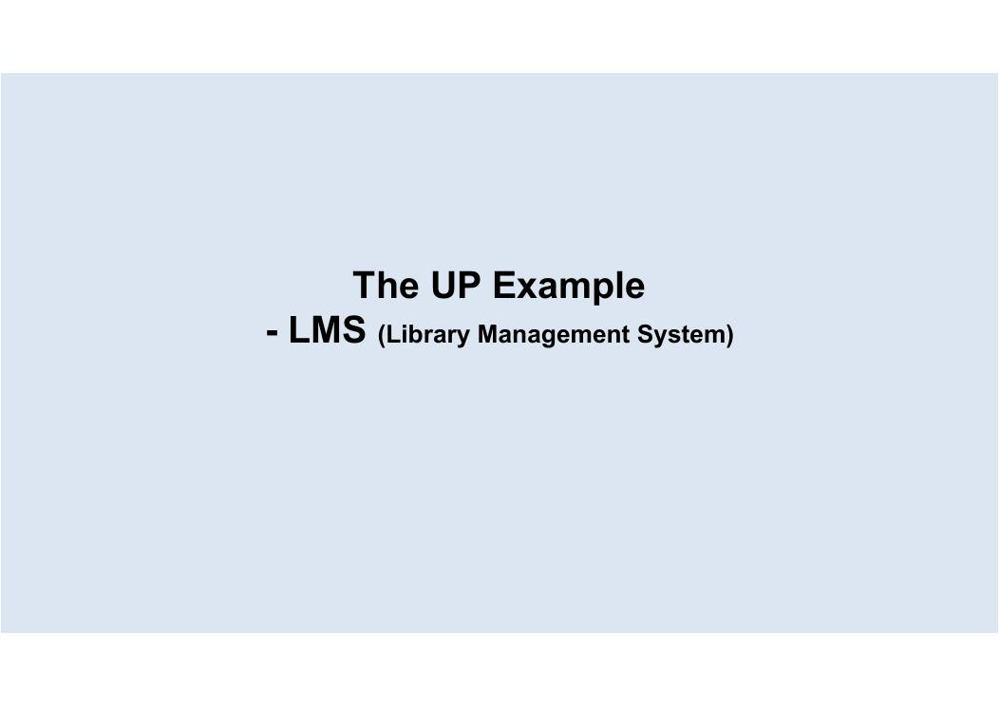

- LMS (Library Management System)

---

## 254. Unified Process (UP)

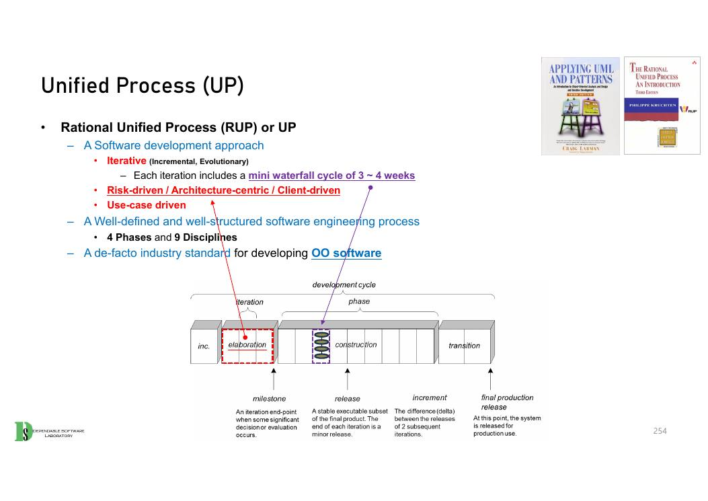

- Rational Unified Process (RUP) or UP
  - A Software development approach
    - Iterative (Incremental, Evolutionary)
      - Each iteration includes a mini waterfall cycle of 3 ~ 4 weeks
    - Risk-driven / Architecture-centric / Client-driven
    - Use-case driven
  - A Well-defined and well-structured software engineering process
    - 4 Phases and 9 Disciplines
  - A de-facto industry standard for developing OO software

---

## 255. Inception

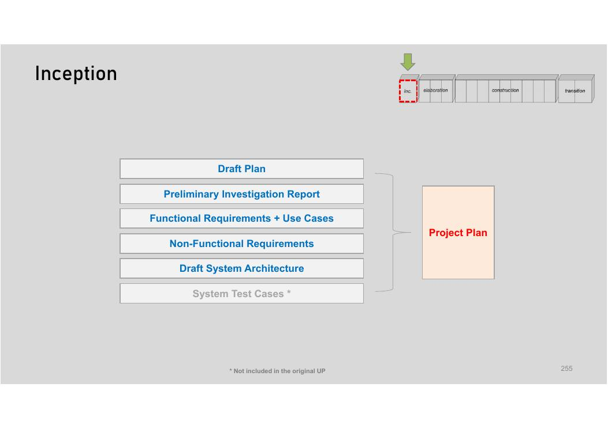

Draft Plan  

Preliminary Investigation Report  

Functional Requirements + Use Cases  
Project Plan  
Non-Functional Requirements  

Draft System Architecture  

System Test Cases \*  

\* Not included in the original UP  

---

## 256. A Draft Plan

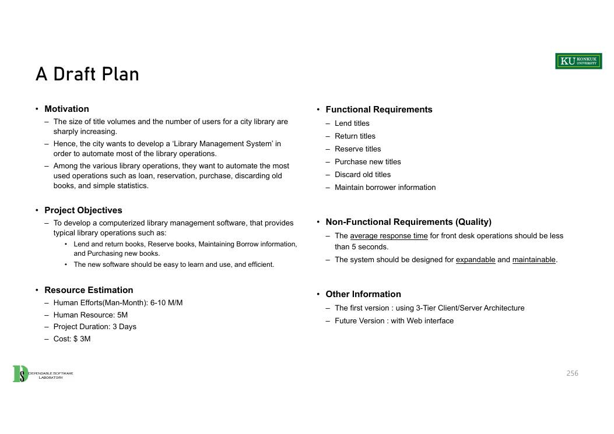

- Motivation · • Functional Requirements
  - The size of title volumes and the number of users for a city library are · – Lend titles sharply increasing.
    - Return titles
  - Hence, the city wants to develop a ‘Library Management System’ in
    - Reserve titles

order to automate most of the library operations.  
  - Among the various library operations, they want to automate the most · – Purchase new titles

used operations such as loan, reservation, purchase, discarding old · – Discard old titles  
books, and simple statistics. · – Maintain borrower information  

- Project Objectives
  - To develop a computerized library management software, that provides · • Non-Functional Requirements (Quality)

typical library operations such as: · – The average response time for front desk operations should be less  
    - Lend and return books, Reserve books, Maintaining Borrow information, · than 5 seconds. and Purchasing new books.
      - The system should be designed for expandable and maintainable.
    - The new software should be easy to learn and use, and efficient.

- Resource Estimation · • Other Information
  - Human Efforts(Man-Month): 6-10 M/M
    - The first version : using 3-Tier Client/Server Architecture
  - Human Resource: 5M
    - Future Version : with Web interface
  - Project Duration: 3 Days
  - Cost: $ 3M

---

## 257. A Preliminary Investigation Report

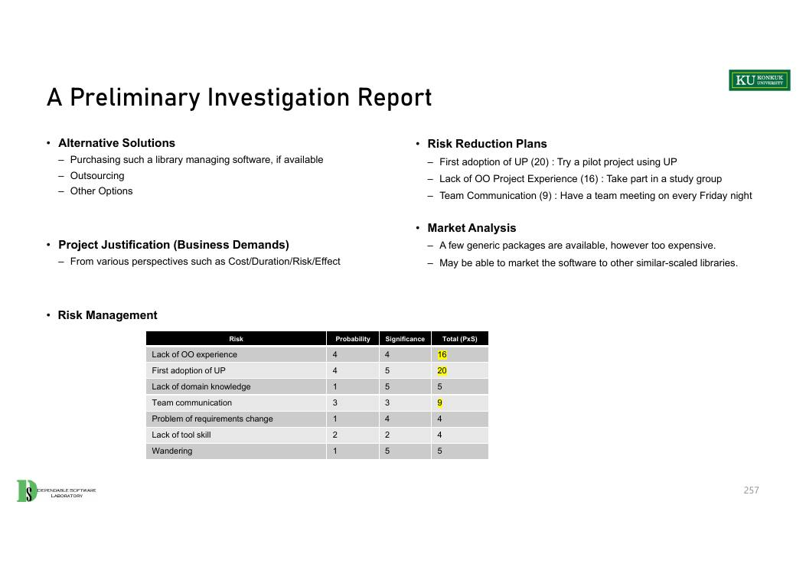

- Alternative Solutions · • Risk Reduction Plans
  - Purchasing such a library managing software, if available · – First adoption of UP (20) : Try a pilot project using UP
  - Outsourcing · – Lack of OO Project Experience (16) : Take part in a study group
  - Other Options · – Team Communication (9) : Have a team meeting on every Friday night

    - Market Analysis
- Project Justification (Business Demands) · – A few generic packages are available, however too expensive.
  - From various perspectives such as Cost/Duration/Risk/Effect · – May be able to market the software to other similar-scaled libraries.

- Risk Management

Risk · Probability · Significance · Total (PxS)  

Lack of OO experience · 4 · 4 · 16  
First adoption of UP · 4 · 5 · 20  
Lack of domain knowledge · 1 · 5 · 5  
Team communication · 3 · 3 · 9  
Problem of requirements change · 1 · 4 · 4  
Lack of tool skill · 2 · 2 · 4  
Wandering · 1 · 5 · 5  

---

## 258. Functional Requirements + Use Cases

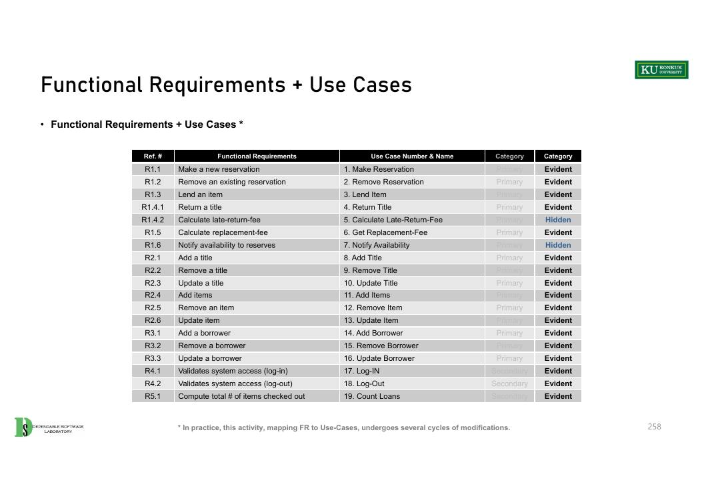

- Functional Requirements + Use Cases \*

Ref. # · Functional Requirements · Use Case Number &amp; Name · Category · Category  

R1.1 · Make a new reservation · 1. Make Reservation · Primary · Evident  
R1.2 · Remove an existing reservation · 2. Remove Reservation · Primary · Evident  
R1.3 · Lend an item · 3. Lend Item · Primary · Evident  
R1.4.1 · Return a title · 4. Return Title · Primary · Evident  
R1.4.2 · Calculate late-return-fee · 5. Calculate Late-Return-Fee · Primary · Hidden  
R1.5 · Calculate replacement-fee · 6. Get Replacement-Fee · Primary · Evident  
R1.6 · Notify availability to reserves · 7. Notify Availability · Primary · Hidden  
R2.1 · Add a title · 8. Add Title · Primary · Evident  
R2.2 · Remove a title · 9. Remove Title · Primary · Evident  
R2.3 · Update a title · 10. Update Title · Primary · Evident  
R2.4 · Add items · 11. Add Items · Primary · Evident  
R2.5 · Remove an item · 12. Remove Item · Primary · Evident  
R2.6 · Update item · 13. Update Item · Primary · Evident  
R3.1 · Add a borrower · 14. Add Borrower · Primary · Evident  
R3.2 · Remove a borrower · 15. Remove Borrower · Primary · Evident  
R3.3 · Update a borrower · 16. Update Borrower · Primary · Evident  
R4.1 · Validates system access (log-in) · 17. Log-IN · Secondary · Evident  
R4.2 · Validates system access (log-out) · 18. Log-Out · Secondary · Evident  
R5.1 · Compute total # of items checked out · 19. Count Loans · Secondary · Evident  

\* In practice, this activity, mapping FR to Use-Cases, undergoes several cycles of modifications.  

---

## 259. Functional Requirements + Use Cases

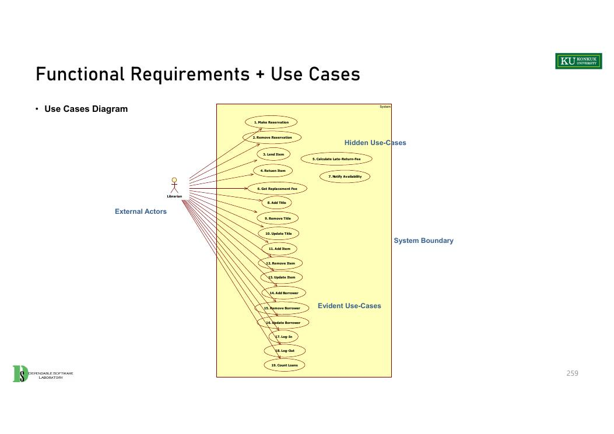

- Use Cases Diagram · System

1\. Make Reservation  

2\. Remove Reservation  
Hidden Use-Cases  
3\. Lend Item  
5\. Calculate Late-Return-Fee  

4\. Retuen Item  
7\. Notify Availability  

6\. Get Replacement Fee  

Librarian  
8\. Add Title  

External Actors  
9\. Remove Title  

10\. Update Title  

System Boundary  
11\. Add Item  

12\. Remove Item  

13\. Update Item  

14\. Add Borrower  

15\. Remove Borrower · Evident Use-Cases  

16\. Update Borrower  

17\. Log-In  

18\. Log-Out  

19\. Count Loans  

---

## 260. Functional Requirements + Use Cases

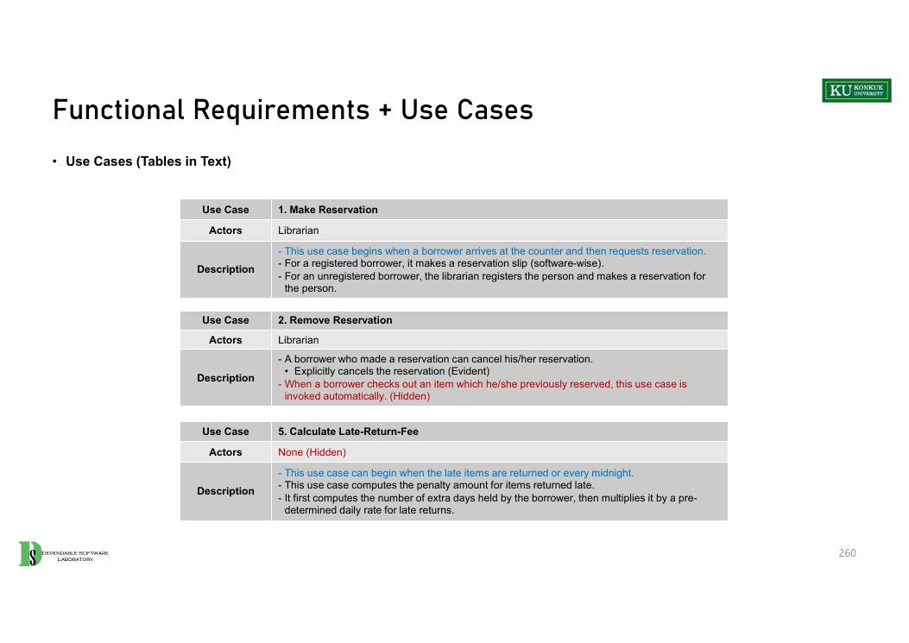

- Use Cases (Tables in Text)

Use Case · 1. Make Reservation  

Actors · Librarian  
  - This use case begins when a borrower arrives at the counter and then requests reservation.
  - For a registered borrower, it makes a reservation slip (software-wise).

Description  
  - For an unregistered borrower, the librarian registers the person and makes a reservation for the person.

Use Case · 2. Remove Reservation  
Actors · Librarian  
  - A borrower who made a reservation can cancel his/her reservation.
    - Explicitly cancels the reservation (Evident)

Description  
  - When a borrower checks out an item which he/she previously reserved, this use case is invoked automatically. (Hidden)

Use Case · 5. Calculate Late-Return-Fee  
Actors · None (Hidden)  
  - This use case can begin when the late items are returned or every midnight.
  - This use case computes the penalty amount for items returned late.

Description  
  - It first computes the number of extra days held by the borrower, then multiplies it by a pre- determined daily rate for late returns.

---

## 261. Non-Functional Requirements

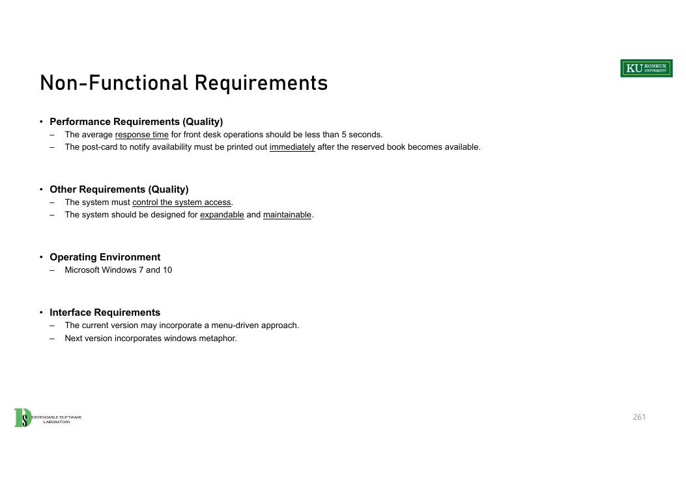

- Performance Requirements (Quality)
  - The average response time for front desk operations should be less than 5 seconds.
  - The post-card to notify availability must be printed out immediately after the reserved book becomes available.

- Other Requirements (Quality)
  - The system must control the system access.
  - The system should be designed for expandable and maintainable.

- Operating Environment
  - Microsoft Windows 7 and 10

- Interface Requirements
  - The current version may incorporate a menu-driven approach.
  - Next version incorporates windows metaphor.

---

## 262. A Draft System Architecture

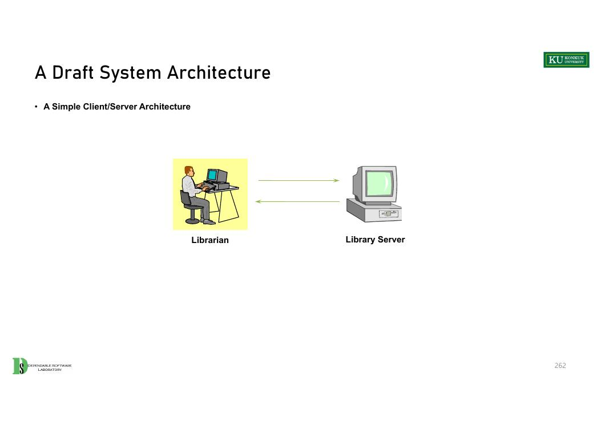

- A Simple Client/Server Architecture

Librarian · Library Server  

---

## 263. System Test Cases

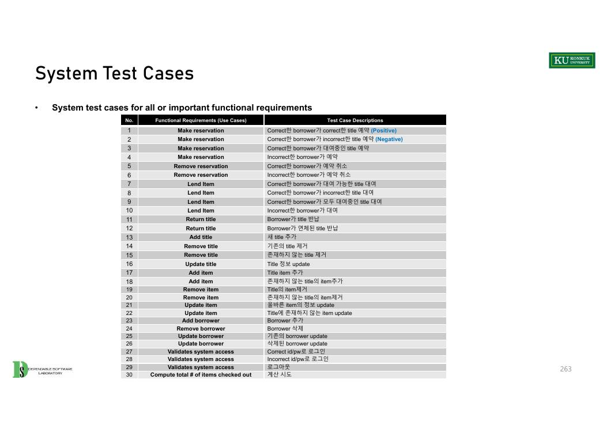

- System test cases for all or important functional requirements

No. · Functional Requirements (Use Cases) · Test Case Descriptions  

1 · Make reservation · Correct한 borrower가 correct한 title 예약 (Positive)  
2 · Make reservation · Correct한 borrower가 incorrect한 title 예약 (Negative)  
3 · Make reservation · Correct한 borrower가 대여중인 title 예약  
4 · Make reservation · Incorrect한 borrower가 예약  
5 · Remove reservation · Correct한 borrower가 예약 취소  
6 · Remove reservation · Incorrect한 borrower가 예약 취소  
7 · Lend Item · Correct한 borrower가 대여 가능한 title 대여  
8 · Lend Item · Correct한 borrower가 incorrect한 title 대여  
9 · Lend Item · Correct한 borrower가 모두 대여중인 title 대여  
10 · Lend Item · Incorrect한 borrower가 대여  
11 · Return title · Borrower가 title 반납  
12 · Return title · Borrower가 연체된 title 반납  
13 · Add title · 새 title 추가  
14 · Remove title · 기존의 title 제거  
15 · Remove title · 존재하지 않는 title 제거  
16 · Update title · Title 정보 update  
17 · Add item · Title item 추가  
18 · Add item · 존재하지 않는 title의 item추가  
19 · Remove item · Title의 item제거  
20 · Remove item · 존재하지 않는 title의 item제거  
21 · Update item · 올바른 item의 정보 update  
22 · Update item · Title에 존재하지 않는 item update  
23 · Add borrower · Borrower 추가  
24 · Remove borrower · Borrower 삭제  
25 · Update borrower · 기존의 borrower update  
26 · Update borrower · 삭제된 borrower update  
27 · Validates system access · Correct id/pw로 로그인  
28 · Validates system access · Incorrect id/pw로 로그인  
29 · Validates system access · 로그아웃 · 263  
30 · Compute total # of items checked out · 계산 시도  

---

## 264. OOA in the 1st Elaboration

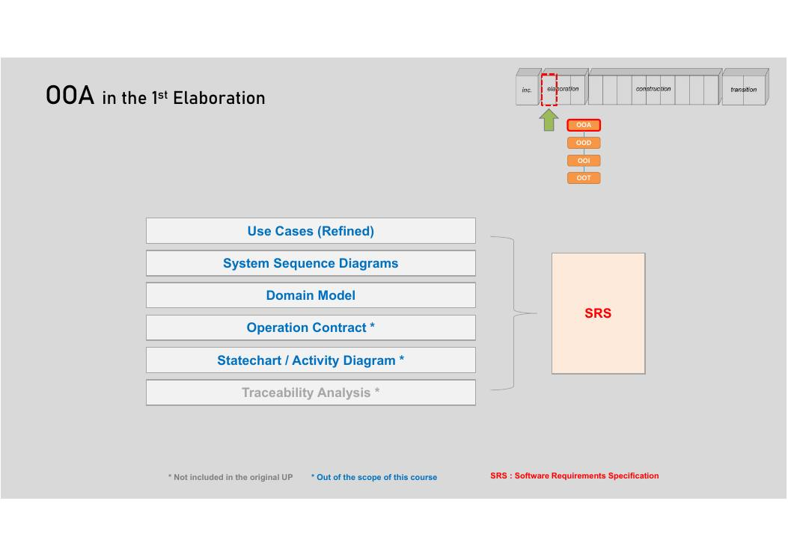

OOA  

OOD  

OOI  

OOT  

Use Cases (Refined)  

System Sequence Diagrams  

Domain Model  
SRS  
Operation Contract \*  

Statechart / Activity Diagram \*  

Traceability Analysis \*  

\* Not included in the original UP · \* Out of the scope of this course · SRS : Software Requirements Specification  

---

## 265. Use Cases (Refined)

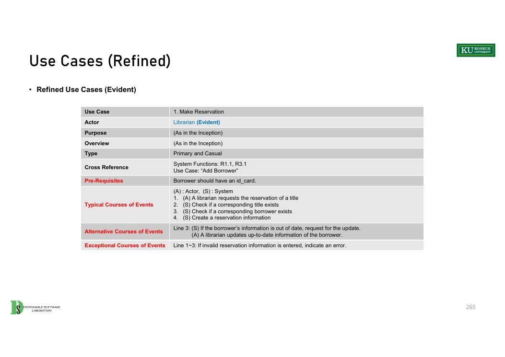

- Refined Use Cases (Evident)

Use Case · 1. Make Reservation  
Actor · Librarian (Evident)  
Purpose · (As in the Inception)  
Overview · (As in the Inception)  
Type · Primary and Casual  
System Functions: R1.1, R3.1  
Cross Reference  
Use Case: “Add Borrower”  
Pre-Requisites · Borrower should have an id_card.  
(A) : Actor, (S) : System  
1\. (A) A librarian requests the reservation of a title  
Typical Courses of Events · 2. (S) Check if a corresponding title exists  
3\. (S) Check if a corresponding borrower exists  
4\. (S) Create a reservation information  
Line 3: (S) If the borrower’s information is out of date, request for the update.  
Alternative Courses of Events  
(A) A librarian updates up-to-date information of the borrower.  
Exceptional Courses of Events · Line 1~3: If invalid reservation information is entered, indicate an error.  

---

## 266. Use Cases (Refined)

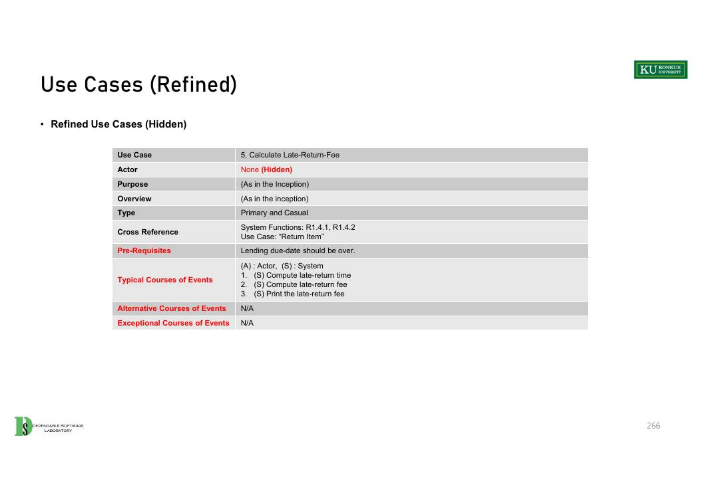

- Refined Use Cases (Hidden)

Use Case · 5. Calculate Late-Return-Fee  
Actor · None (Hidden)  
Purpose · (As in the Inception)  
Overview · (As in the inception)  
Type · Primary and Casual  
System Functions: R1.4.1, R1.4.2  
Cross Reference  
Use Case: “Return Item”  
Pre-Requisites · Lending due-date should be over.  
(A) : Actor, (S) : System  
1\. (S) Compute late-return time  
Typical Courses of Events  
2\. (S) Compute late-return fee  
3\. (S) Print the late-return fee  
Alternative Courses of Events · N/A  
Exceptional Courses of Events · N/A  

---

## 267. System Sequence Diagrams

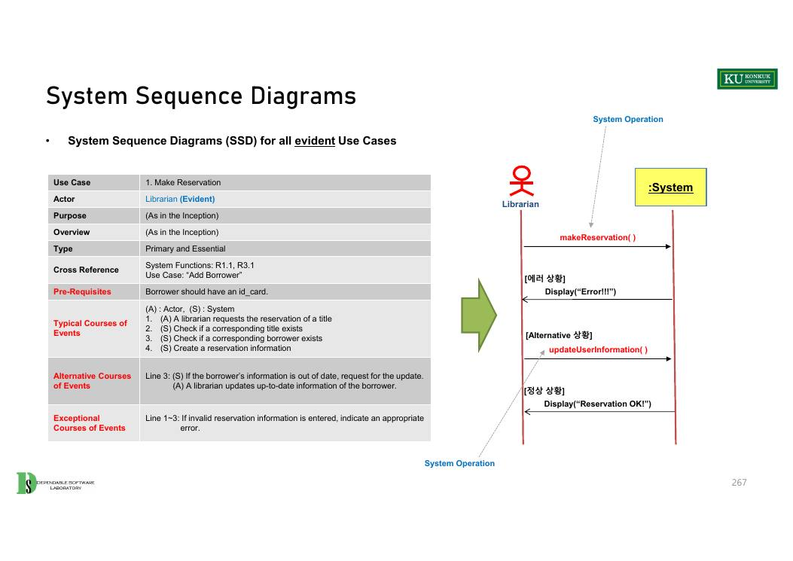

System Operation  

- System Sequence Diagrams (SSD) for all evident Use Cases

Use Case · 1. Make Reservation  
:System  
Actor · Librarian (Evident)  
Librarian  
Purpose · (As in the Inception)  
Overview · (As in the Inception)  
makeReservation( )  
Type · Primary and Essential  

System Functions: R1.1, R3.1  
Cross Reference  
Use Case: “Add Borrower” · [에러 상황]  
Pre-Requisites · Borrower should have an id_card. · Display(“Error!!!”)  

(A) : Actor, (S) : System  
1\. (A) A librarian requests the reservation of a title  
Typical Courses of  
2\. (S) Check if a corresponding title exists  
Events · [Alternative 상황]  
3\. (S) Check if a corresponding borrower exists  
4\. (S) Create a reservation information · updateUserInformation( )  

Alternative Courses · Line 3: (S) If the borrower’s information is out of date, request for the update.  
of Events · (A) A librarian updates up-to-date information of the borrower.  
[정상 상황]  
Display(“Reservation OK!”)  
Exceptional · Line 1~3: If invalid reservation information is entered, indicate an appropriate  
Courses of Events · error.  

System Operation  

---

## 268. System Sequence Diagrams

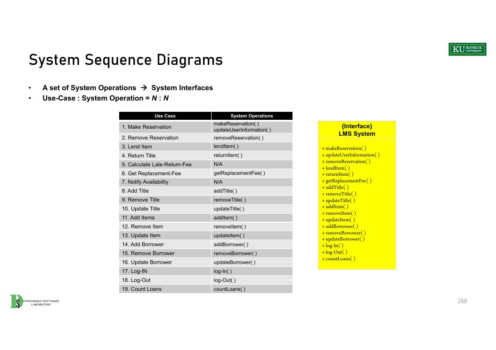

- A set of System Operations → System Interfaces
- Use-Case : System Operation = N : N

Use Cass · System Operations  
makeReservation( ) · {Interface}  
1\. Make Reservation  
updateUserInformation( )  
LMS System  
2\. Remove Reservation · removeReservation( )  
3\. Lend Item · lendItem( ) · + makeReservation( )  
4\. Return Title · returnItem( ) · + updateUserInformation( )  
\+ removeReservation( )  
5\. Calculate Late-Return-Fee · N/A  
\+ lendItem( )  
6\. Get Replacement-Fee · getReplacementFee( ) · + returnItem( )  
7\. Notify Availability · N/A · + getReplacementFee( )  
\+ addTitle( )  
8\. Add Title · addTitle( )  
\+ removeTitle( )  
9\. Remove Title · removeTitle( ) · + updateTitle( )  
10\. Update Title · updateTitle( ) · + addItem( )  
\+ removeItem( )  
11\. Add Items · addItem( ) · + updateItem( )  
12\. Remove Item · removeItem( ) · + addBorrower( )  
\+ removeBorrower( )  
13\. Update Item · updateItem( )  
\+ updateBorrower( )  
14\. Add Borrower · addBorrower( ) · + log-In( )  
15\. Remove Borrower · removeBorrower( ) · + log-Out( )  
\+ countLoans( )  
16\. Update Borrower · updateBorrower( )  
17\. Log-IN · log-In( )  
18\. Log-Out · log-Out( )  
19\. Count Loans · countLoans( )  

---

## 269. Domain Model

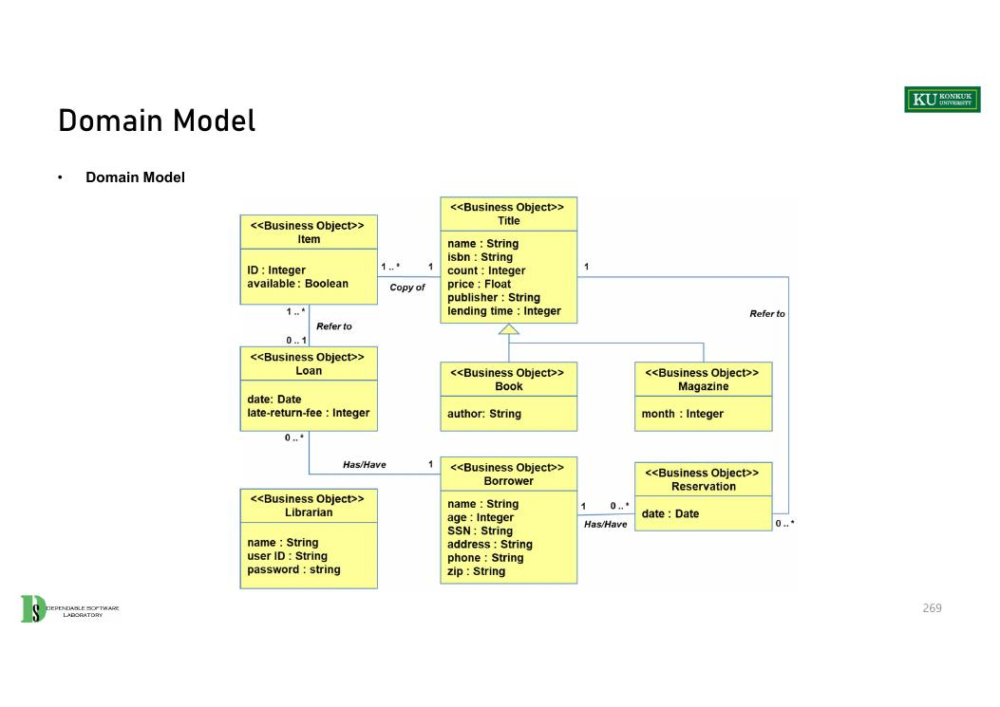

- Domain Model

---

## 270. Operation Contracts

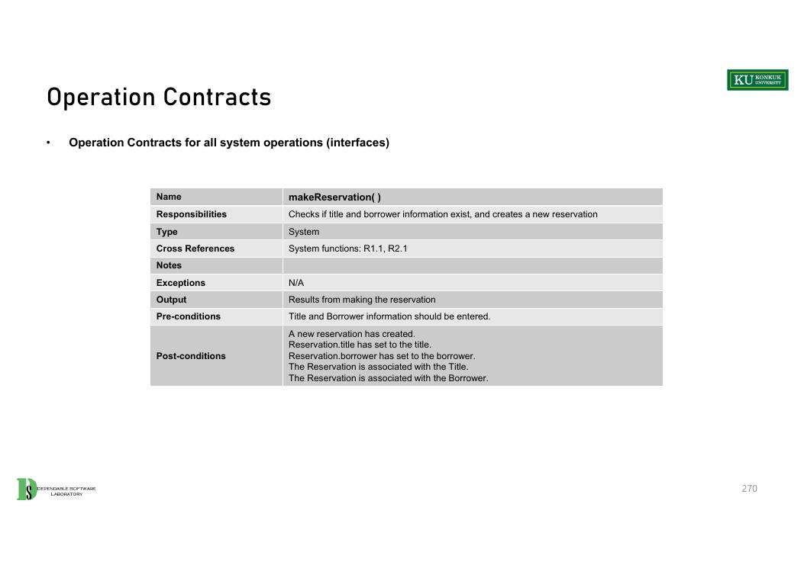

- Operation Contracts for all system operations (interfaces)

Name · makeReservation( )  
Responsibilities · Checks if title and borrower information exist, and creates a new reservation  
Type · System  
Cross References · System functions: R1.1, R2.1  
Notes  
Exceptions · N/A  
Output · Results from making the reservation  
Pre-conditions · Title and Borrower information should be entered.  
A new reservation has created.  
Reservation.title has set to the title.  
Post-conditions · Reservation.borrower has set to the borrower.  
The Reservation is associated with the Title.  
The Reservation is associated with the Borrower.  

---

## 271. Statecharts / Activity Diagram

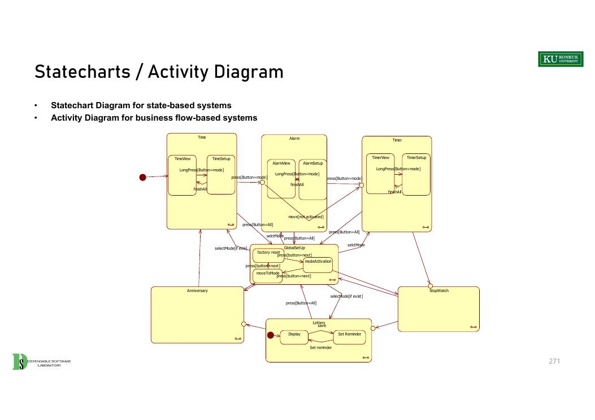

- Statechart Diagram for state-based systems
- Activity Diagram for business flow-based systems

Time · Alarm · Timer  

TimeView · TimeSetup · TimerView · TimerSetup  
AlarmView · AlarmSetup  
LongPress[Button=mode] · LongPress[Button=mode]  
LongPress[Button=mode]  
press[Button=mode] · press[Button=mode]  
finishAll  
finishAll  
finishAll  

move[not activated]  
press[Button=All]  
press[Button=All]  
selctMode  
press[Button=All]  
selctMode  
selectMode[if exis] · GlobalSetUp  
factory reset  
press[button=next]  
modeActivation  
press[button=next]  
moveToMode  
press[button=next]  

Anniversary · StopWatch  
selecMode[if exist]  
press[Button=All]  

Lottery  
save  

Display · Set Reminder  

Set reminder  

---

## 272. Statecharts / Activity Diagram

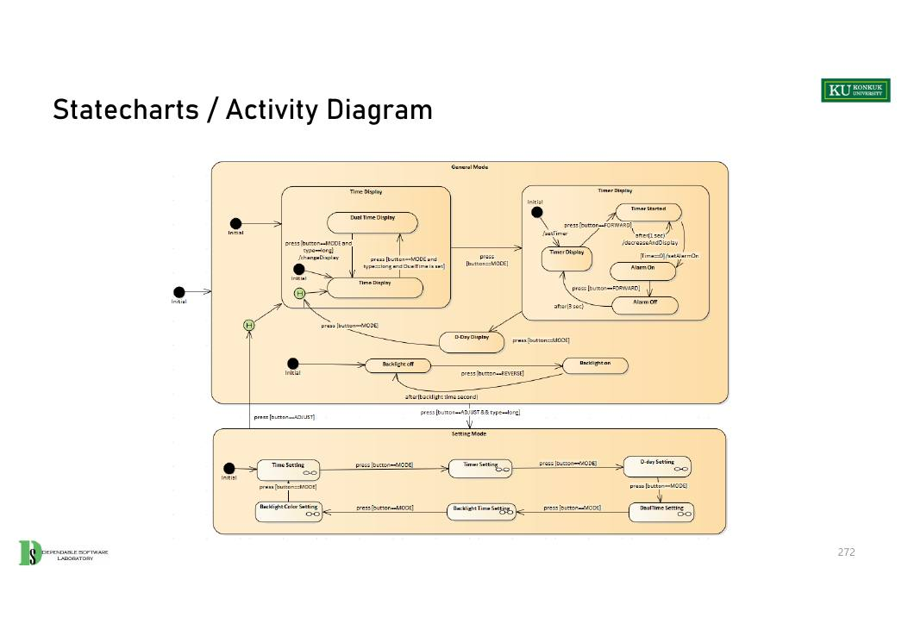

---

## 273. Traceability Analysis

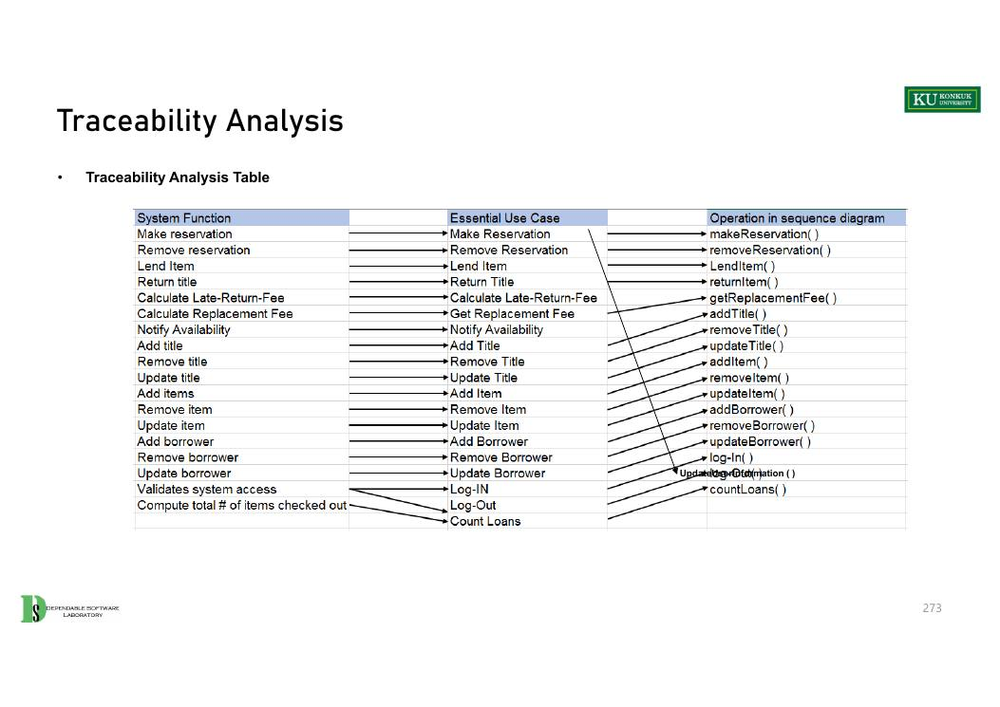

- Traceability Analysis Table

UpdateUserInformation ( )  

---

## 274. OOD in the 1st Elaboration

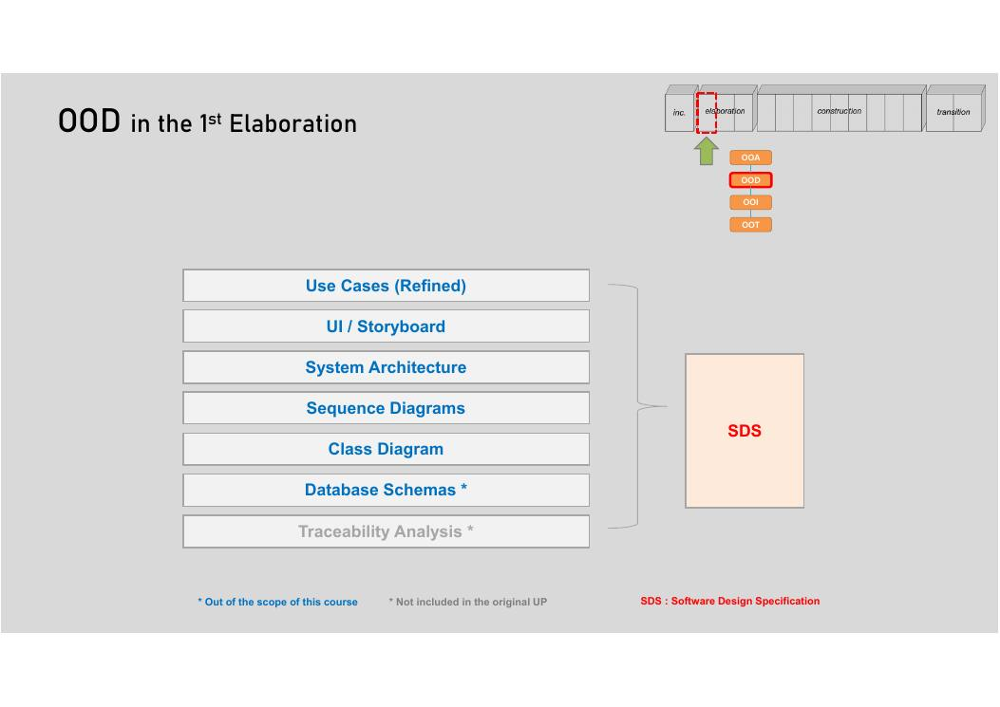

OOA  

OOD  

OOI  

OOT  

Use Cases (Refined)  

UI / Storyboard  

System Architecture  

Sequence Diagrams  
SDS  
Class Diagram  

Database Schemas \*  

Traceability Analysis \*  

\* Out of the scope of this course · \* Not included in the original UP · SDS : Software Design Specification  

---

## 275. Use Cases (Refined)

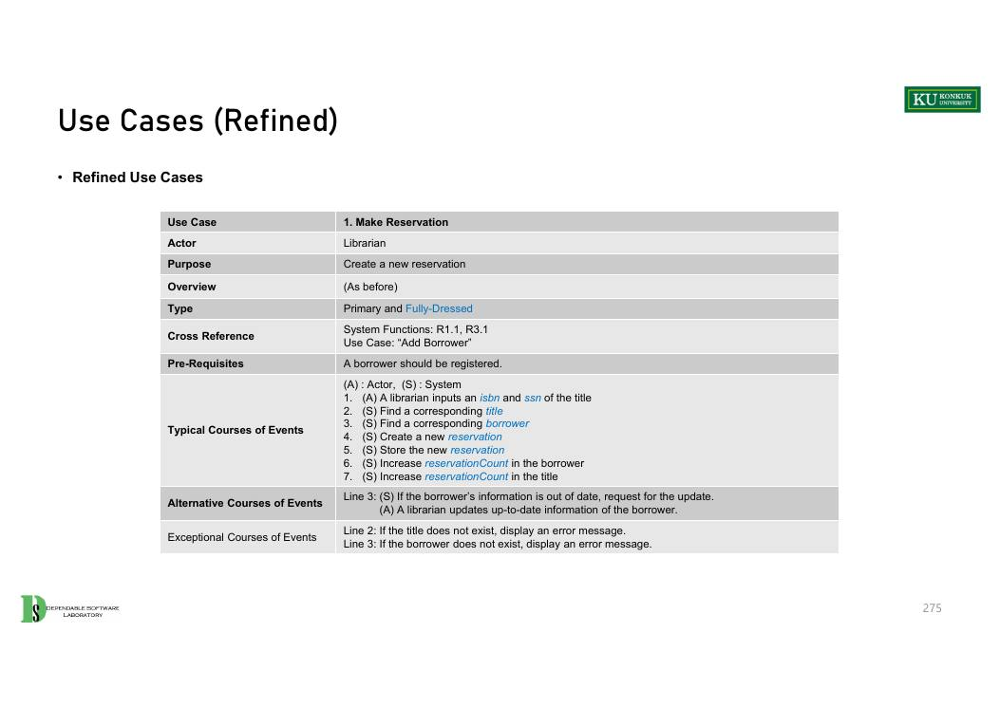

- Refined Use Cases

Use Case · 1. Make Reservation  
Actor · Librarian  
Purpose · Create a new reservation  

Overview · (As before)  

Type · Primary and Fully-Dressed  
System Functions: R1.1, R3.1  
Cross Reference  
Use Case: “Add Borrower”  
Pre-Requisites · A borrower should be registered.  
(A) : Actor, (S) : System  
1\. (A) A librarian inputs an isbn and ssn of the title  
2\. (S) Find a corresponding title  
3\. (S) Find a corresponding borrower  
Typical Courses of Events  
4\. (S) Create a new reservation  
5\. (S) Store the new reservation  
6\. (S) Increase reservationCount in the borrower  
7\. (S) Increase reservationCount in the title  
Line 3: (S) If the borrower’s information is out of date, request for the update.  
Alternative Courses of Events  
(A) A librarian updates up-to-date information of the borrower.  
Line 2: If the title does not exist, display an error message.  
Exceptional Courses of Events  
Line 3: If the borrower does not exist, display an error message.  

---

## 276. UI / Storyboard

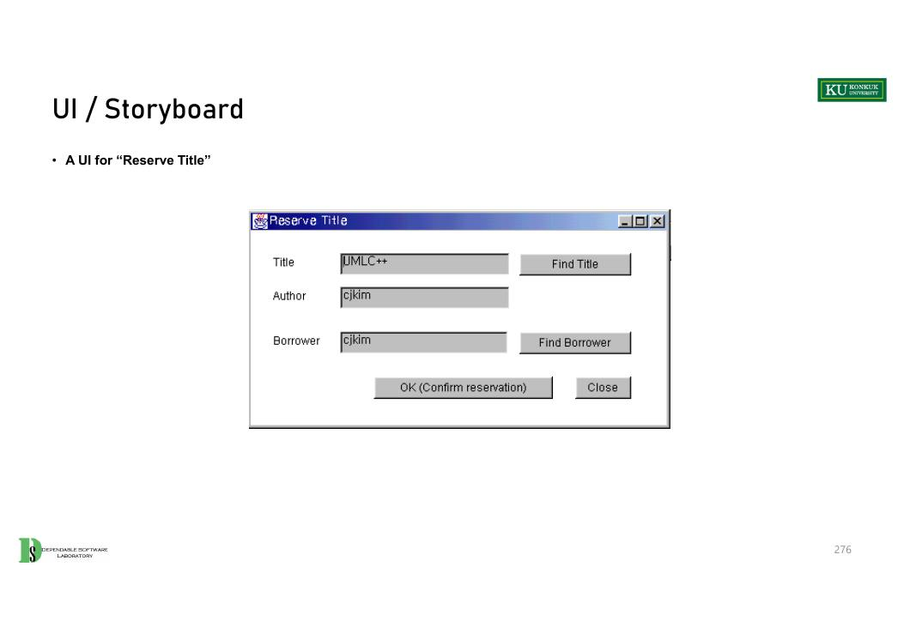

- A UI for “Reserve Title”

---

## 277. System Architecture

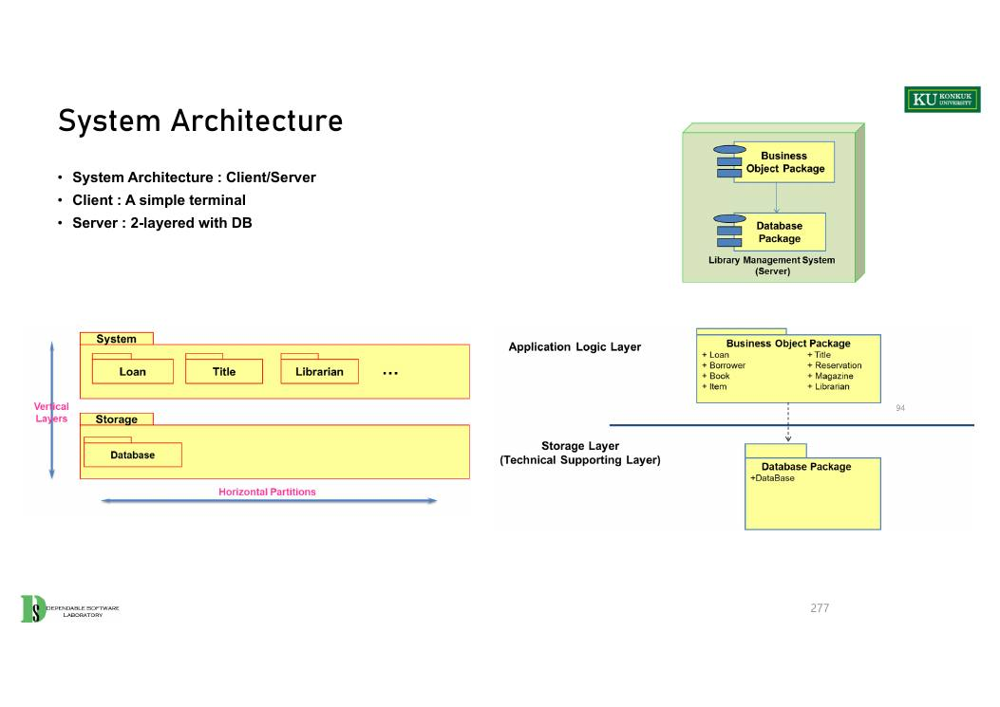

- System Architecture : Client/Server
- Client : A simple terminal
- Server : 2-layered with DB

---

## 278. Sequence Diagrams

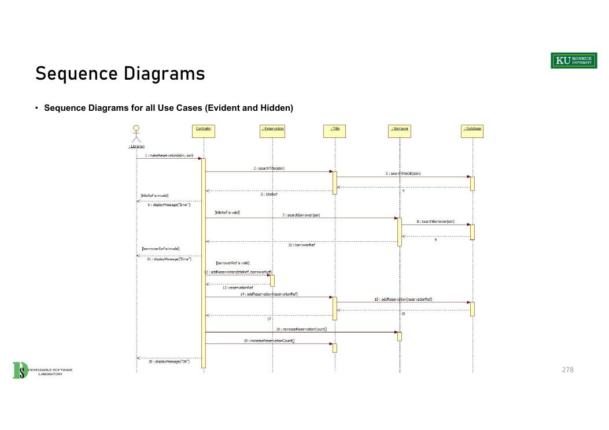

- Sequence Diagrams for all Use Cases (Evident and Hidden)

---

## 279. Class Diagram

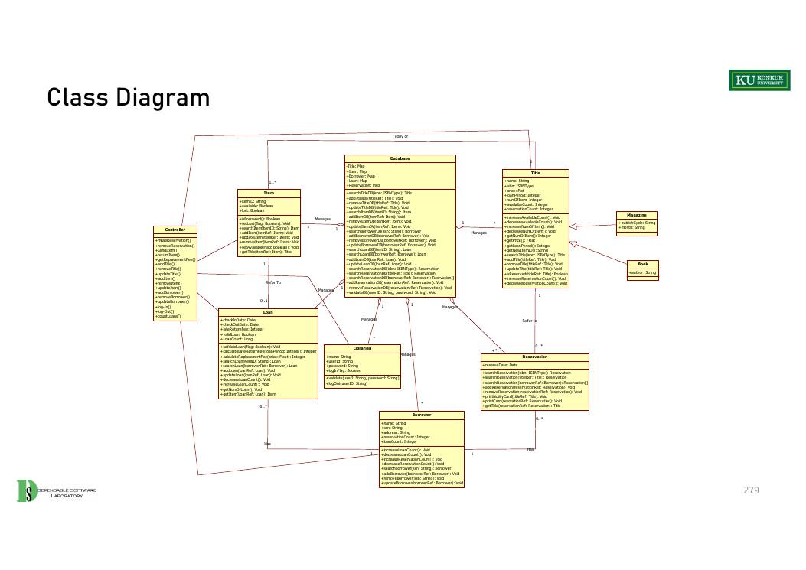

copy of  

Database  
1  
-Title: Map  
\+Item: Map · Title  
\+Borrower: Map  
1..\* · +Loan: Map · +name: String  
\+Reservation: Map · +isbn: ISBNType  
\+price: Flot  
Item · +searchTitleDB(isbn: ISBNType): Title · +loanPeriod: Integer  
\+addTtileDB(titleRef: Title): Void · +numOfItem: Integer  
\+itemID: String · +removeTitleDB(titleRef: Title): Void  
\+available: Boolean · +availalbeCount: Integer  
\+updateTitleDB(titleRef: Title): Void · +reservationCount: Integer  
\+lost: Boolean · +searchItemDB(itemID: String): Item  
\+addItemDB(itemRef: Item): Void · Magazine  
\+isBorrowed(): Boolean · Manages · +increaseAvailableCount(): Void  
\+setLost(flag: Boolean): Void · +removeItemDB(itemRef: Item): Void · 1 · +decreaseAvailableCount(): Void · +publishCycle: String  
\*  
\+searchItem(itemID: String): Item · +updateItemDV(itemRef: Item): Void · +increaseNumOfItem(): Void · +month: String  
Controller · \* · 1  
\+addItem(itemRef: Item): Void · +searchBorrowerDB(ssn: String): Borrower · Manages · +decreaseNumOfItem(): Void  
\+updateItem(itemRef: Item): Void · +addBorrowerDB(borrowerRef: Borrower): Void · +getNumOfItem(): Integer  
\+mkaeReservation() · +removeItem(itemRef: Item): Void · +removeBorrowerDB(borrowerRef: Borrower): Void · +getPrice(): Float  
\+removeReservation() · +setAvailable(flag: Boolean): Void · +updateBorrowerDB(borrowerRef: Borrower): Void · +getLoanPeriod(): Integer  
\+LendItem() · +getTitle(itemRef: Item): Title · +searchLoanDB(itemID: String): Loan · +getNewItemID(): String  
\+returnItem() · +searchLoanDB(borrwerRef: Borrower): Loan · +searchTitle(isbn: ISBNType): Title  
\+getReplacementFee() · +addLoanDB(loanRef: Loan): Void · +addTitle(titleRef: Title): Void  
\+addTitle() · 1 · +updateLoanDB(loanRef: Loan): Void · +removeTitle(titleRef: Title): Void · Book  
\+removeTitle() · +searchReservationDB(isbn: ISBNType): Reservation · +updateTitle(titleRef: Title): Void  
\+updateTitle() · +searchReservationDB(titleRef: Title): Reservation · +isReserved(titleRef: Title): Boolean · +author: String  
\+addItem() · +searchReservationDB(borrowerRef: Borrower): Resrvation[] · +increaseReservationCount(): Void  
\+removeItem() · Refer To · +addReservationDB(reservationRef: Reservation): Void · +decreaseReservationCount(): Void  
\+updateItem() · 1 +removeReservationDB(reservationrRef: Reservation): Void  
Manages · +validateDB(userID: String, password: String): Void  
\+addBorrower()  
\+removeBorrower() · 1  
\+updateBorrower() · 0..1  
\* · 1 · 1  
\+log-In() · Manages  
\+1  
\+log-Out() · Loan  
\+countLoans()  
\+checkInDate: Date · Manages · Refer to  
\+checkOutDate: Date  
\+lateReturnFee: Integer  
\+validLoan: Boolean  
\+LoanCount: Long · \*  

\+setValidLoan(flag: Boolean): Void · 0..\*  
Librarian  
\+calculateLateReturnFee(loanPeriod: Integer): Integer · +\*  
\+calculateReplacementFee(price: Float): Integer · +name: String · Manages  
Reservation  
\+searchLoan(itemID: String): Loan · +userId: String  
\+searchLoan(borrowerRef: Borrower): Loan · +password: String · +reserveDate: Date  
\+addLoan(loanRef: Loan): Void · +logInFlag: Boolean  
\+searchReservation(isbn: ISBNType): Reservation  
\+updateLoan(loanRef: Loan): Void  
\+validate(userI: String, password: String) · +searchReservation(titleRef: Title): Reservation  
\+decreaseLoanCount(): Void  
\+logOut(userID: String) · +searchReservation(borrowerRef: Borrower): Reservation[]  
\+increaseLoanCount(): Void  
\+addReservation(reservationRef: Reservation): Void  
\+getNumOfLoan(): Void  
\+removeReservation(reservationRef: Reservation): Void  
\+getItem(LoanRef: Loan): Item  
\+printNotifyCard(titleRef: Title): Void  
\+printCard(resrvationRef: Reservation): Void  
\*  
0..\* · +getTitle(reservationRef: Reservation): Title  

Borrower  
0..\*  
\+name: String  
\+ssn: String  
\+address: String  
\+reservationCount: Integer  
\+loanCount: Integer  
Has  
\+increaseLoanCount(): Void · Has  
1 · +decreaseLoanCount(): Void · 1  
\+increaseReservationCount(): Void  
\+decreaseReservationCount(): Void  
\+searchBorrower(ssn: String): Borrower  
\+addBorrower(borrowerRef: Borrower): Void  
\+removeBorrower(ssn: String): Void  
\+updateBorrower(borrwerRef: Borrower): Void  

---

## 280. Traceability Analysis

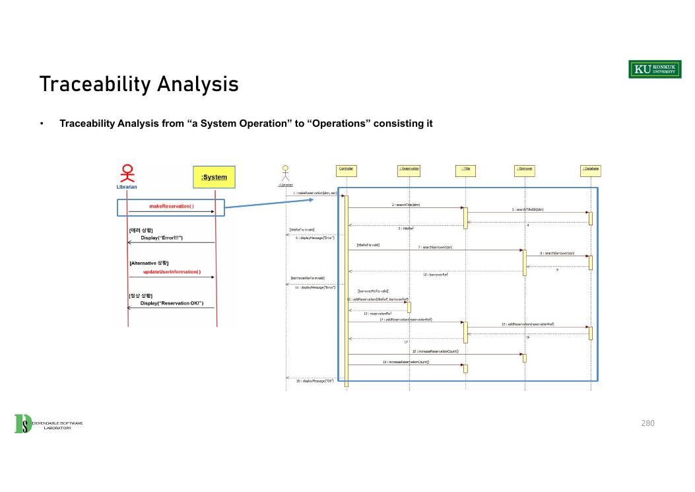

- Traceability Analysis from “a System Operation” to “Operations” consisting it

---

## 281. Traceability Analysis

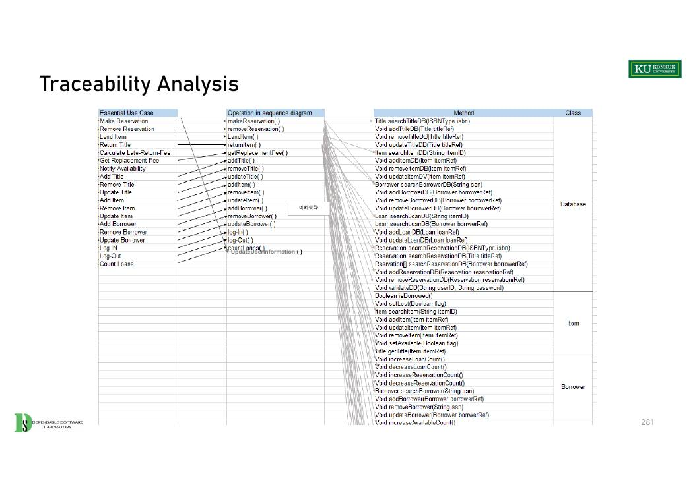

UpdateUserInformation ( )  

---

## 282. Traceability Analysis · M4.1 · startStopWatch() · StopWatchMode

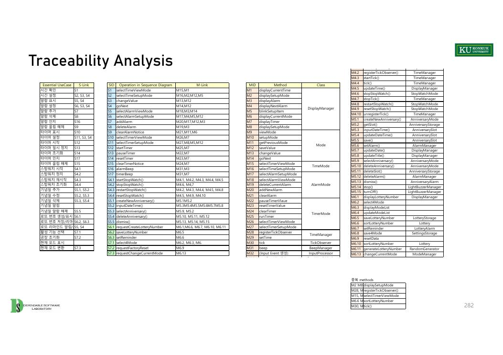

M4.2 · registerTickObserver() · TimeManager  
M4.3 · startTick() · TimeManager  
M4.4 · tick() · TimeManager  
Essential UseCase · S-Link · SID Operation in Sequence Diagram · M-Link · MID · Method · Class  
M4.5 · updateTime() · DisplayManager  
시간 확인 · S1 · S1 selectTimeViewMode · M15,M1 · M1 · displayCurrentTime  
M4.6 · stopStopWatch() · StopWatchMode  
시간 설정 · S2, S3, S4 · S2 selectTimeSetupMode · M16,M2,M12,M5 · M2 · displaySetupMode  
M4.7 · stopTick() · TimeManager  
알람 표시 · S5, S4 · S3 changeValue · M13,M12 · M3 · displayAlarm  
M4.8 · restartStopWatch() · StopWatchMode  
알람 설정 · S6, S3, S4 · S4 goNext · M14,M12 · M4 · displayNextAlarm  
DisplayManager · M4.9 · resetStopWatch() · StopWatchMode  
알람 추가 · S7 · S5 selectAlarmViewMode · M18,M3,M14 · M5 · blinkSetupItem  
M4.10 · unregisterTick() · TimeManager  
알람 삭제 · S8 · S6 selectAlarmSetupMode · M17,M4,M5,M12 · M6 · displayCurrentMode  
M5.1 · createNewAnniversary() · AnniversaryMode  
알람 인지 · S16 · S7 addAlarm · M20,M17,M12,M3 · M7 · displayTimer  
M5.2 · getSlot() · AnniversaryStorage  
알람 울림 해제 · S9 · S8 deleteAlarm · M19,M3 · M8 · displaySetupMode  
M5.3 · inputDateTime() · AnniversarySlot  
타이머 표시 · S10 · S9 clearAlarmNotice · M21,M11,M6 · M9 · viewMode  
M5.4 · updateDateTime() · AnniversarySlot  
타이머 설정 · S11, S3, S4 · S10 selectTimerViewMode · M26,M7 · M10 · setupMode  
M5.5 · save() · AnniversarySlot  
타이머 시작 · S12 · S11 selectTimerSetupMode · M27,M8,M5,M12 · M11 · getPreviousMode  
Mode · M5.6 · setAlarm() · AlarmManager  
타이머 일시 정지 · S13 · S12 startTimer · M25,M7 · M12 · saveValue  
M5.7 · updateDate() · DisplayManager  
타이머 초기화 · S14 · S13 pauseTimer · M22,M7 · M13 · changeValue  
M5.8 · updateTitle() · DisplayManager  
타이머 인지 · S17 · S14 resetTimer · M23,M7 · M14 · goNext  
M5.9 · selectAnniversary() · AnniversaryMode  
타이머 울림 해제 · S15 · S15 clearTimerNotice · M24,M7 · M15 · selectTimerViewMode  
TimeMode · M5.10 · deleteAnniversary() · AnniversaryMode  
스탑워치 시작 · S4.1 · S16 alarmBeep · M31,M3 · M16 · selectTimeSetupMode  
M5.11 · deleteSlot() · AnniversaryStorage  
스탑워치 정지 · S4.2 · S17 timerBeep · M31,M7 · M17 · selectAlarmSetupMode  
M5.12 · deleteAlarm() · AlarmManager  
스탑워치 재시작 · S4.3 · S4.1 startStopWatch() · M4.1, M4.2, M4.3, M4.4, M4.5 · M18 · selectAlarmViewMode  
M5.13 · dismiss() · AnniversaryAlarm  
스탑워치 초기화 · S4.4 · S4.2 stopStopWatch() · M4.6, M4,7 · M19 · deleteCurrentAlarm · AlarmMode  
M5.14 · stop() · LightBuzzerManager  
기념일 추가 · S5.1, S5.2 · S4.3 restartStopWatch() · M4.2, M4.3, M4.4, M4.5, M4.8 · M20 · addNewAlarm  
M5.15 · turnOff() · LightBuzzerManager  
기념일 수정 · S5.2, S5.3 · S4.4 resetStopWatch() · M4.5, M4.9, M4.10 · M21 · clearAlarm  
M6.1 · displayLotteryNumber · DisplayManager  
기념일 삭제 · S5.3, S5.4 · S5.1 createNewAnniversary() · M5.1M5.2 · M22 · pauseTimerVlaue · M6.2 · select4Mode  
기념일 알림 · S5.2 inputDateTime() · M5.3M5.4M5.5M5.6M5.7M5.8 · M23 · resetTimerValue · M6.3 · displayModeList  
기념일 알람 해제 · S5.5 · S5.3 selectAnniversary() · M5.9, M5.2 · M24 · clearTimer · M6.4 · updateModeList  
TimerMode  
로또 번호 생성/표시 S6.1 · S5.4 deleteAnniversary() · M5.10, M5.11, M5.12 · M25 · runTimer · M6.5 · saveLotteryNumber · LotteryStorage  
로또 번호 저장/리마인 · S6.2, S6.3 · S5.5 dismiss() · M5.13, M5.14, M5.15 · M26 · selectTimerViewMode · M6.6 · sortLotteryNumber · Lottery  
로또 리마인드 알림/표 · S5, S4 · S6.1 requestCreateLotteryNumber · M6.1,M6.6, M6.7, M6.10, M6.11 · M27 · selectTimerSetupMode · M6.7 · setReminder · LotteryAlarm  
활성 기능 선택 · S7.1 · S6.2 saveLotteryNumber · M6.5 · M28 · registerTickObserver · M6.8 · save4Mode · SettingsStorage  
TimeManager  
공장 초기화 · S7.2 · S6.3 setReminder · M6.6 · M29 · setTime · M6.9 · resetData  
현재 모드 표시 · S7.1 select4Mode · M6.2, M6.3, M6. · M30 · tick · TickObserver · M6.10 · sortLotteryNumber · Lottery  
현재 모드 변환 · S7.3 · S7.2 requestFactoryReset · M6.9 · M31 · beep · BeepManager · M6.11 · generateLotteryNumber · RandomGenerator  
S7.3 requestChangeCurrentMode · M6.13 · M32 · (Input Event 생성) · InputProcessor · M6.13 · changeCurrentMode · ModeManager  
M4 1 · S · W h() · S · W hM d  

중복 methods  
M2 M8 displaySetupMode  
M28, MregisterTickObserver()  
M15, MselectTimerViewMode  
M6.6 MsortLotteryNumber  
M30, Mtick()  

---

## 283. OOI in the 1st Elaboration

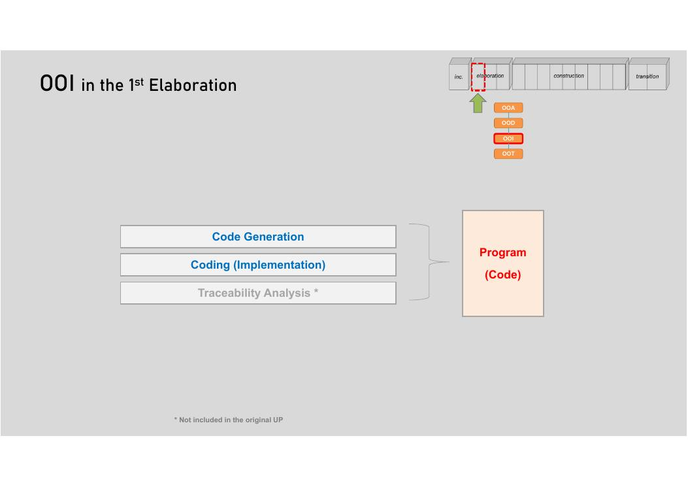

OOA  

OOD  

OOI  

OOT  

Code Generation  
Program  
Coding (Implementation)  
(Code)  
Traceability Analysis \*  

\* Not included in the original UP  

---

## 284. Code Generation

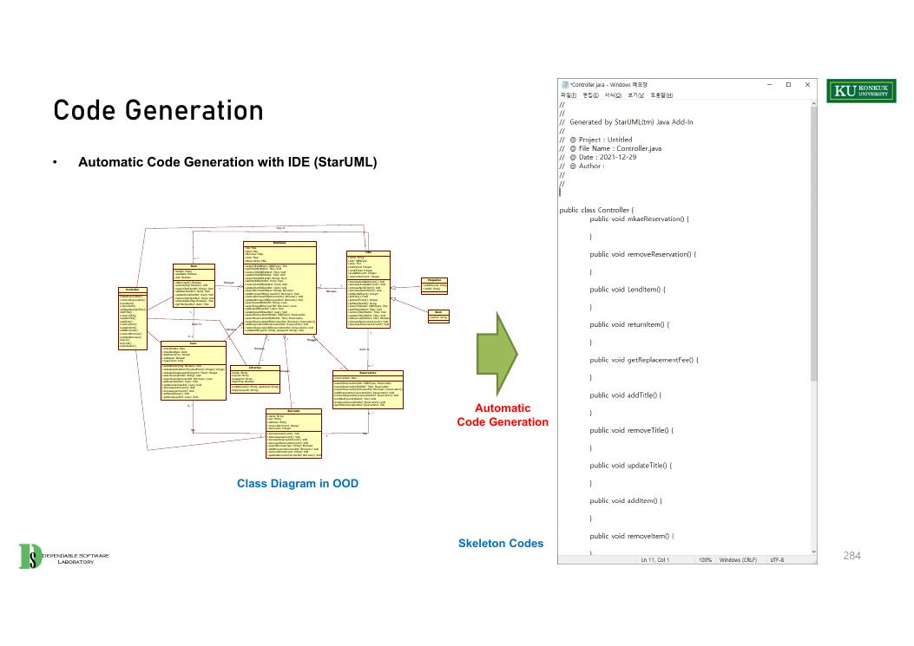

- Automatic Code Generation with IDE (StarUML)

copy of  

Database  
1  
-Title: Map  
\+Item: Map · Title  
\+Borrower: Map  
1..\* · +Loan: Map · +name: String  
\+Reservation: Map · +isbn: ISBNType  
\+price: Flot  
Item · +searchTitleDB(isbn: ISBNType): Title · +loanPeriod: Integer  
\+addTtileDB(titleRef: Title): Void · +numOfItem: Integer  
\+itemID: String · +removeTitleDB(titleRef: Title): Void  
\+available: Boolean · +availalbeCount: Integer  
\+updateTitleDB(titleRef: Title): Void · +reservationCount: Integer  
\+lost: Boolean · +searchItemDB(itemID: String): Item  
\+addItemDB(itemRef: Item): Void · Magazine  
\+isBorrowed(): Boolean · Manages · +increaseAvailableCount(): Void  
\+setLost(flag: Boolean): Void · +removeItemDB(itemRef: Item): Void · 1 · +decreaseAvailableCount(): Void · +publishCycle: String  
\*  
\+searchItem(itemID: String): Item · +updateItemDV(itemRef: Item): Void · +increaseNumOfItem(): Void · +month: String  
Controller · \* · 1  
\+addItem(itemRef: Item): Void · +searchBorrowerDB(ssn: String): Borrower · Manages · +decreaseNumOfItem(): Void  
\+updateItem(itemRef: Item): Void · +addBorrowerDB(borrowerRef: Borrower): Void · +getNumOfItem(): Integer  
\+mkaeReservation() · +removeItem(itemRef: Item): Void · +removeBorrowerDB(borrowerRef: Borrower): Void · +getPrice(): Float  
\+removeReservation() · +setAvailable(flag: Boolean): Void · +updateBorrowerDB(borrowerRef: Borrower): Void · +getLoanPeriod(): Integer  
\+LendItem() · +getTitle(itemRef: Item): Title · +searchLoanDB(itemID: String): Loan · +getNewItemID(): String  
\+returnItem() · +searchLoanDB(borrwerRef: Borrower): Loan · +searchTitle(isbn: ISBNType): Title  
\+getReplacementFee() · +addLoanDB(loanRef: Loan): Void · +addTitle(titleRef: Title): Void  
\+addTitle() · 1 · +updateLoanDB(loanRef: Loan): Void · +removeTitle(titleRef: Title): Void · Book  
\+removeTitle() · +searchReservationDB(isbn: ISBNType): Reservation · +updateTitle(titleRef: Title): Void  
\+updateTitle() · +searchReservationDB(titleRef: Title): Reservation · +isReserved(titleRef: Title): Boolean · +author: String  
\+addItem() · +searchReservationDB(borrowerRef: Borrower): Resrvation[] · +increaseReservationCount(): Void  
\+removeItem() · Refer To · +addReservationDB(reservationRef: Reservation): Void · +decreaseReservationCount(): Void  
\+updateItem() · 1 +removeReservationDB(reservationrRef: Reservation): Void  
Manages · +validateDB(userID: String, password: String): Void  
\+addBorrower()  
\+removeBorrower() · 1  
\+updateBorrower() · 0..1  
\* · 1 · 1  
\+log-In() · Manages  
\+1  
\+log-Out() · Loan  
\+countLoans()  
\+checkInDate: Date · Manages · Refer to  
\+checkOutDate: Date  
\+lateReturnFee: Integer  
\+validLoan: Boolean  
\+LoanCount: Long · \*  

\+setValidLoan(flag: Boolean): Void · 0..\*  
Librarian  
\+calculateLateReturnFee(loanPeriod: Integer): Integer · +\*  
\+calculateReplacementFee(price: Float): Integer · +name: String · Manages  
Reservation  
\+searchLoan(itemID: String): Loan · +userId: String  
\+searchLoan(borrowerRef: Borrower): Loan · +password: String · +reserveDate: Date  
\+addLoan(loanRef: Loan): Void · +logInFlag: Boolean  
\+searchReservation(isbn: ISBNType): Reservation  
\+updateLoan(loanRef: Loan): Void  
\+validate(userI: String, password: String) · +searchReservation(titleRef: Title): Reservation  
\+decreaseLoanCount(): Void  
\+logOut(userID: String) · +searchReservation(borrowerRef: Borrower): Reservation[]  
\+increaseLoanCount(): Void  
\+addReservation(reservationRef: Reservation): Void  
\+getNumOfLoan(): Void  
\+removeReservation(reservationRef: Reservation): Void  
\+getItem(LoanRef: Loan): Item  
\+printNotifyCard(titleRef: Title): Void  
\+printCard(resrvationRef: Reservation): Void  
\*  

Automatic  
0..\* · +getTitle(reservationRef: Reservation): Title  

Borrower  
0..\*  
\+name: String  

Code Generation  
\+ssn: String  
\+address: String  
\+reservationCount: Integer  
\+loanCount: Integer  
Has  
\+increaseLoanCount(): Void · Has  
1 · +decreaseLoanCount(): Void · 1  
\+increaseReservationCount(): Void  
\+decreaseReservationCount(): Void  
\+searchBorrower(ssn: String): Borrower  
\+addBorrower(borrowerRef: Borrower): Void  
\+removeBorrower(ssn: String): Void  
\+updateBorrower(borrwerRef: Borrower): Void  

Class Diagram in OOD  

Skeleton Codes  

---

## 285. Coding (Implementation)

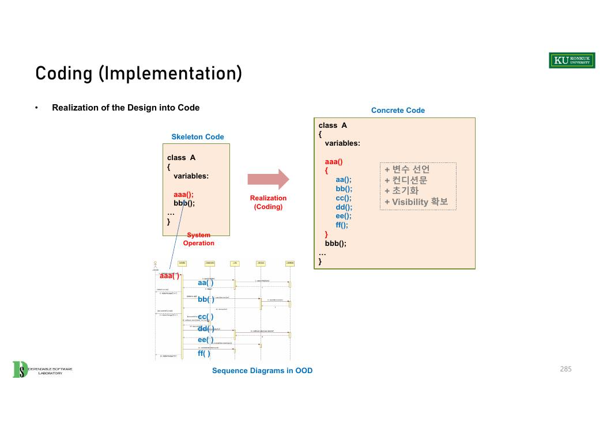

- Realization of the Design into Code · Concrete Code class A

Skeleton Code · {  
variables:  
class A · aaa()  
{ · { · + 변수 선언  
variables: · aa(); · + 컨디션문  
bb(); · + 초기화  
aaa(); · cc();  
Realization  
bbb(); · (Coding)  
\+ Visibility 확보  
dd();  
… · ee();  
} · ff();  
System · }  
Operation · bbb();  
…  
}  
aaa( )  
aa( )  

bb( )  

cc( )  
dd( )  
ee( )  
ff( )  

Sequence Diagrams in OOD  

---

[← 이전: OOAD Summary](14_OOAD_Summary.md) · [← 목차](README.md)
