# Digital Watch Control SW – System Context & Use Cases

OOAD 팀 실습 (슬라이드 77, 85 ~ 88) · Activity #1 Planning

## 1. System Context Diagram

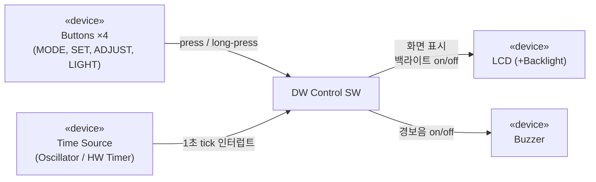

## 2. 전제 (Assumptions)

| 구분 | 내용 |
|---|---|
| 하드웨어 | LCD(백라이트 포함) 1개, 버튼 4개, 부저 1개, SW controller 1개, Time Source(1초 tick) |
| 버튼 | **MODE**: 기능 화면 전환<br>**SET**: 길게 누르면(2초) 설정 모드 진입/종료, 짧게 누르면 다음 항목으로 이동<br>**ADJUST**: 설정 중에는 값 +1, 설정 모드가 아닐 때는 화면마다 다른 기능<br>**LIGHT**: 백라이트 |
| 알람 | 슬롯 4개(AL1~AL4) 고정. 각 슬롯을 ON/OFF한다. |
| 세계시간 | 도시 20개. 도시마다 고정된 UTC offset을 쓰고, 서머타임은 지원하지 않는다. |
| 전원 | 전원 켜기/끄기는 범위에서 제외한다. 시스템은 항상 동작 중이라고 가정한다. |
| 초기 상태 | 현재시간 화면, 알람 슬롯 모두 OFF, 타이머 00:00:00 정지, 세계시간 도시는 첫 번째 도시(SEL) |
| 시간 값 | 설정 무입력 타임아웃 60초, 알람음 30초, 타이머 경보음 10초, 조명 3초, 깜빡임 0.5초 간격 |
| 이전 화면 | 경보가 시작될 때 기능 화면, 선택 상태, 설정 중인 값을 저장한다. 모든 경보가 끝나면 복원한다. 경보가 겹치면 첫 경보가 시작될 때 한 번만 저장한다. |

## 3. Use Case 목록

| # | Use Case | Actor | 구분 | 설명 |
|---|---|---|---|---|
| UC-01 | 시간 계수 (Timekeeping) | None | Hidden | 1초 tick마다 현재 시각과 타이머를 갱신한다. |
| UC-02 | 시계 기능 전환 | 사용자 | Evident | MODE 버튼으로 기능 화면을 바꾼다. |
| UC-03 | 현재시간 화면 표시 | None | Hidden | 현재 시각, 날짜, 아이콘을 표시한다. |
| UC-04 | 알람 화면 표시 | None | Hidden | 알람 슬롯의 시각과 ON/OFF를 표시한다. |
| UC-05 | 타이머 화면 표시 | None | Hidden | 남은 시간과 동작 상태를 표시한다. |
| UC-06 | 세계시간 화면 표시 | None | Hidden | 도시와 그 도시의 시각을 표시한다. |
| UC-07 | 알람 울림 화면 표시 | None | Hidden | 울리는 알람 정보를 표시한다. |
| UC-08 | 타이머 종료 화면 표시 | None | Hidden | 타이머 종료를 표시한다. |
| UC-09 | 현재 시간 설정 | 사용자 | Evident | 현재 날짜와 시간을 바꾼다. |
| UC-10 | 알람 설정 | 사용자 | Evident | 알람 시각을 정하고 켠다. |
| UC-11 | 알람 해제 | 사용자 | Evident | 알람을 끈다. |
| UC-12 | 알람 울리기 | None | Hidden | 알람 시각이 되면 알람을 울린다. |
| UC-13 | 타이머 설정 | 사용자 | Evident | 카운트다운할 시간을 정한다. |
| UC-14 | 타이머 시작/정지 | 사용자 | Evident | 타이머를 시작, 정지, 초기화한다. |
| UC-15 | 타이머 종료 알림 | None | Hidden | 타이머가 0이 되면 경보음을 울린다. |
| UC-16 | 경보음 끄기 | 사용자 | Evident | 울리는 경보음을 끈다. |
| UC-17 | 세계 시간 조회 | 사용자 | Evident | 도시를 골라 그 도시의 시간을 본다. |
| UC-18 | 조명 켜기 | 사용자 | Evident | 백라이트를 잠시 켠다. |

Evident 9개, Hidden 9개.

## 4. Use Case Descriptions (Casual format)

**(A)** : Actor, **(S)** : System

### UC-01
| 항목 | 내용 |
|---|---|
| **Use Case** | **UC-01. 시간 계수 (Timekeeping)** |
| Actor | None (Hidden) |
| Pre-Requisites | N/A |
| Typical | 1. (S) 1초 tick이 들어오면 현재 시각을 1초 늘린다.<br>2. (S) 타이머가 동작 중이면 남은 시간을 1초 줄인다.<br>3. (S) 알람 시각이 되었는지, 타이머가 0이 되었는지 확인한다.<br>4. (S) 지금 기능 화면에 해당하는 표시 UC(UC-03 ~ UC-06)를 요청한다. |
| Alternative | Line 1: 23:59:59가 지나면 날짜를 하루 넘긴다(월말·윤년 반영).<br>Line 3: 알람 시각이 되었으면 UC-12, 타이머가 0이 되었으면 UC-15를 수행한다.<br>Line 4: 경보가 울리는 중이면 표시 UC를 요청하지 않는다. 경보 화면을 그대로 둔다. |
| Exceptional | N/A |

### UC-02
| 항목 | 내용 |
|---|---|
| **Use Case** | **UC-02. 시계 기능 전환** |
| Actor | 사용자 (Evident) |
| Pre-Requisites | N/A |
| Typical | 1. (A) 사용자가 MODE 버튼을 누른다.<br>2. (S) 지금 화면의 다음 기능 화면으로 바꾼다. 순서는 현재시간 → 알람 → 타이머 → 세계시간 → 현재시간이다.<br>3. (S) 바뀐 화면의 표시 UC(UC-03 ~ UC-06)를 바로 요청한다. |
| Alternative | N/A |
| Exceptional | Line 1: 설정 모드 중에는 MODE 입력을 무시한다.<br>Line 1: 경보가 울리는 중이면 UC-16을 수행한다. |

### UC-03
| 항목 | 내용 |
|---|---|
| **Use Case** | **UC-03. 현재시간 화면 표시** |
| Actor | None (Hidden) |
| Pre-Requisites | 기능 화면이 '현재시간'이어야 한다. |
| Typical | 1. (S) UC-01 또는 다른 UC에게서 갱신 요청을 받는다.<br>2. (S) LCD에 다음을 그린다.<br>　- 시:분:초<br>　- 년-월-일, 요일<br>　- 알람 아이콘: ON인 알람이 하나 이상일 때<br>　- 타이머 아이콘: 타이머가 동작 중일 때 |
| Alternative | Line 2: 시간 설정 모드(UC-09)에서는 편집 중인 항목을 0.5초 간격으로 깜빡인다. |
| Exceptional | N/A |

### UC-04
| 항목 | 내용 |
|---|---|
| **Use Case** | **UC-04. 알람 화면 표시** |
| Actor | None (Hidden) |
| Pre-Requisites | 기능 화면이 '알람'이어야 한다. |
| Typical | 1. (S) 다른 UC에게서 갱신 요청을 받는다. 요청은 화면 진입, 슬롯 선택, 값 변경, ON/OFF 변경 때 온다.<br>2. (S) LCD에 다음을 그린다.<br>　- 슬롯 번호(AL1 ~ AL4)<br>　- 알람 시각 시:분<br>　- ON/OFF 표시 |
| Alternative | Line 2: 알람 설정 모드(UC-10)에서는 편집 중인 항목을 깜빡인다. |
| Exceptional | Line 1: tick 때 바뀔 내용이 없으므로, UC-01의 tick 요청에는 다시 그리지 않는다. |

### UC-05
| 항목 | 내용 |
|---|---|
| **Use Case** | **UC-05. 타이머 화면 표시** |
| Actor | None (Hidden) |
| Pre-Requisites | 기능 화면이 '타이머'여야 한다. |
| Typical | 1. (S) UC-01(동작 중일 때 매초) 또는 다른 UC(UC-13, UC-14)에게서 갱신 요청을 받는다.<br>2. (S) LCD에 다음을 그린다.<br>　- 남은 시간 시:분:초<br>　- 상태 표시: 동작 / 정지 |
| Alternative | Line 2: 타이머 설정 모드(UC-13)에서는 남은 시간 대신 설정값을 그리고, 편집 중인 항목을 깜빡인다. |
| Exceptional | N/A |

### UC-06
| 항목 | 내용 |
|---|---|
| **Use Case** | **UC-06. 세계시간 화면 표시** |
| Actor | None (Hidden) |
| Pre-Requisites | 기능 화면이 '세계시간'이어야 한다. |
| Typical | 1. (S) UC-01(매초) 또는 UC-17(도시 변경)에게서 갱신 요청을 받는다.<br>2. (S) 현재 시각에 선택된 도시의 UTC offset을 더해 그 도시의 시각을 계산한다.<br>3. (S) LCD에 다음을 그린다.<br>　- 도시 코드(예: SEL, NYC, LON)<br>　- 그 도시의 시:분:초 |
| Alternative | Line 3: 그 도시의 날짜가 현재 날짜와 다르면 요일도 표시한다. |
| Exceptional | N/A |

### UC-07
| 항목 | 내용 |
|---|---|
| **Use Case** | **UC-07. 알람 울림 화면 표시** |
| Actor | None (Hidden) |
| Pre-Requisites | UC-12(알람 울리기)가 수행 중이어야 한다. |
| Typical | 1. (S) UC-12에게서 표시 요청을 받는다.<br>2. (S) LCD에 다음을 그린다. 전체를 1초 간격으로 깜빡인다.<br>　- 'ALM' 표시<br>　- 울리는 알람의 슬롯 번호<br>　- 알람 시각 시:분 |
| Alternative | Line 2: 같은 시각에 알람이 여러 개 울리면 가장 작은 슬롯 번호를 표시한다. |
| Exceptional | N/A |

### UC-08
| 항목 | 내용 |
|---|---|
| **Use Case** | **UC-08. 타이머 종료 화면 표시** |
| Actor | None (Hidden) |
| Pre-Requisites | UC-15(타이머 종료 알림)가 수행 중이어야 한다. |
| Typical | 1. (S) UC-15에게서 표시 요청을 받는다.<br>2. (S) LCD에 'TIME UP'과 00:00:00을 그린다. 1초 간격으로 깜빡인다. |
| Alternative | N/A |
| Exceptional | N/A |

### UC-09
| 항목 | 내용 |
|---|---|
| **Use Case** | **UC-09. 현재 시간 설정** |
| Actor | 사용자 (Evident) |
| Pre-Requisites | 기능 화면이 '현재시간'이어야 한다. |
| Typical | 1. (A) SET 버튼을 2초 이상 누른다.<br>2. (S) 설정 모드에 들어가고 '초' 항목을 깜빡인다.<br>3. (A) ADJUST로 값을 바꾸고, SET을 짧게 눌러 다음 항목으로 넘어간다. 순서는 초 → 시 → 분 → 년 → 월 → 일이다.<br>4. (A) SET을 2초 이상 눌러 설정을 마친다.<br>5. (S) 바꾼 시간을 저장하고 설정 모드를 끝낸다. UC-03을 요청한다. |
| Alternative | Line 3: '초' 항목에서 ADJUST를 누르면 초를 00으로 맞춘다.<br>Line 3: 60초 동안 입력이 없으면 지금까지 바꾼 값을 저장하고 설정을 끝낸다. |
| Exceptional | Line 5: 없는 날짜(예: 2/30)는 그 달의 마지막 날로 고친다. |

### UC-10
| 항목 | 내용 |
|---|---|
| **Use Case** | **UC-10. 알람 설정** |
| Actor | 사용자 (Evident) |
| Pre-Requisites | 기능 화면이 '알람'이어야 한다. |
| Typical | 1. (A) ADJUST로 알람 슬롯(AL1 ~ AL4)을 고른다.<br>2. (A) SET 버튼을 2초 이상 누른다.<br>3. (S) 그 슬롯의 '시' 항목을 깜빡인다.<br>4. (A) ADJUST로 값을 바꾸고 SET으로 다음 항목(시 → 분)으로 넘어간다.<br>5. (A) SET을 2초 이상 눌러 설정을 마친다.<br>6. (S) 알람 시각을 저장하고 그 슬롯을 ON으로 바꾼다. UC-04를 요청한다. |
| Alternative | Line 4: 60초 동안 입력이 없으면 바꾸기 전 값으로 되돌리고 설정을 끝낸다. |
| Exceptional | N/A. 슬롯이 4개로 고정이라 5번째 알람은 만들 수 없다. |

### UC-11
| 항목 | 내용 |
|---|---|
| **Use Case** | **UC-11. 알람 해제** |
| Actor | 사용자 (Evident) |
| Pre-Requisites | 기능 화면이 '알람'이고, ON인 알람이 하나 이상 있어야 한다. |
| Typical | 1. (A) ADJUST로 끌 알람 슬롯을 고른다.<br>2. (A) SET 버튼을 짧게 누른다.<br>3. (S) 그 슬롯을 OFF로 바꾸고 UC-04를 요청한다. |
| Alternative | Line 3: OFF인 슬롯에서 SET을 짧게 누르면 이전 시각으로 다시 ON한다. |
| Exceptional | N/A |

### UC-12
| 항목 | 내용 |
|---|---|
| **Use Case** | **UC-12. 알람 울리기** |
| Actor | None (Hidden) |
| Pre-Requisites | 미리 설정된 알람이 있어야 한다. 또는 미리 설정된 알람 시간이 되어야 한다. |
| Typical | 1. (S) 미리 설정된 알람 시간이 되면, 지금 화면 상태를 저장한다.<br>2. (S) 알람음을 울리고 UC-07을 요청한다.<br>3. (S) 30초가 지나면 알람음을 끈다.<br>4. (S) 저장해 둔 이전 화면을 복원하고, 해당 표시 UC를 요청한다. |
| Alternative | Line 3: 30초 안에 버튼이 눌리면 UC-16을 수행한다. |
| Exceptional | Line 1: 같은 시각의 알람이 여러 개면 한 번만 울린다.<br>Line 1: 이미 다른 경보가 울리는 중이면 화면 상태를 다시 저장하지 않는다. |

### UC-13
| 항목 | 내용 |
|---|---|
| **Use Case** | **UC-13. 타이머 설정** |
| Actor | 사용자 (Evident) |
| Pre-Requisites | 기능 화면이 '타이머'이고, 타이머가 멈춰 있어야 한다. |
| Typical | 1. (A) SET 버튼을 2초 이상 누른다.<br>2. (S) '시' 항목을 깜빡인다.<br>3. (A) ADJUST로 값을 바꾸고 SET으로 다음 항목(시 → 분 → 초)으로 넘어간다.<br>4. (A) SET을 2초 이상 눌러 설정을 마친다.<br>5. (S) 설정값(최대 23:59:59)을 저장하고, 남은 시간을 설정값으로 맞춘다. UC-05를 요청한다. |
| Alternative | Line 3: 60초 동안 입력이 없으면 바꾸기 전 값으로 되돌린다. |
| Exceptional | Line 1: 타이머가 동작 중이면 설정 모드에 들어가지 않는다. |

### UC-14
| 항목 | 내용 |
|---|---|
| **Use Case** | **UC-14. 타이머 시작/정지** |
| Actor | 사용자 (Evident) |
| Pre-Requisites | 기능 화면이 '타이머'여야 한다. |
| Typical | 1. (A) ADJUST 버튼을 누른다.<br>2. (S) 타이머를 동작 상태로 바꾸고 UC-05를 요청한다. 카운트다운은 UC-01이 한다.<br>3. (A) ADJUST 버튼을 다시 누른다.<br>4. (S) 타이머를 정지 상태로 바꾸고 남은 시간을 그대로 둔다. UC-05를 요청한다. |
| Alternative | Line 3: 정지 상태에서 ADJUST를 누르면 남은 시간부터 다시 시작한다.<br>Line 4: 정지 상태에서 SET을 짧게 누르면 남은 시간을 설정값으로 되돌린다(초기화).<br>Line 2: 동작 중에 다른 화면으로 가도 카운트다운은 계속된다. |
| Exceptional | Line 1: 설정값이 00:00:00이면 시작하지 않는다. |

### UC-15
| 항목 | 내용 |
|---|---|
| **Use Case** | **UC-15. 타이머 종료 알림** |
| Actor | None (Hidden) |
| Pre-Requisites | 타이머가 동작 중이어야 한다. |
| Typical | 1. (S) 남은 시간이 00:00:00이 되면 지금 화면 상태를 저장한다.<br>2. (S) 경보음을 울리고 UC-08을 요청한다.<br>3. (S) 타이머를 멈추고 남은 시간을 설정값으로 되돌린다.<br>4. (S) 10초가 지나면 경보음을 끈다.<br>5. (S) 저장해 둔 이전 화면을 복원하고, 해당 표시 UC를 요청한다. |
| Alternative | Line 4: 10초 안에 버튼이 눌리면 UC-16을 수행한다. |
| Exceptional | Line 1: 이미 다른 경보가 울리는 중이면 화면 상태를 다시 저장하지 않는다. |

### UC-16
| 항목 | 내용 |
|---|---|
| **Use Case** | **UC-16. 경보음 끄기** |
| Actor | 사용자 (Evident) |
| Pre-Requisites | 알람 또는 타이머 경보음이 울리고 있어야 한다. |
| Typical | 1. (A) 아무 버튼이나 누른다.<br>2. (S) 경보음을 끈다.<br>3. (S) 저장해 둔 이전 화면을 복원하고, 해당 표시 UC를 요청한다. |
| Alternative | Line 3: 아직 울리는 다른 경보가 있으면 그 경보 화면(UC-07 또는 UC-08)을 보여준다. 이전 화면 복원은 모든 경보가 끝난 뒤에 한다. |
| Exceptional | Line 1: 이때 누른 버튼은 원래 기능을 하지 않는다. 단, LIGHT는 경보음을 끄면서 UC-18도 수행한다. |

### UC-17
| 항목 | 내용 |
|---|---|
| **Use Case** | **UC-17. 세계 시간 조회** |
| Actor | 사용자 (Evident) |
| Pre-Requisites | 기능 화면이 '세계시간'이어야 한다. |
| Typical | 1. (A) ADJUST 버튼을 누른다.<br>2. (S) 다음 도시를 선택하고 UC-06을 요청한다. 도시 20개를 순환한다. |
| Alternative | Line 1: ADJUST를 길게 누르면 도시가 빠르게 넘어간다. |
| Exceptional | N/A |

### UC-18
| 항목 | 내용 |
|---|---|
| **Use Case** | **UC-18. 조명 켜기** |
| Actor | 사용자 (Evident) |
| Pre-Requisites | N/A. 모든 화면과 모드에서 쓸 수 있다. |
| Typical | 1. (A) LIGHT 버튼을 누른다.<br>2. (S) LCD 백라이트를 켜고 3초 뒤에 끈다. |
| Alternative | Line 1: 조명이 켜져 있을 때 다시 누르면 3초를 처음부터 다시 센다. |
| Exceptional | N/A |

## 5. Use Case Diagram

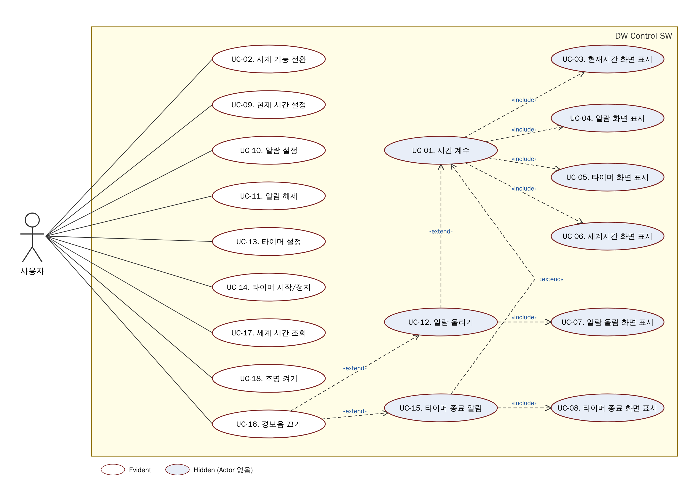

- 편집용 원본: [DigitalWatch_UseCaseDiagram.drawio](DigitalWatch_UseCaseDiagram.drawio) (draw.io에서 열기) · 벡터 이미지: [SVG](DigitalWatch_UseCaseDiagram.svg)
- Actor는 **사용자** 하나다. Evident UC 9개와 연결된다. Hidden UC 9개에는 Actor가 없다(슬라이드 86, 88의 표기와 같다).

| 관계 | Base → 대상 | 의미 |
|---|---|---|
| «include» | UC-01 → UC-03, UC-04, UC-05, UC-06 | 시간 계수는 매 tick마다 지금 모드의 화면 표시를 반드시 포함한다. |
| «include» | UC-12 → UC-07 | 알람 울리기는 알람 울림 화면 표시를 반드시 포함한다. |
| «include» | UC-15 → UC-08 | 타이머 종료 알림은 타이머 종료 화면 표시를 반드시 포함한다. |
| «extend» | UC-12 → UC-01 | 알람 시각이 되면(조건) 시간 계수를 알람 울리기가 확장한다. |
| «extend» | UC-15 → UC-01 | 타이머가 0이 되면(조건) 시간 계수를 타이머 종료 알림이 확장한다. |
| «extend» | UC-16 → UC-12, UC-15 | 경보 중 버튼이 눌리면(조건) 경보음 끄기가 확장한다. |

> 가독성을 위해 생략한 관계: Evident UC(UC-02, 09 ~ 11, 13, 14, 17)가 화면 갱신을 요청하는 관계(UC-03 ~ UC-06). 이 관계는 각 UC description에 적혀 있다.

## 6. System Sequence Diagrams (OOA)

- 편집용 원본: [ssd/DigitalWatch_SSD.drawio](ssd/DigitalWatch_SSD.drawio) (UC마다 한 페이지, 12페이지)
- 시스템을 black box(`:DW Control SW`)로 놓고, 외부에서 들어오는 **system event**와 시스템의 응답(LCD 표시, 부저)만 그렸다.
- system event 이름은 **버튼이 아니라 의도 수준**으로 지었다(슬라이드 102: `scan()`보다 `enterItem()`). 버튼 매핑은 아래 System Operations 표에 따로 적었다.
- Hidden UC는 Use Case Diagram에서는 Actor가 없지만, SSD에서는 사건을 일으키는 외부 장치가 필요하므로 `«device» Time Source`를 lifeline으로 그렸다.
- 화면 표시 UC(UC-03 ~ UC-08)는 외부 event가 없으므로 따로 SSD를 그리지 않았다. 다른 SSD의 응답 메시지("~ 화면 표시")로 나타난다.

| UC | SSD | UC | SSD |
|---|---|---|---|
| UC-01 시간 계수 | 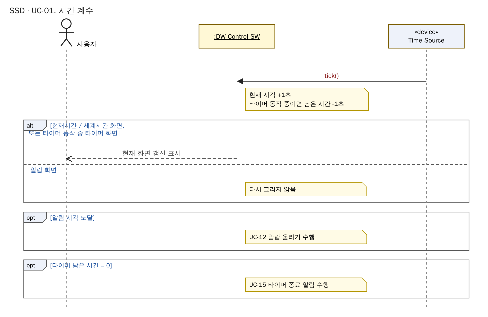 | UC-02 시계 기능 전환 | 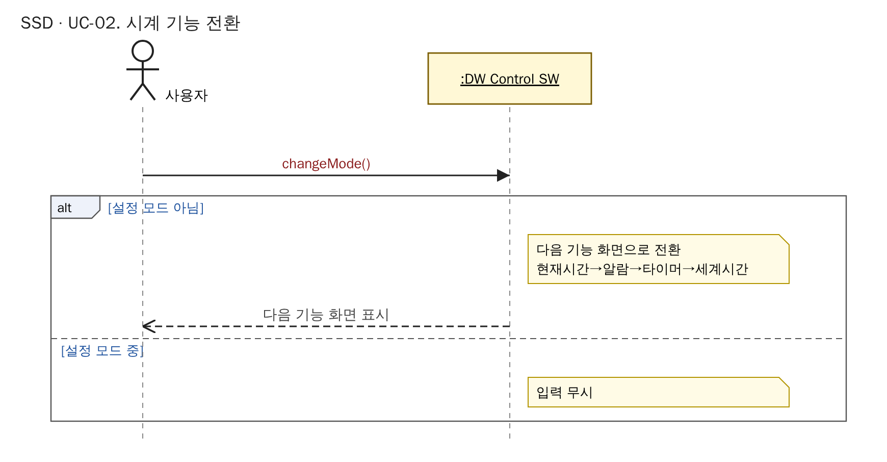 |
| UC-09 현재 시간 설정 | 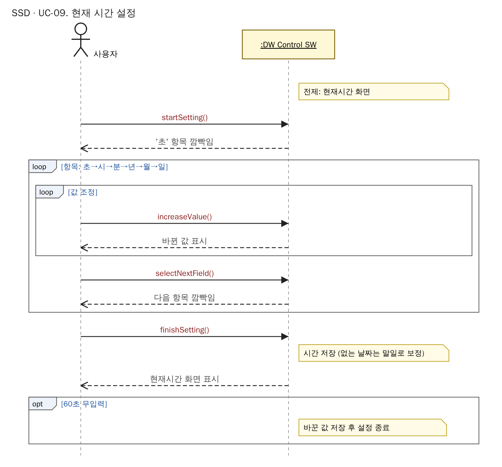 | UC-10 알람 설정 | 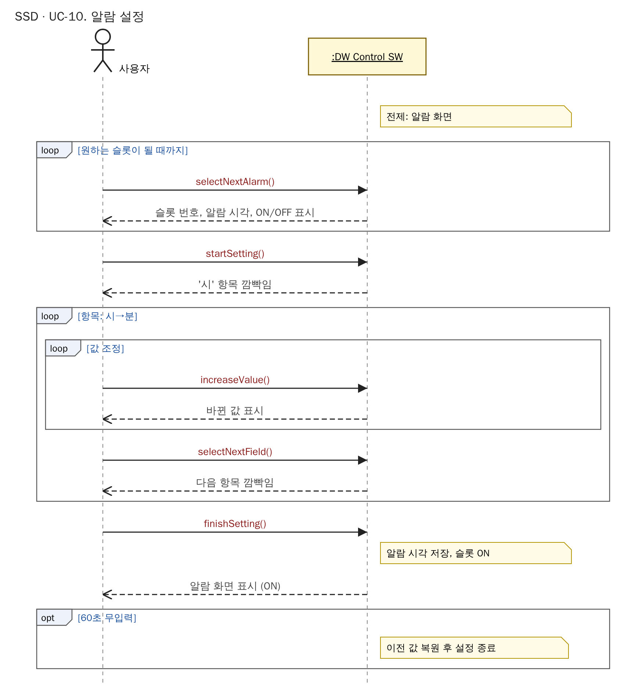 |
| UC-11 알람 해제 | 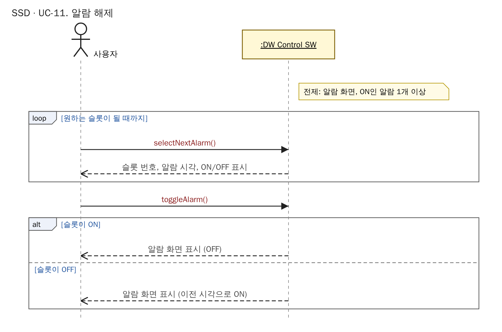 | UC-12 알람 울리기 | 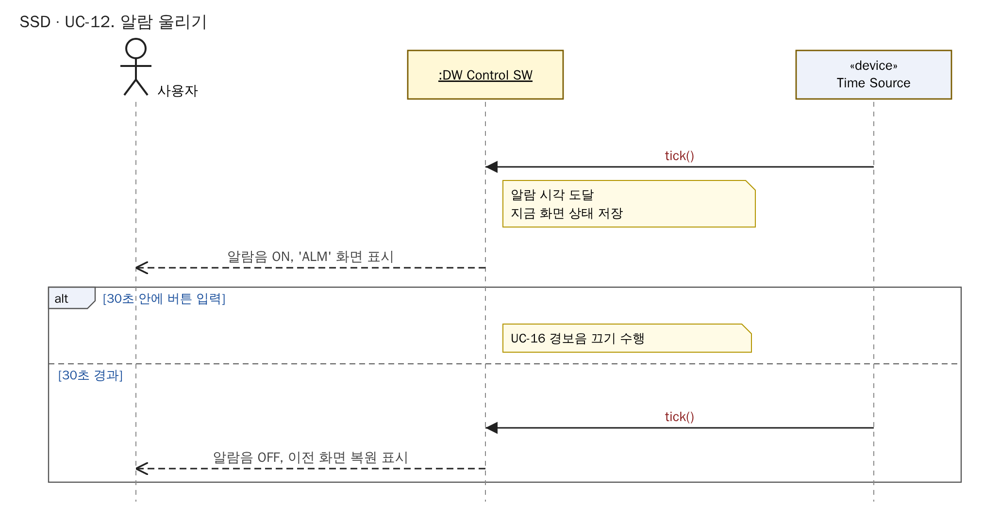 |
| UC-13 타이머 설정 | 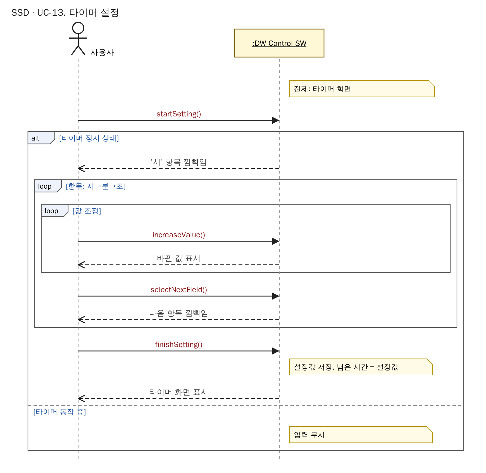 | UC-14 타이머 시작/정지 | 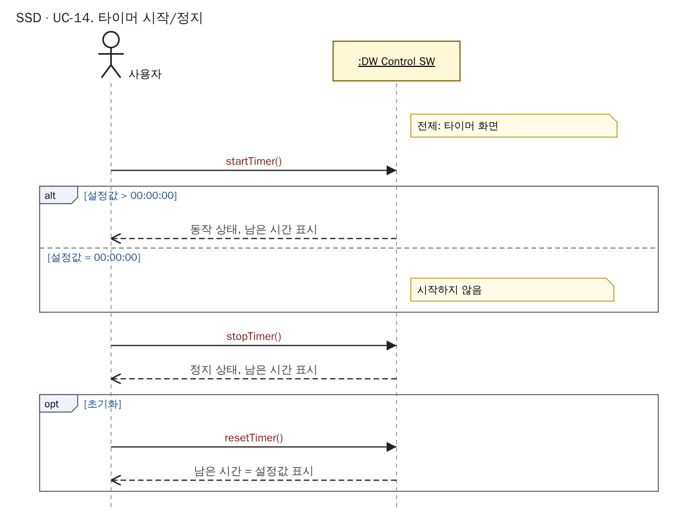 |
| UC-15 타이머 종료 알림 | 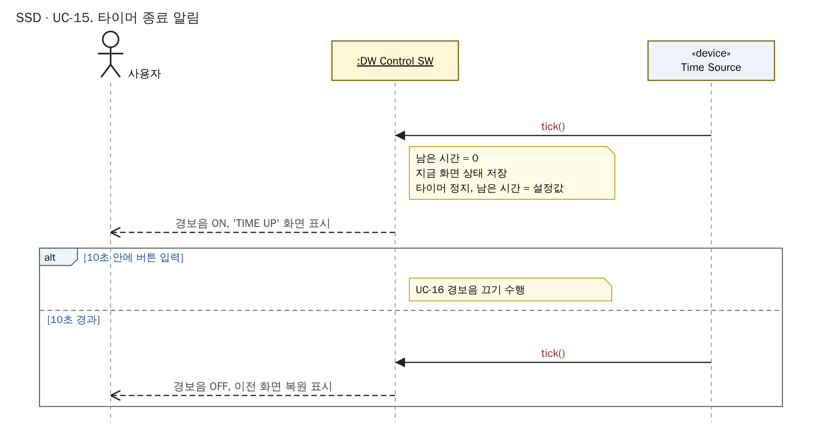 | UC-16 경보음 끄기 | 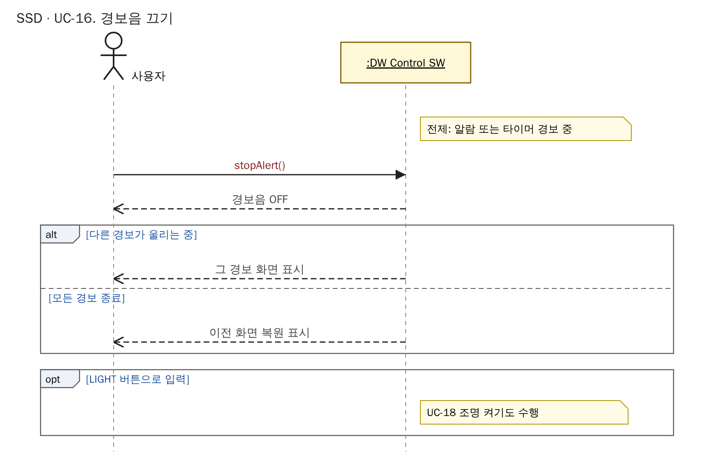 |
| UC-17 세계 시간 조회 | 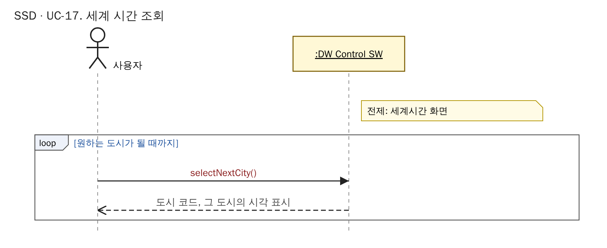 | UC-18 조명 켜기 | 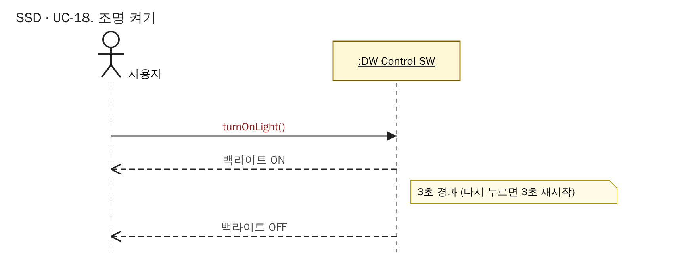 |

## 7. System Operations (System Interface)

```
{Interface}
DW Control SW
+ tick()
+ changeMode()
+ startSetting()
+ selectNextField()
+ increaseValue()
+ finishSetting()
+ selectNextAlarm()
+ toggleAlarm()
+ startTimer()
+ stopTimer()
+ resetTimer()
+ selectNextCity()
+ turnOnLight()
+ stopAlert()
```

| System Operation | 의도 | 물리 입력 (상황) | 관련 UC |
|---|---|---|---|
| `tick()` | 1초가 지났음을 알린다 | Time Source 1초 인터럽트 | UC-01, UC-12, UC-15 |
| `changeMode()` | 다음 기능 화면으로 바꾼다 | MODE | UC-02 |
| `startSetting()` | 설정 모드에 들어간다 | SET 길게 (현재시간·알람·타이머 화면) | UC-09, UC-10, UC-13 |
| `selectNextField()` | 다음 설정 항목으로 넘어간다 | SET 짧게 (설정 중) | UC-09, UC-10, UC-13 |
| `increaseValue()` | 편집 중인 값을 1 올린다 | ADJUST (설정 중) | UC-09, UC-10, UC-13 |
| `finishSetting()` | 설정을 저장하고 끝낸다 | SET 길게 (설정 중) | UC-09, UC-10, UC-13 |
| `selectNextAlarm()` | 다음 알람 슬롯을 고른다 | ADJUST (알람 화면) | UC-10, UC-11 |
| `toggleAlarm()` | 선택한 알람을 켜거나 끈다 | SET 짧게 (알람 화면) | UC-11 |
| `startTimer()` | 타이머를 시작한다 | ADJUST (타이머 화면, 정지 상태) | UC-14 |
| `stopTimer()` | 타이머를 멈춘다 | ADJUST (타이머 화면, 동작 상태) | UC-14 |
| `resetTimer()` | 남은 시간을 설정값으로 되돌린다 | SET 짧게 (타이머 화면, 정지 상태) | UC-14 |
| `selectNextCity()` | 다음 도시를 고른다 | ADJUST (세계시간 화면) | UC-17 |
| `turnOnLight()` | 백라이트를 켠다 | LIGHT | UC-18 |
| `stopAlert()` | 울리는 경보음을 끈다 | 아무 버튼 (경보 중) | UC-16 |

## 8. Traceability Table (UC ↔ SSD ↔ System Operation)

| UC | SSD | System Operations |
|---|---|---|
| UC-01 시간 계수 | SSD_UC-01 | tick() |
| UC-02 시계 기능 전환 | SSD_UC-02 | changeMode() |
| UC-03 ~ UC-06 화면 표시 | (SSD_UC-01, 02, 09 ~ 11, 13, 14, 17의 응답) | – |
| UC-07 알람 울림 화면 표시 | (SSD_UC-12의 응답) | – |
| UC-08 타이머 종료 화면 표시 | (SSD_UC-15의 응답) | – |
| UC-09 현재 시간 설정 | SSD_UC-09 | startSetting(), increaseValue(), selectNextField(), finishSetting() |
| UC-10 알람 설정 | SSD_UC-10 | selectNextAlarm(), startSetting(), increaseValue(), selectNextField(), finishSetting() |
| UC-11 알람 해제 | SSD_UC-11 | selectNextAlarm(), toggleAlarm() |
| UC-12 알람 울리기 | SSD_UC-12 | tick() |
| UC-13 타이머 설정 | SSD_UC-13 | startSetting(), increaseValue(), selectNextField(), finishSetting() |
| UC-14 타이머 시작/정지 | SSD_UC-14 | startTimer(), stopTimer(), resetTimer() |
| UC-15 타이머 종료 알림 | SSD_UC-15 | tick() |
| UC-16 경보음 끄기 | SSD_UC-16 | stopAlert() |
| UC-17 세계 시간 조회 | SSD_UC-17 | selectNextCity() |
| UC-18 조명 켜기 | SSD_UC-18 | turnOnLight() |
