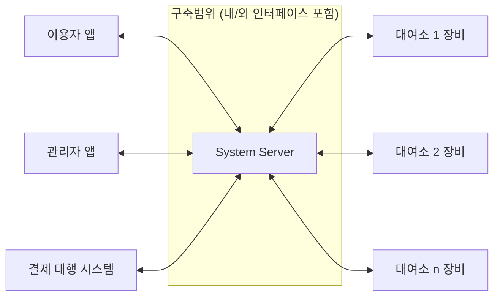

# 시스템 설계/개발 범위 (Context Diagram)

> 원본: `original/AA_SharingBycle_2.jpg`

- **구축 범위** (내/외 인터페이스 포함): **System Server**
- System Server와 양방향(↔)으로 연동하는 외부 요소:
  - 이용자 앱
  - 관리자 앱
  - 결제 대행 시스템
  - 대여소 1 장비, 대여소 2 장비, …, 대여소 n 장비

> 참고: 원본 그림에서는 하단 아이콘 라벨도 "이용자 앱"으로 표기되어 있음.
