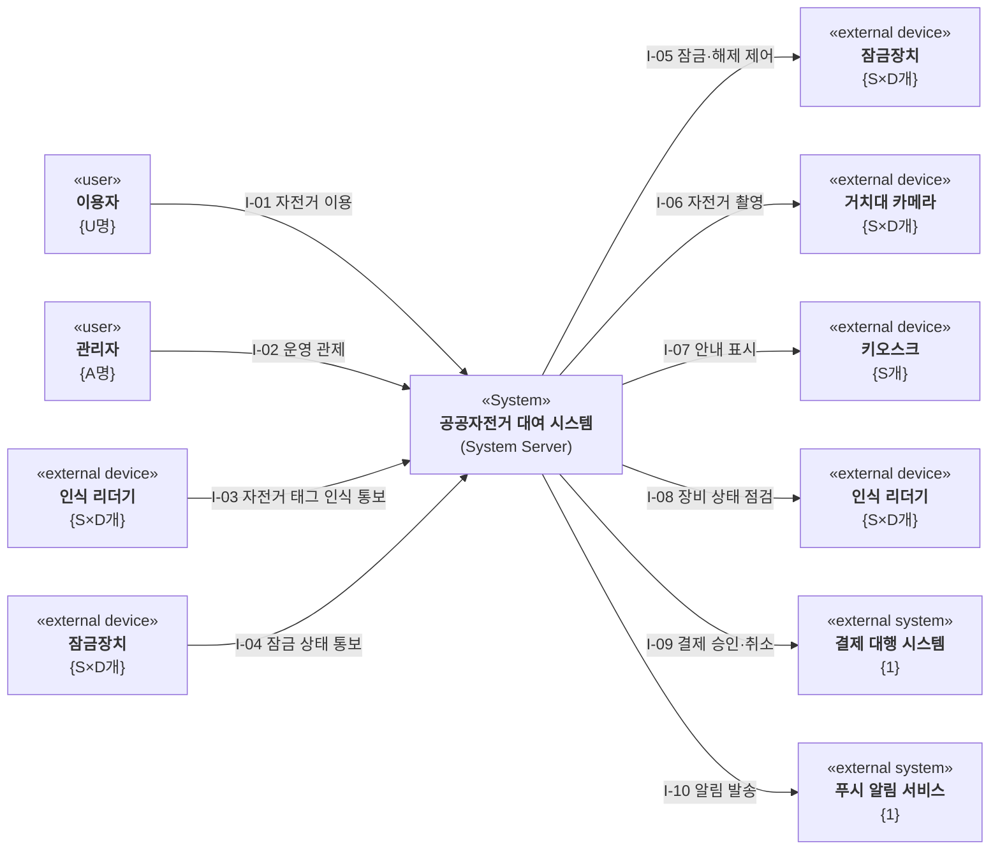

# 2. System Overview

> 공공자전거 대여 시스템 — 소프트웨어 아키텍처 명세 (양식: `2026 AA 인증과제-보고서-양식-v4.2.docx`)
> 근거 자료: [AA_SharingBycle_1~6](../AA_SharingBycle_1.md), [1장 Project Overview](01_Project_Overview.md)

## 2.1. System Context Model

### 2.1.1. System Context Diagram

개발 대상은 **공공자전거 대여 시스템(System Server)** 이다. 이용자 앱·관리자 앱, 결제 대행 시스템, 대여소 장비는 개발 범위 밖에 있는 External Entity다. 대여소 장비는 과제 자료의 "대여소 n 장비"를 역할이 다른 네 종류의 장치로 나누어 식별했다. 장치마다 인터페이스, 개수, 품질 수준이 다르기 때문이다.

화살표 방향은 데이터 흐름이 아니라 **최초 제어(요청)의 방향**(Client → Server)이다. 인터페이스 이름은 External Entity 입장에서 붙였다.

> 표기: S = 대여소 수(50,000), D = 대여소당 평균 거치대 수(10), U = 회원 이용자 수, A = 관리자 수
> 잠금장치와 인식 리더기는 양쪽에서 먼저 요청하는 채널이 모두 있어서, 이해하기 쉽도록 좌·우에 같은 장치를 두 번 표기했다. 실제로는 각각 하나의 External Entity다.
> I-08 장비 상태 점검은 인식 리더기·잠금장치·거치대 카메라·키오스크 네 장치 모두에 적용된다. 그림에는 대표로 하나만 표시했다.

**External Interface 목록**

| ID | Interface 명 (EE 관점) | Client → Server | 주요 내용 |
|---|---|---|---|
| I-01 | 자전거 이용 | 이용자 → System | 회원가입·카드 등록, 대여소 조회, 자전거 예약, QR 대여 요청, 이용·결제 내역 조회, 미결제 요금 결제 |
| I-02 | 운영 관제 | 관리자 → System | 전국 거치 현황 조회, 잠금장치 원격 잠금·해제(재배치 포함), 재배치 추천·고장 알림 조회, 정비 완료 처리, 기준값(대여 가능 자전거 하한) 설정 |
| I-03 | 자전거 태그 인식 통보 | 인식 리더기 → System | 거치대에 꽂힌 자전거의 식별 태그 ID 통보(반납 또는 재배치 거치 시작) |
| I-04 | 잠금 상태 통보 | 잠금장치 → System | 잠금 완료·해제 완료 등 잠금 상태 변화 통보(반납 확정의 근거) |
| I-05 | 잠금·해제 제어 | System → 잠금장치 | 대여 승인 시 해제, 반납 시 잠금, 관리자 원격 잠금·해제 명령 |
| I-06 | 자전거 촬영 | System → 거치대 카메라 | 반납된 자전거 촬영 요청과 이미지 수신(파손 점검용) |
| I-07 | 안내 표시 | System → 키오스크 | 반납 확정, 거치대별 대여 가능·정비 필요 상태 등 안내 화면 갱신 |
| I-08 | 장비 상태 점검 | System → 각 대여소 장비 | 리더기·잠금장치·카메라·키오스크 상태의 주기적 수집(heartbeat) |
| I-09 | 결제 승인·취소 | System → 결제 대행 시스템 | 카드 등록 확인, 예약 수수료 선결제, 이용 요금 자동 결제, 결제 실패 결과 수신 |
| I-10 | 알림 발송 | System → 푸시 알림 서비스 | 이용자: 반납 확정·결제 실패·예약 자동 취소 / 관리자: 장비 고장·재배치 추천·정비 필요 |

### 2.1.2. External Entity List

| Name | Kind | Description |
|---|---|---|
| **이용자** | 사용자 | **역할**: 이용자 앱으로 대여소를 조회·예약하고, 자전거 QR을 스캔해 대여하며, 반납 결과와 요금 결제 알림을 받는다. 이후 Use Case의 주 Actor가 된다. **Multiplicity {U명}**: 회원 약 500만 명, 출퇴근 피크 시 동시 이용 수만 명(가정 A-02). 이 규모에서도 대여·반납이 빨라야 하고(BG-01), 회원이 2배로 늘어도 서비스할 수 있어야 한다(BG-10). **단말 환경 및 숙련도**: 개인 스마트폰(iOS/Android)과 이동통신망을 쓰며, 야외에서 이동 중에 사용한다. IT 숙련도는 일반 시민부터 고령층까지 다양하므로 QR 스캔 한 번으로 대여할 수 있어야 한다. |
| **관리자** | 사용자 | **역할**: 관리자 앱으로 전국 대여소의 거치 현황, 장비 고장, 재배치 추천을 확인하고, 잠금장치를 원격으로 제어하며, 정비 상태를 관리한다. **Multiplicity {A명}**: 운영기관 관제센터와 권역별 관리자 수백 명. 전국 5만 개 대여소를 소수 인원이 관리해야 하므로 고장·쏠림을 시스템이 먼저 알려 주어야 한다(BG-04, BG-05). **단말 환경 및 숙련도**: 관제센터 PC 또는 업무용 태블릿·스마트폰을 쓰며, 운영 업무 교육을 받은 숙련 사용자다. |
| **인식 리더기** | 외부 장치 | **역할**: 거치대에 꽂힌 자전거의 식별 태그를 읽어 시스템에 통보한다. 반납 처리와 재배치 거치 처리가 여기서 시작된다. **Multiplicity {S×D = 약 50만 개}**: 거치대마다 1개(가정 A-03). 어느 대여소에서나 반납할 수 있어야 하므로(BG-01, BG-04) 모든 거치대에 있어야 한다. **품질 수준**: 대여소 통신망(LTE/유선)으로 연결되며, 통신 단절과 오인식이 생길 수 있다. 장비 자체 고장도 날 수 있어 상태 감시가 필요하다(BG-05). |
| **잠금장치** | 외부 장치 | **역할**: 시스템 명령으로 거치대의 자전거를 잠그거나 풀고, 잠금 상태를 통보한다. 잠금 확인이 곧 반납 확정의 근거다. **Multiplicity {S×D = 약 50만 개}**: 거치대마다 1개. **품질 수준**: 기계 장치라서 명령을 보낸 뒤 상태가 실제로 바뀌기까지 수 초가 걸릴 수 있고, 걸림·고장으로 실패할 수 있다. 명령 결과를 반드시 확인해야 요금 오처리를 막을 수 있다(BG-03). |
| **거치대 카메라** | 외부 장치 | **역할**: 반납된 자전거를 촬영해 이미지를 제공한다. 시스템은 이 이미지로 타이어 펑크, 체인 이탈, 부품 파손을 점검한다. **Multiplicity {S×D = 약 50만 개}**: 거치대마다 1개(가정 A-03). 모든 반납 자전거를 점검해야 파손 자전거 대여 사고를 없앨 수 있다(BG-07). **품질 수준**: 야간·역광·우천 때 이미지 품질이 떨어질 수 있다. 이미지 전송량이 커서 통신 대역폭 제약이 있다. |
| **키오스크** | 외부 장치 | **역할**: 대여소 현장에서 거치대별 상태(대여 가능·정비 필요·빈 거치대)와 반납 확정을 안내한다. **Multiplicity {S = 50,000개}**: 대여소마다 1개(가정 A-03). 앱 알림이 늦거나 오지 않아도 현장에서 반납을 확인할 수 있게 한다(BG-01, BG-03). **품질 수준**: 옥외 설치로 고장·통신 단절이 생길 수 있고, 표시 갱신이 늦을 수 있다. |
| **결제 대행 시스템** | 외부 시스템 | **역할**: 이용자가 등록한 신용카드로 예약 수수료와 이용 요금을 결제(승인)하거나 취소하고, 결과를 돌려준다. **Multiplicity {1}**: 계약한 PG사 1곳(가정 A-08). 하나의 대여·반납에 결제가 한 번만 이루어져야 한다(BG-03, BG-12). **품질 수준**: 외부 사업자 서비스라 응답 지연(수 초)이나 일시 장애가 생길 수 있고, 시스템이 이를 통제할 수 없다. 결제가 늦어지거나 실패해도 대여·반납 처리는 멈추지 않아야 한다(BG-01, BG-08). |
| **푸시 알림 서비스** | 외부 시스템 | **역할**: 시스템의 요청을 받아 이용자 앱·관리자 앱으로 푸시 알림을 전달한다. **Multiplicity {1}**: 모바일 OS용 푸시 서비스(가정 A-07). **품질 수준**: 전달은 최선 노력(best-effort) 방식이라 지연·유실될 수 있다. 그래서 반납 확정은 키오스크와 앱 조회로도 확인할 수 있게 한다. |

## 2.2. System Feature List

| ID | Title | Description | I | Related Business Goal ID |
|---|---|---|---|---|
| SF-01 | 가고 싶은 대여소에 자전거가 있는지 미리 알고 확보한다 | 이용자는 현재 위치나 원하는 위치 주변 대여소의 대여 가능 자전거 수, 빈 거치대 수, 요금을 앱으로 확인한다. 필요하면 자전거를 예약해 15분 동안 확보할 수 있어 헛걸음이 줄어든다. | 중 | BG-02 |
| SF-02 | 줄 서거나 기다리지 않고 바로 빌린다 | 이용자는 키오스크 조작이나 회원 확인 절차 없이 앱으로 QR만 스캔하면 즉시 잠금이 풀려 자전거를 탈 수 있다. 출퇴근 피크에도 대여가 지연되지 않는다. | 상 | BG-01, BG-02 |
| SF-03 | 어느 대여소에서나 꽂기만 하면 반납이 끝난다 | 이용자는 빌린 대여소가 아니어도 빈 거치대에 자전거를 꽂기만 하면 된다. 반납이 확정되면 키오스크와 앱으로 바로 알 수 있어, 반납이 됐는지 걱정하지 않아도 된다. | 상 | BG-01, BG-03 |
| SF-04 | 요금은 정확히 한 번, 자동으로 정산된다 | 반납이 확정되면 이용 시간에 따른 요금에서 예약 수수료를 뺀 금액이 등록 카드로 자동 결제된다. 같은 대여에 대해 중복 청구나 누락이 생기지 않아 이용자와 운영기관, PG사 모두 정산 결과를 믿을 수 있다. | 상 | BG-03, BG-09, BG-12 |
| SF-05 | 요금을 내지 않으면 다음 이용이 제한된다 | 결제에 실패하면 이용자에게 즉시 알리고, 미결제 요금을 해결하기 전까지 새 대여를 막아 미수금이 쌓이지 않게 한다. | 중 | BG-09 |
| SF-06 | 고장 난 자전거는 다음 사람이 빌릴 수 없다 | 반납된 자전거를 자동으로 촬영·점검해 파손이 의심되면 즉시 대여를 막고 정비 대상으로 알려 준다. 정비 담당자는 순회 점검 없이 정비할 자전거를 바로 찾을 수 있다. | 상 | BG-07 |
| SF-07 | 대여소 장비 고장을 민원보다 먼저 안다 | 전국 대여소 장비의 상태를 계속 확인해 고장이 나면 곧바로 관리자에게 알리므로, 서비스 공백이 생기기 전에 조치할 수 있다. | 상 | BG-05, BG-08 |
| SF-08 | 전국 대여소를 한 화면에서 보고 원격으로 조치한다 | 관리자는 전국 대여소의 거치대·자전거·빈 거치대 현황을 한눈에 보고, 현장에 가지 않고도 잠금장치를 잠그거나 풀 수 있다. | 중 | BG-04, BG-05 |
| SF-09 | 자전거가 부족하거나 넘치는 대여소를 미리 짚어 준다 | 대여 가능 자전거가 기준보다 적거나 빈 거치대가 10% 미만인 대여소를 주기적으로 찾아 관리자에게 추천한다. 재배치로 옮기는 자전거는 '재배치 중'으로 따로 관리해 이용 기록·요금과 섞이지 않는다. | 중 | BG-02, BG-04, BG-06 |
| SF-10 | 24시간 365일 멈추지 않는 서비스 | 일부 장비·서버·외부 시스템에 장애가 생겨도 전국 대여·반납 서비스가 계속되고, 기능 개선과 점검도 서비스를 멈추지 않고 진행한다. | 상 | BG-08, BG-15 |
| SF-11 | 이용자의 개인·결제·위치 정보를 안전하게 지킨다 | 회원 정보, 카드 정보, 이용 이력을 허가된 사람만 필요한 만큼만 볼 수 있게 보호해 유출 사고를 막고 보안 인증 기준을 만족한다. | 상 | BG-11 |
| SF-12 | 대여소와 이용자가 늘어도 그대로 쓴다 | 대여소·회원 수가 늘어도 시스템을 다시 구축하지 않고 확장만으로 같은 서비스 품질을 유지한다. | 중 | BG-10 |
| SF-13 | 새 장비와 외부 시스템을 쉽게 붙인다 | 장비 모델이나 공급사가 바뀌거나 결제 대행사가 바뀌어도 시스템 전체를 고치지 않고 연동 부분만 추가해 빠르게 적용한다. | 하 | BG-13, BG-14 |
| SF-14 | 문제가 생기면 원인을 빨리 찾는다 | 대여·반납·결제·장비 통신의 처리 과정을 추적할 수 있어, 장애나 민원이 생겼을 때 어디에서 문제가 났는지 빠르게 파악한다. | 중 | BG-15, BG-05 |

\* I(Importance): 상 / 중 / 하로 구분

**BG ↔ SF 추적성 (모든 BG에 대응하는 SF가 있는지 확인)**

| BG | 관련 SF | BG | 관련 SF |
|---|---|---|---|
| BG-01 대여·반납 신속성 | SF-02, SF-03 | BG-09 미수율 | SF-04, SF-05 |
| BG-02 확실한 이용 | SF-01, SF-02, SF-09 | BG-10 수요 증가 대응 | SF-12 |
| BG-03 요금 정확성 | SF-03, SF-04 | BG-11 개인정보 보호 | SF-11 |
| BG-04 쏠림 해소 | SF-08, SF-09 | BG-12 정산 불일치 | SF-04 |
| BG-05 고장 인지 | SF-07, SF-08, SF-14 | BG-13 장비 연동 기간 | SF-13 |
| BG-06 재배치 기록 정확성 | SF-09 | BG-14 개발 일정·예산 | SF-13 |
| BG-07 파손 자전거 차단 | SF-06 | BG-15 무중단 배포·장애 분석 | SF-10, SF-14 |
| BG-08 가용률 | SF-07, SF-10 | | |

## 2.3. Assumptions about the System

과제 안내 자료에 명시되지 않았지만 설계에 필요해서 세운 가정과, 과제 내용을 수정·확장한 부분이다.

**규모 및 부하**

| ID | 가정 |
|---|---|
| A-01 | 대여소 S = 50,000개, 대여소당 평균 거치대 D = 10개(총 약 50만 거치대), 운영 자전거 약 40만 대로 가정한다. |
| A-02 | 회원 약 500만 명, 하루 대여 약 100만 건으로 가정한다. 출퇴근 피크 1시간에 하루 건수의 15%(약 15만 건, 평균 약 42건/초)가 몰리고, 순간 최대는 평균의 3배(약 150건/초)로 본다. 반납도 같은 수준이다. |
| A-03 | 인식 리더기·잠금장치·거치대 카메라는 거치대마다 1개, 키오스크는 대여소마다 1개다. 각 장비는 대여소 통신 모듈(LTE/유선)로 서버와 IP 통신을 하며, 통신 단절이 생길 수 있다. |

**외부 연동 (과제 확장 포함)**

| ID | 가정 |
|---|---|
| A-04 | 과제 자료의 "대여소 n 장비"는 역할이 다른 인식 리더기·잠금장치·거치대 카메라·키오스크 네 종류로 나누어 External Entity로 식별한다. 대여소 단위 중계 장치(게이트웨이)는 두지 않는다. |
| A-05 | 이용자 앱과 관리자 앱은 개발 범위 밖에 있으며, 시스템이 제공하는 API를 사용한다. Context Diagram과 Use Case에서는 앱을 쓰는 사람(이용자·관리자)을 External Entity·Actor로 표기한다. |
| A-06 | QR 코드와 식별 태그에는 같은 자전거 ID가 들어 있다. 앱은 스캔한 자전거 ID를 서버에 보내 대여를 요청한다. |
| A-07 | **(확장)** 시스템이 먼저 이용자·관리자에게 알리는 기능(반납 확정, 결제 실패, 고장 알림 등)은 외부 푸시 알림 서비스로 전달한다. |
| A-08 | 결제 대행 시스템은 1곳이며, 승인·취소 API와 거래 식별자(멱등 키)로 중복 요청을 걸러 주는 기능을 제공한다. 응답 시간은 보통 3초 이내이지만 일시 장애가 생길 수 있다. |

**업무 규칙 (과제 해석·확장)**

| ID | 가정 |
|---|---|
| A-09 | 예약은 특정 자전거 단위로 하며, 이용자 1명은 동시에 예약 1건, 대여 1대까지만 할 수 있다. 예약한 이용자가 15분 안에 QR로 대여하면 예약이 끝나고 대여로 바뀐다. |
| A-10 | 요금표(기본 요금, 시간당 요금, 예약 수수료)는 관리자가 설정한다. 예약 수수료가 이용 요금보다 크면 추가 결제 금액은 0원이고, 차액은 환불하지 않는다. |
| A-11 | 자동 결제에 실패하면 시스템이 정해진 횟수만큼 재시도한다. 그래도 실패하면 이용자가 앱에서 카드를 바꾸거나 다시 결제해 미결제를 해결한다. 해결되면 대여 제한이 풀린다. |
| A-12 | 대여 승인 후 일정 시간(예: 30초) 안에 잠금 해제가 확인되지 않으면 대여를 취소하며, 요금은 발생하지 않는다. |
| A-13 | 반납 시 잠금장치가 잠금을 확인하지 못하면 반납이 확정되지 않는다. 이 경우 키오스크·앱으로 다시 거치하라고 안내한다. |
| A-14 | 파손 점검은 카메라 이미지를 시스템이 자동 분석해 판정한다(분석 기능은 구축 범위에 포함). 판정이 불확실하면 안전을 위해 '정비 필요'로 처리한다. 정비가 끝나면 관리자가 관리자 앱에서 대여 가능 상태로 되돌린다. |
| A-15 | 장비 상태는 1분 주기로 수집한다. 연속 3회 응답이 없거나 장비가 오류를 보고하면 고장으로 판단한다. |
| A-16 | 재배치 추천은 5분 주기로 계산한다. '대여 가능 자전거 하한' 기준은 관리자가 대여소별 또는 전체 기본값으로 설정한다. |
| A-17 | 관리자의 원격 잠금 해제는 '재배치'와 '장애 조치'로 목적을 구분해 기록한다. '재배치 중'인 자전거는 대여할 수 없으며, 다른 대여소 리더기에 인식되면 요금 정산 없이 그 대여소에 거치된 것으로 반영한다. |
| A-18 | 재배치 기사와 정비 담당자는 시스템을 직접 쓰지 않는다. 관리자가 전화 등 오프라인으로 작업을 지시하므로, 이들은 External Entity에 포함하지 않는다. |
