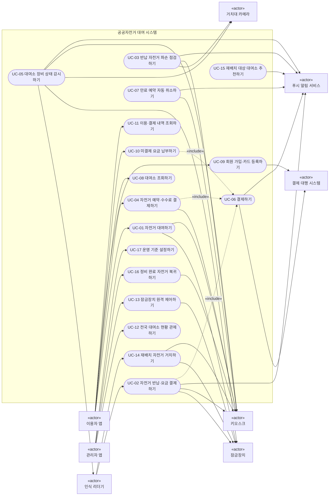

# 3. Architectural Driver

> 공공자전거 대여 시스템 — 소프트웨어 아키텍처 명세 (양식: `2026 AA 인증과제-보고서-양식-v4.2.docx`)
> 근거 자료: [AA_SharingBycle_1~6](../AA_SharingBycle_1.md), [1장](01_Project_Overview.md), [2장](02_System_Overview.md)

## 3.1. Primary Functionality

### 3.1.1. Use Case Diagram

Actor는 2장 System Context Model의 External Entity와 같다: 이용자 앱, 관리자 앱, 인식 리더기, 잠금장치, 거치대 카메라, 키오스크, 결제 대행 시스템, 푸시 알림 서비스.
Association 방향은 interaction을 **처음 시작하는 쪽**에서 받는 쪽으로 그렸다. 시스템 내부 주기(타이머)나 다른 UC의 완료 이벤트로 시작하는 UC(UC-03, UC-05, UC-07, UC-15)는 Triggering actor가 없고, 시스템에서 장비·외부 시스템 쪽으로만 Association이 있다.

> - 실선 화살표는 Association(최초 제어 방향), 점선은 «include»다.
> - UC-06 결제하기는 반납·예약·미결제 납부에서 공통으로 쓰는 결제 기능이다. 그래서 «include»로 분리했고, 이를 포함하는 UC 이름에 결제 기능을 드러냈다.
> - 장비가 시스템에 보내는 응답(잠금장치의 잠금·해제 완료 통보 I-04, 카메라 이미지, 장비 상태 응답)은 시스템이 시작한 interaction의 응답이라 별도 Association으로 그리지 않았다.

**Use Case 목록**

| ID | Use Case | Triggering Actor | 관련 Actor | 관련 SF |
|---|---|---|---|---|
| UC-01 | 자전거 대여하기 | 이용자 앱 | 잠금장치, 키오스크 | SF-02 |
| UC-02 | 자전거 반납·요금 결제하기 | 인식 리더기 | 잠금장치, 키오스크, 푸시 알림 서비스, (UC-06) | SF-03, SF-04, SF-05 |
| UC-03 | 반납 자전거 파손 점검하기 | (반납 확정 이벤트) | 거치대 카메라, 키오스크, 푸시 알림 서비스 | SF-06 |
| UC-04 | 자전거 예약·수수료 결제하기 | 이용자 앱 | 키오스크, (UC-06) | SF-01 |
| UC-05 | 대여소 장비 상태 감시하기 | (1분 주기) | 인식 리더기, 잠금장치, 거치대 카메라, 키오스크, 푸시 알림 서비스 | SF-07 |
| UC-06 | 결제하기 | (포함하는 UC) | 결제 대행 시스템, 푸시 알림 서비스 | SF-04, SF-05 |
| UC-07 | 만료 예약 자동 취소하기 | (예약 만료 시각) | 키오스크, 푸시 알림 서비스 | SF-01 |
| UC-08 | 대여소 조회하기 | 이용자 앱 | — | SF-01 |
| UC-09 | 회원 가입·카드 등록하기 | 이용자 앱 | 결제 대행 시스템 | SF-04, SF-11 |
| UC-10 | 미결제 요금 납부하기 | 이용자 앱 | (UC-06) | SF-05 |
| UC-11 | 이용·결제 내역 조회하기 | 이용자 앱 | — | SF-04 |
| UC-12 | 전국 대여소 현황 관제하기 | 관리자 앱 | — | SF-08 |
| UC-13 | 잠금장치 원격 제어하기 | 관리자 앱 | 잠금장치 | SF-08, SF-09 |
| UC-14 | 재배치 자전거 거치하기 | 인식 리더기 | 잠금장치, 키오스크 | SF-09 |
| UC-15 | 재배치 대상 대여소 추천하기 | (5분 주기) | 푸시 알림 서비스 | SF-09 |
| UC-16 | 정비 완료 자전거 복귀하기 | 관리자 앱 | 키오스크 | SF-06 |
| UC-17 | 운영 기준 설정하기 (요금표, 대여 가능 하한) | 관리자 앱 | — | SF-04, SF-09 |

> 텍스트 명세는 중요도가 가장 높은 5개(UC-01~UC-05)만 작성한다. 이 5개는 핵심 업무(대여·반납·정산), 안전(파손 차단), 예약, 가용성(장비 고장)을 대표하며, 3.2절 QA 시나리오의 대상이다.
> 공유 데이터는 `[ ]`로 표시한다: [회원 정보], [자전거 상태], [대여 기록], [예약], [결제 내역], [요금표], [장비 상태], [대여소 현황], [점검 기록].

### 3.1.2. UC-01 자전거 대여하기

| 항목 | 내용 |
|---|---|
| **UC name** | UC-01 자전거 대여하기 |
| **Actors** | 이용자 앱(Triggering), 잠금장치, 키오스크 |
| **Pre-conditions** | **P1 (회원 인증)**: 요청이 유효한 회원 인증 토큰을 갖고 있다. 아니면 거절하고 로그인을 요구한다. **P2 (결제 수단 등록)**: [회원 정보]에 유효한 신용카드가 등록되어 있다. 아니면 거절하고 카드 등록을 안내한다. **P3 (미결제 요금 없음)**: [결제 내역]에 해당 회원의 미결제 건이 없다. 아니면 거절하고 미결제 금액과 납부 방법(UC-10)을 안내한다. **P4 (진행 중 대여 없음)**: [대여 기록]에 해당 회원의 '대여 중' 건이 없다(1인 1대, A-09). 아니면 거절한다. **P5 (대여 가능한 자전거)**: [자전거 상태]가 '대여 가능'이거나, 요청한 회원이 예약한 '예약됨'이다. '정비 필요', '점검 대기', '재배치 중', 다른 회원의 '예약됨'이면 거절하고 사유를 알린다. **P6 (거치대 잠금장치 정상)**: [장비 상태]에서 해당 거치대 잠금장치가 '정상'이다. 아니면 거절하고 같은 대여소의 다른 자전거를 안내한다. |
| **Main success flow** | 1. 이용자 앱이 이용자가 스캔한 자전거 ID(QR)로 대여를 요청한다. 2. 시스템은 선행 조건을 검증한다. 3. 시스템은 [자전거 상태]를 '대여 처리 중'으로 바꿔 다른 요청이 같은 자전거를 대여·예약하지 못하게 한다. 4. 시스템은 해당 거치대 잠금장치에 해제를 명령한다. 5. 잠금장치가 해제 완료를 통보한다. 6. 시스템은 [대여 기록](회원, 자전거, 대여소, 대여 시각 = 해제 확인 시각)을 만들고 [자전거 상태]를 '대여 중'으로 바꿔 대여를 확정한다. 7. 시스템은 이용자 앱에 대여 완료(대여 시각, 요금 기준)를 응답한다. 8. 시스템은 [대여소 현황]의 대여 가능 자전거 수와 빈 거치대 수를 갱신한다. 9. 시스템은 키오스크에 해당 거치대를 '빈 거치대'로 표시하도록 요청한다. |
| **Alternative flow** | **A1: 예약한 자전거를 대여하는 경우** 2a. 시스템은 해당 자전거의 [예약]이 요청한 회원의 것이고 만료 전임을 확인한다. 6a. 시스템은 [예약]을 '대여 전환'으로 끝내고, 예약 수수료를 [대여 기록]에 연결해 반납 때 요금에서 빼도록 한다. **A2: 같은 자전거에 대여·예약 요청이 동시에 들어오는 경우** 3a. 시스템은 [자전거 상태]를 먼저 '대여 처리 중'으로 바꾼 요청 하나만 진행한다. 3b. 시스템은 나머지 요청을 "이미 이용 중인 자전거"로 거절한다. |
| **Exceptional flow** | **E1: 잠금 해제 응답 시간 초과** 5a. 30초(A-12) 안에 해제 완료 통보가 없으면, 시스템은 해제 취소(잠금)를 명령하고 대여를 취소한다. 요금은 발생하지 않는다. 5b. 시스템은 [자전거 상태]를 원래 상태로 되돌리고, 해당 잠금장치를 [장비 상태] '점검 필요'로 기록한다(A-20). 5c. 시스템은 이용자 앱에 대여 실패를 응답하고 다른 자전거를 안내한다. **E2: 잠금장치가 해제 실패를 통보** 5a. 시스템은 E1의 5a~5c를 수행한다. 고장 판정과 관리자 알림은 UC-05가 한다(A-20). **E3: 이용자 앱이 같은 요청을 다시 보냄(통신 단절 후 재전송)** 1a. 시스템은 요청 ID로 중복을 판별해, 이미 처리한 요청이면 기존 결과만 응답한다. |
| **Post-conditions** | **Q1 (대여 기록 생성)**: 해제 확인 시각을 대여 시각으로 하는 [대여 기록]이 정확히 1건 있다. **Q2 (자전거 대여 중)**: [자전거 상태]가 '대여 중'이고, 다른 회원은 대여·예약할 수 없다. **Q3 (현황 반영)**: [대여소 현황]의 대여 가능 자전거 수와 빈 거치대 수가 반영되어 있다. **Q4 (예약 종료)**: 예약이 있었으면 [예약]이 '대여 전환'으로 종료되어 있다. |

### 3.1.3. UC-02 자전거 반납·요금 결제하기

| 항목 | 내용 |
|---|---|
| **UC name** | UC-02 자전거 반납·요금 결제하기 |
| **Actors** | 인식 리더기(Triggering), 잠금장치, 키오스크, 푸시 알림 서비스, (결제 대행 시스템: UC-06 «include») |
| **Pre-conditions** | **P1 (등록된 거치대 장비)**: 통보한 인식 리더기가 [장비 상태]에 등록된 운영 중 장비다. 아니면 무시하고 보안 이벤트로 기록한다. **P2 (대여 중인 자전거)**: 인식된 태그의 자전거에 '대여 중'인 [대여 기록]이 있다. '재배치 중'이면 UC-14를 수행한다. 이미 거치된 자전거이면 무시하고 이상 이벤트로 기록한다. |
| **Main success flow** | 1. 인식 리더기가 거치대에 꽂힌 자전거의 식별 태그 ID를 통보한다. 2. 시스템은 해당 자전거의 진행 중 [대여 기록]을 찾아 '반납 처리 중'으로 바꾼다. 3. 시스템은 해당 거치대 잠금장치에 잠금을 명령한다. 4. 잠금장치가 잠금 완료를 통보한다. 5. 시스템은 [대여 기록]에 반납 시각(= 잠금 확인 시각)과 반납 대여소를 기록해 반납을 확정한다. 6. 시스템은 [자전거 상태]를 '점검 대기'(대여 불가, A-19)로 바꾸고 파손 점검(UC-03)을 시작시킨다. 7. 시스템은 키오스크에 반납 확정을 표시하도록 요청한다. 8. 시스템은 [대여소 현황]을 갱신한다. 9. 시스템은 푸시 알림 서비스로 이용자 앱에 반납 확정과 이용 시간을 알린다. 10. 시스템은 [요금표]로 이용 요금을 계산한다: (대여 시각~반납 시각 이용 시간에 따른 요금) − (예약 수수료). 결과가 0보다 작으면 0원으로 한다(A-10). 11. 시스템은 [대여 기록] ID를 결제 식별자로 하여 이용 요금을 결제한다(UC-06 «include»). 12. 시스템은 결제 결과를 [결제 내역]에 기록한다. 13. 시스템은 푸시 알림 서비스로 이용자 앱에 결제 완료를 알린다. |
| **Alternative flow** | **A1: 결제할 금액이 0원인 경우** 11a. 시스템은 결제 대행 시스템을 호출하지 않고 [결제 내역]에 0원 정산 완료로 기록한다. **A2: 자동 결제 실패(카드 한도·정지 등)** 12a. 시스템은 [결제 내역]을 '미결제'로 기록하고, 해당 회원에게 신규 대여·예약 제한을 건다. 13a. 시스템은 푸시 알림 서비스로 이용자 앱에 결제 실패와 납부 방법(UC-10)을 알린다. **A3: 결제 대행 시스템 응답 지연** 11a. 반납 확정 처리(5~9)는 결제 결과를 기다리지 않고 먼저 끝낸다. 결제는 '결제 대기'로 보관했다가 같은 결제 식별자로 재시도해, 정확히 한 번만 승인되게 한다. |
| **Exceptional flow** | **E1: 잠금 확인 시간 초과·잠금 실패** 4a. 10초(A-13) 안에 잠금 완료 통보가 없거나 실패를 통보하면, 시스템은 반납을 확정하지 않고 [대여 기록]을 '대여 중'으로 되돌린다. 요금 시간은 계속 흐른다. 4b. 시스템은 키오스크와 이용자 앱(푸시)에 "다시 꽂아 주세요"라고 안내한다. 4c. 같은 거치대에서 3회 연속 실패하면, 시스템은 해당 잠금장치를 [장비 상태] '점검 필요'로 기록하고(A-20) 다른 거치대에 반납하도록 안내한다. **E2: 같은 태그가 중복 통보됨** 1a. 이미 반납이 확정된 [대여 기록]이면 무시해 중복 정산을 막는다. **E3: 푸시 알림 전달 실패** 9a. 반납 확정은 키오스크 표시와 이용자 앱의 이용 내역 조회(UC-11)로 확인할 수 있다. 시스템은 알림을 정해진 횟수만큼 재시도한다. |
| **Post-conditions** | **Q1 (반납 확정)**: [대여 기록]에 잠금 확인 시각으로 반납 시각과 반납 대여소가 기록되어 있다. **Q2 (정확히 한 번 정산)**: 해당 [대여 기록]에 대해 [결제 내역]이 정확히 1건 있고, 상태는 '결제 완료' 또는 '미결제(대여 제한)'다. **Q3 (자전거 위치·상태)**: 자전거는 반납 대여소에 거치되어 있고 [자전거 상태]는 '점검 대기'이며, 파손 점검(UC-03)이 요청되어 있다. **Q4 (현황 반영)**: [대여소 현황]이 갱신되어 있다. |

### 3.1.4. UC-03 반납 자전거 파손 점검하기

| 항목 | 내용 |
|---|---|
| **UC name** | UC-03 반납 자전거 파손 점검하기 |
| **Actors** | 거치대 카메라, 키오스크, 푸시 알림 서비스 (시작: UC-02의 반납 확정 이벤트) |
| **Pre-conditions** | **P1 (점검 대기 자전거)**: [자전거 상태]가 '점검 대기'다. 아니면 점검을 수행하지 않는다. **P2 (거치대 카메라 정상)**: [장비 상태]에서 해당 거치대 카메라가 '정상'이다. 아니면 점검할 수 없으므로 안전을 위해 자전거를 '정비 필요(점검 불가)'로 바꾸고 관리자에게 알린다. |
| **Main success flow** | 1. 시스템은 반납 확정된 자전거가 거치된 거치대의 카메라에 촬영을 요청한다. 2. 거치대 카메라가 촬영 이미지를 전송한다. 3. 시스템은 이미지를 분석해 타이어 펑크, 체인 이탈, 부품 파손 여부를 판정한다. 4. 시스템은 '정상' 판정 결과와 이미지를 [점검 기록]에 남긴다. 5. 시스템은 [자전거 상태]를 '대여 가능'으로 바꾼다. 6. 시스템은 키오스크에 해당 거치대를 '대여 가능'으로 표시하도록 요청한다. 7. 시스템은 [대여소 현황]의 대여 가능 자전거 수를 갱신한다. |
| **Alternative flow** | **A1: 파손으로 판정된 경우** 4a. 시스템은 파손 유형과 이미지를 [점검 기록]에 남긴다. 5a. 시스템은 [자전거 상태]를 '정비 필요'로 바꿔 대여를 막는다. 이미 정산된 요금은 바꾸지 않는다. 6a. 시스템은 키오스크에 해당 거치대를 '정비 필요'로 표시하도록 요청한다. 7a. 시스템은 푸시 알림 서비스로 관리자 앱에 정비 필요 자전거(대여소, 거치대, 파손 유형)를 알린다. **A2: 판정 신뢰도가 기준보다 낮은 경우** 3a. 시스템은 안전을 위해 A1과 똑같이 '정비 필요'로 처리하고, [점검 기록]에 '판정 불확실'로 표시한다(A-14). |
| **Exceptional flow** | **E1: 촬영 응답 시간 초과 또는 판독할 수 없는 이미지** 2a. 시스템은 촬영을 1회 다시 요청한다. 2b. 다시 실패하면, 시스템은 [자전거 상태]를 '정비 필요(점검 불가)'로 바꾸고 관리자 앱에 알린다. 2c. 시스템은 카메라를 [장비 상태] '점검 필요'로 기록한다(A-20). |
| **Post-conditions** | **Q1 (점검 결과 기록)**: [점검 기록]에 판정 결과·근거 이미지·판정 시각이 있다. **Q2 (대여 가능 여부 결정)**: [자전거 상태]가 '대여 가능' 또는 '정비 필요'로 정해져 있다. '점검 대기'로 남아 있지 않다. **Q3 (요금 무관)**: 점검 결과로 해당 이용자의 [결제 내역]이 바뀌지 않는다. |

### 3.1.5. UC-04 자전거 예약·수수료 결제하기

| 항목 | 내용 |
|---|---|
| **UC name** | UC-04 자전거 예약·수수료 결제하기 |
| **Actors** | 이용자 앱(Triggering), 키오스크, (결제 대행 시스템: UC-06 «include») |
| **Pre-conditions** | **P1 (회원 인증)**, **P2 (결제 수단 등록)**, **P3 (미결제 요금 없음)**: UC-01과 같다. **P4 (진행 중 예약·대여 없음)**: 해당 회원에게 유효한 [예약]이나 '대여 중'인 [대여 기록]이 없다(A-09). 아니면 거절한다. **P5 (운영 중 대여소)**: 요청한 대여소가 운영 중이다. 아니면 거절한다. |
| **Main success flow** | 1. 이용자 앱이 대여소 조회(UC-08) 결과에서 고른 대여소의 자전거 예약을 요청한다. 2. 시스템은 해당 대여소에서 '대여 가능'이고 잠금장치가 정상인 자전거 하나를 골라, [자전거 상태]를 '예약 처리 중'으로 바꿔 잠정 확보한다. 3. 시스템은 [요금표]의 예약 수수료를 등록 카드로 결제한다(UC-06 «include», 결제 식별자 = 예약 ID). 4. 시스템은 [예약](회원, 자전거, 거치대, 만료 시각 = 결제 시각 + 15분)을 만든다. 5. 시스템은 [자전거 상태]를 '예약됨'으로 바꾼다. 6. 시스템은 [대여소 현황]의 대여 가능 자전거 수를 갱신한다. 7. 시스템은 키오스크에 해당 거치대를 '예약됨'으로 표시하도록 요청한다. 8. 시스템은 이용자 앱에 예약 확정(대여소, 거치대 번호, 만료 시각)을 응답한다. |
| **Alternative flow** | **A1: 대여 가능한 자전거가 없는 경우(동시 대여·예약으로 소진)** 2a. 시스템은 결제하지 않고 이용자 앱에 예약 불가와 가까운 다른 대여소를 응답한다. **A2: 15분 안에 대여하지 않은 경우** 8a. 만료 시각이 되면 UC-07이 예약을 자동 취소한다. 수수료는 환불하지 않는다. |
| **Exceptional flow** | **E1: 예약 수수료 결제 실패** 3a. 시스템은 잠정 확보한 자전거를 '대여 가능'으로 되돌리고, 예약을 만들지 않은 채 이용자 앱에 실패 사유를 응답한다. **E2: 결제 응답 시간 초과(결과 불명)** 3a. 시스템은 같은 결제 식별자로 결제 대행 시스템에 결과를 조회한다. 3b. 그래도 확인되지 않으면 승인 취소를 요청한 뒤 E1과 같이 처리해 이중 청구와 무단 청구를 막는다. |
| **Post-conditions** | **Q1 (예약 생성)**: 만료 시각이 결제 시각 + 15분인 [예약]이 1건 있다. **Q2 (자전거 확보)**: [자전거 상태]가 '예약됨'이고, 만료 전에는 다른 회원이 대여·예약할 수 없다. **Q3 (수수료 결제)**: [결제 내역]에 예약 수수료 결제가 정확히 1건 기록되어 있다. **Q4 (만료 예정 등록)**: UC-07이 만료 시각에 예약을 처리하도록 등록되어 있다. |

### 3.1.6. UC-05 대여소 장비 상태 감시하기

| 항목 | 내용 |
|---|---|
| **UC name** | UC-05 대여소 장비 상태 감시하기 |
| **Actors** | 인식 리더기, 잠금장치, 거치대 카메라, 키오스크, 푸시 알림 서비스 (시작: 1분 주기, A-15) |
| **Pre-conditions** | **P1 (운영 중 장비)**: [장비 상태]에 '운영 중'으로 등록된 장비만 감시한다. 설치 전·철거 장비는 제외한다. |
| **Main success flow** | 1. 시스템은 감시 주기가 되면 대상 장비 목록을 정한다(직전에 '점검 필요'로 기록된 장비를 맨 앞에 둔다). 2. 시스템은 각 대여소의 인식 리더기·잠금장치·거치대 카메라·키오스크에 상태를 요청한다. 3. 각 장비가 상태(정상 또는 오류 코드)를 응답한다. 4. 시스템은 응답 시각과 '정상' 상태로 [장비 상태]를 갱신한다. |
| **Alternative flow** | **A1: 고장 감지(오류 코드 응답 또는 연속 3회 무응답)** 4a. 시스템은 해당 장비를 [장비 상태] '고장'으로 바꾼다. 4b. 잠금장치·인식 리더기 고장이면 해당 거치대를 대여·반납 대상에서 빼고, 거치된 자전거를 대여소 조회 결과에서 제외한다. 4c. 시스템은 키오스크가 정상이면 해당 거치대를 '사용 불가'로 표시하게 한다. 4d. 시스템은 푸시 알림 서비스로 관리자 앱에 고장(대여소, 장비, 오류 유형, 감지 시각)을 알린다. **A2: 고장 장비 복구** 4a. '고장'이던 장비가 정상 응답하면, 시스템은 '정상'으로 되돌리고 거치대를 다시 운영 대상에 넣은 뒤 관리자 앱에 복구를 알린다. **A3: 대여소 전체 무응답(대여소 통신 단절)** 4a. 시스템은 장비마다 알리지 않고, '대여소 통신 장애' 1건으로 묶어 관리자에게 알린다(알림 폭주 방지). **A4: '점검 필요'로 기록된 장비가 이번 주기에도 이상인 경우(A-20)** 4a. 시스템은 연속 3회를 기다리지 않고 A1과 같이 즉시 고장으로 판정해 알린다. 정상 응답이면 '점검 필요' 표시를 지운다. |
| **Exceptional flow** | **E1: 푸시 알림 전달 실패** 4d-a. 고장 내역은 관리자 앱 관제 화면(UC-12)의 미확인 고장 목록에 남는다. 시스템은 알림을 재시도한다. **E2: 한 주기 안에 수집을 끝내지 못함(대량 응답 지연)** 2a. 시스템은 남은 장비를 다음 주기 맨 앞에 수집하고, 수집 지연을 운영 경보로 기록한다. |
| **Post-conditions** | **Q1 (상태 최신성)**: 모든 운영 중 장비의 [장비 상태]가 마지막 주기 결과로 갱신되어 있다. **Q2 (고장 장비 격리)**: 고장 장비가 있는 거치대는 대여·반납·예약 대상에서 빠져 있다. **Q3 (관리자 인지)**: 새로 감지한 고장마다 관리자 알림 또는 미확인 고장 목록 항목이 있다. |

## 3.2. Quality Attribute Scenario

### 3.2.1. QA Scenario List

| ID | Title | Type | I | D | Related Use Case | Related System Feature |
|---|---|---|---|---|---|---|
| QA-01 | 출퇴근 피크 시간에도 QR 대여 즉시 처리 | 성능 | H | H | UC-01 | SF-02 |
| QA-02 | 결제 지연과 상관없는 신속한 반납 확정 | 성능 | H | H | UC-02 | SF-03, SF-04 |
| QA-03 | 서버 장애 시에도 대여·반납 지속, 거래 무손실 | 가용성 | H | H | UC-01, UC-02 | SF-10, SF-04 |
| QA-04 | 파손 자전거의 신속·정확한 대여 차단 | 성능 | H | H | UC-03 | SF-06 |
| QA-05 | 대여소 장비 고장 5분 내 탐지·보고 | 가용성 | H | M | UC-05 | SF-07 |
| QA-06 | 회원 개인정보·결제정보 무단 접근 차단 | 보안성 | H | M | UC-09, UC-11 | SF-11 |
| QA-07 | 서비스 중단 없는 기능 배포 | 가용성(배포) | H | M | 전체 | SF-10 |
| QA-08 | 대여소·회원 2배 증가 시 재구축 없이 성능 유지 | 확장성 | M | M | UC-01, UC-02, UC-05 | SF-12 |
| QA-09 | 대여·반납·결제 장애 원인 30분 내 파악 | 유지보수성(관측 가능성) | M | M | UC-01, UC-02, UC-06 | SF-14 |
| QA-10 | 신규 대여소 장비 모델 2주 내 연동 | 변경 용이성 | L | M | UC-01, UC-02, UC-05 | SF-13 |

\* I(Importance): 이해관계자(특히 이용자·운영기관) 관점의 중요도, D(Difficulty): 개발자 관점의 구현 난이도 (H/M/L)
\* 시스템에 가장 중대한 순서(I, D 순)로 배치했고, 상위 5개(QA-01~QA-05)를 명세한다.
\* QA의 I는 관련 SF의 중요도를 따른다(예: SF-10 '상' → QA-07 H, SF-13 '하' → QA-10 L).

### 3.2.2. QA-01 출퇴근 피크 시간에도 QR 대여 즉시 처리

| 항목 | 내용 |
|---|---|
| **QA Type** | 성능 |
| **Description** | 출퇴근 피크에 전국에서 대여 요청이 몰려도, 시스템은 이용자가 QR을 스캔하면 대여 승인 검증을 마치고 즉시 잠금장치에 해제를 명령해야 한다. |
| **Source of Stimulus** | 전국 이용자 앱 (피크 시 초당 최대 150건, A-02) |
| **Stimulus** | QR 스캔 대여 요청(I-01 자전거 이용)이 초당 150건씩 10분 동안 계속 들어온다. |
| **Artifact** | 공공자전거 대여 시스템(System Server) |
| **Environment** | 출퇴근 피크의 정상 운영 상태다. 같은 시간에 반납 태그 인식 통보가 초당 150건, 장비 상태 수집 응답이 초당 약 2.6만 건(장비 약 155만 대 / 60초) 함께 처리되고 있다. |
| **Response** | 시스템은 선행 조건(회원·미결제·예약·자전거 상태·장비 상태)을 검증하고, 자전거를 '대여 처리 중'으로 확보한 뒤 해당 잠금장치에 해제 명령을 보낸다. |
| **Response Measure** | **측정 기준**: 대여 요청 수신부터 잠금장치 해제 명령 송신까지 걸린 시간(잠금장치의 기계 동작 시간은 제외) **목표치**: 평균 0.5초, 99%가 1초 이내, 처리 실패율(시스템 원인) 0.1% 미만 **목표치 설정 근거**: 잠금장치 동작(수 초)과 앱 통신을 합해도 이용자가 QR을 스캔하고 3초 안에 자전거를 뺄 수 있어야 "줄 서지 않고 바로 빌린다"(SF-02)가 성립하고, 대여 소요시간 만족도 4.5점(BG-01)을 달성할 수 있다. |

### 3.2.3. QA-02 결제 지연과 상관없는 신속한 반납 확정

| 항목 | 내용 |
|---|---|
| **QA Type** | 성능 |
| **Description** | 이용자가 자전거를 거치대에 꽂으면, 결제 대행 시스템의 응답이 늦더라도 시스템은 곧바로 잠금을 확인하고 반납 확정을 키오스크와 앱에 알려야 한다. |
| **Source of Stimulus** | 전국 대여소 인식 리더기 (피크 시 초당 최대 150건, A-02) |
| **Stimulus** | 대여 중인 자전거의 태그 인식 통보(I-03)가 초당 150건씩 10분 동안 계속 들어온다. |
| **Artifact** | 공공자전거 대여 시스템(System Server) |
| **Environment** | 출퇴근 피크다. 결제 대행 시스템의 응답 시간이 평소(평균 3초)보다 길어져 최대 30초까지 늦어지고 있다(A-08). 대여 요청 초당 150건이 함께 처리되고 있다. |
| **Response** | 시스템은 잠금 명령을 보내고, 잠금 확인을 받으면 반납 시각을 기록해 반납을 확정한다. 키오스크 표시와 이용자 앱 알림을 보내고, 요금 계산·결제는 반납 확정과 분리해 처리한다. |
| **Response Measure** | **측정 기준**: ① 태그 인식 통보 수신부터 잠금 명령 송신까지 걸린 시간, ② 잠금 완료 통보 수신부터 키오스크 반납 확정 표시 명령 송신까지 걸린 시간(잠금장치 동작 시간 제외), ③ 결제 대행 응답 지연 중 반납 확정 지연 여부 **목표치**: ①과 ② 각각 평균 0.5초, 99%가 1초 이내. 결제 지연 중에도 ①과 ②의 목표를 지킨다. 반납 1건당 요금 결제는 정확히 1건이다. **목표치 설정 근거**: 이용자는 꽂고 나서 확정 안내를 볼 때까지 현장에서 기다린다. 결제 대행 시스템은 우리가 통제할 수 없으므로 확정과 분리해야 신속성(BG-01)과 "반납이 됐는지 불안하지 않은" 경험(SF-03, BG-03)을 지킬 수 있다. |

### 3.2.4. QA-03 서버 장애 시에도 대여·반납 지속, 거래 무손실

| 항목 | 내용 |
|---|---|
| **QA Type** | 가용성 |
| **Description** | 연중무휴 서비스이므로 시스템 서버 일부가 갑자기 멈춰도 대여·반납은 계속되어야 하고, 처리 중이던 대여·반납·결제 거래가 사라지거나 두 번 처리되면 안 된다. |
| **Source of Stimulus** | System Server 내부 (서버 하드웨어·프로세스 장애) |
| **Stimulus** | 대여·반납을 처리하는 서버 노드 1대가 예고 없이 중단된다. |
| **Artifact** | 공공자전거 대여 시스템(System Server)의 대여·반납·정산 처리 기능 |
| **Environment** | 출퇴근 피크다(대여·반납 각 초당 150건). 중단된 노드에서 대여(잠금 해제 대기), 반납(잠금 확인 대기), 결제 대기 거래가 진행 중이다. |
| **Response** | 시스템은 노드 장애를 감지해 새 요청을 정상 노드로 보낸다. 진행 중이던 거래는 마지막으로 기록된 단계부터 이어서 처리하고, 같은 거래가 다시 처리되지 않게 거래 식별자로 막는다. |
| **Response Measure** | **측정 기준**: ① 장애 발생부터 대여·반납 요청이 다시 정상 처리될 때까지 걸린 시간, ② 장애 시점 진행 중 거래의 유실·중복 건수 **목표치**: ① 30초 이내, ② 유실 0건·요금 중복/누락 0건 **목표치 설정 근거**: BG-08(연간 가용률 99.9% = 연간 중단 8.76시간 이하)과 BG-03(요금 중복·누락 민원 0건)을 지키기 위한 지표다. 노드 장애 1건당 중단을 30초 이내로 묶어야 연간 장애가 여러 번 나도 가용률 목표 안에 들어간다. 30초 안에 복구하면 거치대 앞의 이용자가 한 번 다시 시도하는 수준으로 영향을 줄일 수 있다(SF-10, SF-04). |

### 3.2.5. QA-04 파손 자전거의 신속·정확한 대여 차단

| 항목 | 내용 |
|---|---|
| **QA Type** | 성능 (판정 정확성 포함) |
| **Description** | 반납된 자전거를 다음 이용자가 빌리기 전에 촬영·판정해, 파손 자전거는 확실히 막고 정상 자전거는 빨리 대여 가능 상태로 돌려야 한다. |
| **Source of Stimulus** | 전국 거치대 카메라 (반납 피크 시 초당 최대 150장, 장당 약 1MB) |
| **Stimulus** | 반납이 확정된 자전거의 촬영 이미지가 초당 150장씩 10분 동안 계속 들어온다. |
| **Artifact** | 공공자전거 대여 시스템(System Server)의 파손 점검 기능 |
| **Environment** | 출퇴근 피크다. 주간·야간·우천 등 조명 조건이 다양하고, 대여·반납 처리가 함께 진행 중이다. 판정 전 자전거는 '점검 대기'라 대여할 수 없다. |
| **Response** | 시스템은 이미지를 분석해 파손 여부를 판정한다. 정상이면 '대여 가능'으로, 파손이거나 판정이 불확실하면 '정비 필요'로 바꿔 대여를 막고 관리자 앱에 알린다. |
| **Response Measure** | **측정 기준**: ① 반납 확정부터 판정 완료(상태 변경)까지 걸린 시간, ② 실제 파손 자전거를 정상으로 판정한 비율(미탐지율), ③ 정상 자전거를 정비 필요로 판정한 비율(과잉 차단율) **목표치**: ① 99%가 30초 이내, ② 1% 이하, ③ 5% 이하 **목표치 설정 근거**: 미탐지는 안전 사고로 이어지므로 가장 엄격하게 잡았다(BG-07 파손 자전거 대여 사고 0건, SF-06). 판정이 늦거나 과잉 차단이 많으면 대여 가능 자전거가 줄고(BG-02) 정비 인력 절감(BG-07의 30% 절감)도 어려워진다. 피크에 반납 직후 다음 이용자가 오기까지 걸리는 시간을 고려해 30초로 정했다. |

### 3.2.6. QA-05 대여소 장비 고장 5분 내 탐지·보고

| 항목 | 내용 |
|---|---|
| **QA Type** | 가용성 |
| **Description** | 전국 약 155만 대의 대여소 장비 중 고장 난 장비를 시스템이 먼저 찾아내 이용 대상에서 빼고, 관리자에게 바로 알려야 한다. |
| **Source of Stimulus** | 대여소 장비(인식 리더기·잠금장치·거치대 카메라·키오스크) |
| **Stimulus** | 잠금장치 1대가 고장 나 상태 요청에 응답하지 않는다(동시에 전국 장비의 최대 1%가 고장 상태일 수 있다). |
| **Artifact** | 공공자전거 대여 시스템(System Server)의 장비 감시 기능 |
| **Environment** | 정상 운영 중이며 1분 주기로 상태를 수집하고 있다(초당 약 2.6만 건). 일부 대여소는 통신이 불안정해 응답이 가끔 늦는다. |
| **Response** | 시스템은 연속 3회 무응답을 고장으로 판정한다. 해당 거치대를 대여·반납·예약 대상에서 빼고, 관리자 앱에 고장을 알린다. 대여소 전체가 무응답이면 1건으로 묶어 알린다. |
| **Response Measure** | **측정 기준**: ① 고장 발생부터 관리자 알림 송신까지 걸린 시간, ② 고장 탐지 누락률, ③ 오탐률(일시적 통신 지연을 고장으로 잘못 판정한 비율) **목표치**: ① 99%가 5분 이내, ② 0.1% 이하, ③ 1% 이하 **목표치 설정 근거**: BG-05(고장 인지 평균 5분 이내, 민원으로 처음 알게 되는 고장 10% 이하)를 달성하는 지표다. 1분 주기 × 3회 판정(3분)에 처리·알림 여유를 더해 5분으로 정했다. 오탐이 많으면 정상 거치대가 이용 대상에서 빠져 가용성(BG-08)이 떨어지므로 오탐률도 제한한다(SF-07). |
