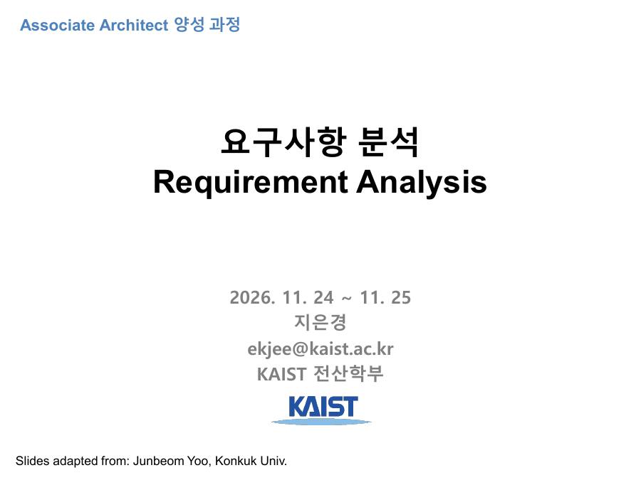
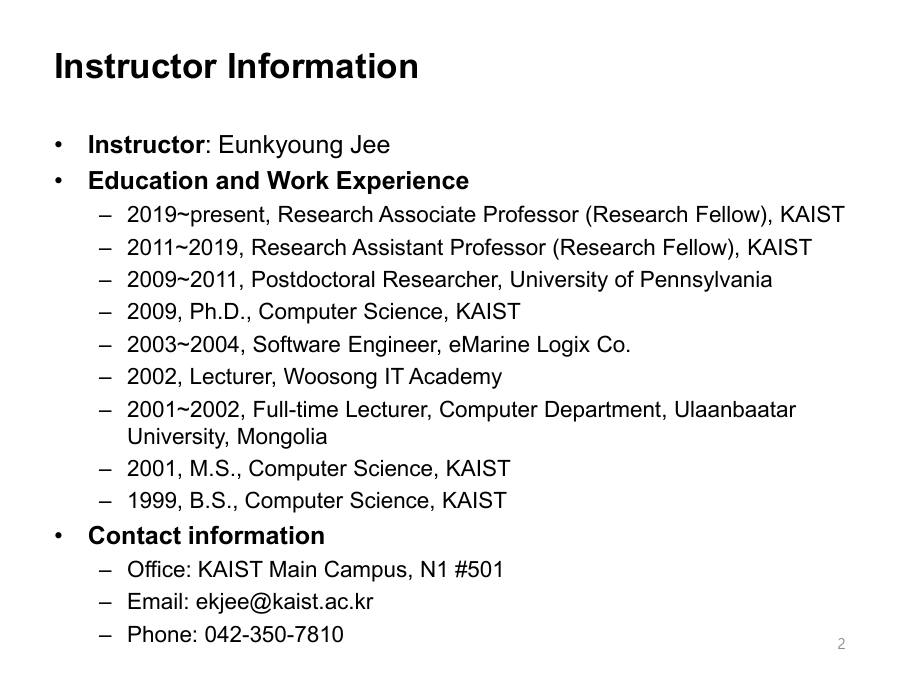
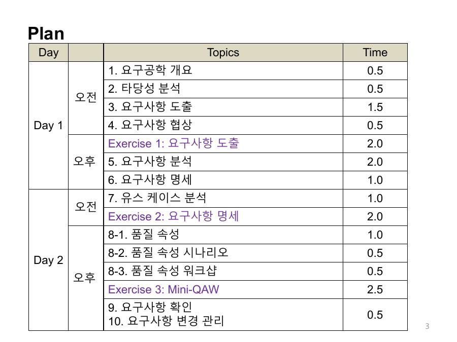

# 과정 소개

> 요구사항 분석 (Requirement Analysis) · 슬라이드 1–3 · 원본: [PDF](../../original/삼성전자AA_요구사항분석_강의_20261124-1125_지은경.pdf)

[← 목차](README.md) · [다음: 1. 요구공학 개요 →](01_요구공학_개요.md)

## 슬라이드 목록

- [1. Associate Architect 양성 과정](#s1)
- [2. Instructor Information](#s2)
- [3. Plan](#s3)

---

## 1. Associate Architect 양성 과정

요구사항 분석  
Requirement Analysis  

2026\. 11. 24 ~ 11. 25  
지은경  
ekjee@kaist.ac.kr  
KAIST 전산학부  

Slides adapted from: Junbeom Yoo, Konkuk Univ.  

---

## 2. Instructor Information

- Instructor: Eunkyoung Jee
- Education and Work Experience
  - 2019~present, Research Associate Professor (Research Fellow), KAIST
  - 2011~2019, Research Assistant Professor (Research Fellow), KAIST
  - 2009~2011, Postdoctoral Researcher, University of Pennsylvania
  - 2009, Ph.D., Computer Science, KAIST
  - 2003~2004, Software Engineer, eMarine Logix Co.
  - 2002, Lecturer, Woosong IT Academy
  - 2001~2002, Full-time Lecturer, Computer Department, Ulaanbaatar University, Mongolia
  - 2001, M.S., Computer Science, KAIST
  - 1999, B.S., Computer Science, KAIST
- Contact information
  - Office: KAIST Main Campus, N1 #501
  - Email: ekjee@kaist.ac.kr
  - Phone: 042-350-7810

---

## 3. Plan

Day · Topics · Time  
1\. 요구공학 개요 · 0.5  
2\. 타당성 분석 · 0.5  
오전  
3\. 요구사항 도출 · 1.5  
Day 1 · 4. 요구사항 협상 · 0.5  
Exercise 1: 요구사항 도출 · 2.0  
오후 · 5. 요구사항 분석 · 2.0  
6\. 요구사항 명세 · 1.0  
7\. 유스 케이스 분석 · 1.0  
오전  
Exercise 2: 요구사항 명세 · 2.0  
8-1. 품질 속성 · 1.0  
8-2. 품질 속성 시나리오 · 0.5  
Day 2  
8-3. 품질 속성 워크샵 · 0.5  
오후  
Exercise 3: Mini-QAW · 2.5  
9\. 요구사항 확인  
0.5  
10\. 요구사항 변경 관리  

---

[← 목차](README.md) · [다음: 1. 요구공학 개요 →](01_요구공학_개요.md)
