# 1. 요구공학 개요

> 요구사항 분석 (Requirement Analysis) · 슬라이드 4–14 · 원본: [PDF](../../original/삼성전자AA_요구사항분석_강의_20261124-1125_지은경.pdf)

[← 이전: 과정 소개](00_과정소개.md) · [← 목차](README.md) · [다음: 2. 타당성 분석 →](02_타당성_분석.md)

## 슬라이드 목록

- [4. Day 1](#s4)
- [5. 1\. 요구공학 – 개요](#s5)
- [6. (이미지 슬라이드)](#s6)
- [7. 요구공학(Requirements Engineering)](#s7)
- [8. 요구공학과 요구사항](#s8)
- [9. 소프트웨어 개발 생명주기와 요구공학 프로세스](#s9)
- [10. 폭포수 모델(Waterfall Model)](#s10)
- [11. 점진적 모델](#s11)
- [12. 나선형 모델(Spiral Model)](#s12)
- [13. 애자일 모델(Agile Models) 및 RUP](#s13)
- [14. 요구공학 프로세스](#s14)

---

## 4. Day 1

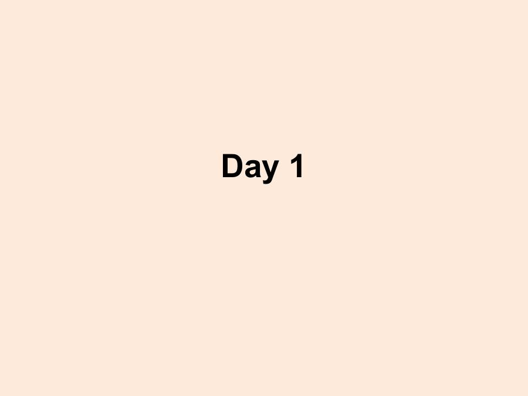

---

## 5. 1\. 요구공학 – 개요

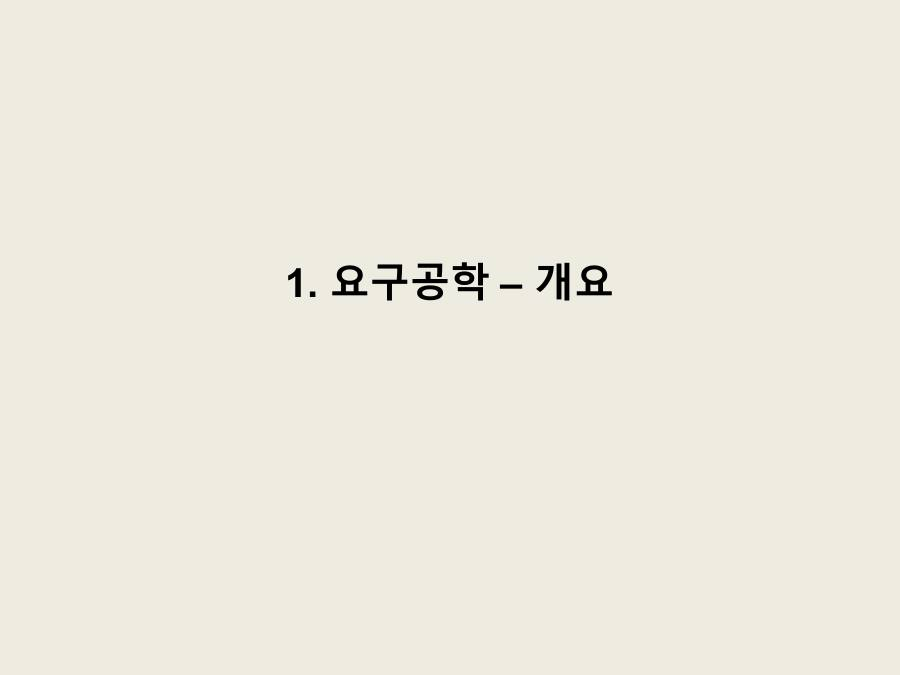

---

## 6. (이미지 슬라이드)

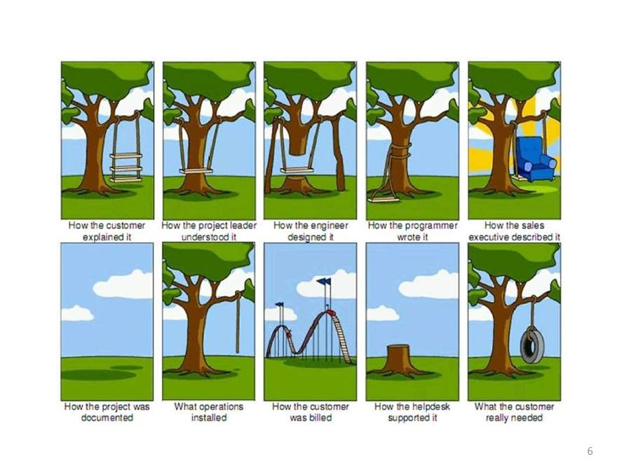

---

## 7. 요구공학(Requirements Engineering)

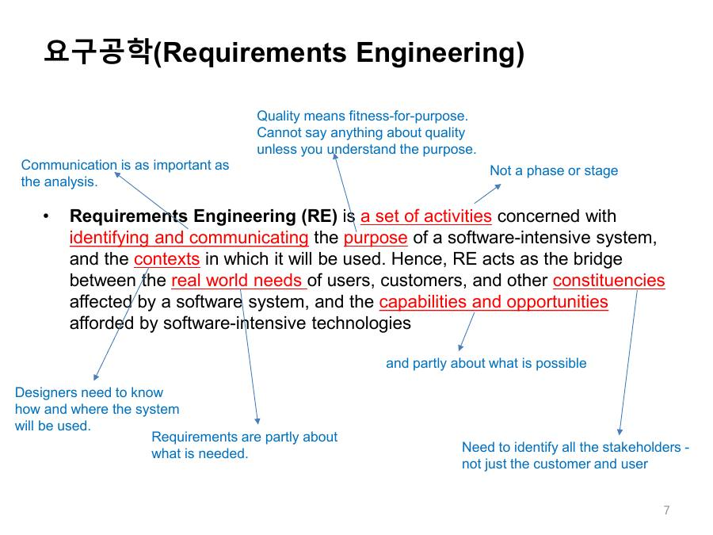

Quality means fitness-for-purpose.  
Cannot say anything about quality  
unless you understand the purpose.  
Communication is as important as · Not a phase or stage  
the analysis.  

- Requirements Engineering (RE) is a set of activities concerned with identifying and communicating the purpose of a software-intensive system, and the contexts in which it will be used. Hence, RE acts as the bridge between the real world needs of users, customers, and other constituencies affected by a software system, and the capabilities and opportunities afforded by software-intensive technologies

and partly about what is possible  

Designers need to know  
how and where the system  
will be used.  
Requirements are partly about  
what is needed. · Need to identify all the stakeholders -  
not just the customer and user  

---

## 8. 요구공학과 요구사항

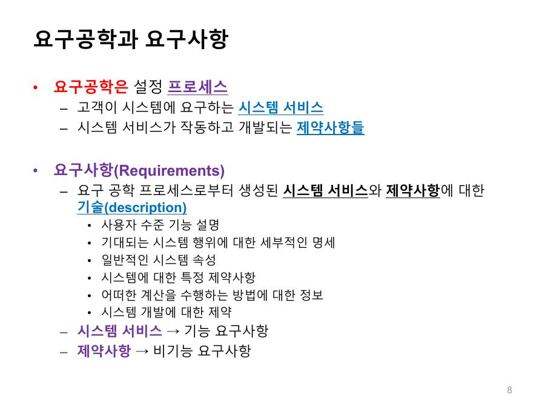

- 요구공학은 설정 프로세스
  - 고객이 시스템에 요구하는 시스템 서비스
  - 시스템 서비스가 작동하고 개발되는 제약사항들

- 요구사항(Requirements)
  - 요구 공학 프로세스로부터 생성된 시스템 서비스와 제약사항에 대한 기술(description)
    - 사용자 수준 기능 설명
    - 기대되는 시스템 행위에 대한 세부적인 명세
    - 일반적인 시스템 속성
    - 시스템에 대한 특정 제약사항
    - 어떠한 계산을 수행하는 방법에 대한 정보
    - 시스템 개발에 대한 제약
  - 시스템 서비스 → 기능 요구사항
  - 제약사항 → 비기능 요구사항

---

## 9. 소프트웨어 개발 생명주기와 요구공학 프로세스

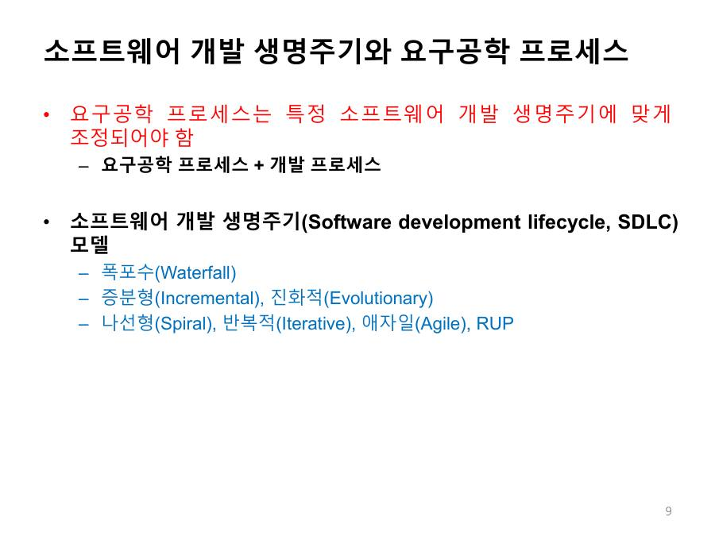

- 요구공학 프로세스는 특정 소프트웨어 개발 생명주기에 맞게 조정되어야 함
  - 요구공학 프로세스 + 개발 프로세스

- 소프트웨어 개발 생명주기(Software development lifecycle, SDLC) 모델
  - 폭포수(Waterfall)
  - 증분형(Incremental), 진화적(Evolutionary)
  - 나선형(Spiral), 반복적(Iterative), 애자일(Agile), RUP

---

## 10. 폭포수 모델(Waterfall Model)

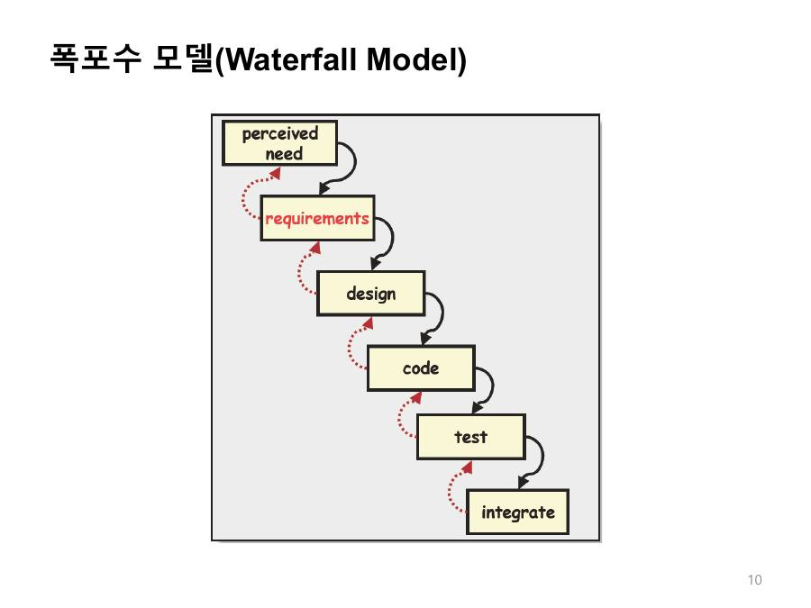

---

## 11. 점진적 모델

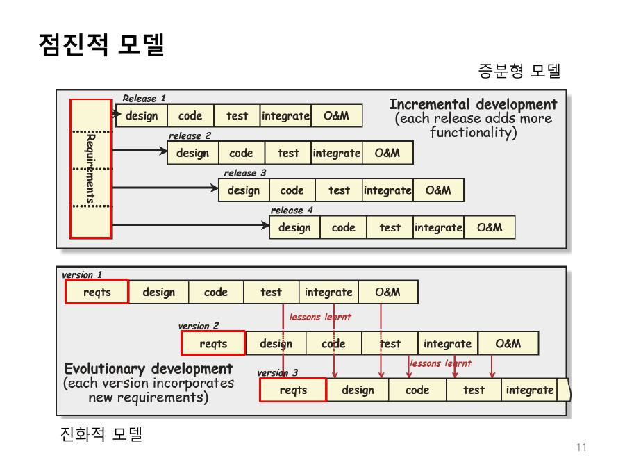

증분형 모델  

진화적 모델  

---

## 12. 나선형 모델(Spiral Model)

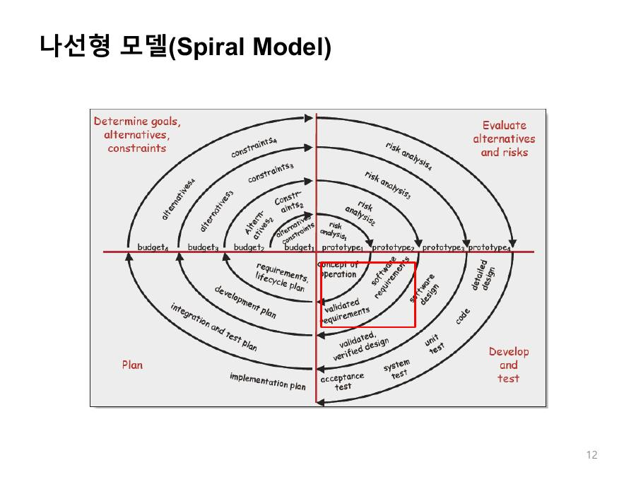

---

## 13. 애자일 모델(Agile Models) 및 RUP

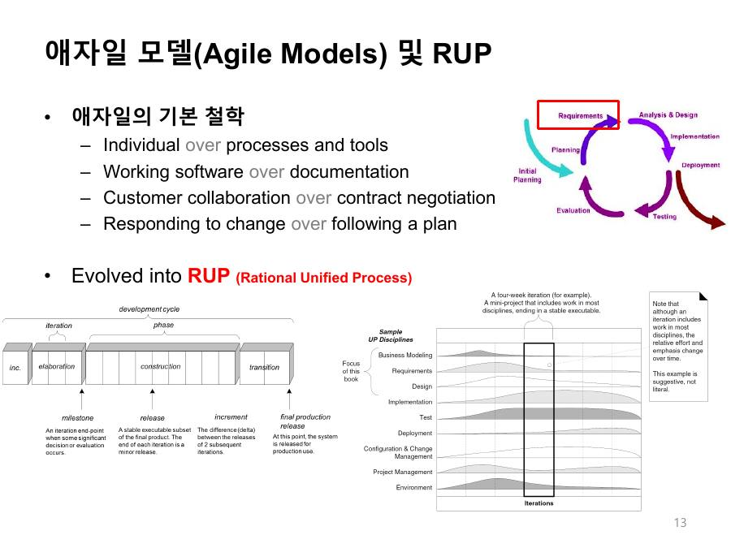

- 애자일의 기본 철학
  - Individual over processes and tools
  - Working software over documentation
  - Customer collaboration over contract negotiation
  - Responding to change over following a plan

- Evolved into RUP (Rational Unified Process)

---

## 14. 요구공학 프로세스

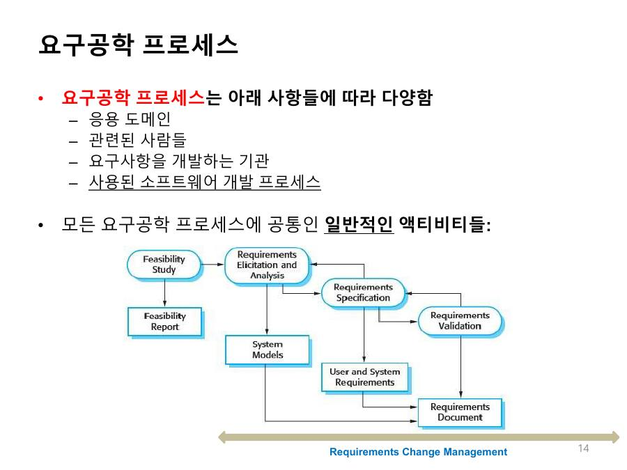

- 요구공학 프로세스는 아래 사항들에 따라 다양함
  - 응용 도메인
  - 관련된 사람들
  - 요구사항을 개발하는 기관
  - 사용된 소프트웨어 개발 프로세스

- 모든 요구공학 프로세스에 공통인 일반적인 액티비티들:

Requirements Change Management  

---

[← 이전: 과정 소개](00_과정소개.md) · [← 목차](README.md) · [다음: 2. 타당성 분석 →](02_타당성_분석.md)
