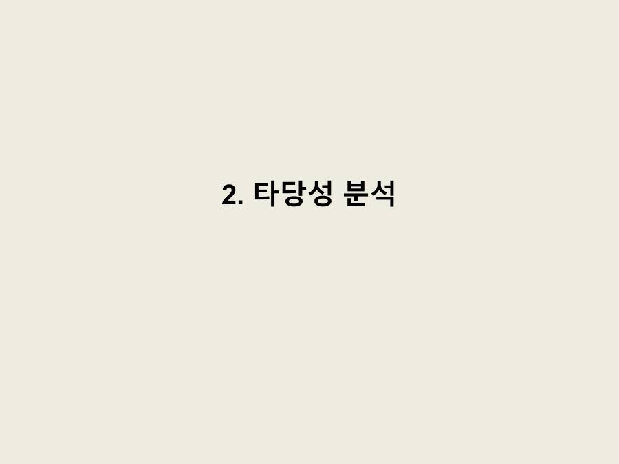
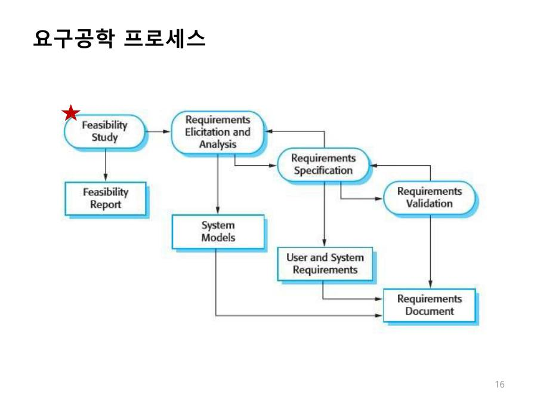
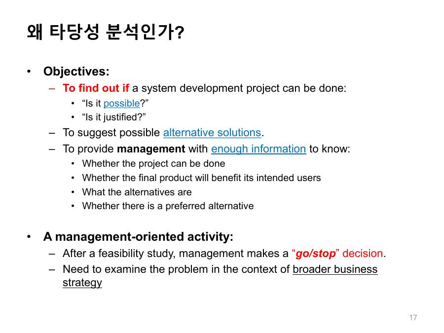
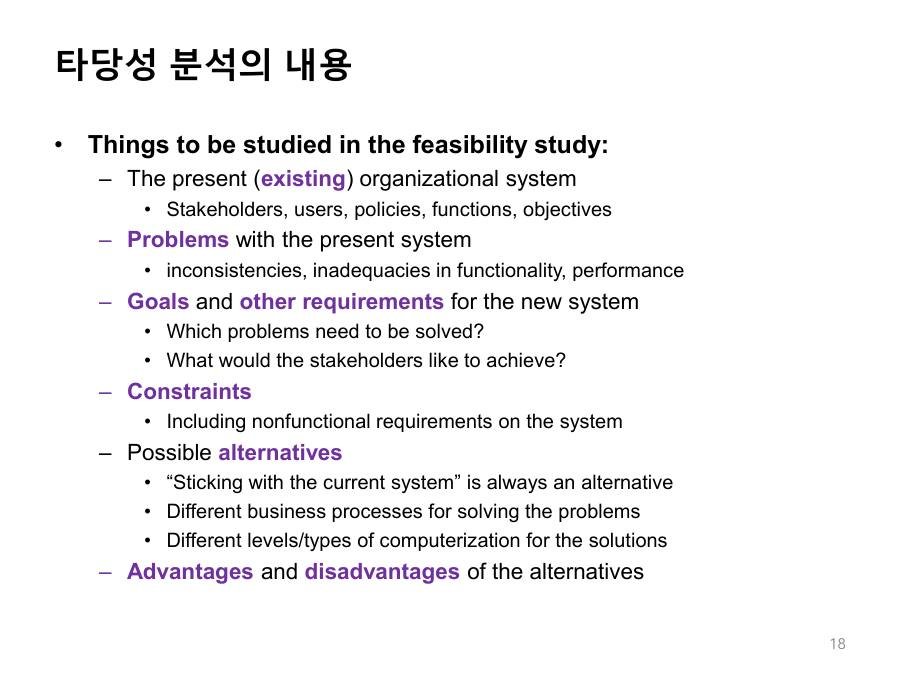
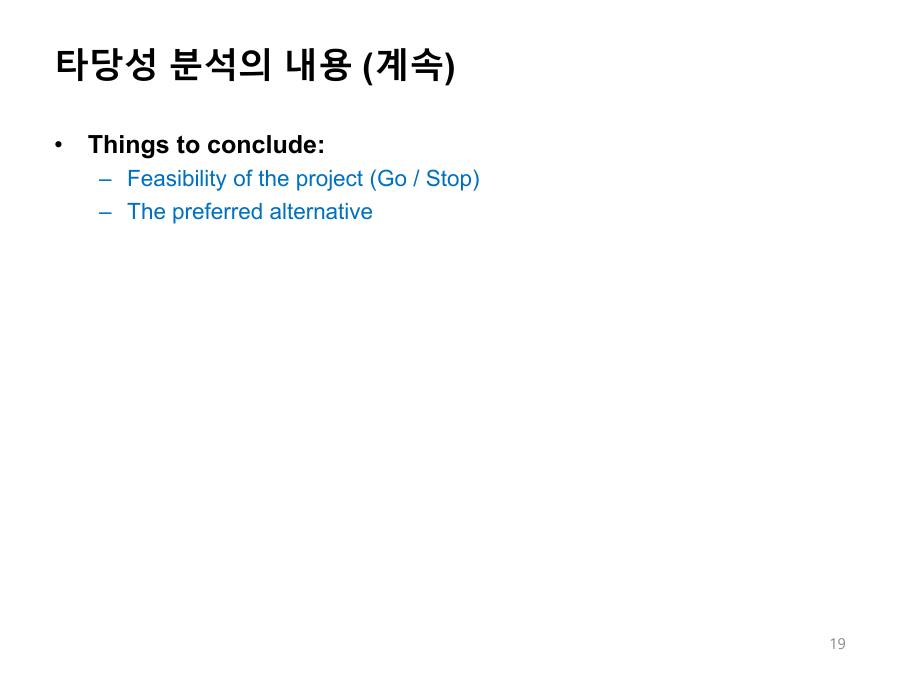
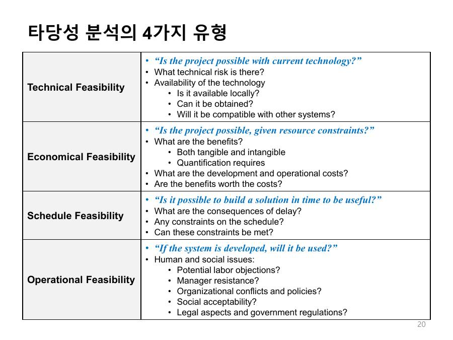
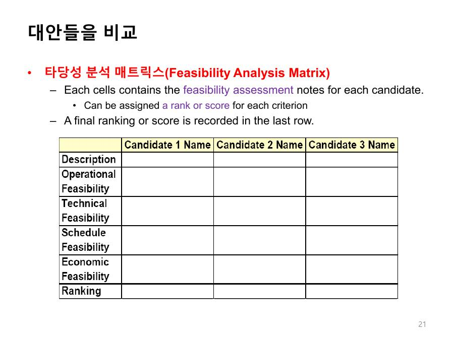
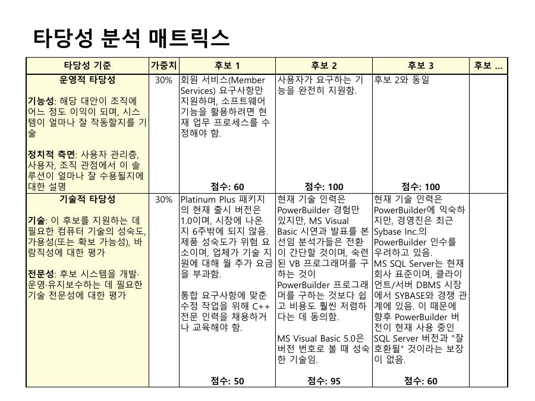
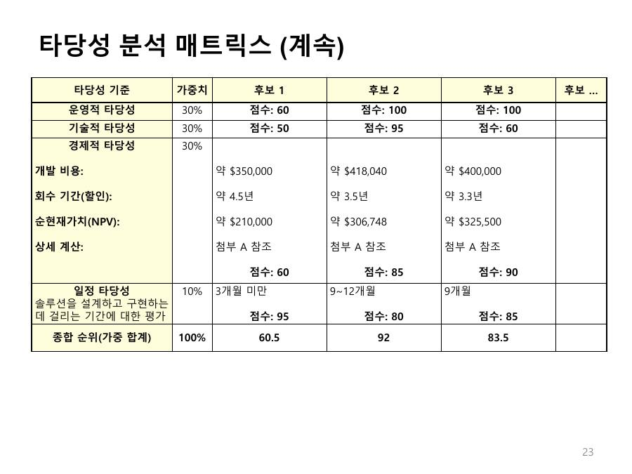

# 2. 타당성 분석

> 요구사항 분석 (Requirement Analysis) · 슬라이드 15–23 · 원본: [PDF](../../original/삼성전자AA_요구사항분석_강의_20261124-1125_지은경.pdf)

[← 이전: 1. 요구공학 개요](01_요구공학_개요.md) · [← 목차](README.md) · [다음: 3. 요구사항 도출 →](03_요구사항_도출.md)

## 슬라이드 목록

- [15. 2\. 타당성 분석](#s15)
- [16. 요구공학 프로세스](#s16)
- [17. 왜 타당성 분석인가?](#s17)
- [18. 타당성 분석의 내용](#s18)
- [19. 타당성 분석의 내용 (계속)](#s19)
- [20. 타당성 분석의 4가지 유형](#s20)
- [21. 대안들을 비교](#s21)
- [22. 타당성 분석 매트릭스](#s22)
- [23. 타당성 분석 매트릭스 (계속)](#s23)

---

## 15. 2\. 타당성 분석

---

## 16. 요구공학 프로세스

---

## 17. 왜 타당성 분석인가?

- Objectives:
  - To find out if a system development project can be done:
    - “Is it possible?”
    - “Is it justified?”
  - To suggest possible alternative solutions.
  - To provide management with enough information to know:
    - Whether the project can be done
    - Whether the final product will benefit its intended users
    - What the alternatives are
    - Whether there is a preferred alternative

- A management-oriented activity:
  - After a feasibility study, management makes a “go/stop” decision.
  - Need to examine the problem in the context of broader business strategy

---

## 18. 타당성 분석의 내용

- Things to be studied in the feasibility study:
  - The present (existing) organizational system
    - Stakeholders, users, policies, functions, objectives
  - Problems with the present system
    - inconsistencies, inadequacies in functionality, performance
  - Goals and other requirements for the new system
    - Which problems need to be solved?
    - What would the stakeholders like to achieve?
  - Constraints
    - Including nonfunctional requirements on the system
  - Possible alternatives
    - “Sticking with the current system” is always an alternative
    - Different business processes for solving the problems
    - Different levels/types of computerization for the solutions
  - Advantages and disadvantages of the alternatives

---

## 19. 타당성 분석의 내용 (계속)

- Things to conclude:
  - Feasibility of the project (Go / Stop)
  - The preferred alternative

---

## 20. 타당성 분석의 4가지 유형

- “Is the project possible with current technology?”
- What technical risk is there?
- Availability of the technology

Technical Feasibility  
- Is it available locally?
- Can it be obtained?
- Will it be compatible with other systems?
- “Is the project possible, given resource constraints?”
- What are the benefits?
  - Both tangible and intangible

Economical Feasibility  
- Quantification requires
- What are the development and operational costs?
- Are the benefits worth the costs?
- “Is it possible to build a solution in time to be useful?”
- What are the consequences of delay?

Schedule Feasibility  
- Any constraints on the schedule?
- Can these constraints be met?
- “If the system is developed, will it be used?”
- Human and social issues:
  - Potential labor objections?

Operational Feasibility · • Manager resistance?  
- Organizational conflicts and policies?
- Social acceptability?
- Legal aspects and government regulations?

---

## 21. 대안들을 비교

- 타당성 분석 매트릭스(Feasibility Analysis Matrix)
  - Each cells contains the feasibility assessment notes for each candidate.
    - Can be assigned a rank or score for each criterion
  - A final ranking or score is recorded in the last row.

---

## 22. 타당성 분석 매트릭스

타당성 기준 · 가중치 · 후보 1 · 후보 2 · 후보 3 · 후보 …  
운영적 타당성 · 30% 회원 서비스(Member 사용자가 요구하는 기 · 후보 2와 동일  
Services) 요구사항만 능을 완전히 지원함.  
기능성: 해당 대안이 조직에 · 지원하며, 소프트웨어  
어느 정도 이익이 되며, 시스 · 기능을 활용하려면 현  
템이 얼마나 잘 작동할지를 기 · 재 업무 프로세스를 수  
술 · 정해야 함.  

정치적 측면: 사용자 관리층,  
사용자, 조직 관점에서 이 솔  
루션이 얼마나 잘 수용될지에  
대한 설명 · 점수: 60 · 점수: 100 · 점수: 100  
기술적 타당성 · 30% Platinum Plus 패키지 현재 기술 인력은 · 현재 기술 인력은  
의 현재 출시 버전은 · PowerBuilder 경험만 · PowerBuilder에 익숙하  
기술: 이 후보를 지원하는 데 · 1.0이며, 시장에 나온 · 있지만, MS Visual · 지만, 경영진은 최근  
필요한 컴퓨터 기술의 성숙도, · 지 6주밖에 되지 않음. Basic 시연과 발표를 본 Sybase Inc.의  
가용성(또는 확보 가능성), 바 · 제품 성숙도가 위험 요 선임 분석가들은 전환 PowerBuilder 인수를  
람직성에 대한 평가 · 소이며, 업체가 기술 지 이 간단할 것이며, 숙련 우려하고 있음.  
원에 대해 월 추가 요금 된 VB 프로그래머를 구 MS SQL Server는 현재  
전문성: 후보 시스템을 개발· · 을 부과함. · 하는 것이 · 회사 표준이며, 클라이  
운영·유지보수하는 데 필요한 · PowerBuilder 프로그래 언트/서버 DBMS 시장  
기술 전문성에 대한 평가 · 통합 요구사항에 맞춘 머를 구하는 것보다 쉽 에서 SYBASE와 경쟁 관  
수정 작업을 위해 C++ 고 비용도 훨씬 저렴하 계에 있음. 이 때문에  
전문 인력을 채용하거 다는 데 동의함. · 향후 PowerBuilder 버  
나 교육해야 함. · 전이 현재 사용 중인  
MS Visual Basic 5.0은 SQL Server 버전과 "잘  
버전 번호로 볼 때 성숙 호환될" 것이라는 보장  
한 기술임. · 이 없음.  

점수: 50 · 점수: 95 · 점수: 60  

---

## 23. 타당성 분석 매트릭스 (계속)

타당성 기준 · 가중치 · 후보 1 · 후보 2 · 후보 3 · 후보 …  
운영적 타당성 · 30% · 점수: 60 · 점수: 100 · 점수: 100  
기술적 타당성 · 30% · 점수: 50 · 점수: 95 · 점수: 60  
경제적 타당성 · 30%  

개발 비용: · 약 $350,000 · 약 $418,040 · 약 $400,000  

회수 기간(할인): · 약 4.5년 · 약 3.5년 · 약 3.3년  

순현재가치(NPV): · 약 $210,000 · 약 $306,748 · 약 $325,500  

상세 계산: · 첨부 A 참조 · 첨부 A 참조 · 첨부 A 참조  

점수: 60 · 점수: 85 · 점수: 90  
일정 타당성 · 10% · 3개월 미만 · 9~12개월 · 9개월  
솔루션을 설계하고 구현하는  
데 걸리는 기간에 대한 평가 · 점수: 95 · 점수: 80 · 점수: 85  

종합 순위(가중 합계) · 100% · 60.5 · 92 · 83.5  

---

[← 이전: 1. 요구공학 개요](01_요구공학_개요.md) · [← 목차](README.md) · [다음: 3. 요구사항 도출 →](03_요구사항_도출.md)
