# 3. 요구사항 도출

> 요구사항 분석 (Requirement Analysis) · 슬라이드 24–51 · 원본: [PDF](../../original/삼성전자AA_요구사항분석_강의_20261124-1125_지은경.pdf)

[← 이전: 2. 타당성 분석](02_타당성_분석.md) · [← 목차](README.md) · [다음: 4. 요구사항 협상 →](04_요구사항_협상.md)

## 슬라이드 목록

- [24. 3\. 요구사항 도출](#s24)
- [25. 요구공학 프로세스](#s25)
- [26. 요구사항 도출(Elicitation)](#s26)
- [27. 요구사항 도출의 어려움](#s27)
- [28. 이해관계자(Stakeholders)](#s28)
- [29. 요구사항 도출 및 분석 활동들](#s29)
- [30. 흔히 접하는 상황](#s30)
- [31. 요구사항 도출 시 기억해야 할 사항](#s31)
- [32. 1\. Don’t Lose Sight of the Goal](#s32)
- [33. 2\. Think Who’s Smart](#s33)
- [34. 3\. A Single Stakeholder Can’t Speak for All](#s34)
- [35. 4\. Use Appropriate Elicitation Methods](#s35)
- [36. 5\. Accept Requirements Changes](#s36)
- [37. 6\. Manage Elicited Requirements](#s37)
- [38. 이해관계자 요구사항 도출 기법](#s38)
- [39. 1\. 요구사항 워크샵](#s39)
- [40. 2\. 브레인스토밍(Brainstorming)](#s40)
- [41. 2\. 브레인스토밍 (계속)](#s41)
- [42. 3\. 스토리보드(Storyboards)](#s42)
- [43. 4\. 인터뷰(Interviews)](#s43)
- [44. 5\. 설문(Questionnaires)](#s44)
- [45. 6\. 역할극(Role Playing)](#s45)
- [46. 7\. 프로토타입(Prototypes)](#s46)
- [47. 8\. 고객 요구사항 명세 검토](#s47)
- [48. 어떤 기법을 사용할 것인가?](#s48)
- [49. 어떤 기법을 사용할 것인가? (계속)](#s49)
- [50. 도출된 요구사항을 어떻게 관리할 것인가?](#s50)
- [51. 요구사항 도출 결과 사례](#s51)

---

## 24. 3\. 요구사항 도출

---

## 25. 요구공학 프로세스

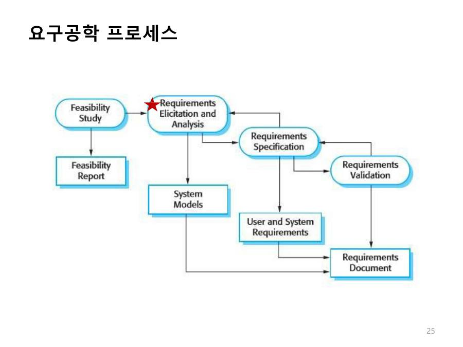

---

## 26. 요구사항 도출(Elicitation)

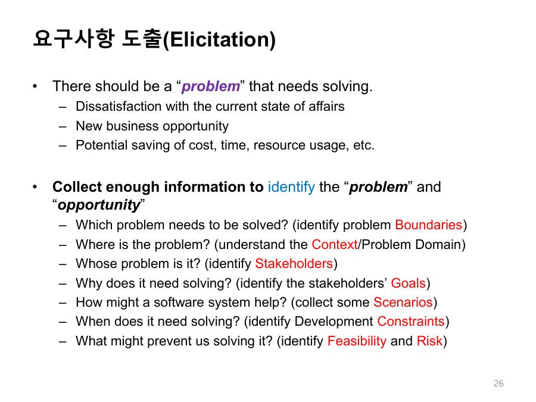

- There should be a “problem” that needs solving.
  - Dissatisfaction with the current state of affairs
  - New business opportunity
  - Potential saving of cost, time, resource usage, etc.

- Collect enough information to identify the “problem” and “opportunity”
  - Which problem needs to be solved? (identify problem Boundaries)
  - Where is the problem? (understand the Context/Problem Domain)
  - Whose problem is it? (identify Stakeholders)
  - Why does it need solving? (identify the stakeholders’ Goals)
  - How might a software system help? (collect some Scenarios)
  - When does it need solving? (identify Development Constraints)
  - What might prevent us solving it? (identify Feasibility and Risk)

---

## 27. 요구사항 도출의 어려움

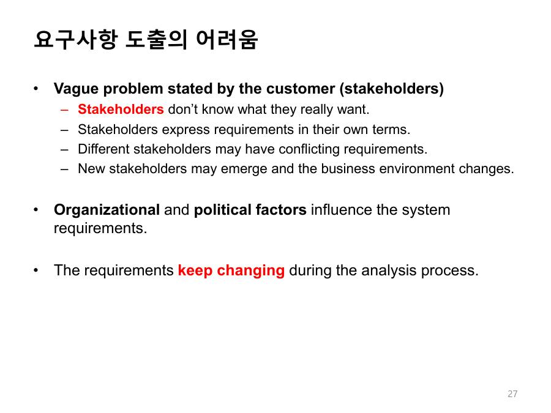

- Vague problem stated by the customer (stakeholders)
  - Stakeholders don’t know what they really want.
  - Stakeholders express requirements in their own terms.
  - Different stakeholders may have conflicting requirements.
  - New stakeholders may emerge and the business environment changes.

- Organizational and political factors influence the system requirements.

- The requirements keep changing during the analysis process.

---

## 28. 이해관계자(Stakeholders)

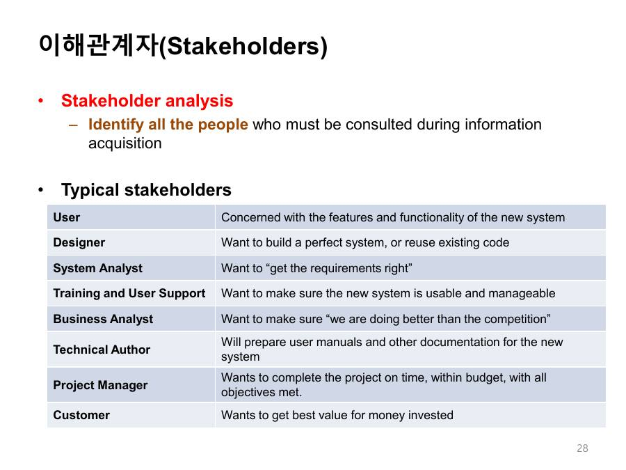

- Stakeholder analysis
  - Identify all the people who must be consulted during information acquisition

- Typical stakeholders

User · Concerned with the features and functionality of the new system  

Designer · Want to build a perfect system, or reuse existing code  

System Analyst · Want to “get the requirements right”  

Training and User Support · Want to make sure the new system is usable and manageable  

Business Analyst · Want to make sure “we are doing better than the competition”  
Will prepare user manuals and other documentation for the new  
Technical Author  
system  
Wants to complete the project on time, within budget, with all  
Project Manager  
objectives met.  
Customer · Wants to get best value for money invested  

---

## 29. 요구사항 도출 및 분석 활동들

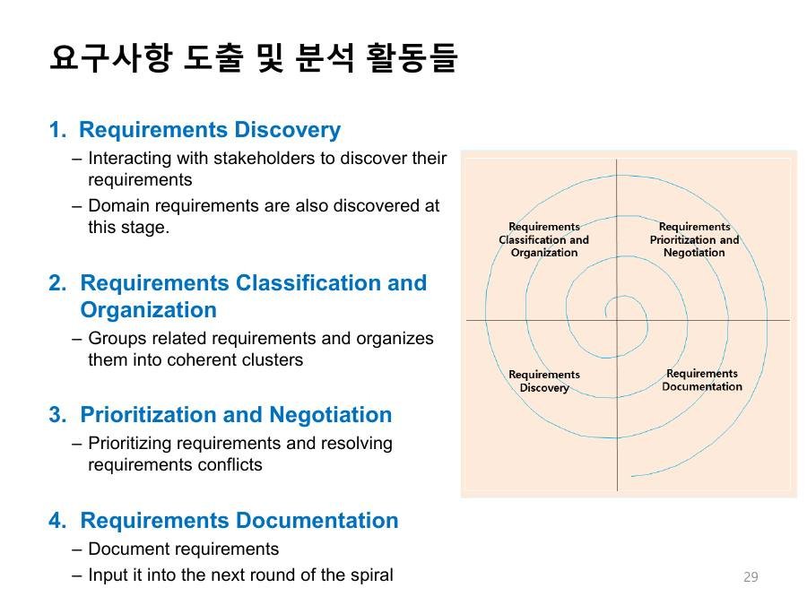

1\. Requirements Discovery  
- Interacting with stakeholders to discover their requirements
- Domain requirements are also discovered at this stage.

2\. Requirements Classification and  
Organization  
- Groups related requirements and organizes them into coherent clusters

3\. Prioritization and Negotiation  
- Prioritizing requirements and resolving requirements conflicts

4\. Requirements Documentation  
- Document requirements
- Input it into the next round of the spiral

---

## 30. 흔히 접하는 상황

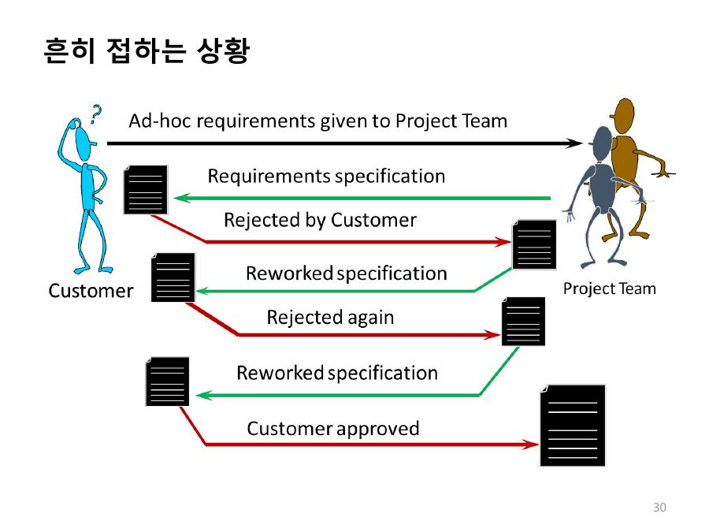

---

## 31. 요구사항 도출 시 기억해야 할 사항

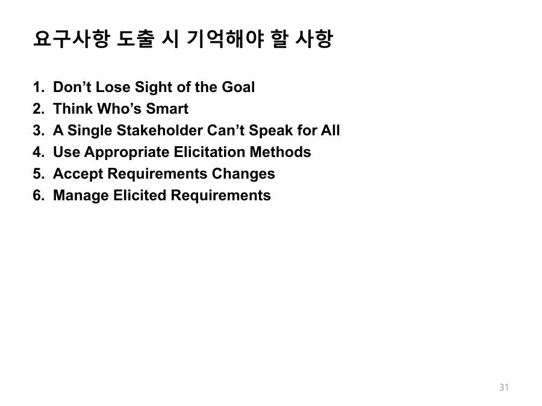

1\. Don’t Lose Sight of the Goal  
2\. Think Who’s Smart  
3\. A Single Stakeholder Can’t Speak for All  
4\. Use Appropriate Elicitation Methods  
5\. Accept Requirements Changes  
6\. Manage Elicited Requirements  

---

## 32. 1\. Don’t Lose Sight of the Goal

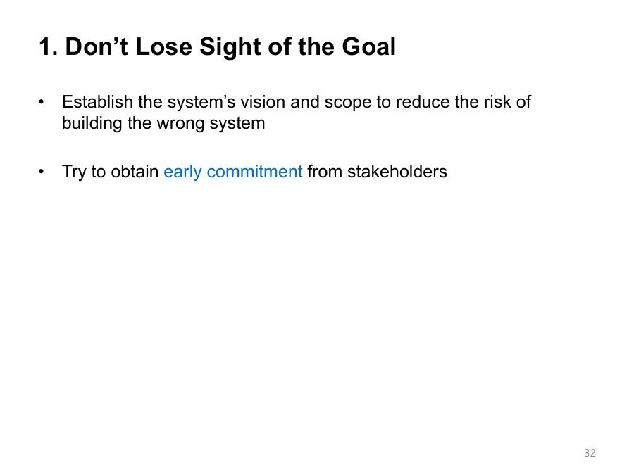

- Establish the system’s vision and scope to reduce the risk of building the wrong system

- Try to obtain early commitment from stakeholders

---

## 33. 2\. Think Who’s Smart

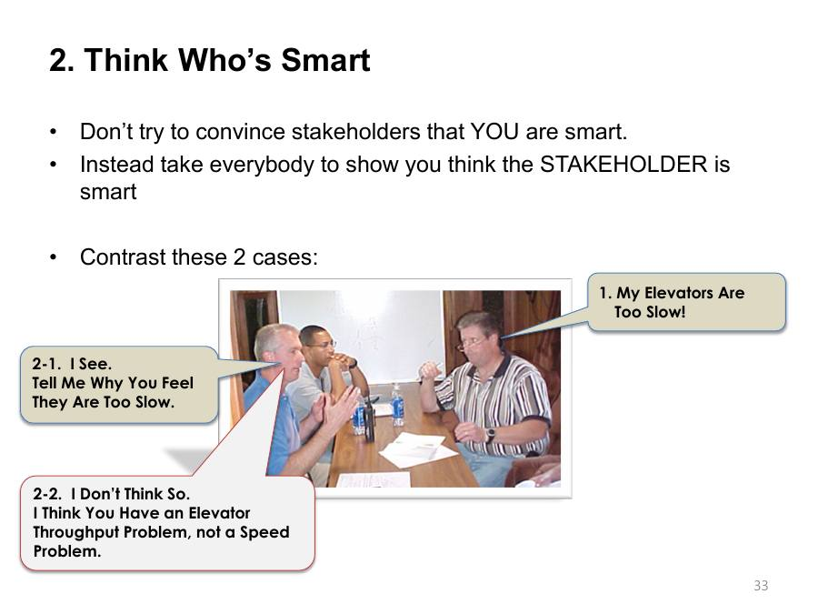

- Don’t try to convince stakeholders that YOU are smart.
- Instead take everybody to show you think the STAKEHOLDER is smart

- Contrast these 2 cases: 1. My Elevators Are Too Slow!

2-1. I See.  
Tell Me Why You Feel  
They Are Too Slow.  

2-2. I Don’t Think So.  
I Think You Have an Elevator  
Throughput Problem, not a Speed  
Problem.  

---

## 34. 3\. A Single Stakeholder Can’t Speak for All

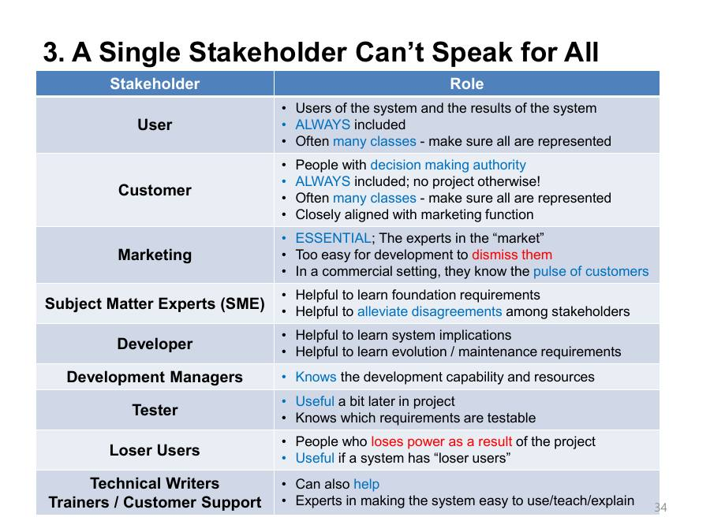

Stakeholder · Role  
- Users of the system and the results of the system

User · • ALWAYS included  
- Often many classes - make sure all are represented
- People with decision making authority
- ALWAYS included; no project otherwise!

Customer · • Often many classes - make sure all are represented  
- Closely aligned with marketing function
- ESSENTIAL; The experts in the “market”

Marketing · • Too easy for development to dismiss them  
- In a commercial setting, they know the pulse of customers
- Helpful to learn foundation requirements

Subject Matter Experts (SME) · • Helpful to alleviate disagreements among stakeholders  
- Helpful to learn system implications

Developer · • Helpful to learn evolution / maintenance requirements  
Development Managers · • Knows the development capability and resources  
- Useful a bit later in project

Tester · • Knows which requirements are testable  
- People who loses power as a result of the project

Loser Users · • Useful if a system has “loser users”  
Technical Writers · • Can also help  
Trainers / Customer Support · • Experts in making the system easy to use/teach/explain  

---

## 35. 4\. Use Appropriate Elicitation Methods

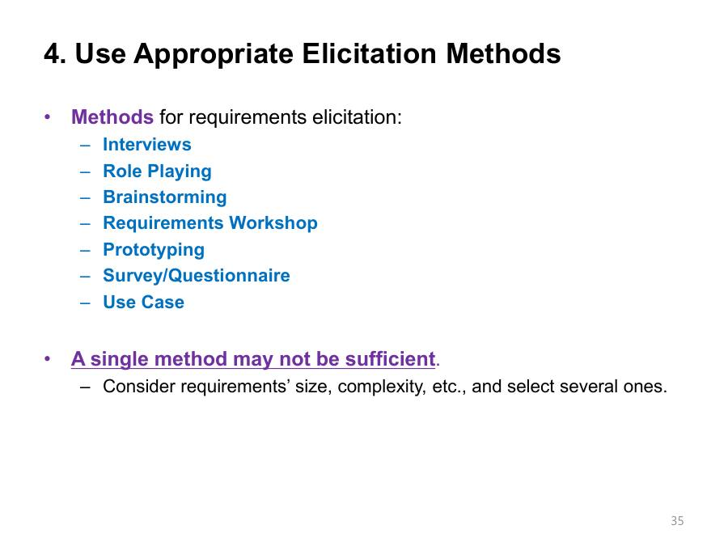

- Methods for requirements elicitation:
  - Interviews
  - Role Playing
  - Brainstorming
  - Requirements Workshop
  - Prototyping
  - Survey/Questionnaire
  - Use Case

- A single method may not be sufficient.
  - Consider requirements’ size, complexity, etc., and select several ones.

---

## 36. 5\. Accept Requirements Changes

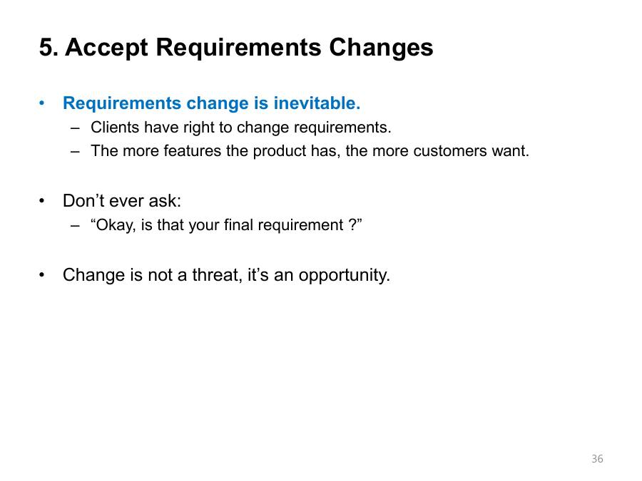

- Requirements change is inevitable.
  - Clients have right to change requirements.
  - The more features the product has, the more customers want.

- Don’t ever ask:
  - “Okay, is that your final requirement ?”

- Change is not a threat, it’s an opportunity.

---

## 37. 6\. Manage Elicited Requirements

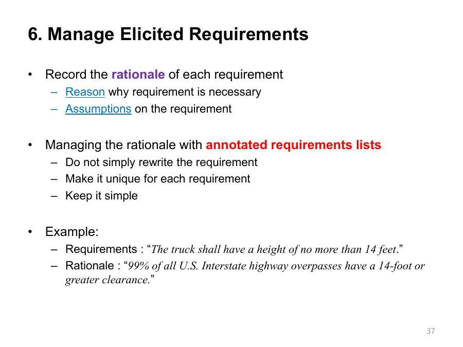

- Record the rationale of each requirement
  - Reason why requirement is necessary
  - Assumptions on the requirement

- Managing the rationale with annotated requirements lists
  - Do not simply rewrite the requirement
  - Make it unique for each requirement
  - Keep it simple

- Example:
  - Requirements : “The truck shall have a height of no more than 14 feet.”
  - Rationale : “99% of all U.S. Interstate highway overpasses have a 14-foot or greater clearance.”

---

## 38. 이해관계자 요구사항 도출 기법

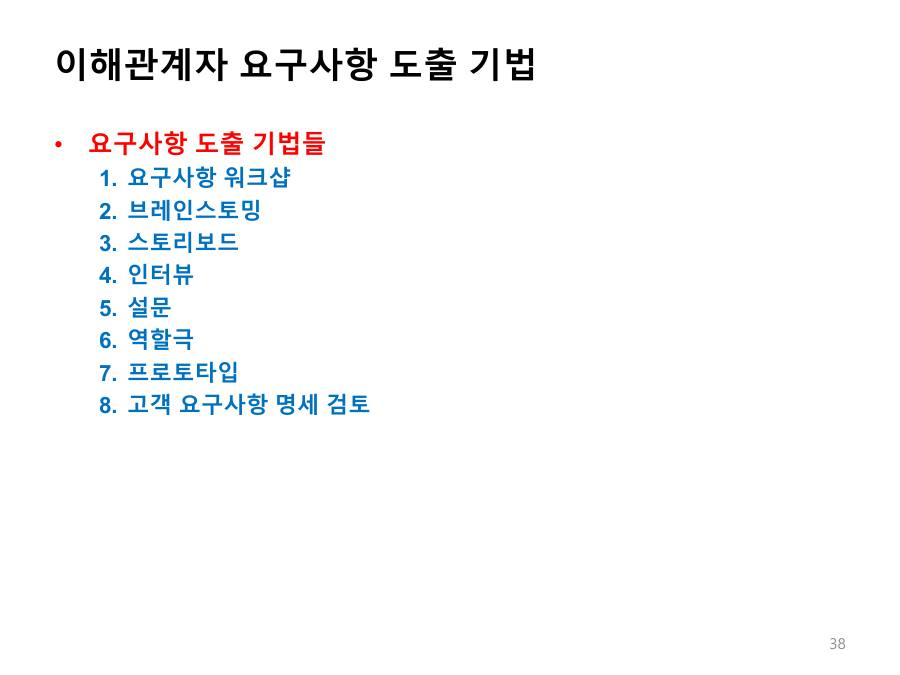

- 요구사항 도출 기법들 1. 요구사항 워크샵 2. 브레인스토밍 3. 스토리보드 4. 인터뷰 5. 설문 6. 역할극 7. 프로토타입 8. 고객 요구사항 명세 검토

---

## 39. 1\. 요구사항 워크샵

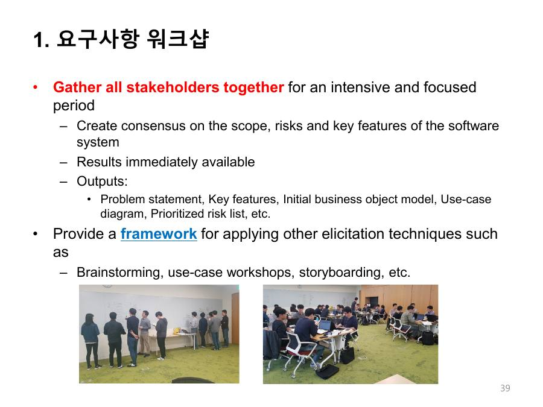

- Gather all stakeholders together for an intensive and focused period
  - Create consensus on the scope, risks and key features of the software system
  - Results immediately available
  - Outputs:
    - Problem statement, Key features, Initial business object model, Use-case diagram, Prioritized risk list, etc.
- Provide a framework for applying other elicitation techniques such as
  - Brainstorming, use-case workshops, storyboarding, etc.

---

## 40. 2\. 브레인스토밍(Brainstorming)

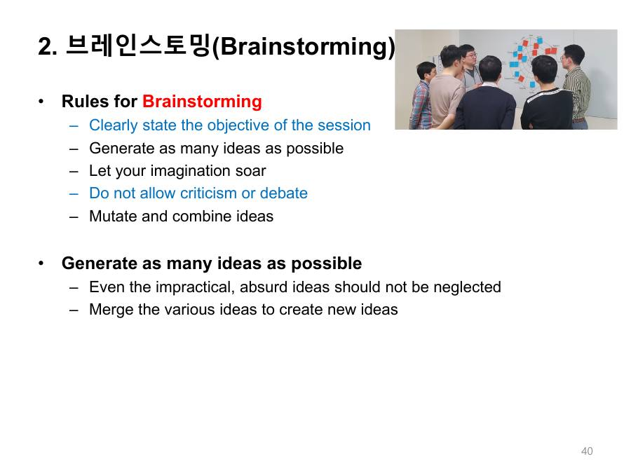

- Rules for Brainstorming
  - Clearly state the objective of the session
  - Generate as many ideas as possible
  - Let your imagination soar
  - Do not allow criticism or debate
  - Mutate and combine ideas

- Generate as many ideas as possible
  - Even the impractical, absurd ideas should not be neglected
  - Merge the various ideas to create new ideas

---

## 41. 2\. 브레인스토밍 (계속)

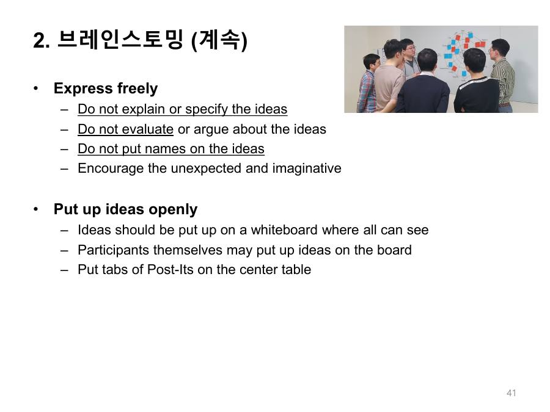

- Express freely
  - Do not explain or specify the ideas
  - Do not evaluate or argue about the ideas
  - Do not put names on the ideas
  - Encourage the unexpected and imaginative

- Put up ideas openly
  - Ideas should be put up on a whiteboard where all can see
  - Participants themselves may put up ideas on the board
  - Put tabs of Post-Its on the center table

---

## 42. 3\. 스토리보드(Storyboards)

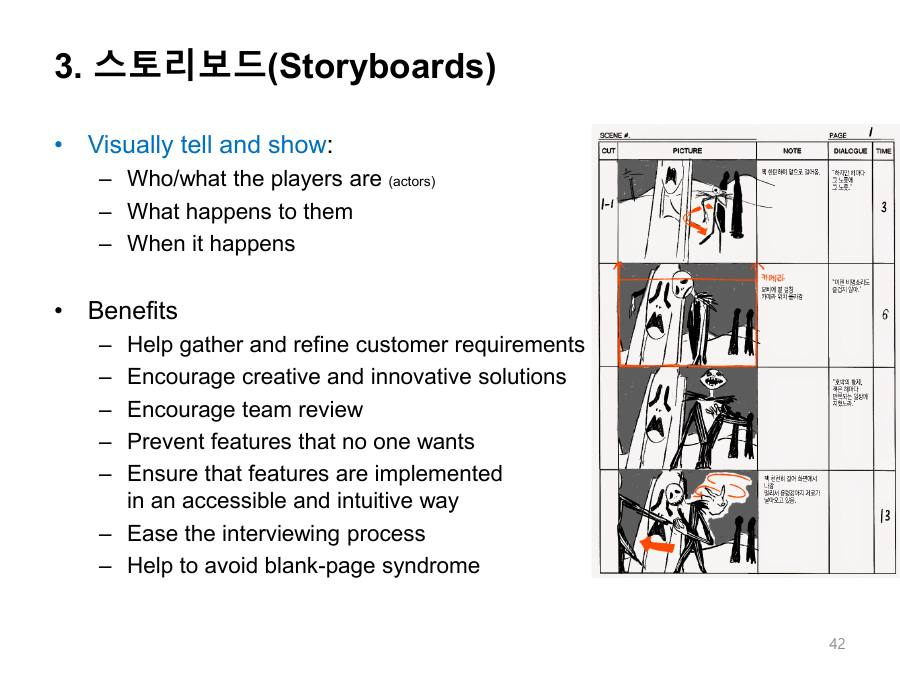

- Visually tell and show:
  - Who/what the players are (actors)
  - What happens to them
  - When it happens

- Benefits
  - Help gather and refine customer requirements
  - Encourage creative and innovative solutions
  - Encourage team review
  - Prevent features that no one wants
  - Ensure that features are implemented in an accessible and intuitive way
  - Ease the interviewing process
  - Help to avoid blank-page syndrome

---

## 43. 4\. 인터뷰(Interviews)

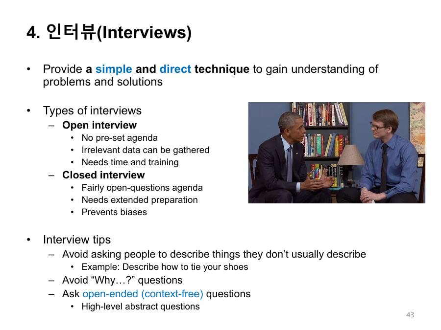

- Provide a simple and direct technique to gain understanding of problems and solutions

- Types of interviews
  - Open interview
    - No pre-set agenda
    - Irrelevant data can be gathered
    - Needs time and training
  - Closed interview
    - Fairly open-questions agenda
    - Needs extended preparation
    - Prevents biases

- Interview tips
  - Avoid asking people to describe things they don’t usually describe
    - Example: Describe how to tie your shoes
  - Avoid “Why…?” questions
  - Ask open-ended (context-free) questions
    - High-level abstract questions

---

## 44. 5\. 설문(Questionnaires)

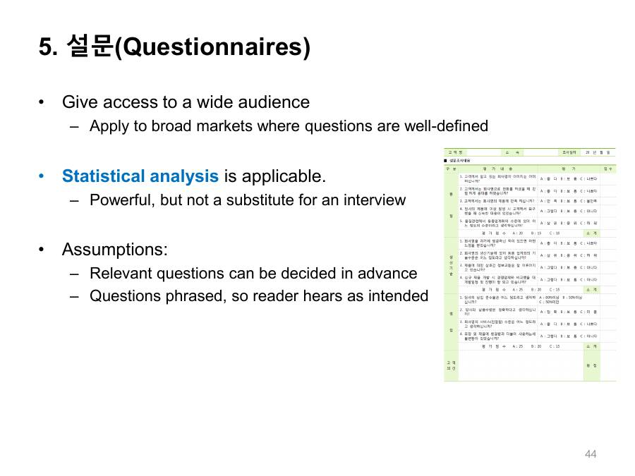

- Give access to a wide audience
  - Apply to broad markets where questions are well-defined

- Statistical analysis is applicable.
  - Powerful, but not a substitute for an interview

- Assumptions:
  - Relevant questions can be decided in advance
  - Questions phrased, so reader hears as intended

---

## 45. 6\. 역할극(Role Playing)

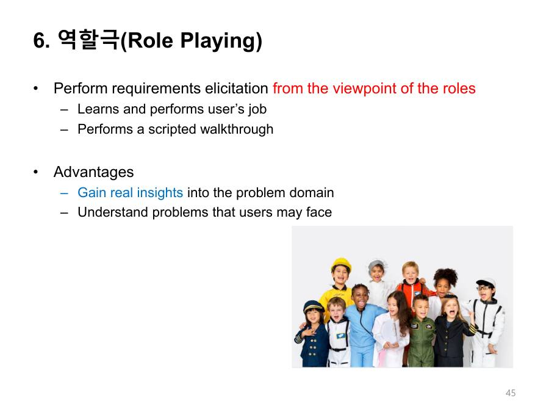

- Perform requirements elicitation from the viewpoint of the roles
  - Learns and performs user’s job
  - Performs a scripted walkthrough

- Advantages
  - Gain real insights into the problem domain
  - Understand problems that users may face

---

## 46. 7\. 프로토타입(Prototypes)

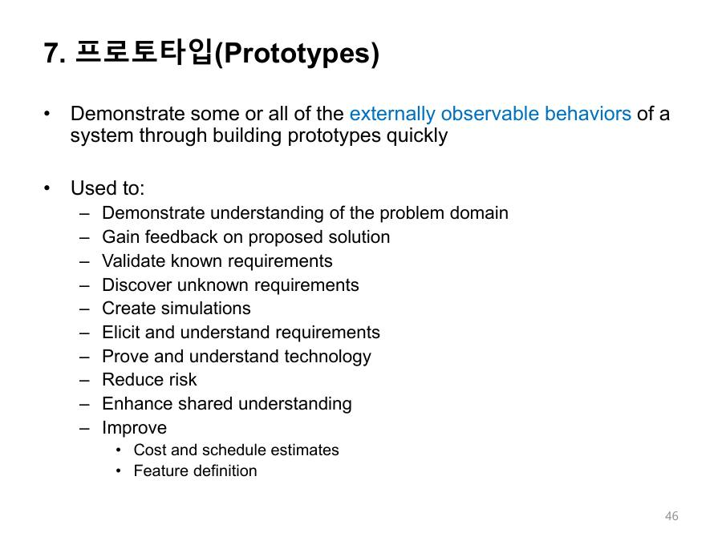

- Demonstrate some or all of the externally observable behaviors of a system through building prototypes quickly

- Used to:
  - Demonstrate understanding of the problem domain
  - Gain feedback on proposed solution
  - Validate known requirements
  - Discover unknown requirements
  - Create simulations
  - Elicit and understand requirements
  - Prove and understand technology
  - Reduce risk
  - Enhance shared understanding
  - Improve
    - Cost and schedule estimates
    - Feature definition

---

## 47. 8\. 고객 요구사항 명세 검토

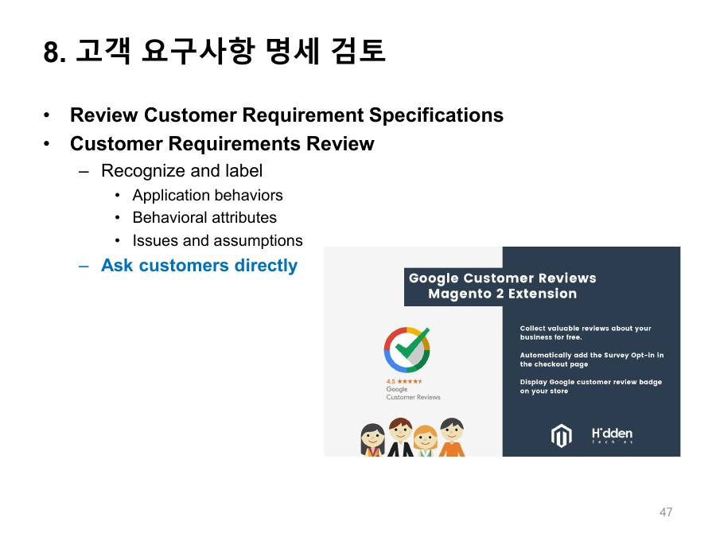

- Review Customer Requirement Specifications
- Customer Requirements Review
  - Recognize and label
    - Application behaviors
    - Behavioral attributes
    - Issues and assumptions
  - Ask customers directly

---

## 48. 어떤 기법을 사용할 것인가?

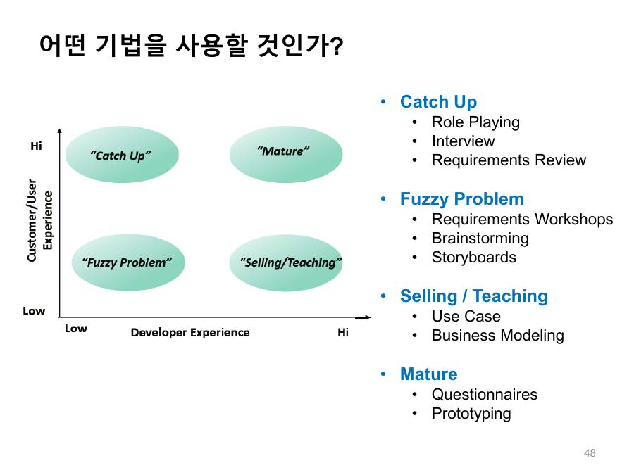

- Catch Up
  - Role Playing
  - Interview
  - Requirements Review

- Fuzzy Problem
  - Requirements Workshops
  - Brainstorming
  - Storyboards

- Selling / Teaching
  - Use Case
  - Business Modeling

- Mature
  - Questionnaires
  - Prototyping

---

## 49. 어떤 기법을 사용할 것인가? (계속)

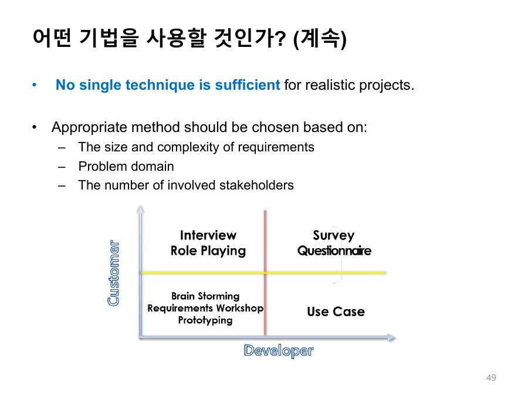

- No single technique is sufficient for realistic projects.

- Appropriate method should be chosen based on:
  - The size and complexity of requirements
  - Problem domain
  - The number of involved stakeholders

---

## 50. 도출된 요구사항을 어떻게 관리할 것인가?

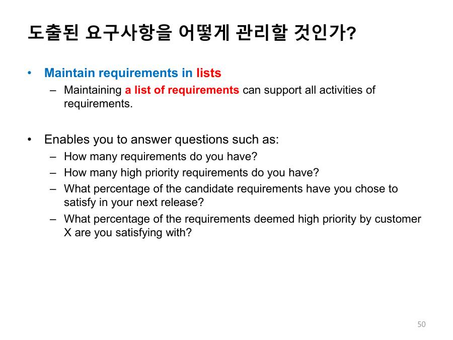

- Maintain requirements in lists
  - Maintaining a list of requirements can support all activities of requirements.

- Enables you to answer questions such as:
  - How many requirements do you have?
  - How many high priority requirements do you have?
  - What percentage of the candidate requirements have you chose to satisfy in your next release?
  - What percentage of the requirements deemed high priority by customer X are you satisfying with?

---

## 51. 요구사항 도출 결과 사례

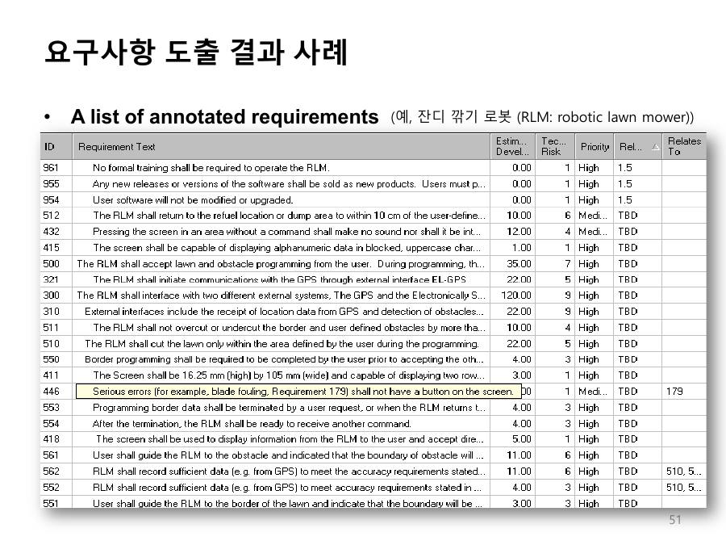

- A list of annotated requirements (예, 잔디 깎기 로봇 (RLM: robotic lawn mower))

---

[← 이전: 2. 타당성 분석](02_타당성_분석.md) · [← 목차](README.md) · [다음: 4. 요구사항 협상 →](04_요구사항_협상.md)
