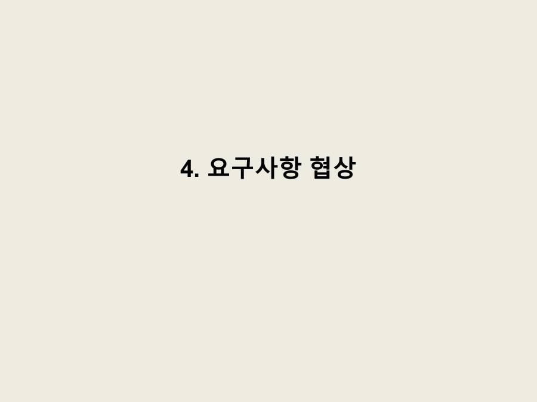
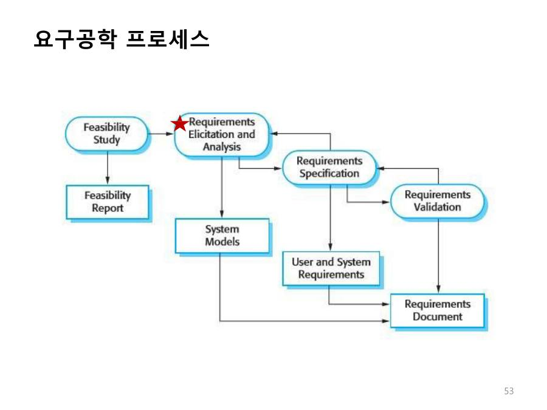
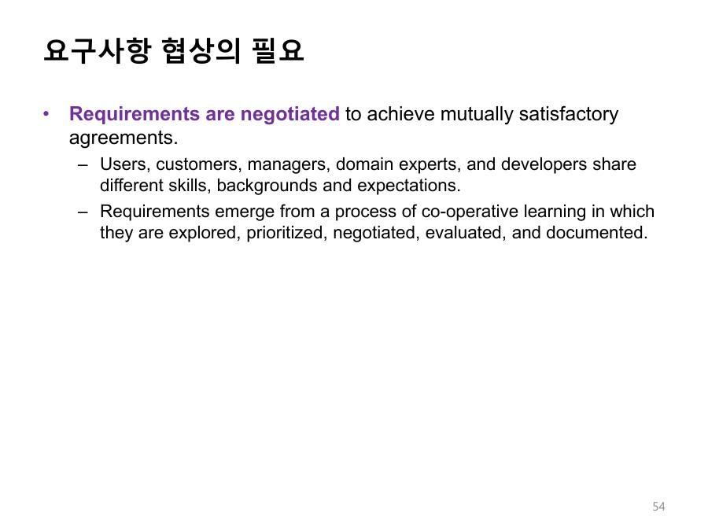
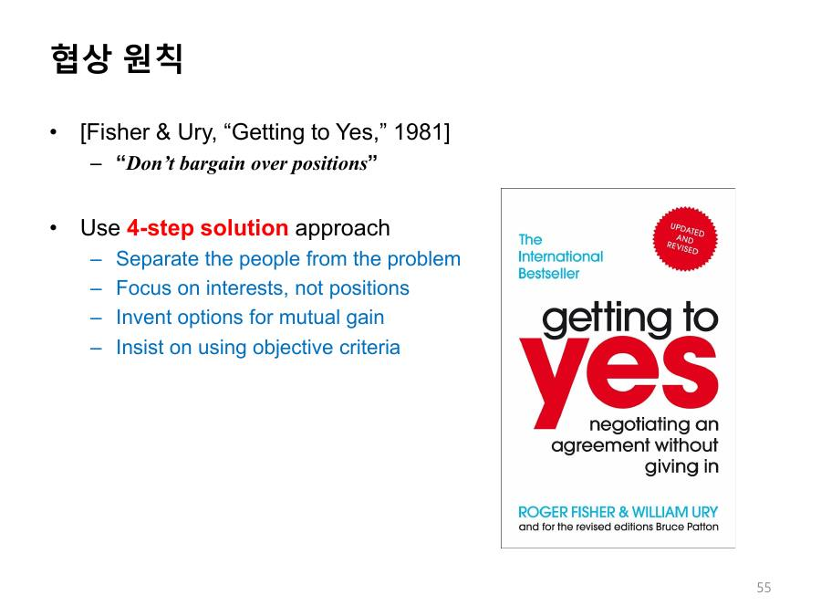
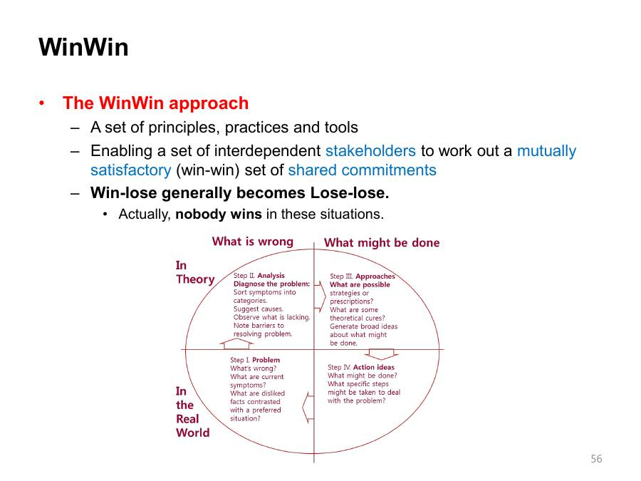
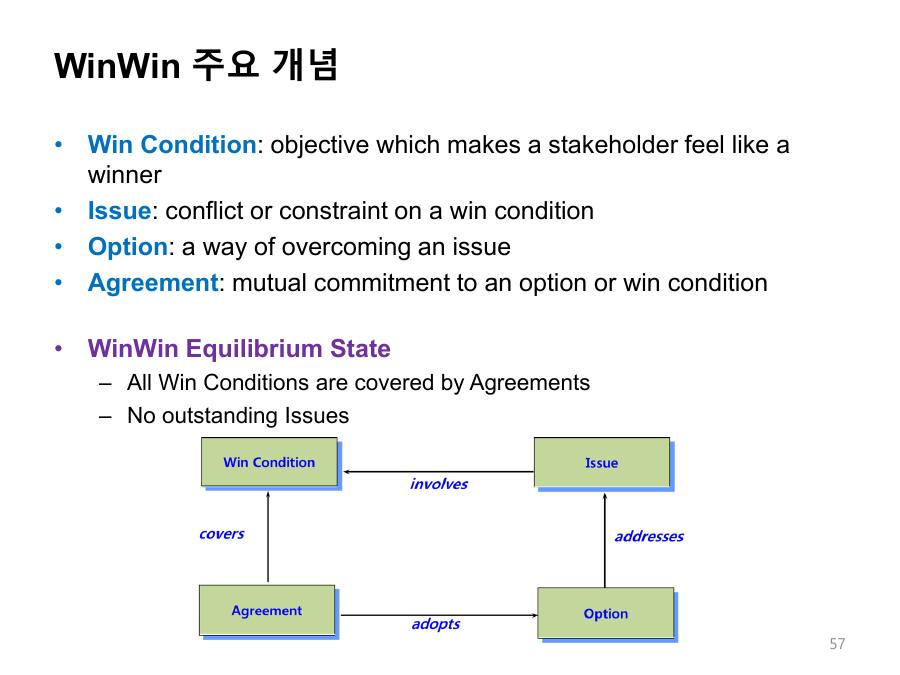
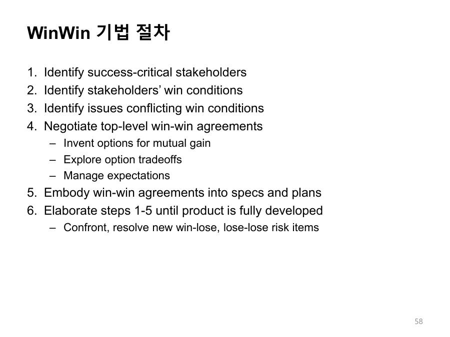

# 4. 요구사항 협상

> 요구사항 분석 (Requirement Analysis) · 슬라이드 52–58 · 원본: [PDF](../../original/삼성전자AA_요구사항분석_강의_20261124-1125_지은경.pdf)

[← 이전: 3. 요구사항 도출](03_요구사항_도출.md) · [← 목차](README.md) · [다음: 실습 1: 요구사항 도출 →](04x_실습1_요구사항_도출.md)

## 슬라이드 목록

- [52. 4\. 요구사항 협상](#s52)
- [53. 요구공학 프로세스](#s53)
- [54. 요구사항 협상의 필요](#s54)
- [55. 협상 원칙](#s55)
- [56. WinWin](#s56)
- [57. WinWin 주요 개념](#s57)
- [58. WinWin 기법 절차](#s58)

---

## 52. 4\. 요구사항 협상

---

## 53. 요구공학 프로세스

---

## 54. 요구사항 협상의 필요

- Requirements are negotiated to achieve mutually satisfactory agreements.
  - Users, customers, managers, domain experts, and developers share different skills, backgrounds and expectations.
  - Requirements emerge from a process of co-operative learning in which they are explored, prioritized, negotiated, evaluated, and documented.

---

## 55. 협상 원칙

- [Fisher &amp; Ury, “Getting to Yes,” 1981]
  - “Don’t bargain over positions”

- Use 4-step solution approach
  - Separate the people from the problem
  - Focus on interests, not positions
  - Invent options for mutual gain
  - Insist on using objective criteria

---

## 56. WinWin

- The WinWin approach
  - A set of principles, practices and tools
  - Enabling a set of interdependent stakeholders to work out a mutually satisfactory (win-win) set of shared commitments
  - Win-lose generally becomes Lose-lose.
    - Actually, nobody wins in these situations.

---

## 57. WinWin 주요 개념

- Win Condition: objective which makes a stakeholder feel like a winner
- Issue: conflict or constraint on a win condition
- Option: a way of overcoming an issue
- Agreement: mutual commitment to an option or win condition

- WinWin Equilibrium State
  - All Win Conditions are covered by Agreements
  - No outstanding Issues

---

## 58. WinWin 기법 절차

1\. Identify success-critical stakeholders  
2\. Identify stakeholders’ win conditions  
3\. Identify issues conflicting win conditions  
4\. Negotiate top-level win-win agreements  
- Invent options for mutual gain
- Explore option tradeoffs
- Manage expectations

5\. Embody win-win agreements into specs and plans  
6\. Elaborate steps 1-5 until product is fully developed  
- Confront, resolve new win-lose, lose-lose risk items

---

[← 이전: 3. 요구사항 도출](03_요구사항_도출.md) · [← 목차](README.md) · [다음: 실습 1: 요구사항 도출 →](04x_실습1_요구사항_도출.md)
