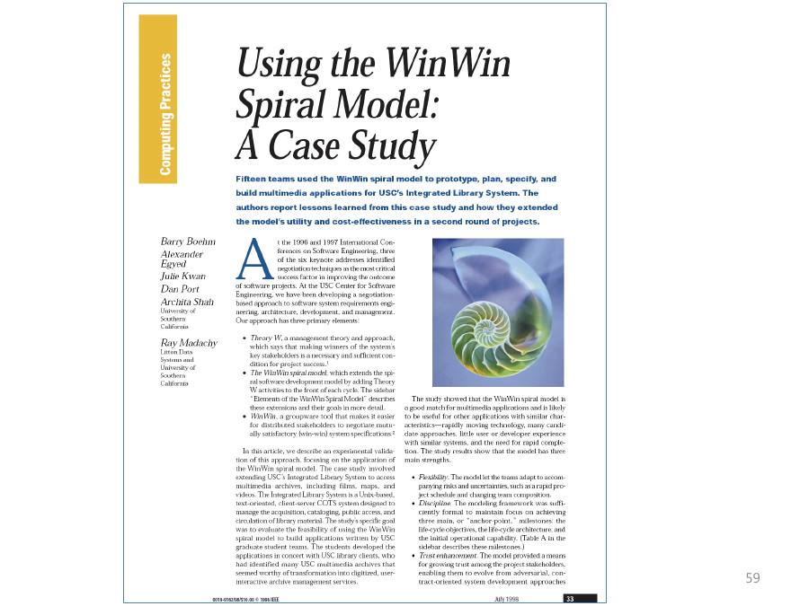
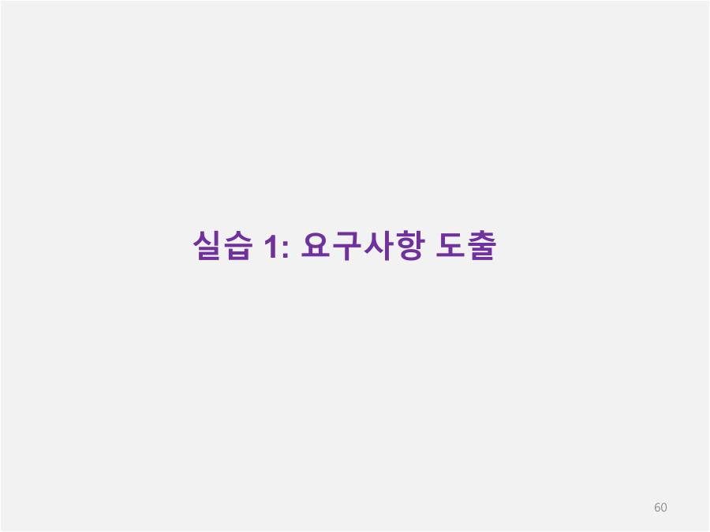
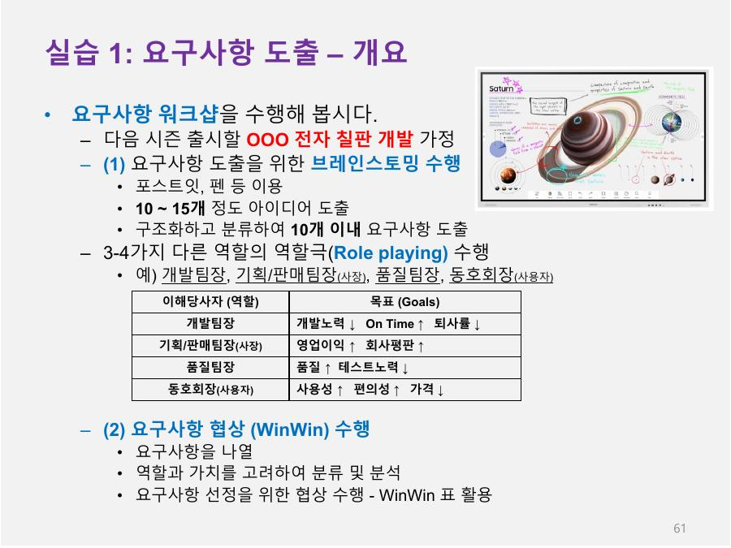
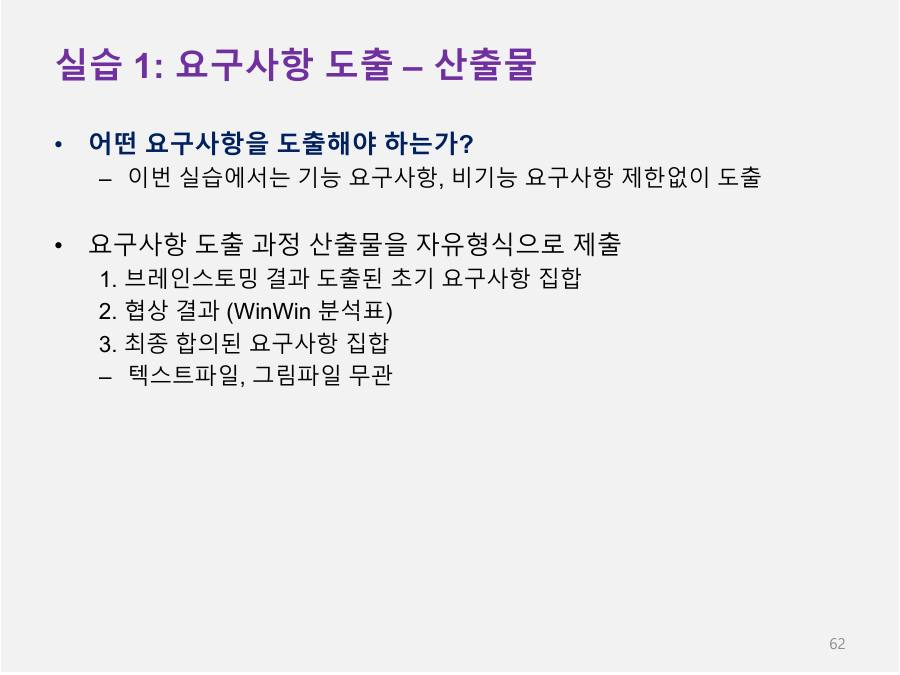
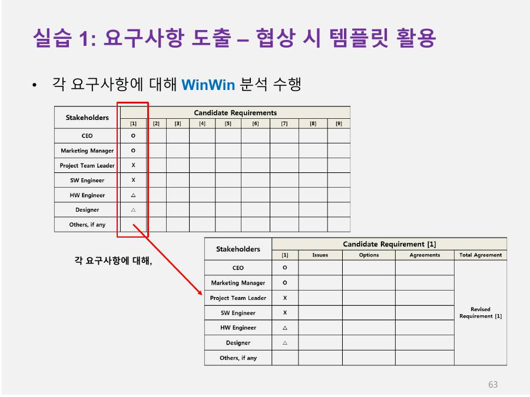
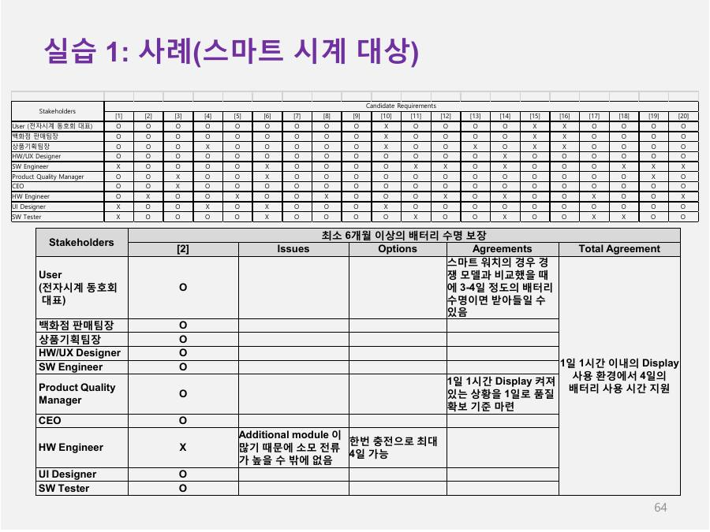
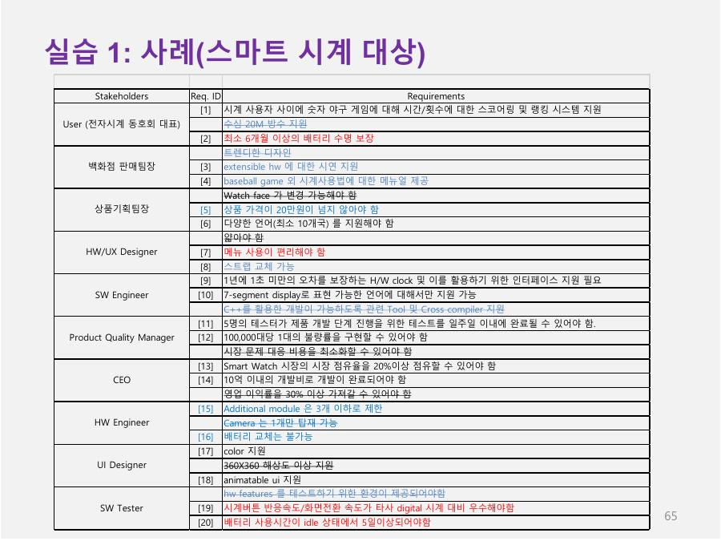
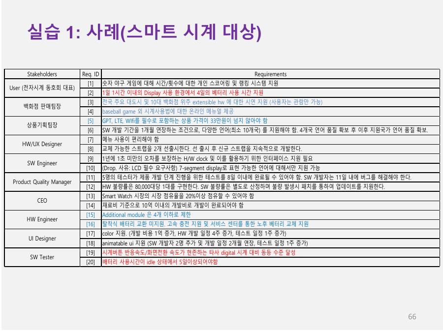

# 실습 1: 요구사항 도출

> 요구사항 분석 (Requirement Analysis) · 슬라이드 59–66 · 원본: [PDF](../../original/삼성전자AA_요구사항분석_강의_20261124-1125_지은경.pdf)

[← 이전: 4. 요구사항 협상](04_요구사항_협상.md) · [← 목차](README.md) · [다음: 5. 요구사항 분석 →](05_요구사항_분석.md)

## 슬라이드 목록

- [59. (이미지 슬라이드)](#s59)
- [60. 실습 1: 요구사항 도출](#s60)
- [61. 실습 1: 요구사항 도출 – 개요](#s61)
- [62. 실습 1: 요구사항 도출 – 산출물](#s62)
- [63. 실습 1: 요구사항 도출 – 협상 시 템플릿 활용](#s63)
- [64. 실습 1: 사례(스마트 시계 대상)](#s64)
- [65. 실습 1: 사례(스마트 시계 대상)](#s65)
- [66. 실습 1: 사례(스마트 시계 대상)](#s66)

---

## 59. (이미지 슬라이드)

---

## 60. 실습 1: 요구사항 도출

---

## 61. 실습 1: 요구사항 도출 – 개요

- 요구사항 워크샵을 수행해 봅시다.
  - 다음 시즌 출시할 OOO 전자 칠판 개발 가정
  - (1) 요구사항 도출을 위한 브레인스토밍 수행
    - 포스트잇, 펜 등 이용
    - 10 ~ 15개 정도 아이디어 도출
    - 구조화하고 분류하여 10개 이내 요구사항 도출
  - 3-4가지 다른 역할의 역할극(Role playing) 수행
    - 예) 개발팀장, 기획/판매팀장(사장), 품질팀장, 동호회장(사용자)

이해당사자 (역할) · 목표 (Goals)  
개발팀장 · 개발노력 ↓ On Time ↑ 퇴사률 ↓  
기획/판매팀장(사장) · 영업이익 ↑ 회사평판 ↑  
품질팀장 · 품질 ↑ 테스트노력 ↓  
동호회장(사용자) · 사용성 ↑ 편의성 ↑ 가격 ↓  

  - (2) 요구사항 협상 (WinWin) 수행
    - 요구사항을 나열
    - 역할과 가치를 고려하여 분류 및 분석
    - 요구사항 선정을 위한 협상 수행 - WinWin 표 활용

---

## 62. 실습 1: 요구사항 도출 – 산출물

- 어떤 요구사항을 도출해야 하는가?
  - 이번 실습에서는 기능 요구사항, 비기능 요구사항 제한없이 도출

- 요구사항 도출 과정 산출물을 자유형식으로 제출 1. 브레인스토밍 결과 도출된 초기 요구사항 집합 2. 협상 결과 (WinWin 분석표) 3. 최종 합의된 요구사항 집합
  - 텍스트파일, 그림파일 무관

---

## 63. 실습 1: 요구사항 도출 – 협상 시 템플릿 활용

- 각 요구사항에 대해 WinWin 분석 수행

각 요구사항에 대해,  

---

## 64. 실습 1: 사례(스마트 시계 대상)

Candidate Requirements  
Stakeholders  
[1] · [2] · [3] · [4] · [5] · [6] · [7] · [8] · [9] · [10] · [11] · [12] · [13] · [14] · [15] · [16] · [17] · [18] · [19] · [20]  
User (전자시계 동호회 대표) · O · O · O · O · O · O · O · O · O · X · O · O · O · O · X · X · O · O · O · O  
백화점 판매팀장 · O · O · O · O · O · O · O · O · O · X · O · O · O · O · X · X · O · O · O · O  
상품기획팀장 · O · O · O · X · O · O · O · O · O · X · O · O · X · O · X · X · O · O · O · O  
HW/UX Designer · O · O · O · O · O · O · O · O · O · O · O · O · O · X · O · O · O · O · O · O  
SW Engineer · X · O · O · O · O · X · O · O · O · O · X · X · O · X · O · O · O · X · X · X  
Product Quality Manager · O · O · X · O · O · X · O · O · O · O · O · O · O · O · O · O · O · O · X · O  
CEO · O · O · X · O · O · O · O · O · O · O · O · O · O · O · O · O · O · O · O · O  
HW Engineer · O · X · O · O · X · O · O · X · O · O · O · X · O · X · O · O · X · O · O · X  
UI Designer · X · O · O · X · O · X · O · O · O · X · O · O · O · O · O · O · O · O · O · O  
SW Tester · X · O · O · O · O · X · O · O · O · O · X · O · O · X · O · O · X · X · O · O  

최소 6개월 이상의 배터리 수명 보장  
Stakeholders  
[2] · Issues · Options · Agreements · Total Agreement  
스마트 워치의 경우 경  
User · 쟁 모델과 비교했을 때  
(전자시계 동호회 · O · 에 3-4일 정도의 배터리  
대표) · 수명이면 받아들일 수  
있음  
백화점 판매팀장 · O  
상품기획팀장 · O  
HW/UX Designer · O  
SW Engineer · O · 1일 1시간 이내의 Display  
1일 1시간 Display 켜져 · 사용 환경에서 4일의  
Product Quality · 배터리  사용 시간 지원  
O · 있는 상황을 1일로 품질  
Manager  
확보 기준 마련  
CEO · O  
Additional module 이  
한번 충전으로 최대  
HW Engineer · X · 많기 때문에 소모 전류  
4일 가능  
가 높을 수 밖에 없음  
UI Designer · O  
SW Tester · O  

---

## 65. 실습 1: 사례(스마트 시계 대상)

Stakeholders · Req. ID · Requirements  
[1] · 시계 사용자 사이에 숫자 야구 게임에 대해 시간/횟수에 대한 스코어링 및 랭킹 시스템 지원  
User (전자시계 동호회 대표) · 수심 20M 방수 지원  
[2] · 최소 6개월 이상의 배터리 수명 보장  
트렌디한 디자인  
백화점 판매팀장 · [3] · extensible hw 에 대한 시연 지원  
[4] · baseball game 외 시계사용법에 대한 메뉴얼 제공  
Watch face 가 변경 가능해야 함  
상품기획팀장 · [5] · 상품 가격이 20만원이 넘지 않아야 함  
[6] · 다양한 언어(최소 10개국) 를 지원해야 함  
얇아야 함  
HW/UX Designer · [7] · 메뉴 사용이 편리해야 함  
[8] · 스트랩 교체 가능  
[9] · 1년에 1초 미만의 오차를 보장하는 H/W clock 및 이를 활용하기 위한 인터페이스 지원 필요  
SW Engineer · [10] · 7-segment display로 표현 가능한 언어에 대해서만 지원 가능  
C++를 활용한 개발이 가능하도록 관련 Tool 및 Cross compiler 지원  
[11] · 5명의 테스터가 제품 개발 단계 진행을 위한 테스트를 일주일 이내에 완료될 수 있어야 함.  
Product Quality Manager · [12] · 100,000대당 1대의 불량률을 구현할 수 있어야 함  
시장 문제 대응 비용을 최소화할 수 있어야 함  
[13] · Smart Watch 시장의 시장 점유율을 20%이상 점유할 수 있어야 함  
CEO · [14] · 10억 이내의 개발비로 개발이 완료되어야 함  
영업 이익률을 30% 이상 가져갈 수 있어야 함  
[15] · Additional module 은 3개 이하로 제한  
HW Engineer · Camera 는 1개만 탑재 가능  
[16] · 배터리 교체는 불가능  
[17] · color 지원  
UI Designer · 360X360 해상도 이상 지원  
[18] · animatable ui 지원  
hw features 를 테스트하기 위한 환경이 제공되어야함  
SW Tester · [19] · 시계버튼 반응속도/화면전환 속도가 타사 digital 시계 대비 우수해야함  
[20] · 배터리 사용시간이 idle 상태에서 5일이상되어야함  

---

## 66. 실습 1: 사례(스마트 시계 대상)

Stakeholders · Req. ID · Requirements  
[1] · 숫자 야구 게임에 대해 시간/횟수에 대한 개인 스코어링 및 랭킹 시스템 지원  
User (전자시계 동호회 대표)  
[2] · 1일 1시간 이내의 Display 사용 환경에서 4일의 베터리 사용 시간 지원  
[3] · 전국 주요 대도시 및 10대 백화점 위주 extensible hw 에 대한 시연 지원 (사용자는 관람만 가능)  
백화점 판매팀장  
[4] · baseball game 외 시계사용법에 대한 온라인 메뉴얼 제공  
[5] · GPT, LTE, WIfi를 필수로 포함하는 상품 가격이 33만원이 넘지 않아야 함  
상품기획팀장  
[6] · SW 개발 기간을 1개월 연장하는 조건으로, 다양한 언어(최소 10개국) 를 지원해야 함. 4개국 언어 품질 확보 후 이후 지원국가 언어 품질 확보.  
[7] · 메뉴 사용이 편리해야 함  
HW/UX Designer  
[8] · 교체 가능한 스트랩을 2개 선출시한다. 선 출시 후 신규 스트랩을 지속적으로 개발한다.  
[9] · 1년에 1초 미만의 오차를 보장하는 H/W clock 및 이를 활용하기 위한 인터페이스 지원 필요  
SW Engineer  
[10] · (Drop. 사유: LCD 필수 요구사항) 7-segment display로 표현 가능한 언어에 대해서만 지원 가능  
[11] · 5명의 테스터가 제품 개발 단계 진행을 위한 테스트를 8일 이내에 완료될 수 있어야 함. SW 개발자는 11일 내에 버그를 해결해야 한다.  
Product Quality Manager  
[12] · HW 불량률은 80,000대당 1대를 구현한다. SW 불량률은 별도로 산정하며 불량 발생시 패치를 통하여 업데이트를 지원한다.  
[13] · Smart Watch 시장의 시장 점유율을 20%이상 점유할 수 있어야 함  
CEO  
[14] · 재료비 기준으로 10억 이내의 개발비로 개발이 완료되어야 함  
[15] · Additional module 은 4개 이하로 제한  
HW Engineer  
[16] · 탈착식 배터리 교환 미지원. 고속 충전 지원 및 서비스 센터를 통한 노후 베터리 교체 지원  
[17] · color 지원. (개발 비용 1억 증가, HW 개발 일정 4주 증가, 테스트 일정 1주 증가)  
UI Designer  
[18] · animatable ui 지원 (SW 개발자 2명 추가 및 개발 일정 2개월 연장, 테스트 일정 1주 증가)  
[19] · 시계버튼 반응속도/화면전환 속도가 현존하는 타사 digital 시계 대비 동등 수준 달성  
SW Tester  
[20] · 배터리 사용시간이 idle 상태에서 5일이상되어야함  

---

[← 이전: 4. 요구사항 협상](04_요구사항_협상.md) · [← 목차](README.md) · [다음: 5. 요구사항 분석 →](05_요구사항_분석.md)
