# 5. 요구사항 분석

> 요구사항 분석 (Requirement Analysis) · 슬라이드 67–110 · 원본: [PDF](../../original/삼성전자AA_요구사항분석_강의_20261124-1125_지은경.pdf)

[← 이전: 실습 1: 요구사항 도출](04x_실습1_요구사항_도출.md) · [← 목차](README.md) · [다음: 6. 요구사항 명세 →](06_요구사항_명세.md)

## 슬라이드 목록

- [67. 5\. 요구사항 분석](#s67)
- [68. 요구공학 프로세스](#s68)
- [69. 요구사항 모델링](#s69)
- [70. 요구사항 모델의 특징(Features)](#s70)
- [71. 요구사항 모델링 표기법(Notations)](#s71)
- [72. 요구사항 모델링 표기법(언어) 원칙](#s72)
- [73. 모델링 기법들](#s73)
- [74. 주요 요구사항 모델링 기법들](#s74)
- [75. 1\. Structured Analysis](#s75)
- [76. Data Flow Diagram (DFD)](#s76)
- [77. DFD Level 0 - RVC Example](#s77)
- [78. DFD Level 0 - RVC Example](#s78)
- [79. DFD Level 1 - RVC Example](#s79)
- [80. DFD Level 2 - RVC Example](#s80)
- [81. DFD Level 2 - RVC Example](#s81)
- [82. DFD Level 3 - RVC Example](#s82)
- [83. DFD Level 4 - RVC Example](#s83)
- [84. DFD - RVC Example](#s84)
- [85. State Transition Diagram (STD)](#s85)
- [86. STD Example](#s86)
- [87. E-R Modeling](#s87)
- [88. E-R Modeling (cont.)](#s88)
- [89. E-R Modeling (cont.)](#s89)
- [90. 2\. Use Case Analysis](#s90)
- [91. Use Case: Example · Use case](#s91)
- [92. 요구사항 우선순위 지정](#s92)
- [93. 비용-가치(Cost-Value) 접근법](#s93)
- [94. 비용 및 가치 추정](#s94)
- [95. 추정 과정에서 발생하는 문제점](#s95)
- [96. 분석적 계층 프로세스 (AHP)](#s96)
- [97. AHP 예시 - 비용 추정](#s97)
- [98. ROI 그래프](#s98)
- [99. 기타 선정 기준](#s99)
- [100. 이해관계자별 가치 시각화](#s100)
- [101. 요구사항 우선순위 결정 시 고려 사항](#s101)
- [102. 요구사항 우선순위 결정 시 고려 사항 (계속)](#s102)
- [103. 요구사항 우선순위 결정 방법](#s103)
- [104. 요구사항 우선순위 결정 방법 (계속)](#s104)
- [105. 요구사항 우선순위 결정 방법 (계속)](#s105)
- [106. 요구사항 분류(Triage)](#s106)
- [107. 요구사항 분류 (계속)](#s107)
- [108. 주석이 달린 요구사항 목록](#s108)
- [109. 주석이 달린 요구사항 사례](#s109)
- [110. 요구사항 분류 결과](#s110)

---

## 67. 5\. 요구사항 분석

---

## 68. 요구공학 프로세스

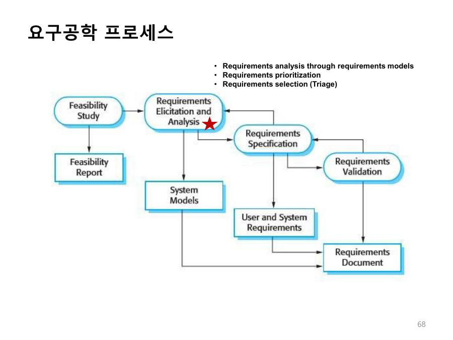

- Requirements analysis through requirements models
- Requirements prioritization
- Requirements selection (Triage)

---

## 69. 요구사항 모델링

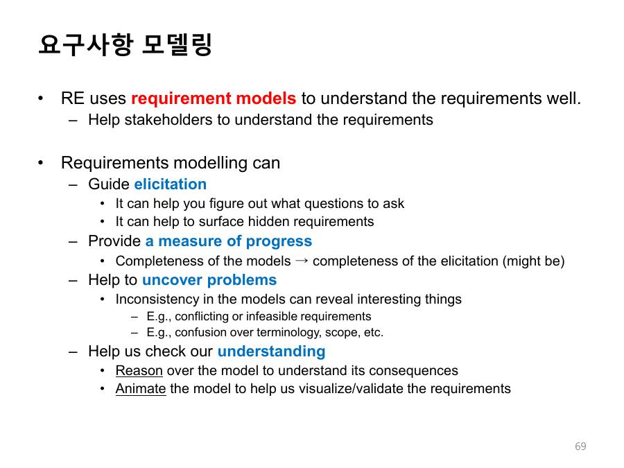

- RE uses requirement models to understand the requirements well.
  - Help stakeholders to understand the requirements

- Requirements modelling can
  - Guide elicitation
    - It can help you figure out what questions to ask
    - It can help to surface hidden requirements
  - Provide a measure of progress
    - Completeness of the models → completeness of the elicitation (might be)
  - Help to uncover problems
    - Inconsistency in the models can reveal interesting things
      - E.g., conflicting or infeasible requirements
      - E.g., confusion over terminology, scope, etc.
  - Help us check our understanding
    - Reason over the model to understand its consequences
    - Animate the model to help us visualize/validate the requirements

---

## 70. 요구사항 모델의 특징(Features)

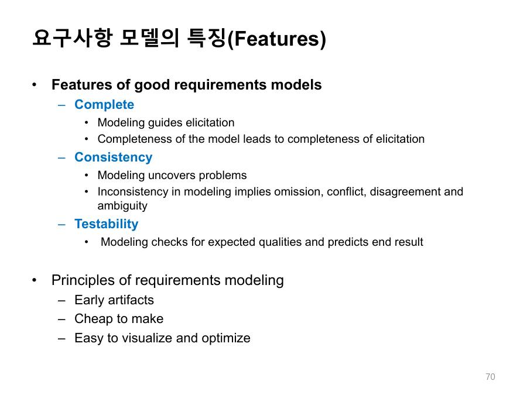

- Features of good requirements models
  - Complete
    - Modeling guides elicitation
    - Completeness of the model leads to completeness of elicitation
  - Consistency
    - Modeling uncovers problems
    - Inconsistency in modeling implies omission, conflict, disagreement and ambiguity
  - Testability
    - Modeling checks for expected qualities and predicts end result

- Principles of requirements modeling
  - Early artifacts
  - Cheap to make
  - Easy to visualize and optimize

---

## 71. 요구사항 모델링 표기법(Notations)

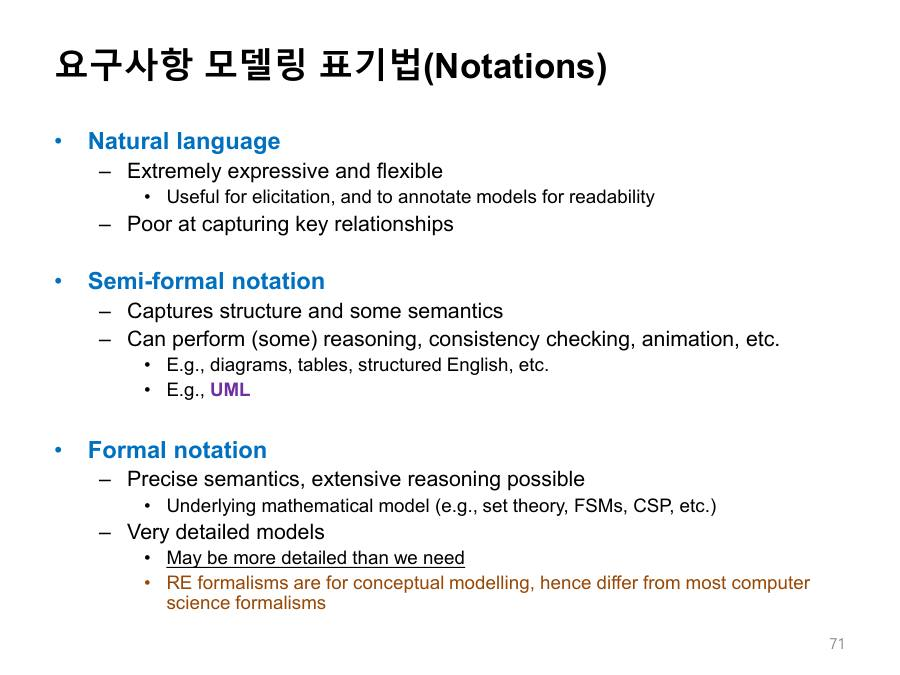

- Natural language
  - Extremely expressive and flexible
    - Useful for elicitation, and to annotate models for readability
  - Poor at capturing key relationships

- Semi-formal notation
  - Captures structure and some semantics
  - Can perform (some) reasoning, consistency checking, animation, etc.
    - E.g., diagrams, tables, structured English, etc.
    - E.g., UML

- Formal notation
  - Precise semantics, extensive reasoning possible
    - Underlying mathematical model (e.g., set theory, FSMs, CSP, etc.)
  - Very detailed models
    - May be more detailed than we need
    - RE formalisms are for conceptual modelling, hence differ from most computer science formalisms

---

## 72. 요구사항 모델링 표기법(언어) 원칙

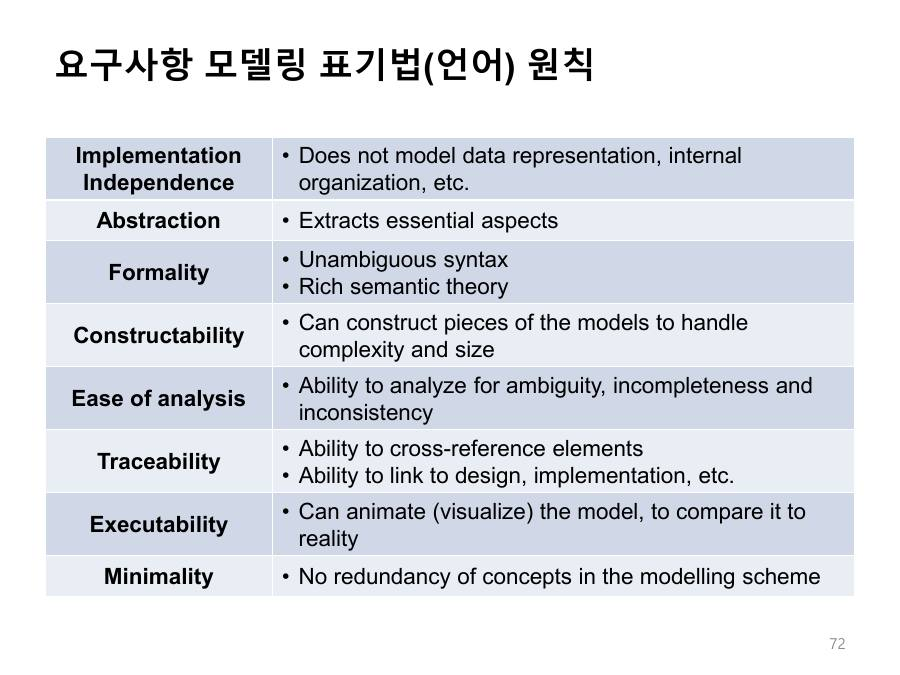

Implementation · • Does not model data representation, internal  
Independence · organization, etc.  
Abstraction · • Extracts essential aspects  
- Unambiguous syntax

Formality  
- Rich semantic theory
- Can construct pieces of the models to handle

Constructability  
complexity and size  
- Ability to analyze for ambiguity, incompleteness and

Ease of analysis  
inconsistency  
- Ability to cross-reference elements

Traceability  
- Ability to link to design, implementation, etc.
- Can animate (visualize) the model, to compare it to

Executability  
reality  
Minimality · • No redundancy of concepts in the modelling scheme  

---

## 73. 모델링 기법들

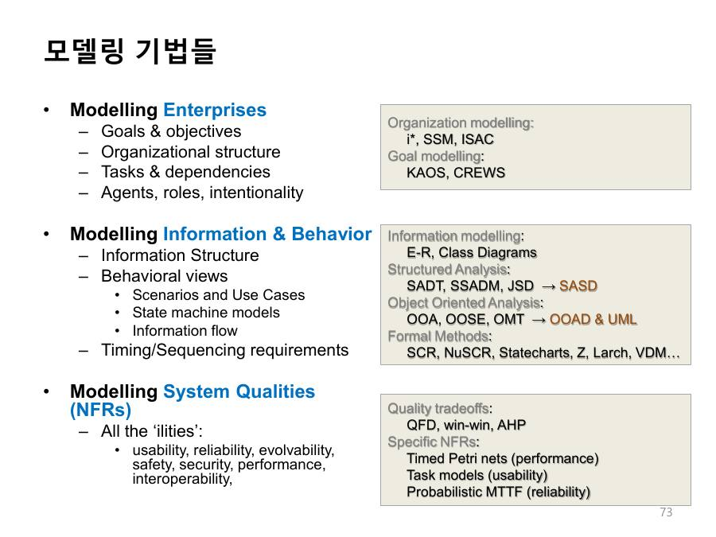

- Modelling Enterprises Organization modelling:
  - Goals &amp; objectives · i\*, SSM, ISAC
  - Organizational structure · Goal modelling:
  - Tasks &amp; dependencies · KAOS, CREWS
  - Agents, roles, intentionality

- Modelling Information &amp; Behavior · Information modelling:
  - Information Structure · E-R, Class Diagrams Structured Analysis:
  - Behavioral views SADT, SSADM, JSD → SASD
    - Scenarios and Use Cases Object Oriented Analysis:
    - State machine models · OOA, OOSE, OMT → OOAD &amp; UML
    - Information flow · Formal Methods:
  - Timing/Sequencing requirements · SCR, NuSCR, Statecharts, Z, Larch, VDM…

- Modelling System Qualities

(NFRs) · Quality tradeoffs:  
QFD, win-win, AHP  
  - All the ‘ilities’: Specific NFRs:
    - usability, reliability, evolvability,

safety, security, performance, · Timed Petri nets (performance)  
interoperability, · Task models (usability)  
Probabilistic MTTF (reliability)  

---

## 74. 주요 요구사항 모델링 기법들

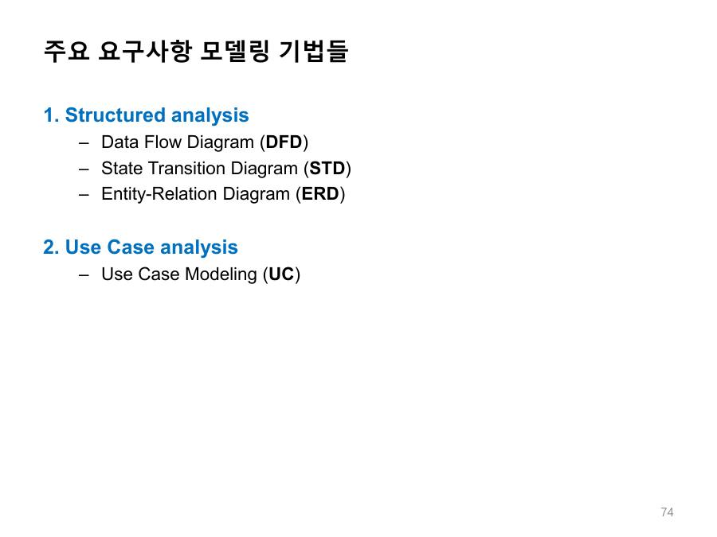

1\. Structured analysis  
- Data Flow Diagram (DFD)
- State Transition Diagram (STD)
- Entity-Relation Diagram (ERD)

2\. Use Case analysis  
- Use Case Modeling (UC)

---

## 75. 1\. Structured Analysis

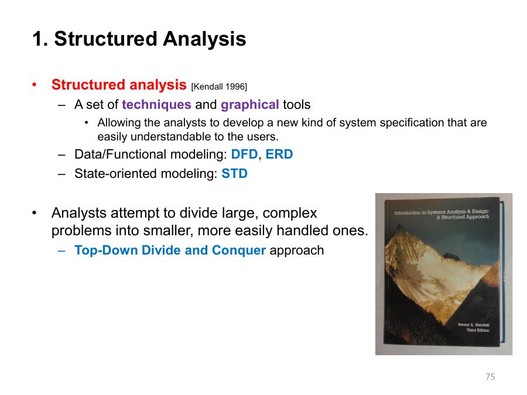

- Structured analysis [Kendall 1996]
  - A set of techniques and graphical tools
    - Allowing the analysts to develop a new kind of system specification that are easily understandable to the users.
  - Data/Functional modeling: DFD, ERD
  - State-oriented modeling: STD

- Analysts attempt to divide large, complex problems into smaller, more easily handled ones.
  - Top-Down Divide and Conquer approach

---

## 76. Data Flow Diagram (DFD)

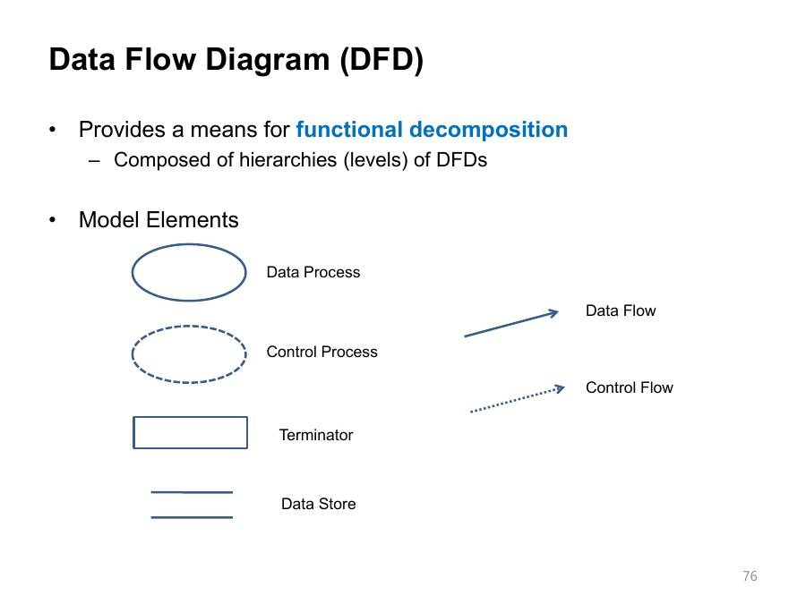

- Provides a means for functional decomposition
  - Composed of hierarchies (levels) of DFDs

- Model Elements

Data Process  

Data Flow  

Control Process  

Control Flow  

Terminator  

Data Store  

---

## 77. DFD Level 0 - RVC Example

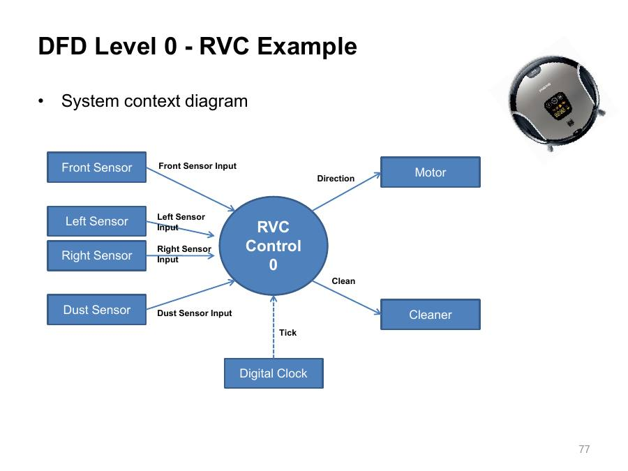

- System context diagram

Front Sensor · Front Sensor Input  
Motor  
Direction  

Left Sensor  
Left Sensor · Input · RVC  
Right Sensor · Control  
Right Sensor · Input  
0  
Clean  

Dust Sensor · Dust Sensor Input · Cleaner  
Tick  

Digital Clock  

---

## 78. DFD Level 0 - RVC Example

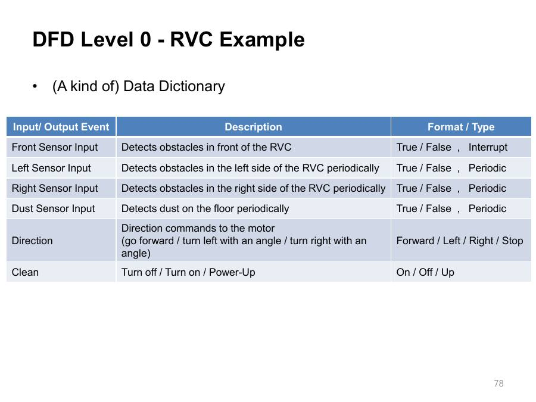

- (A kind of) Data Dictionary

Input/ Output Event · Description · Format / Type  
Front Sensor Input · Detects obstacles in front of the RVC · True / False , Interrupt  
Left Sensor Input · Detects obstacles in the left side of the RVC periodically · True / False , Periodic  
Right Sensor Input · Detects obstacles in the right side of the RVC periodically · True / False , Periodic  
Dust Sensor Input · Detects dust on the floor periodically · True / False , Periodic  
Direction commands to the motor  
Direction · (go forward / turn left with an angle / turn right with an · Forward / Left / Right / Stop  
angle)  
Clean · Turn off / Turn on / Power-Up · On / Off / Up  

---

## 79. DFD Level 1 - RVC Example

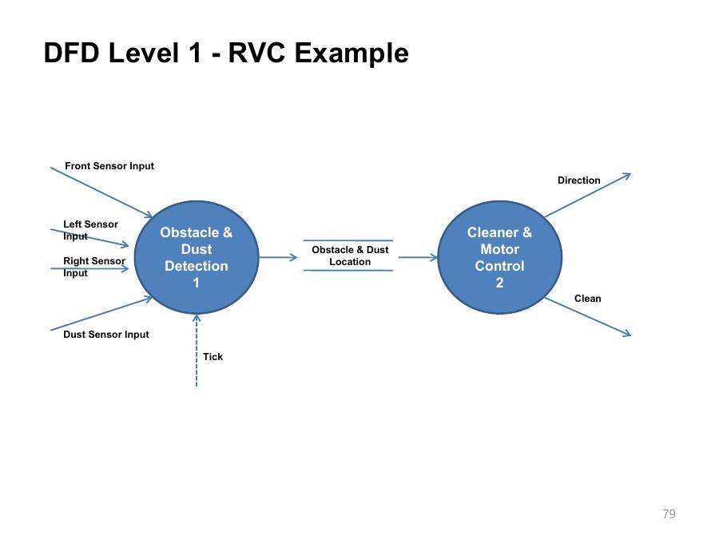

Front Sensor Input  
Direction  

Left Sensor  
Input · Obstacle &amp; · Cleaner &amp;  
Dust · Obstacle &amp; Dust · Motor  
Right Sensor · Location  
Input  
Detection · Control  
1 · 2  
Clean  

Dust Sensor Input  

Tick  

---

## 80. DFD Level 2 - RVC Example

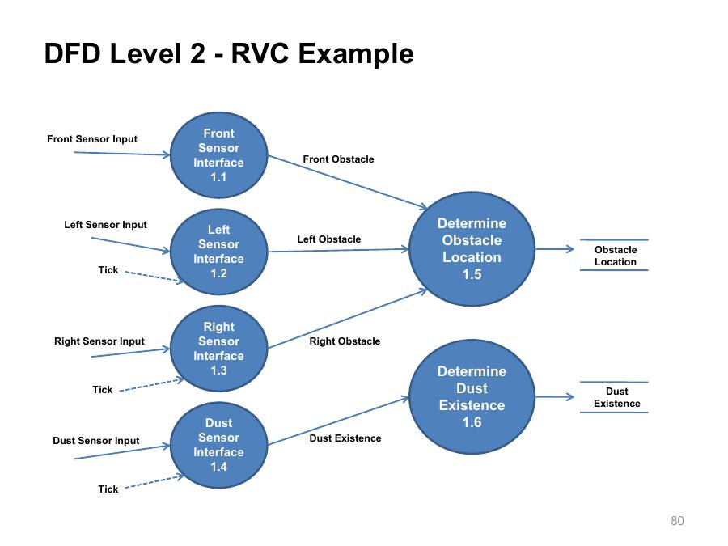

Front Sensor Input  
Front  
Sensor  
Interface · Front Obstacle  
1.1  

Left Sensor Input  
Left · Determine  
Sensor  
Left Obstacle · Obstacle  
Obstacle  
Interface · Location · Location  
Tick · 1.2 · 1.5  

Right  
Right Sensor Input · Sensor · Right Obstacle  
Interface  
1.3 · Determine  
Tick · Dust · Dust  
Existence · Existence  

Dust · 1.6  
Dust Sensor Input · Sensor · Dust Existence  
Interface  
1.4  
Tick  

---

## 81. DFD Level 2 - RVC Example

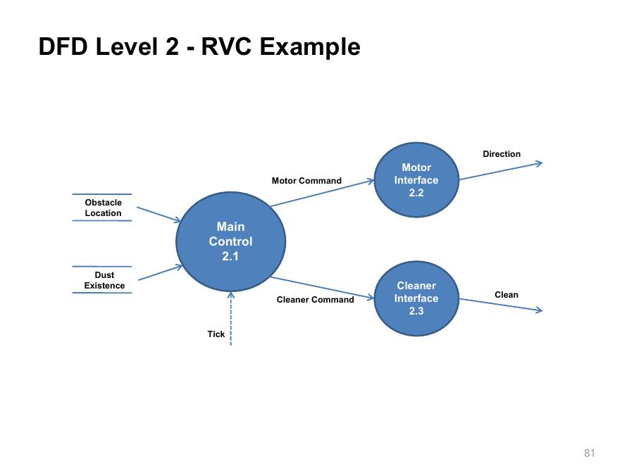

Direction  
Motor  
Motor Command · Interface  
2.2  
Obstacle  
Location  
Main  
Control  
2.1  
Dust  
Existence · Cleaner  
Clean  
Cleaner Command · Interface  
2.3  

Tick  

---

## 82. DFD Level 3 - RVC Example

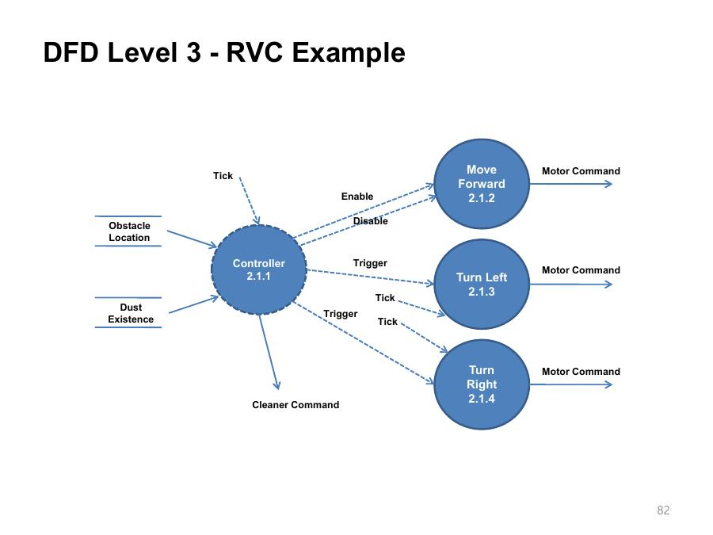

Tick  
Move · Motor Command  
Forward  
Enable · 2.1.2  

Obstacle · Disable  
Location  

Controller · Trigger  
Motor Command  
2.1.1 · Turn Left  
2.1.3  
Tick  
Dust  
Trigger  
Existence · Tick  

Turn · Motor Command  
Right  
Cleaner Command  
2.1.4  

---

## 83. DFD Level 4 - RVC Example

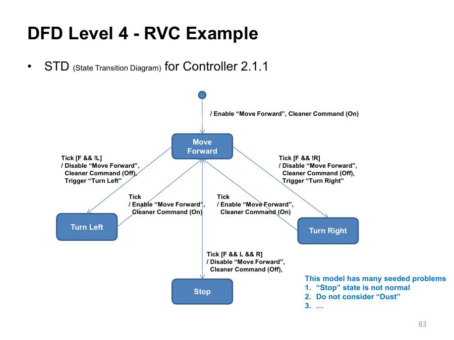

- STD (State Transition Diagram) for Controller 2.1.1

/ Enable “Move Forward”, Cleaner Command (On)  

Move  
Forward  
Tick [F &amp;&amp; !L] · Tick [F &amp;&amp; !R]  
/ Disable “Move Forward”, · / Disable “Move Forward”,  
Cleaner Command (Off), · Cleaner Command (Off),  
Trigger “Turn Left” · Trigger “Turn Right”  

Tick · Tick  
/ Enable “Move Forward”, · / Enable “Move Forward”,  
Cleaner Command (On) · Cleaner Command (On)  

Turn Left  
Turn Right  

Tick [F &amp;&amp; L &amp;&amp; R]  
/ Disable “Move Forward”,  
Cleaner Command (Off),  
This model has many seeded problems  
1\. “Stop” state is not normal  
Stop  
2\. Do not consider “Dust”  
3\. …  

---

## 84. DFD - RVC Example

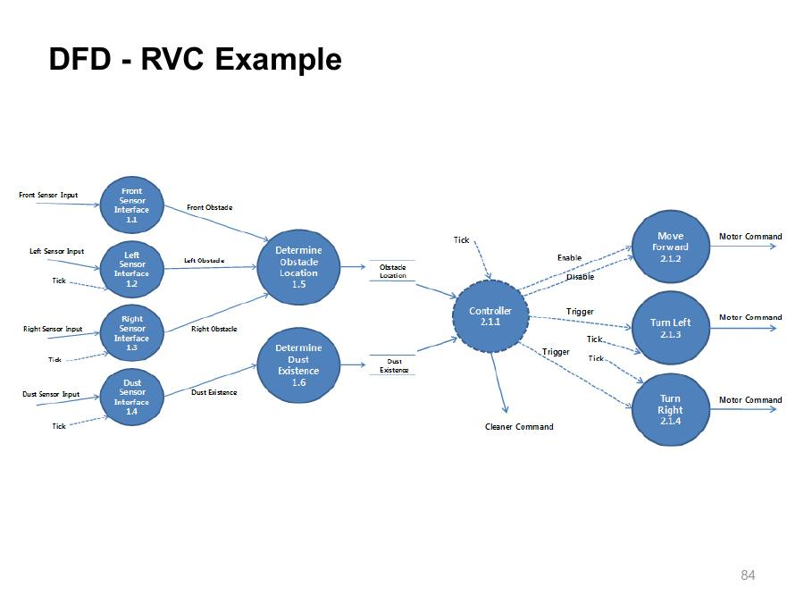

---

## 85. State Transition Diagram (STD)

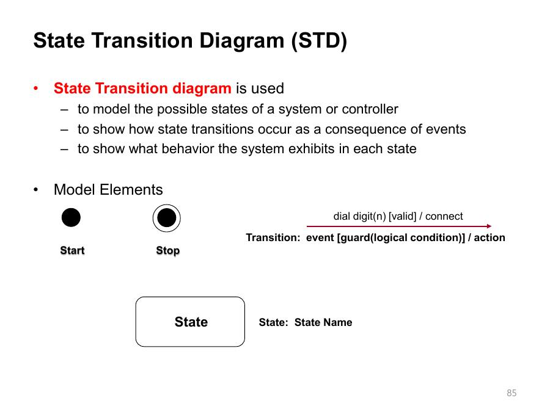

- State Transition diagram is used
  - to model the possible states of a system or controller
  - to show how state transitions occur as a consequence of events
  - to show what behavior the system exhibits in each state

- Model Elements dial digit(n) [valid] / connect

Transition: event [guard(logical condition)] / action  
Start · Stop  

State · State: State Name  

---

## 86. STD Example

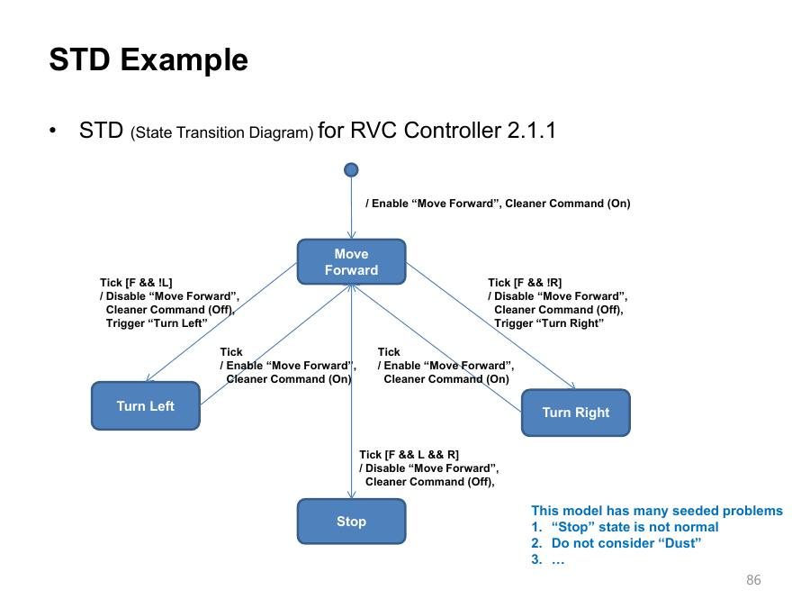

- STD (State Transition Diagram) for RVC Controller 2.1.1

/ Enable “Move Forward”, Cleaner Command (On)  

Move  
Forward  
Tick [F &amp;&amp; !L] · Tick [F &amp;&amp; !R]  
/ Disable “Move Forward”, · / Disable “Move Forward”,  
Cleaner Command (Off), · Cleaner Command (Off),  
Trigger “Turn Left” · Trigger “Turn Right”  

Tick · Tick  
/ Enable “Move Forward”, · / Enable “Move Forward”,  
Cleaner Command (On) · Cleaner Command (On)  

Turn Left  
Turn Right  

Tick [F &amp;&amp; L &amp;&amp; R]  
/ Disable “Move Forward”,  
Cleaner Command (Off),  

This model has many seeded problems  
Stop · 1. “Stop” state is not normal  
2\. Do not consider “Dust”  
3\. …  

---

## 87. E-R Modeling

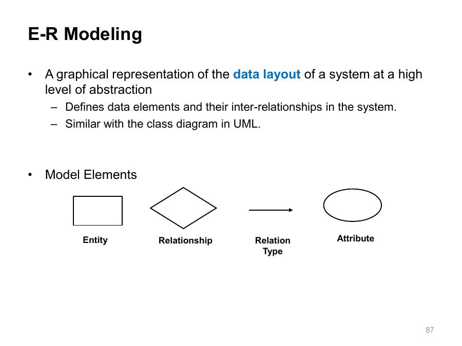

- A graphical representation of the data layout of a system at a high level of abstraction
  - Defines data elements and their inter-relationships in the system.
  - Similar with the class diagram in UML.

- Model Elements

Entity · Relationship · Relation · Attribute  
Type  

---

## 88. E-R Modeling (cont.)

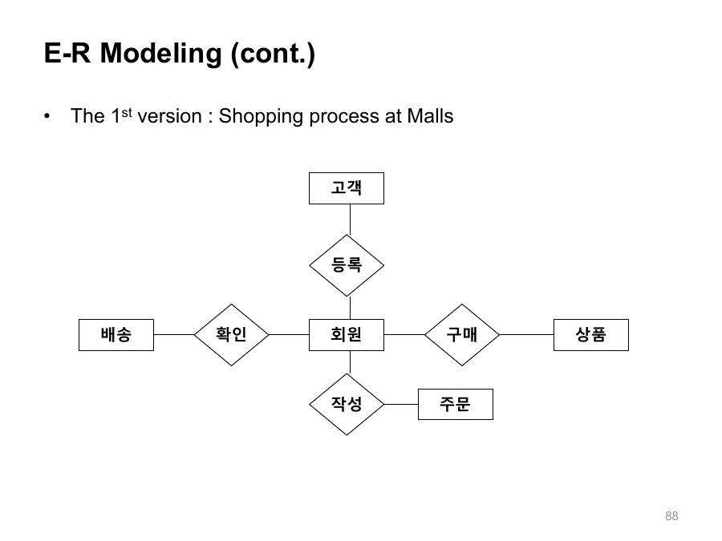

- The 1st version : Shopping process at Malls

고객  

등록  

배송 · 확인 · 회원 · 구매 · 상품  

작성 · 주문  

---

## 89. E-R Modeling (cont.)

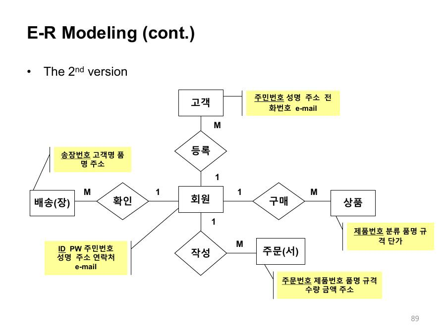

- The 2nd version 주민번호 성명 주소 전

고객 · 화번호 e-mail  

M  

송장번호 고객명 품 · 등록  
명 주소  
1  
M · 1 · 1 · M  
배송(장) · 확인 · 회원 · 구매 · 상품  
1  
제품번호 분류 품명 규  
M · 격 단가  
ID PW 주민번호 · 주문(서)  
성명 주소 연락처  
작성  
e-mail  
주문번호 제품번호 품명 규격  
수량 금액 주소  

---

## 90. 2\. Use Case Analysis

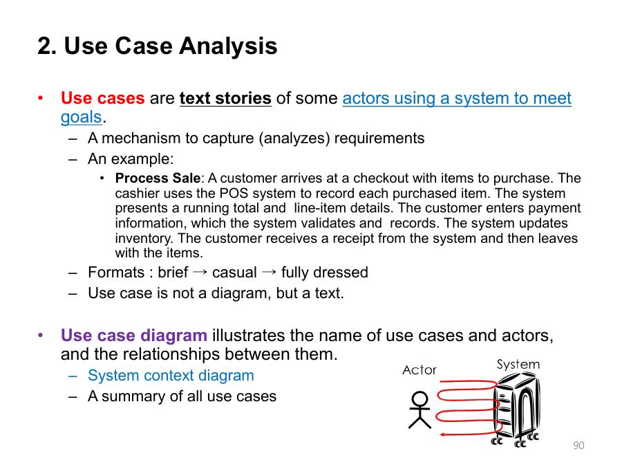

- Use cases are text stories of some actors using a system to meet goals.
  - A mechanism to capture (analyzes) requirements
  - An example:
    - Process Sale: A customer arrives at a checkout with items to purchase. The cashier uses the POS system to record each purchased item. The system presents a running total and line-item details. The customer enters payment information, which the system validates and records. The system updates inventory. The customer receives a receipt from the system and then leaves with the items.
  - Formats : brief → casual → fully dressed
  - Use case is not a diagram, but a text.

- Use case diagram illustrates the name of use cases and actors, and the relationships between them.
  - System context diagram
  - A summary of all use cases

---

## 91. Use Case: Example · Use case

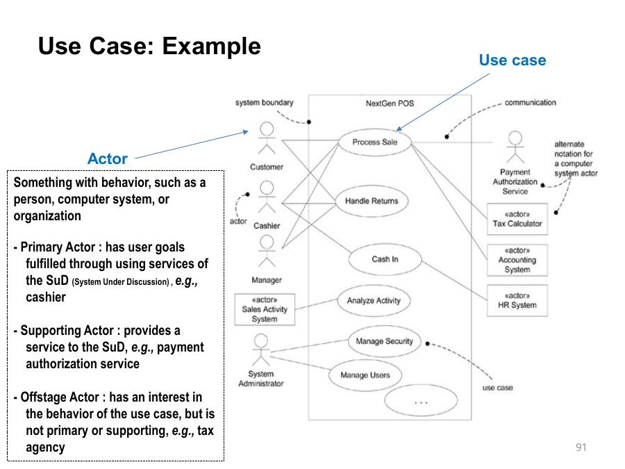

Actor  
Something with behavior, such as a  
person, computer system, or  
organization  

- Primary Actor : has user goals fulfilled through using services of the SuD (System Under Discussion) , e.g., cashier

- Supporting Actor : provides a service to the SuD, e.g., payment authorization service

- Offstage Actor : has an interest in the behavior of the use case, but is not primary or supporting, e.g., tax agency

---

## 92. 요구사항 우선순위 지정

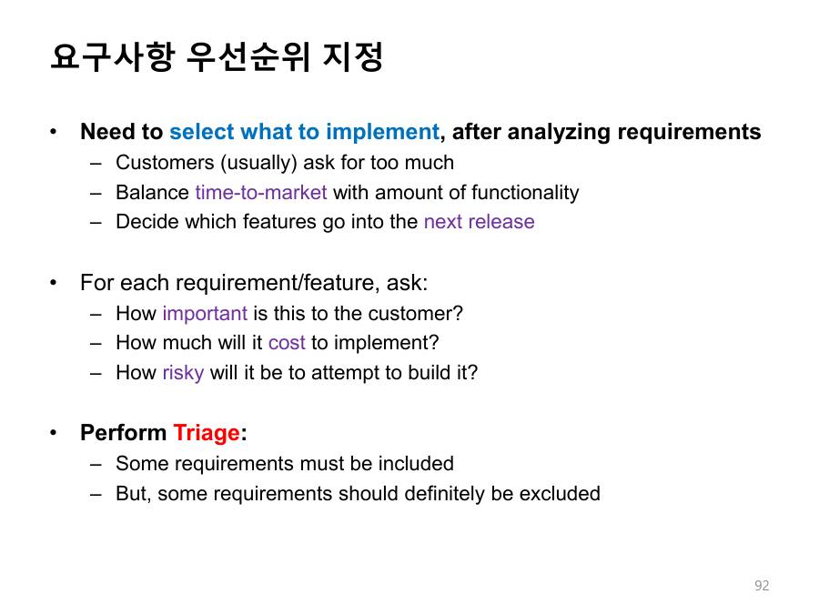

- Need to select what to implement, after analyzing requirements
  - Customers (usually) ask for too much
  - Balance time-to-market with amount of functionality
  - Decide which features go into the next release

- For each requirement/feature, ask:
  - How important is this to the customer?
  - How much will it cost to implement?
  - How risky will it be to attempt to build it?

- Perform Triage:
  - Some requirements must be included
  - But, some requirements should definitely be excluded

---

## 93. 비용-가치(Cost-Value) 접근법

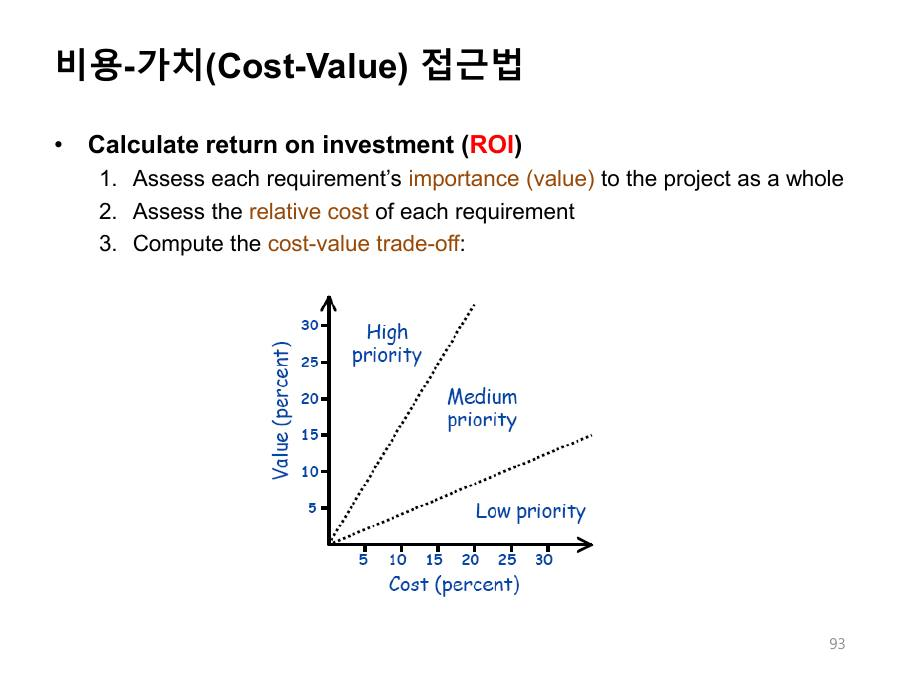

- Calculate return on investment (ROI) 1. Assess each requirement’s importance (value) to the project as a whole 2. Assess the relative cost of each requirement 3. Compute the cost-value trade-off:

---

## 94. 비용 및 가치 추정

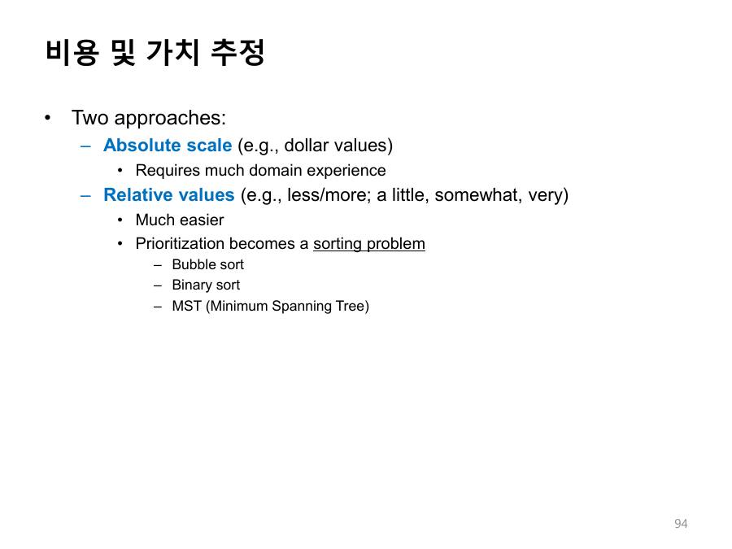

- Two approaches:
  - Absolute scale (e.g., dollar values)
    - Requires much domain experience
  - Relative values (e.g., less/more; a little, somewhat, very)
    - Much easier
    - Prioritization becomes a sorting problem
      - Bubble sort
      - Binary sort
      - MST (Minimum Spanning Tree)

---

## 95. 추정 과정에서 발생하는 문제점

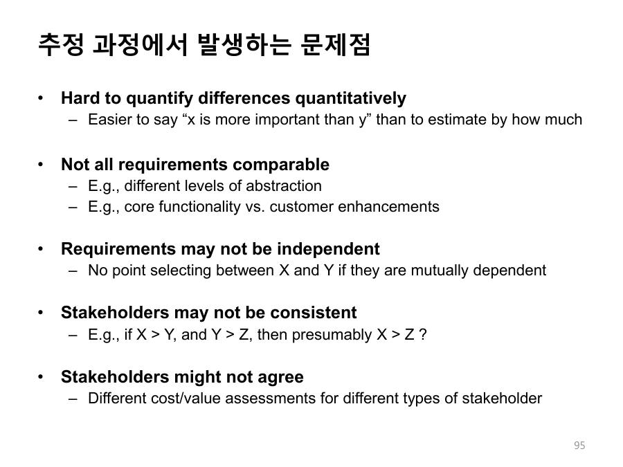

- Hard to quantify differences quantitatively
  - Easier to say “x is more important than y” than to estimate by how much

- Not all requirements comparable
  - E.g., different levels of abstraction
  - E.g., core functionality vs. customer enhancements

- Requirements may not be independent
  - No point selecting between X and Y if they are mutually dependent

- Stakeholders may not be consistent
  - E.g., if X &gt; Y, and Y &gt; Z, then presumably X &gt; Z ?

- Stakeholders might not agree
  - Different cost/value assessments for different types of stakeholder

---

## 96. 분석적 계층 프로세스 (AHP)

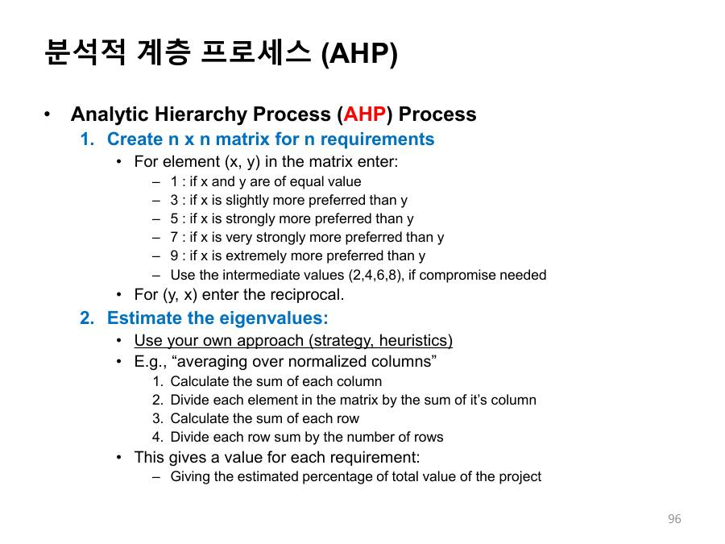

- Analytic Hierarchy Process (AHP) Process 1. Create n x n matrix for n requirements
  - For element (x, y) in the matrix enter:
    - 1 : if x and y are of equal value
    - 3 : if x is slightly more preferred than y
    - 5 : if x is strongly more preferred than y
    - 7 : if x is very strongly more preferred than y
    - 9 : if x is extremely more preferred than y
    - Use the intermediate values (2,4,6,8), if compromise needed
  - For (y, x) enter the reciprocal.

2\. Estimate the eigenvalues:  
  - Use your own approach (strategy, heuristics)
  - E.g., “averaging over normalized columns” 1. Calculate the sum of each column 2. Divide each element in the matrix by the sum of it’s column 3. Calculate the sum of each row 4. Divide each row sum by the number of rows
  - This gives a value for each requirement:
    - Giving the estimated percentage of total value of the project

---

## 97. AHP 예시 - 비용 추정

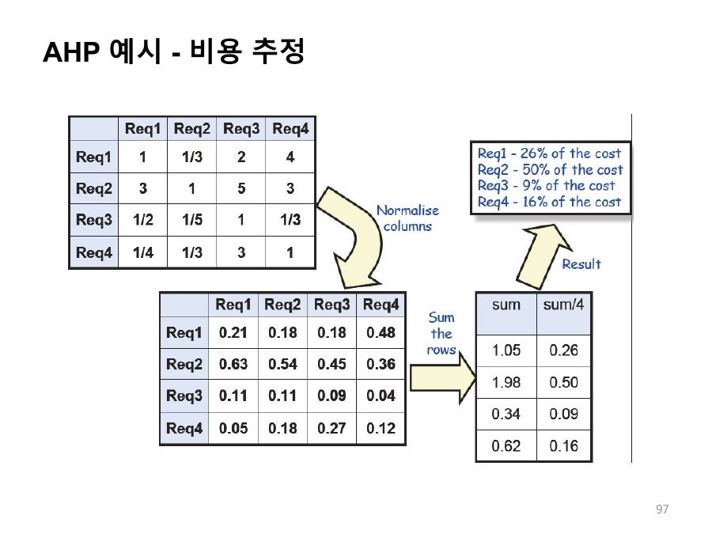

---

## 98. ROI 그래프

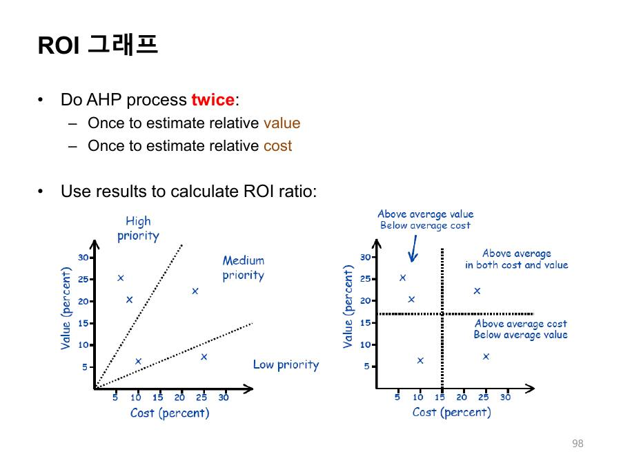

- Do AHP process twice:
  - Once to estimate relative value
  - Once to estimate relative cost

- Use results to calculate ROI ratio:

---

## 99. 기타 선정 기준

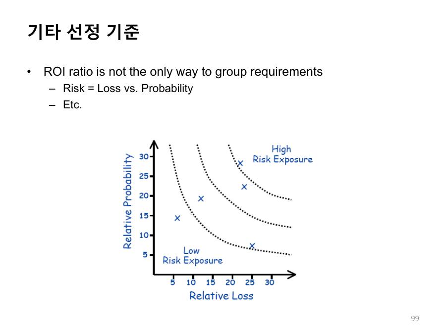

- ROI ratio is not the only way to group requirements
  - Risk = Loss vs. Probability
  - Etc.

---

## 100. 이해관계자별 가치 시각화

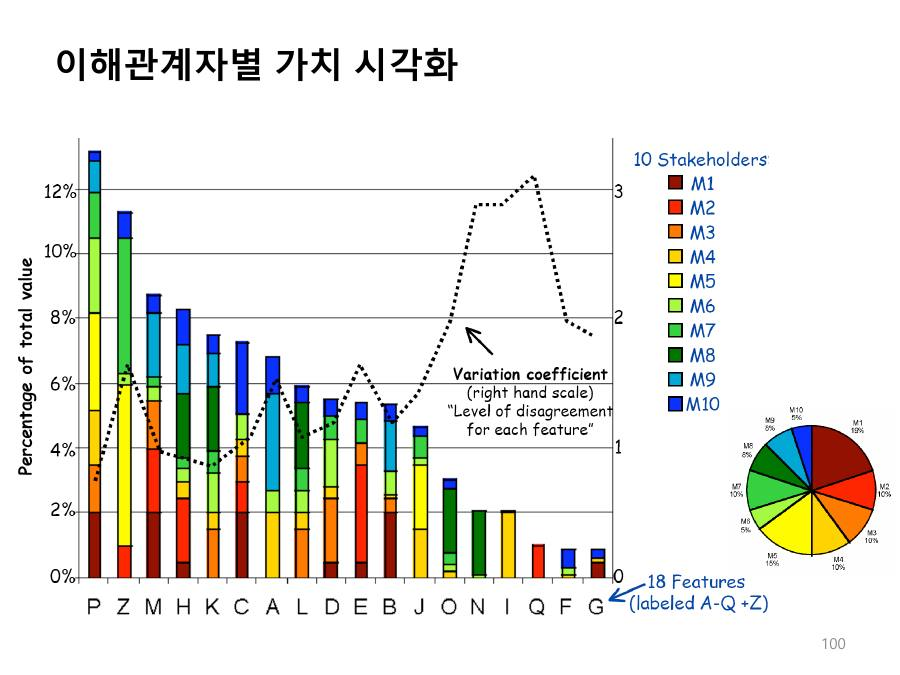

---

## 101. 요구사항 우선순위 결정 시 고려 사항

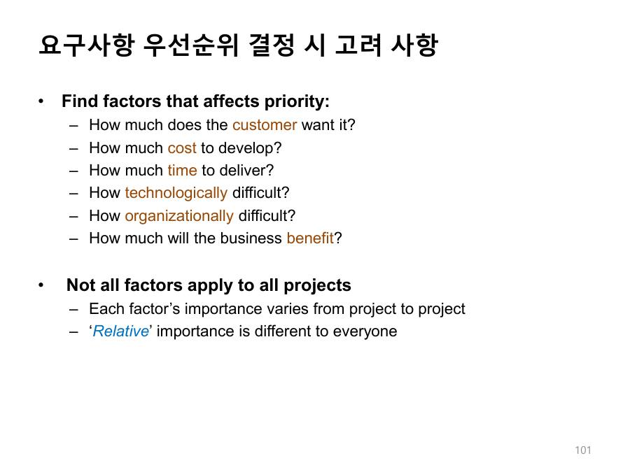

- Find factors that affects priority:
  - How much does the customer want it?
  - How much cost to develop?
  - How much time to deliver?
  - How technologically difficult?
  - How organizationally difficult?
  - How much will the business benefit?

- Not all factors apply to all projects
  - Each factor’s importance varies from project to project
  - ‘Relative’ importance is different to everyone

---

## 102. 요구사항 우선순위 결정 시 고려 사항 (계속)

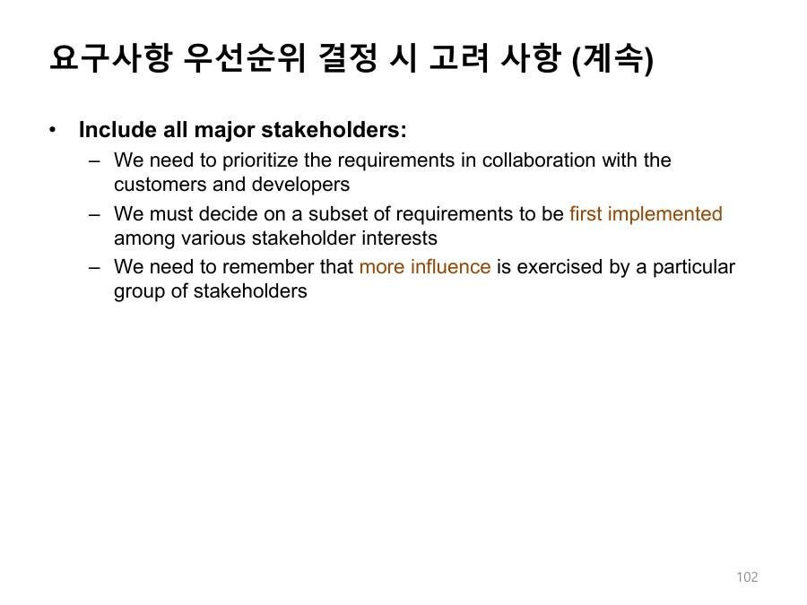

- Include all major stakeholders:
  - We need to prioritize the requirements in collaboration with the customers and developers
  - We must decide on a subset of requirements to be first implemented among various stakeholder interests
  - We need to remember that more influence is exercised by a particular group of stakeholders

---

## 103. 요구사항 우선순위 결정 방법

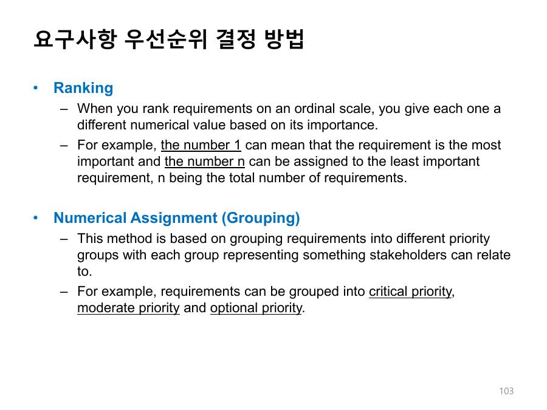

- Ranking
  - When you rank requirements on an ordinal scale, you give each one a different numerical value based on its importance.
  - For example, the number 1 can mean that the requirement is the most important and the number n can be assigned to the least important requirement, n being the total number of requirements.

- Numerical Assignment (Grouping)
  - This method is based on grouping requirements into different priority groups with each group representing something stakeholders can relate to.
  - For example, requirements can be grouped into critical priority, moderate priority and optional priority.

---

## 104. 요구사항 우선순위 결정 방법 (계속)

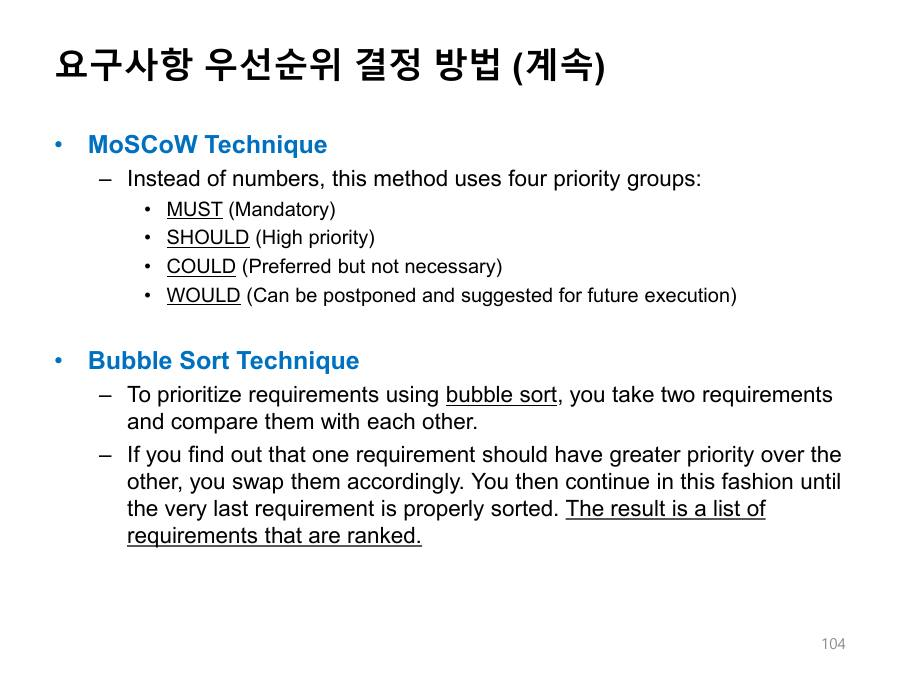

- MoSCoW Technique
  - Instead of numbers, this method uses four priority groups:
    - MUST (Mandatory)
    - SHOULD (High priority)
    - COULD (Preferred but not necessary)
    - WOULD (Can be postponed and suggested for future execution)

- Bubble Sort Technique
  - To prioritize requirements using bubble sort, you take two requirements and compare them with each other.
  - If you find out that one requirement should have greater priority over the other, you swap them accordingly. You then continue in this fashion until the very last requirement is properly sorted. The result is a list of requirements that are ranked.

---

## 105. 요구사항 우선순위 결정 방법 (계속)

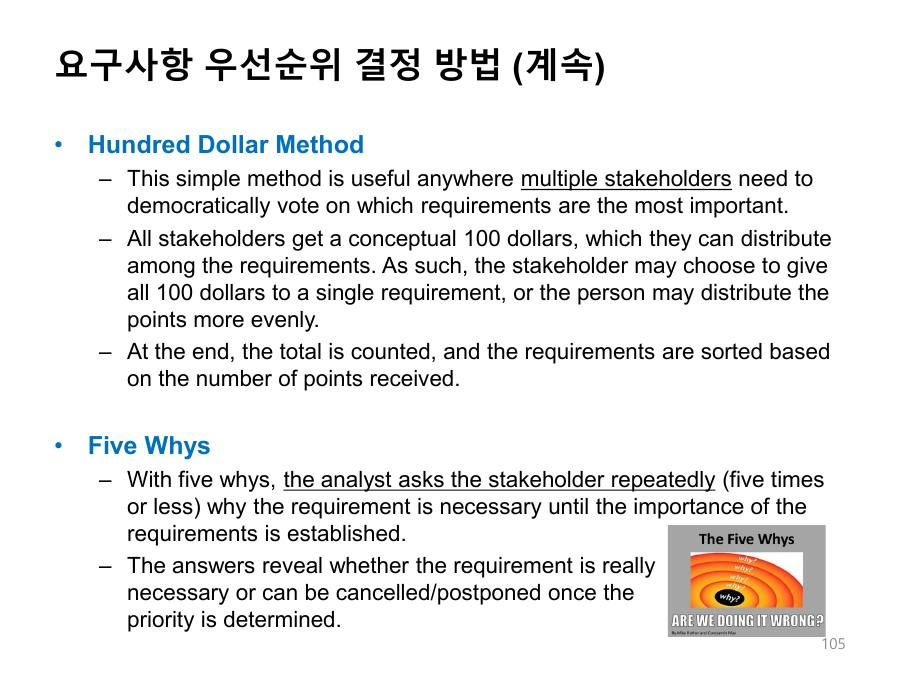

- Hundred Dollar Method
  - This simple method is useful anywhere multiple stakeholders need to democratically vote on which requirements are the most important.
  - All stakeholders get a conceptual 100 dollars, which they can distribute among the requirements. As such, the stakeholder may choose to give all 100 dollars to a single requirement, or the person may distribute the points more evenly.
  - At the end, the total is counted, and the requirements are sorted based on the number of points received.

- Five Whys
  - With five whys, the analyst asks the stakeholder repeatedly (five times or less) why the requirement is necessary until the importance of the requirements is established.
  - The answers reveal whether the requirement is really necessary or can be cancelled/postponed once the priority is determined.

---

## 106. 요구사항 분류(Triage)

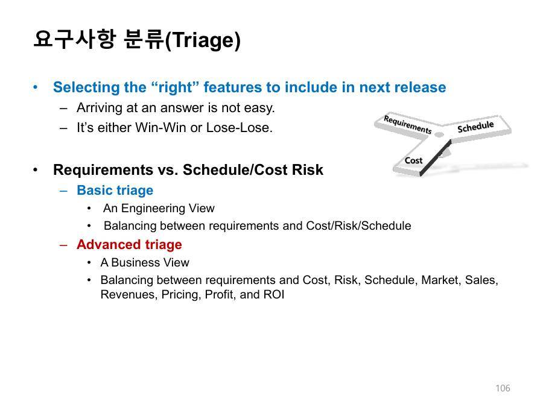

- Selecting the “right” features to include in next release
  - Arriving at an answer is not easy.
  - It’s either Win-Win or Lose-Lose.

- Requirements vs. Schedule/Cost Risk
  - Basic triage
    - An Engineering View
    - Balancing between requirements and Cost/Risk/Schedule
  - Advanced triage
    - A Business View
    - Balancing between requirements and Cost, Risk, Schedule, Market, Sales, Revenues, Pricing, Profit, and ROI

---

## 107. 요구사항 분류 (계속)

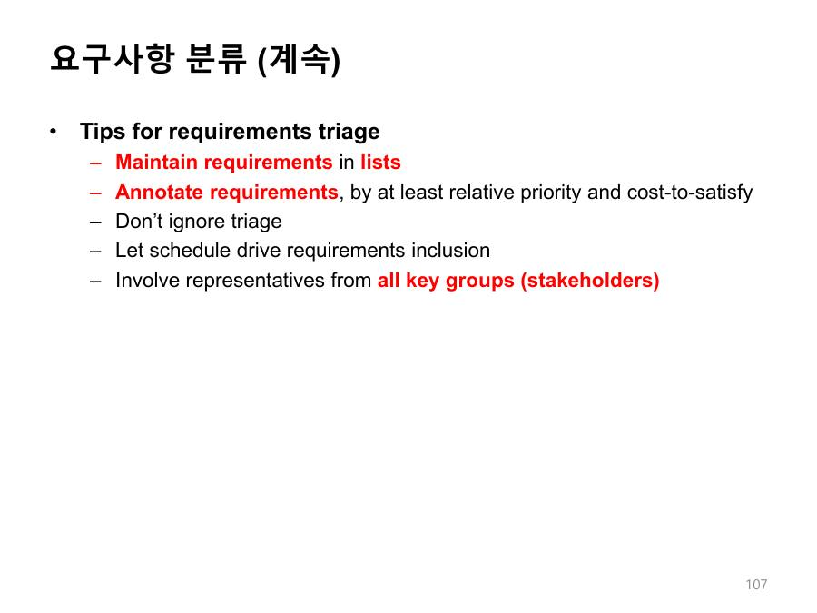

- Tips for requirements triage
  - Maintain requirements in lists
  - Annotate requirements, by at least relative priority and cost-to-satisfy
  - Don’t ignore triage
  - Let schedule drive requirements inclusion
  - Involve representatives from all key groups (stakeholders)

---

## 108. 주석이 달린 요구사항 목록

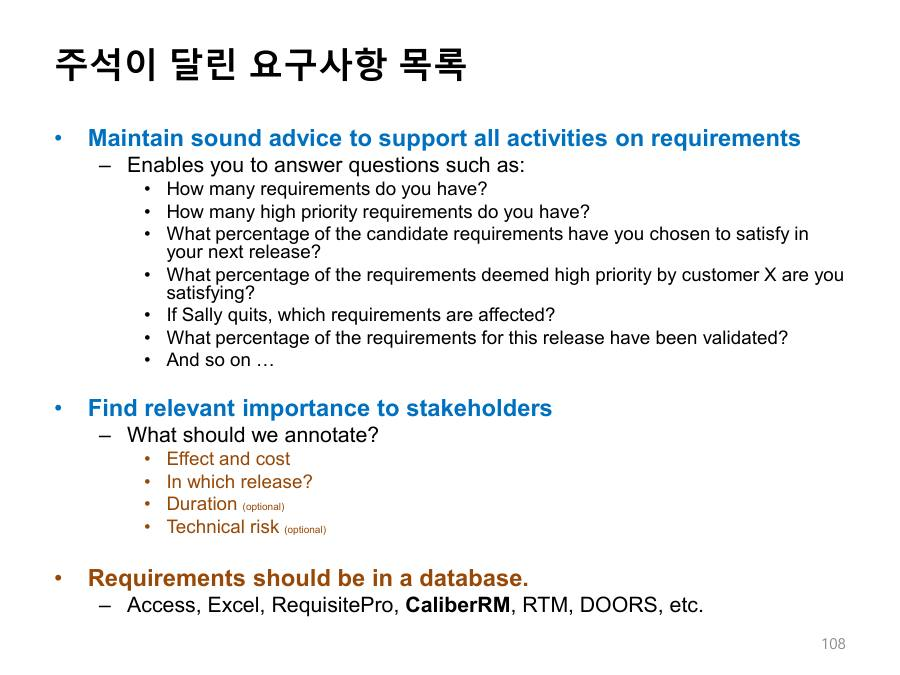

- Maintain sound advice to support all activities on requirements
  - Enables you to answer questions such as:
    - How many requirements do you have?
    - How many high priority requirements do you have?
    - What percentage of the candidate requirements have you chosen to satisfy in your next release?
    - What percentage of the requirements deemed high priority by customer X are you satisfying?
    - If Sally quits, which requirements are affected?
    - What percentage of the requirements for this release have been validated?
    - And so on …

- Find relevant importance to stakeholders
  - What should we annotate?
    - Effect and cost
    - In which release?
    - Duration (optional)
    - Technical risk (optional)

- Requirements should be in a database.
  - Access, Excel, RequisitePro, CaliberRM, RTM, DOORS, etc.

---

## 109. 주석이 달린 요구사항 사례

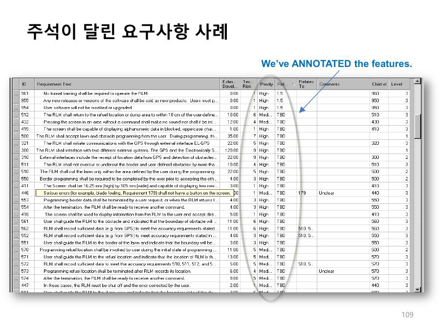

We’ve ANNOTATED the features.  

---

## 110. 요구사항 분류 결과

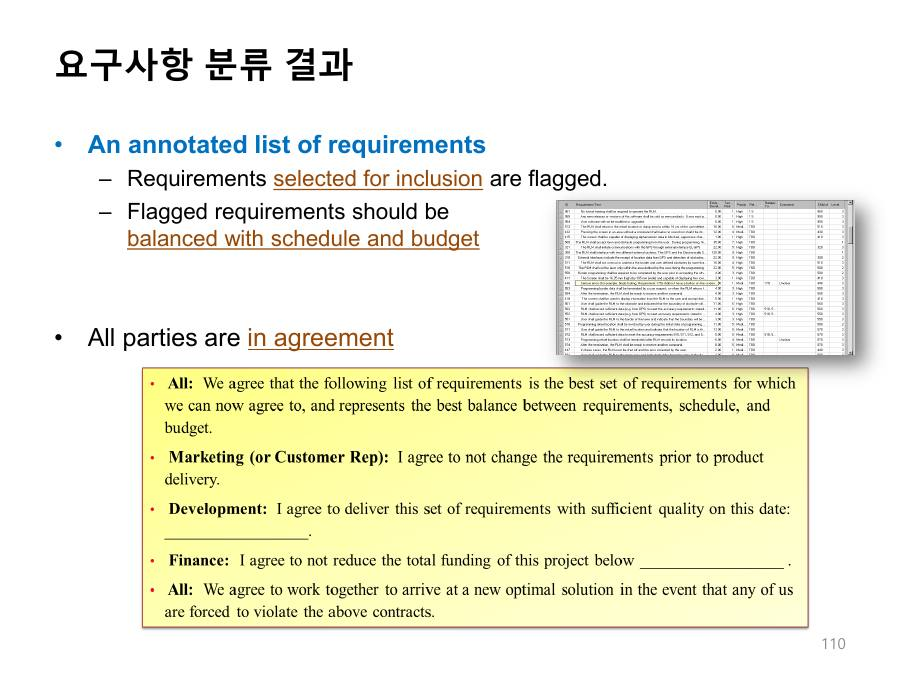

- An annotated list of requirements
  - Requirements selected for inclusion are flagged.
  - Flagged requirements should be balanced with schedule and budget

- All parties are in agreement

---

[← 이전: 실습 1: 요구사항 도출](04x_실습1_요구사항_도출.md) · [← 목차](README.md) · [다음: 6. 요구사항 명세 →](06_요구사항_명세.md)
