# 6. 요구사항 명세

> 요구사항 분석 (Requirement Analysis) · 슬라이드 111–145 · 원본: [PDF](../../original/삼성전자AA_요구사항분석_강의_20261124-1125_지은경.pdf)

[← 이전: 5. 요구사항 분석](05_요구사항_분석.md) · [← 목차](README.md) · [다음: 7. 유스 케이스 분석 →](07_유스케이스_분석.md)

## 슬라이드 목록

- [111. 6\. 요구사항 명세](#s111)
- [112. 요구공학 프로세스](#s112)
- [113. 요구사항 유형](#s113)
- [114. 요구사항 정의 및 명세](#s114)
- [115. 기능 vs. 비기능 요구사항](#s115)
- [116. 비기능 요구사항](#s116)
- [117. 비기능 요구사항 (계속)](#s117)
- [118. 비기능 요구사항 분류](#s118)
- [119. 비기능 요구사항 3가지 유형](#s119)
- [120. 비기능 요구사항 예시](#s120)
- [121. 목표(Goals)와 요구사항](#s121)
- [122. 도메인 요구사항](#s122)
- [123. 도메인 요구사항 사례 : LIBSYS](#s123)
- [124. 요구사항의 완전성 및 일관성](#s124)
- [125. 소프트웨어 요구사항 문서](#s125)
- [126. SRS의 목적](#s126)
- [127. 좋은 명세의 특징](#s127)
- [128. SRS 내용](#s128)
- [129. SRS가 포함하지 않을 것](#s129)
- [130. SRS에서 흔히 저지르는 실수](#s130)
- [131. 요구사항과 설계는 불가분한 관계](#s131)
- [132. 요구사항 문서 가변성(Variability)](#s132)
- [133. SRS 표준: IEEE STD 830-1998](#s133)
- [134. SRS 템플릿: IEEE STD 830.1998](#s134)
- [135. SRS 템플릿: IEEE STD 830.1998](#s135)
- [136. SRS 템플릿: IEEE STD 830.1998](#s136)
- [137. SRS 템플릿: IEEE STD 830.1998](#s137)
- [138. SRS 템플릿: IEEE STD 830.1998](#s138)
- [139. 자연어 SRS의 문제점](#s139)
- [140. 구조화된 명세](#s140)
- [141. Form 기반 명세](#s141)
- [142. 표 형식 명세](#s142)
- [143. 요구사항 작성 사례](#s143)
- [144. 요구사항 작성 사례 (계속)](#s144)
- [145. Plan](#s145)

---

## 111. 6\. 요구사항 명세

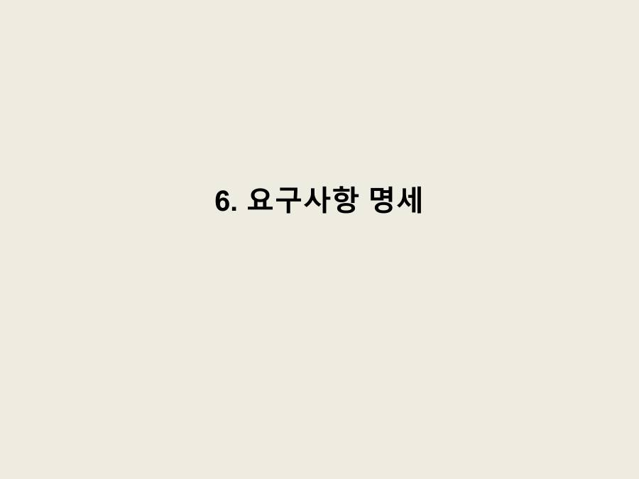

---

## 112. 요구공학 프로세스

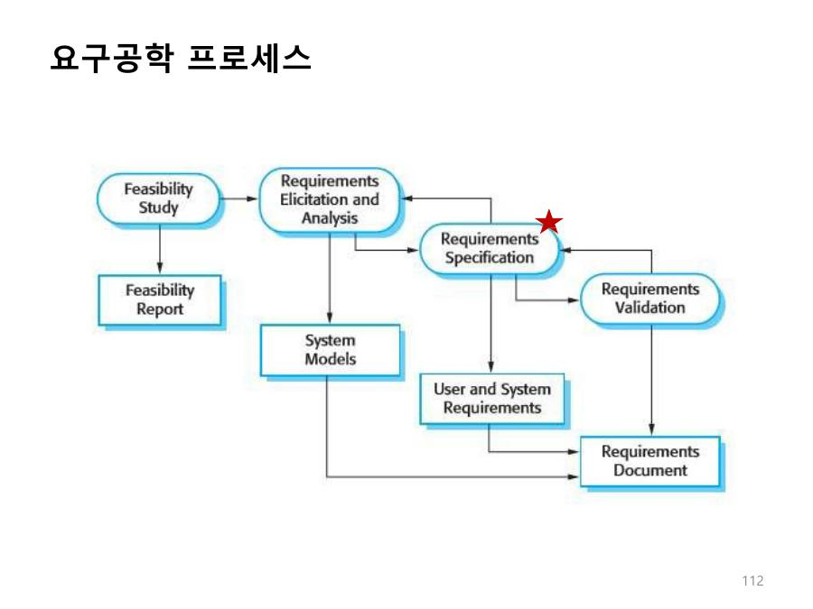

---

## 113. 요구사항 유형

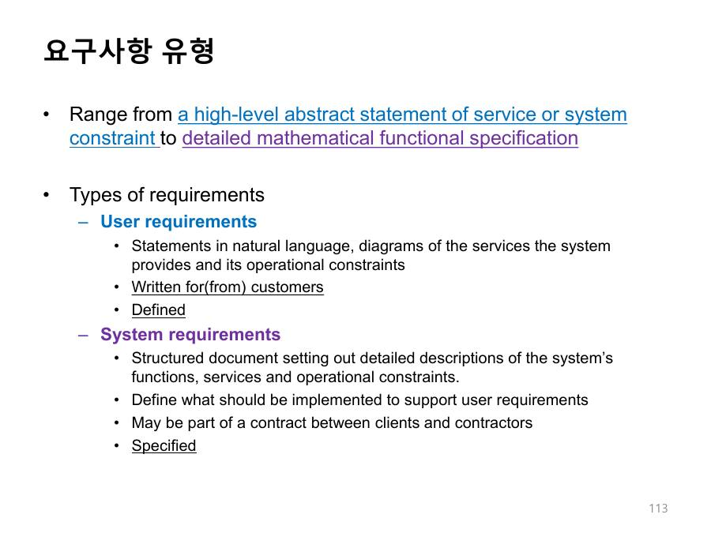

- Range from a high-level abstract statement of service or system constraint to detailed mathematical functional specification

- Types of requirements
  - User requirements
    - Statements in natural language, diagrams of the services the system provides and its operational constraints
    - Written for(from) customers
    - Defined
  - System requirements
    - Structured document setting out detailed descriptions of the system’s functions, services and operational constraints.
    - Define what should be implemented to support user requirements
    - May be part of a contract between clients and contractors
    - Specified

---

## 114. 요구사항 정의 및 명세

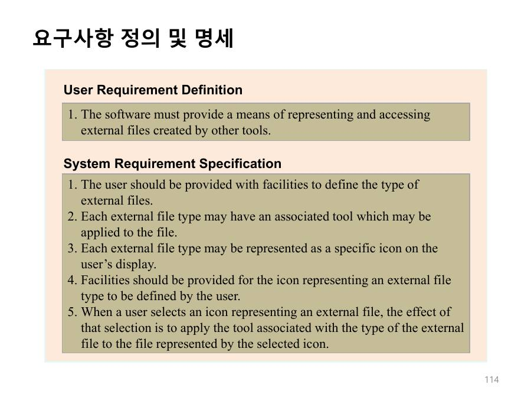

User Requirement Definition  
1\. The software must provide a means of representing and accessing  
external files created by other tools.  

System Requirement Specification  
1\. The user should be provided with facilities to define the type of  
external files.  
2\. Each external file type may have an associated tool which may be  
applied to the file.  
3\. Each external file type may be represented as a specific icon on the  
user’s display.  
4\. Facilities should be provided for the icon representing an external file  
type to be defined by the user.  
5\. When a user selects an icon representing an external file, the effect of  
that selection is to apply the tool associated with the type of the external  
file to the file represented by the selected icon.  

---

## 115. 기능 vs. 비기능 요구사항

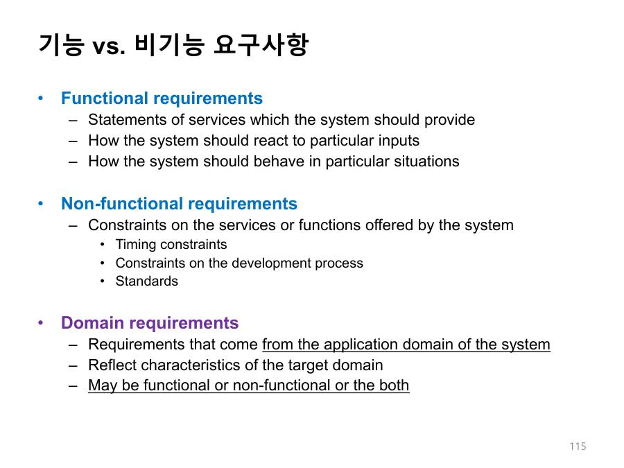

- Functional requirements
  - Statements of services which the system should provide
  - How the system should react to particular inputs
  - How the system should behave in particular situations

- Non-functional requirements
  - Constraints on the services or functions offered by the system
    - Timing constraints
    - Constraints on the development process
    - Standards

- Domain requirements
  - Requirements that come from the application domain of the system
  - Reflect characteristics of the target domain
  - May be functional or non-functional or the both

---

## 116. 비기능 요구사항

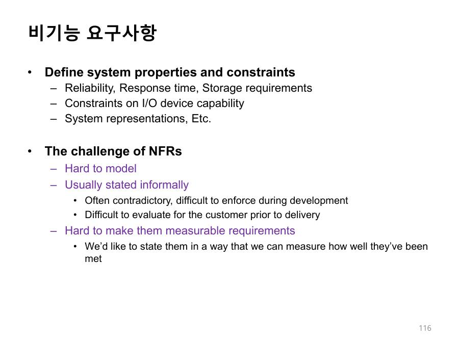

- Define system properties and constraints
  - Reliability, Response time, Storage requirements
  - Constraints on I/O device capability
  - System representations, Etc.

- The challenge of NFRs
  - Hard to model
  - Usually stated informally
    - Often contradictory, difficult to enforce during development
    - Difficult to evaluate for the customer prior to delivery
  - Hard to make them measurable requirements
    - We’d like to state them in a way that we can measure how well they’ve been met

---

## 117. 비기능 요구사항 (계속)

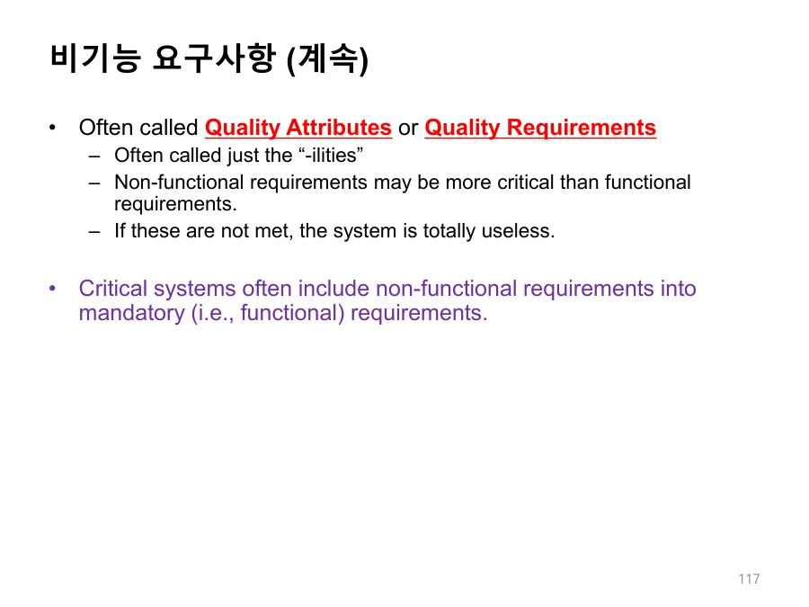

- Often called Quality Attributes or Quality Requirements
  - Often called just the “-ilities”
  - Non-functional requirements may be more critical than functional requirements.
  - If these are not met, the system is totally useless.

- Critical systems often include non-functional requirements into mandatory (i.e., functional) requirements.

---

## 118. 비기능 요구사항 분류

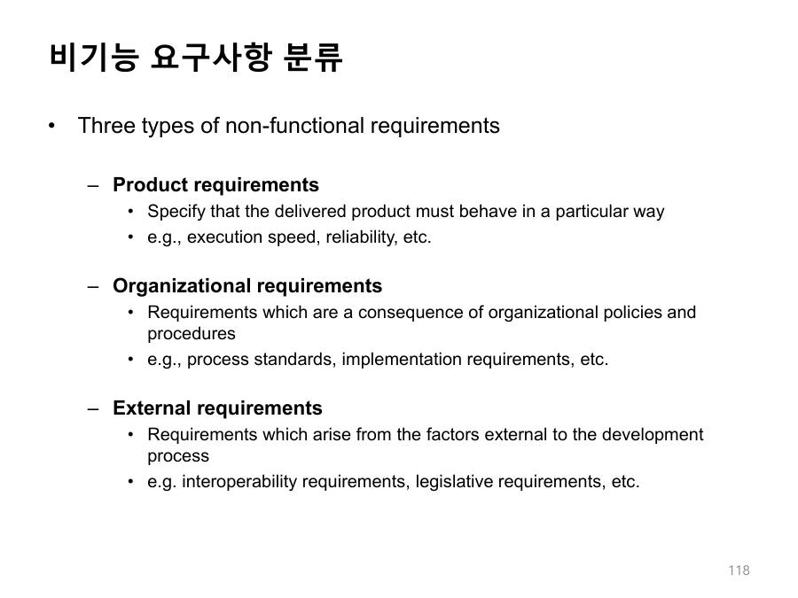

- Three types of non-functional requirements

  - Product requirements
    - Specify that the delivered product must behave in a particular way
    - e.g., execution speed, reliability, etc.

  - Organizational requirements
    - Requirements which are a consequence of organizational policies and procedures
    - e.g., process standards, implementation requirements, etc.

  - External requirements
    - Requirements which arise from the factors external to the development process
    - e.g. interoperability requirements, legislative requirements, etc.

---

## 119. 비기능 요구사항 3가지 유형

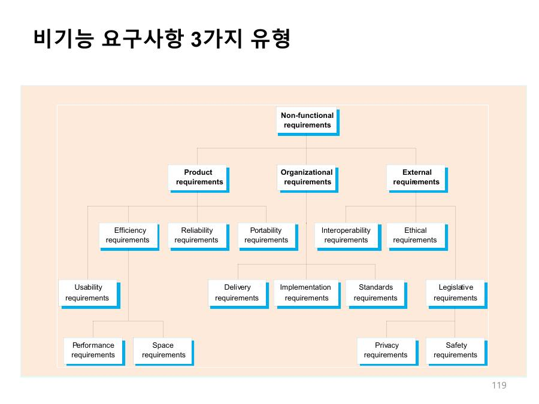

Non-functional  
requirements  

Product · Organizational · External  
requirements · requirements · requirements  

Efficiency · Reliability · Portability · Interoperability · Ethical  
requirements · requirements · requirements · requirements · requirements  

Usability · Delivery · Implementation · Standards · Legislative  
requirements · requirements · requirements · requirements · requirements  

Performance · Space · Privacy · Safety  
requirements · requirements · requirements · requirements  

---

## 120. 비기능 요구사항 예시

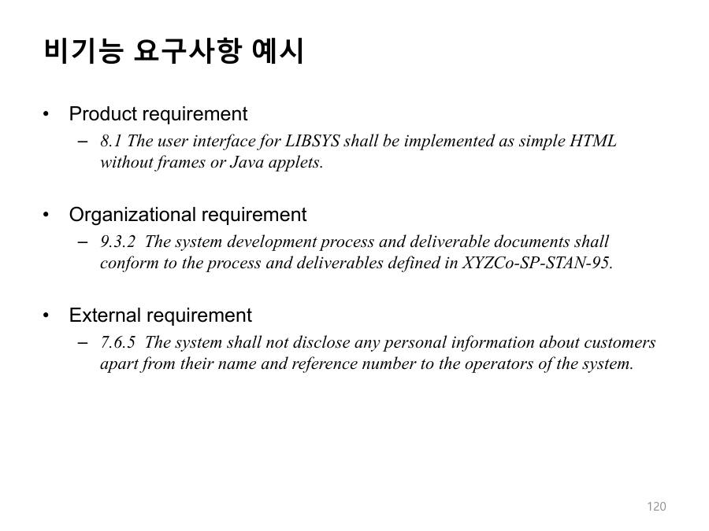

- Product requirement
  - 8.1 The user interface for LIBSYS shall be implemented as simple HTML without frames or Java applets.

- Organizational requirement
  - 9.3.2 The system development process and deliverable documents shall conform to the process and deliverables defined in XYZCo-SP-STAN-95.

- External requirement
  - 7.6.5 The system shall not disclose any personal information about customers apart from their name and reference number to the operators of the system.

---

## 121. 목표(Goals)와 요구사항

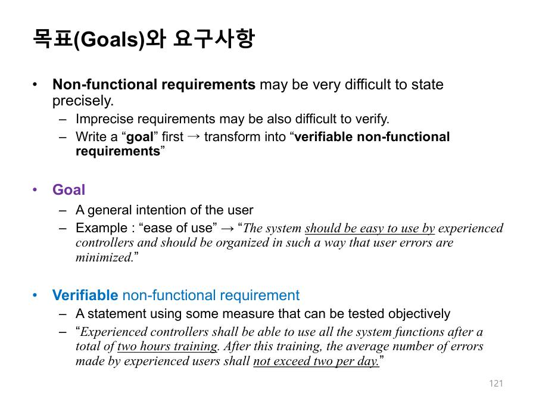

- Non-functional requirements may be very difficult to state precisely.
  - Imprecise requirements may be also difficult to verify.
  - Write a “goal” first → transform into “verifiable non-functional requirements”

- Goal
  - A general intention of the user
  - Example : “ease of use” → “The system should be easy to use by experienced controllers and should be organized in such a way that user errors are minimized.”

- Verifiable non-functional requirement
  - A statement using some measure that can be tested objectively
  - “Experienced controllers shall be able to use all the system functions after a total of two hours training. After this training, the average number of errors made by experienced users shall not exceed two per day.”

---

## 122. 도메인 요구사항

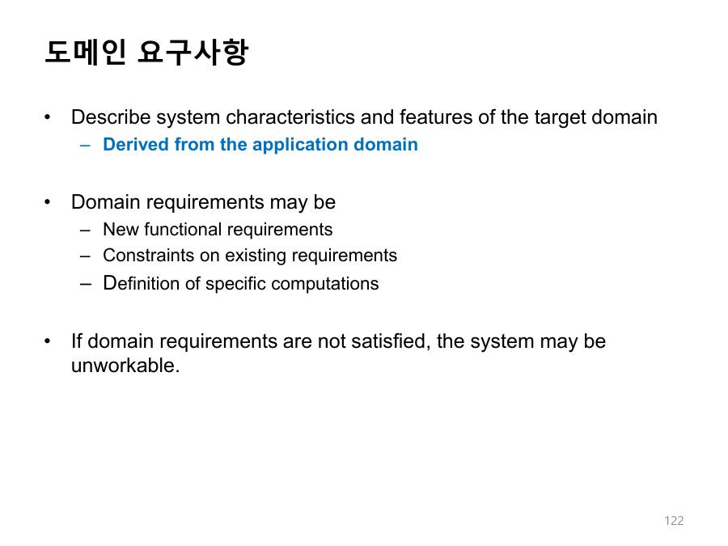

- Describe system characteristics and features of the target domain
  - Derived from the application domain

- Domain requirements may be
  - New functional requirements
  - Constraints on existing requirements
  - Definition of specific computations

- If domain requirements are not satisfied, the system may be unworkable.

---

## 123. 도메인 요구사항 사례 : LIBSYS

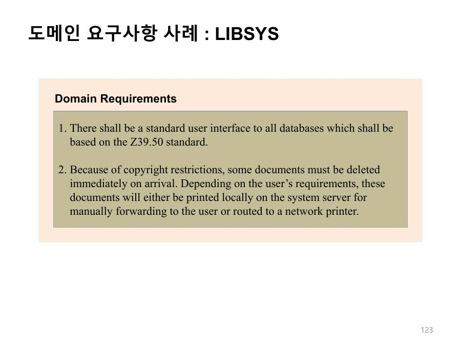

Domain Requirements  

1\. There shall be a standard user interface to all databases which shall be  
based on the Z39.50 standard.  

2\. Because of copyright restrictions, some documents must be deleted  
immediately on arrival. Depending on the user’s requirements, these  
documents will either be printed locally on the system server for  
manually forwarding to the user or routed to a network printer.  

---

## 124. 요구사항의 완전성 및 일관성

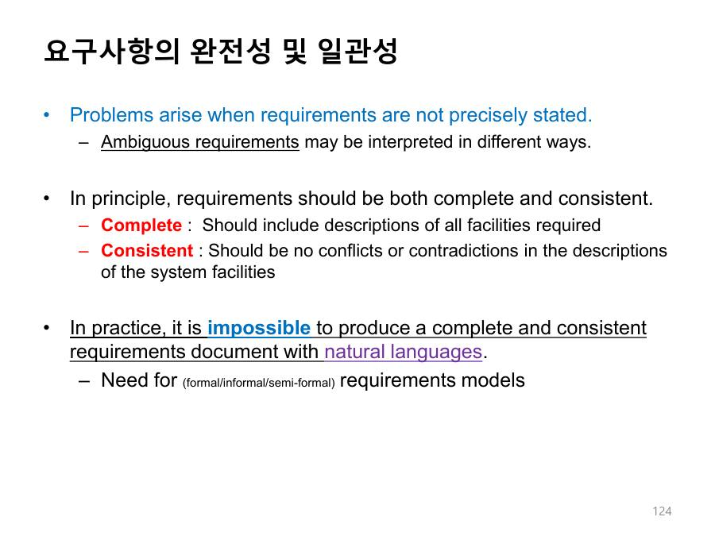

- Problems arise when requirements are not precisely stated.
  - Ambiguous requirements may be interpreted in different ways.

- In principle, requirements should be both complete and consistent.
  - Complete : Should include descriptions of all facilities required
  - Consistent : Should be no conflicts or contradictions in the descriptions of the system facilities

- In practice, it is impossible to produce a complete and consistent requirements document with natural languages.
  - Need for (formal/informal/semi-formal) requirements models

---

## 125. 소프트웨어 요구사항 문서

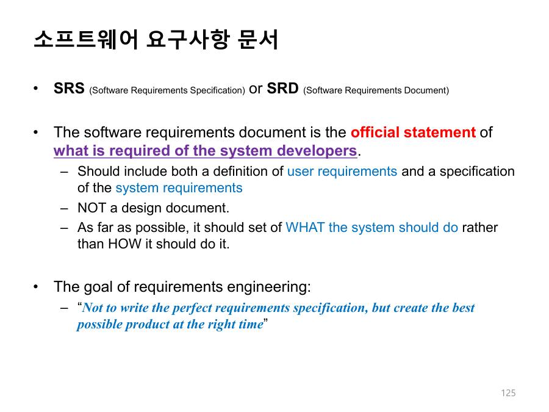

- SRS (Software Requirements Specification) or SRD (Software Requirements Document)

- The software requirements document is the official statement of what is required of the system developers.
  - Should include both a definition of user requirements and a specification of the system requirements
  - NOT a design document.
  - As far as possible, it should set of WHAT the system should do rather than HOW it should do it.

- The goal of requirements engineering:
  - “Not to write the perfect requirements specification, but create the best possible product at the right time”

---

## 126. SRS의 목적

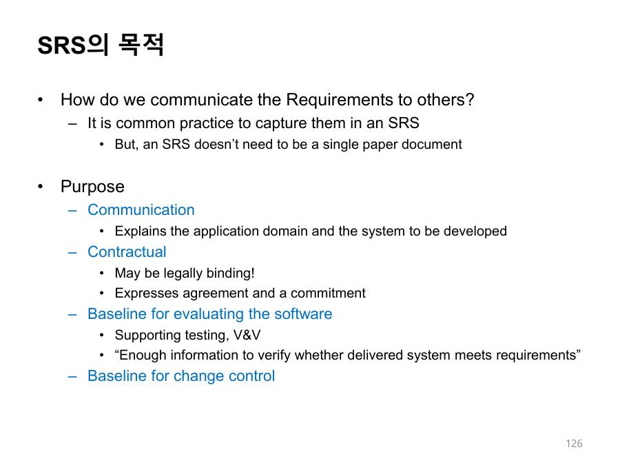

- How do we communicate the Requirements to others?
  - It is common practice to capture them in an SRS
    - But, an SRS doesn’t need to be a single paper document

- Purpose
  - Communication
    - Explains the application domain and the system to be developed
  - Contractual
    - May be legally binding!
    - Expresses agreement and a commitment
  - Baseline for evaluating the software
    - Supporting testing, V&amp;V
    - “Enough information to verify whether delivered system meets requirements”
  - Baseline for change control

---

## 127. 좋은 명세의 특징

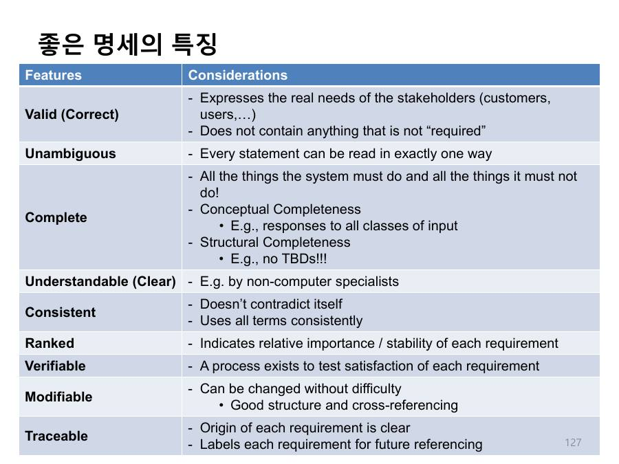

Features · Considerations  
- Expresses the real needs of the stakeholders (customers,

Valid (Correct) · users,…)  
- Does not contain anything that is not “required”

Unambiguous · - Every statement can be read in exactly one way  
- All the things the system must do and all the things it must not do!
- Conceptual Completeness

Complete  
- E.g., responses to all classes of input
- Structural Completeness
  - E.g., no TBDs!!!

Understandable (Clear) - E.g. by non-computer specialists  
- Doesn’t contradict itself

Consistent  
- Uses all terms consistently

Ranked · - Indicates relative importance / stability of each requirement  
Verifiable · - A process exists to test satisfaction of each requirement  
- Can be changed without difficulty

Modifiable  
- Good structure and cross-referencing
- Origin of each requirement is clear

Traceable  
- Labels each requirement for future referencing

---

## 128. SRS 내용

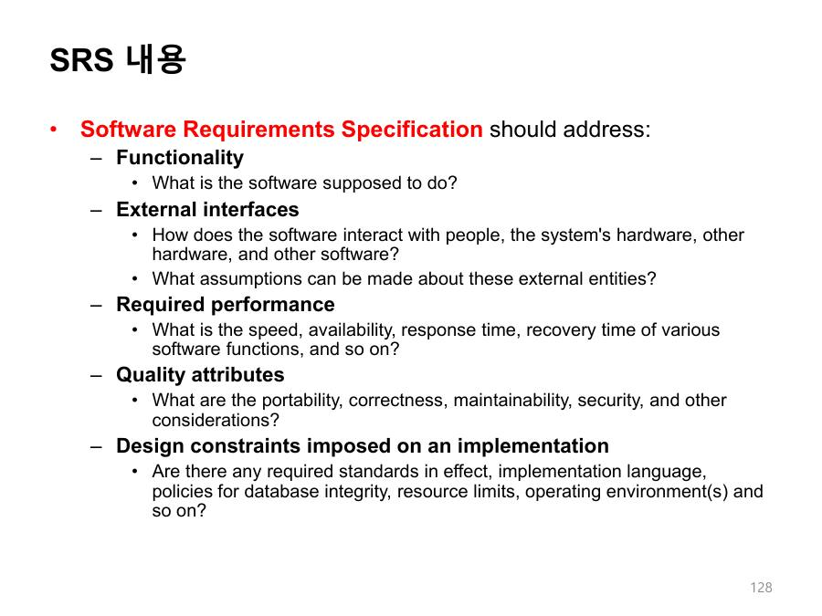

- Software Requirements Specification should address:
  - Functionality
    - What is the software supposed to do?
  - External interfaces
    - How does the software interact with people, the system's hardware, other hardware, and other software?
    - What assumptions can be made about these external entities?
  - Required performance
    - What is the speed, availability, response time, recovery time of various software functions, and so on?
  - Quality attributes
    - What are the portability, correctness, maintainability, security, and other considerations?
  - Design constraints imposed on an implementation
    - Are there any required standards in effect, implementation language, policies for database integrity, resource limits, operating environment(s) and so on?

---

## 129. SRS가 포함하지 않을 것

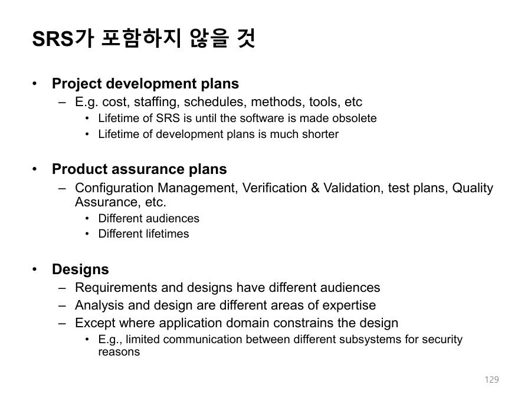

- Project development plans
  - E.g. cost, staffing, schedules, methods, tools, etc
    - Lifetime of SRS is until the software is made obsolete
    - Lifetime of development plans is much shorter

- Product assurance plans
  - Configuration Management, Verification &amp; Validation, test plans, Quality Assurance, etc.
    - Different audiences
    - Different lifetimes

- Designs
  - Requirements and designs have different audiences
  - Analysis and design are different areas of expertise
  - Except where application domain constrains the design
    - E.g., limited communication between different subsystems for security reasons

---

## 130. SRS에서 흔히 저지르는 실수

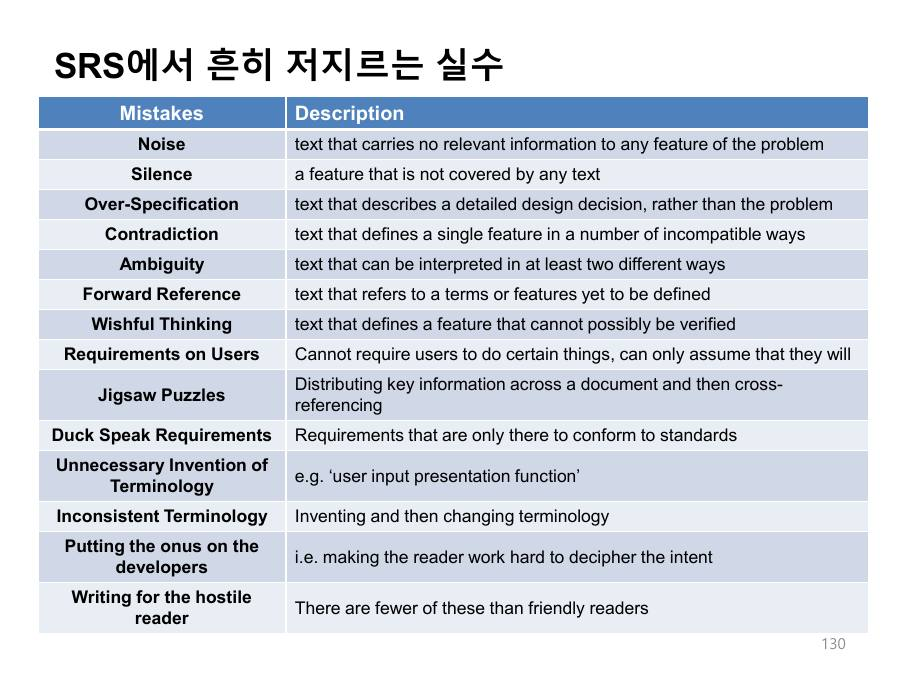

Mistakes · Description  
Noise · text that carries no relevant information to any feature of the problem  
Silence · a feature that is not covered by any text  
Over-Specification · text that describes a detailed design decision, rather than the problem  
Contradiction · text that defines a single feature in a number of incompatible ways  
Ambiguity · text that can be interpreted in at least two different ways  
Forward Reference · text that refers to a terms or features yet to be defined  
Wishful Thinking · text that defines a feature that cannot possibly be verified  
Requirements on Users · Cannot require users to do certain things, can only assume that they will  
Distributing key information across a document and then cross-  
Jigsaw Puzzles  
referencing  
Duck Speak Requirements · Requirements that are only there to conform to standards  
Unnecessary Invention of  
e.g. ‘user input presentation function’  
Terminology  
Inconsistent Terminology · Inventing and then changing terminology  
Putting the onus on the  
i.e. making the reader work hard to decipher the intent  
developers  
Writing for the hostile  
There are fewer of these than friendly readers  
reader  

---

## 131. 요구사항과 설계는 불가분한 관계

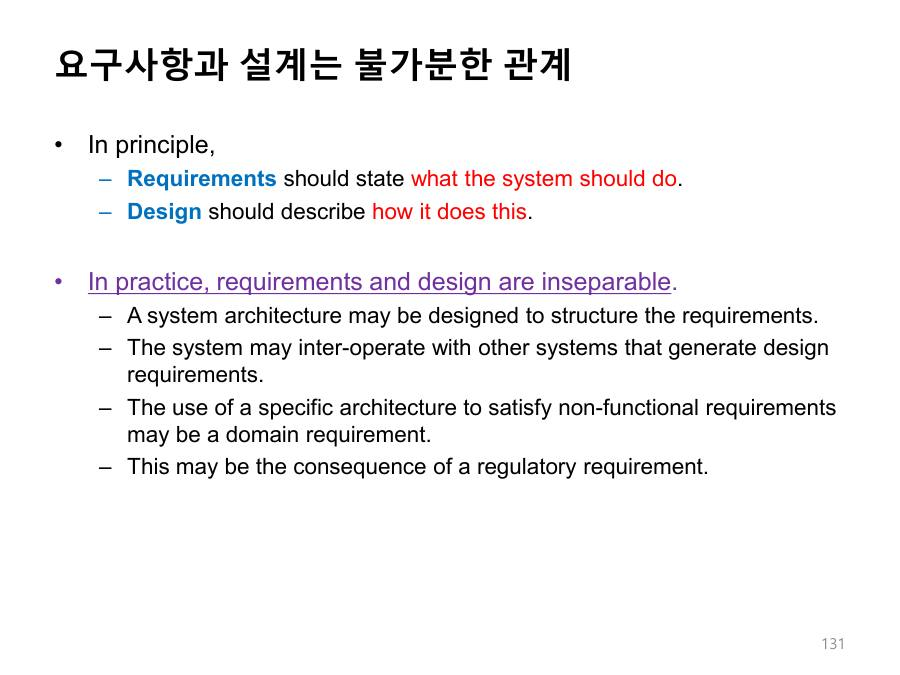

- In principle,
  - Requirements should state what the system should do.
  - Design should describe how it does this.

- In practice, requirements and design are inseparable.
  - A system architecture may be designed to structure the requirements.
  - The system may inter-operate with other systems that generate design requirements.
  - The use of a specific architecture to satisfy non-functional requirements may be a domain requirement.
  - This may be the consequence of a regulatory requirement.

---

## 132. 요구사항 문서 가변성(Variability)

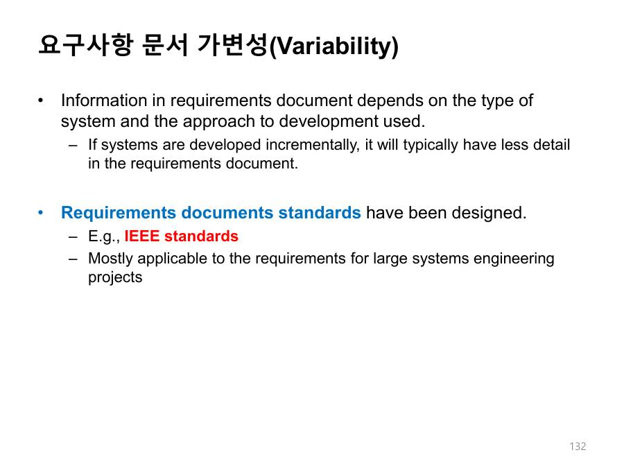

- Information in requirements document depends on the type of system and the approach to development used.
  - If systems are developed incrementally, it will typically have less detail in the requirements document.

- Requirements documents standards have been designed.
  - E.g., IEEE standards
  - Mostly applicable to the requirements for large systems engineering projects

---

## 133. SRS 표준: IEEE STD 830-1998

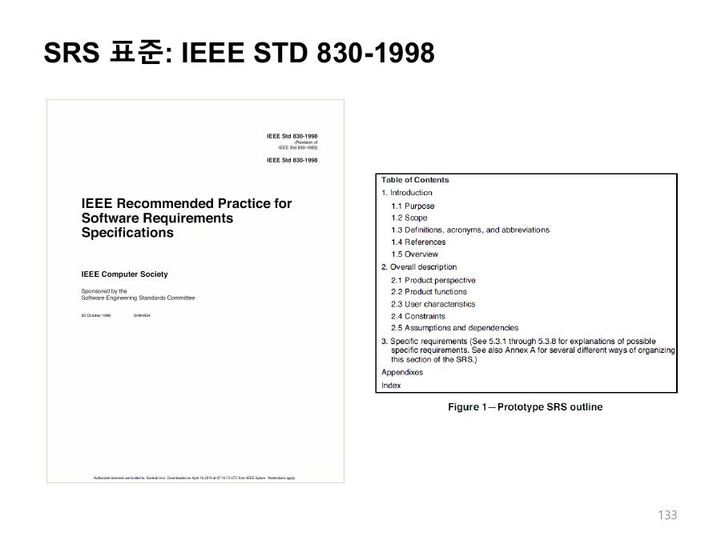

---

## 134. SRS 템플릿: IEEE STD 830.1998

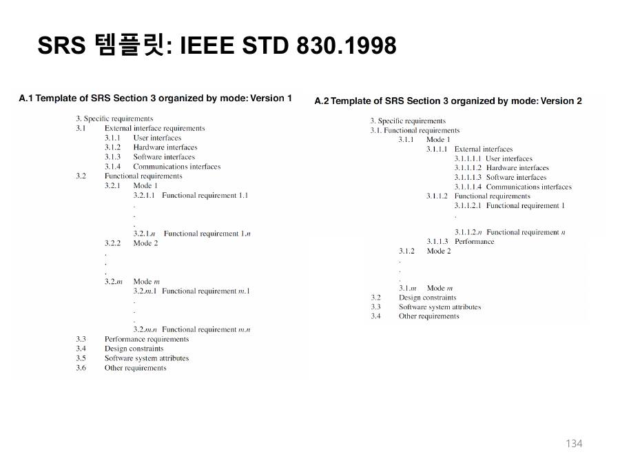

---

## 135. SRS 템플릿: IEEE STD 830.1998

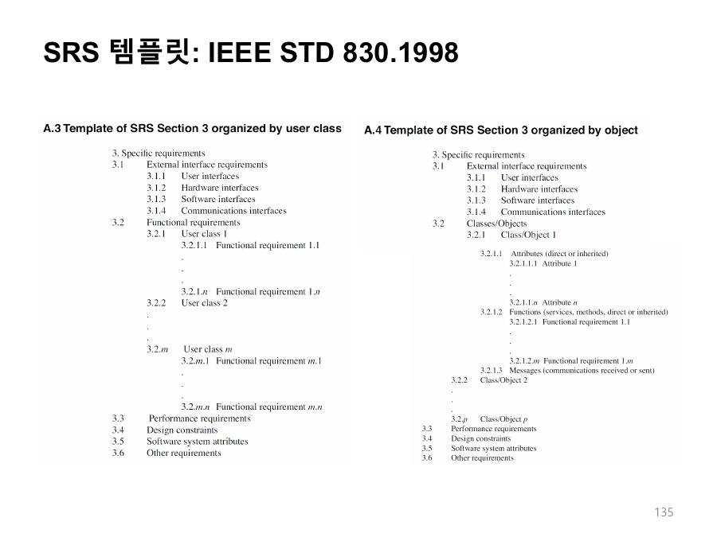

---

## 136. SRS 템플릿: IEEE STD 830.1998

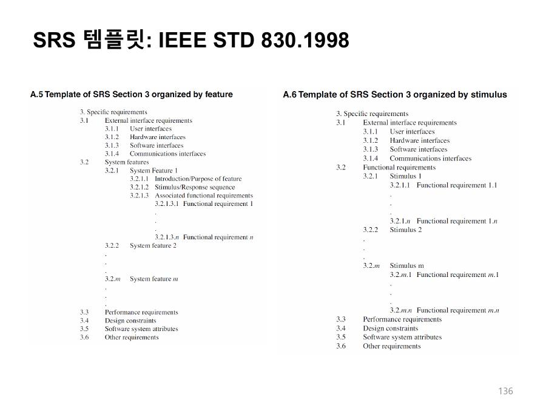

---

## 137. SRS 템플릿: IEEE STD 830.1998

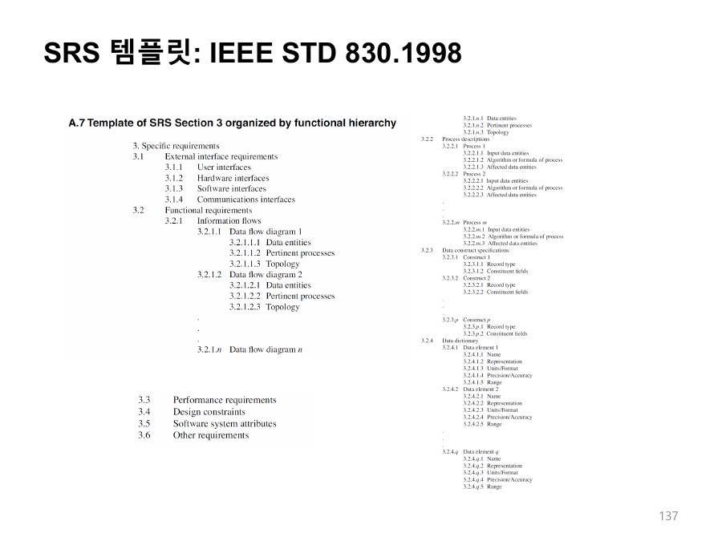

---

## 138. SRS 템플릿: IEEE STD 830.1998

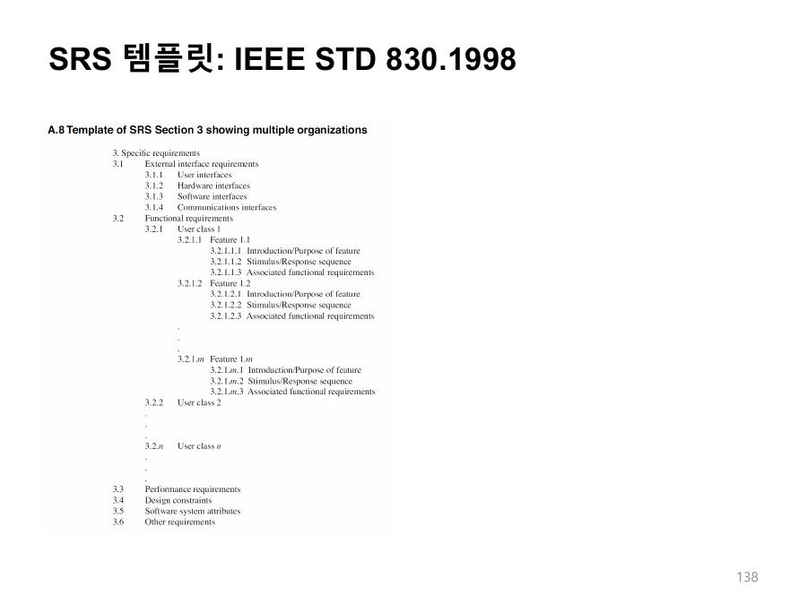

---

## 139. 자연어 SRS의 문제점

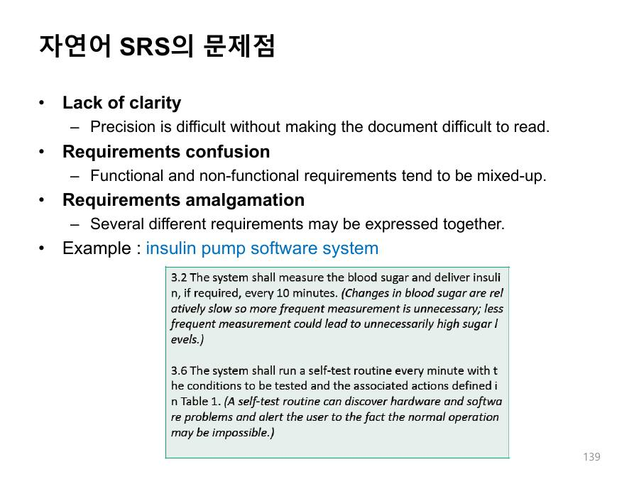

- Lack of clarity
  - Precision is difficult without making the document difficult to read.
- Requirements confusion
  - Functional and non-functional requirements tend to be mixed-up.
- Requirements amalgamation
  - Several different requirements may be expressed together.
- Example : insulin pump software system

---

## 140. 구조화된 명세

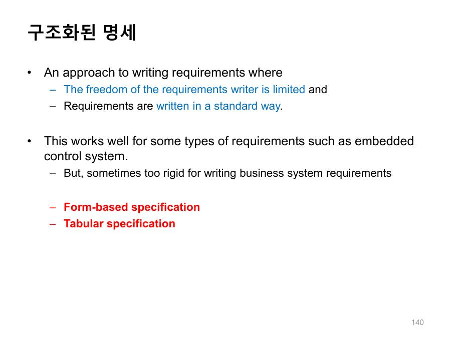

- An approach to writing requirements where
  - The freedom of the requirements writer is limited and
  - Requirements are written in a standard way.

- This works well for some types of requirements such as embedded control system.
  - But, sometimes too rigid for writing business system requirements

  - Form-based specification
  - Tabular specification

---

## 141. Form 기반 명세

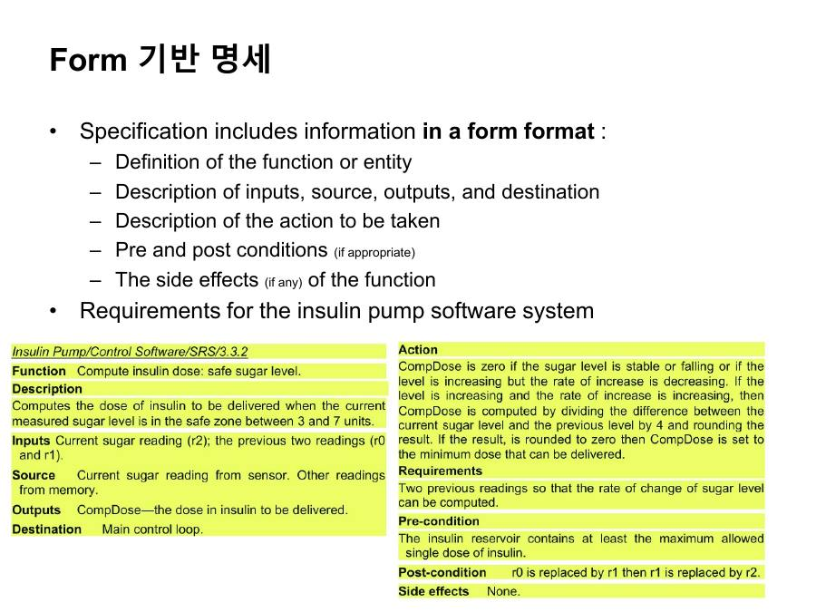

- Specification includes information in a form format :
  - Definition of the function or entity
  - Description of inputs, source, outputs, and destination
  - Description of the action to be taken
  - Pre and post conditions (if appropriate)
  - The side effects (if any) of the function
- Requirements for the insulin pump software system

---

## 142. 표 형식 명세

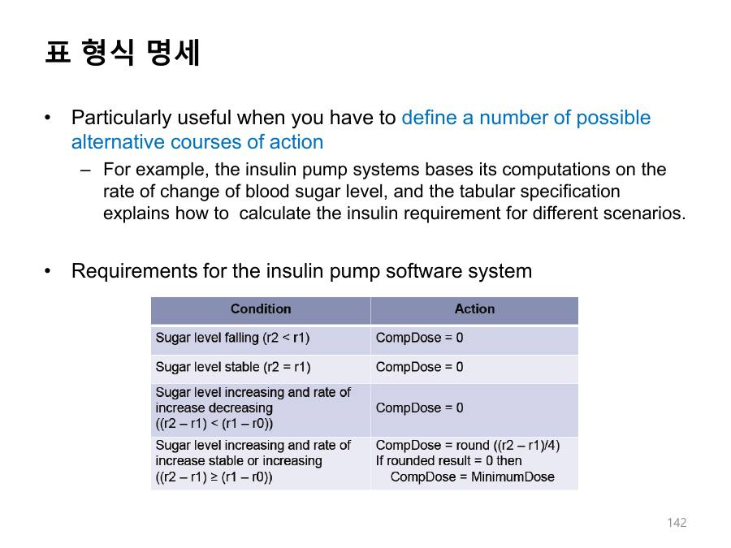

- Particularly useful when you have to define a number of possible alternative courses of action
  - For example, the insulin pump systems bases its computations on the rate of change of blood sugar level, and the tabular specification explains how to calculate the insulin requirement for different scenarios.

- Requirements for the insulin pump software system

---

## 143. 요구사항 작성 사례

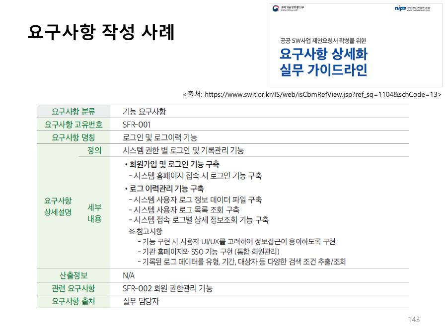

&lt;출처: https://www.swit.or.kr/IS/web/isCbmRefView.jsp?ref_sq=1104&amp;schCode=13&gt;  

---

## 144. 요구사항 작성 사례 (계속)

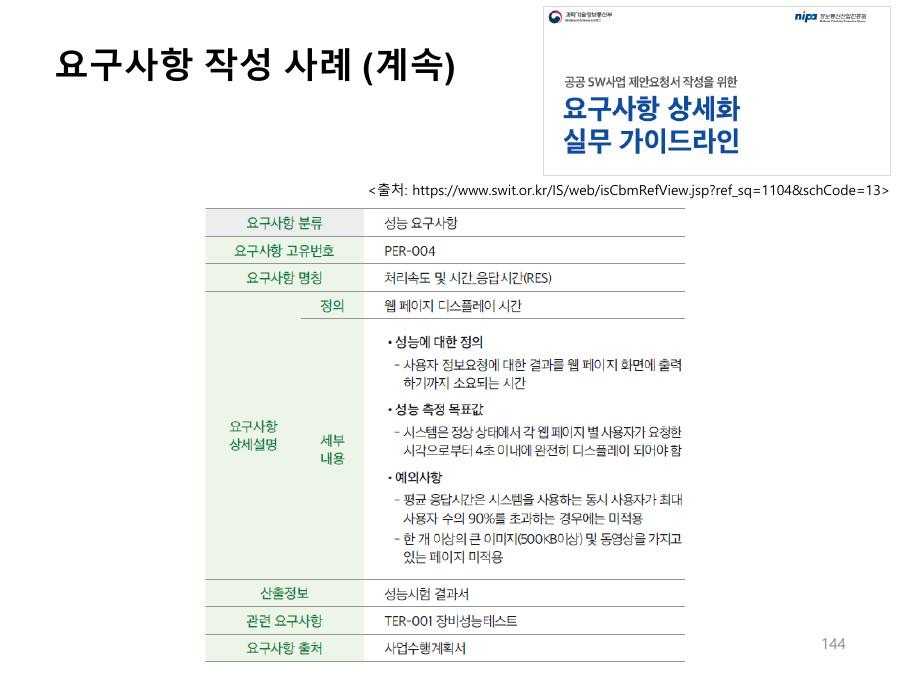

&lt;출처: https://www.swit.or.kr/IS/web/isCbmRefView.jsp?ref_sq=1104&amp;schCode=13&gt;  

---

## 145. Plan

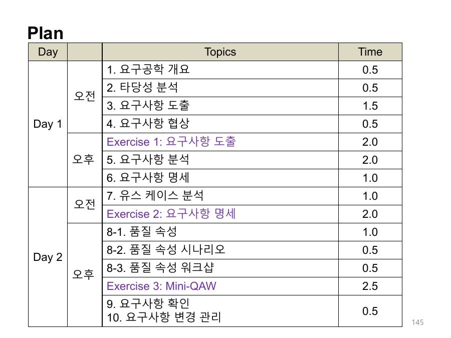

Day · Topics · Time  
1\. 요구공학 개요 · 0.5  
2\. 타당성 분석 · 0.5  
오전  
3\. 요구사항 도출 · 1.5  
Day 1 · 4. 요구사항 협상 · 0.5  
Exercise 1: 요구사항 도출 · 2.0  
오후 · 5. 요구사항 분석 · 2.0  
6\. 요구사항 명세 · 1.0  
7\. 유스 케이스 분석 · 1.0  
오전  
Exercise 2: 요구사항 명세 · 2.0  
8-1. 품질 속성 · 1.0  
8-2. 품질 속성 시나리오 · 0.5  
Day 2  
8-3. 품질 속성 워크샵 · 0.5  
오후  
Exercise 3: Mini-QAW · 2.5  
9\. 요구사항 확인  
0.5  
10\. 요구사항 변경 관리  

---

[← 이전: 5. 요구사항 분석](05_요구사항_분석.md) · [← 목차](README.md) · [다음: 7. 유스 케이스 분석 →](07_유스케이스_분석.md)
