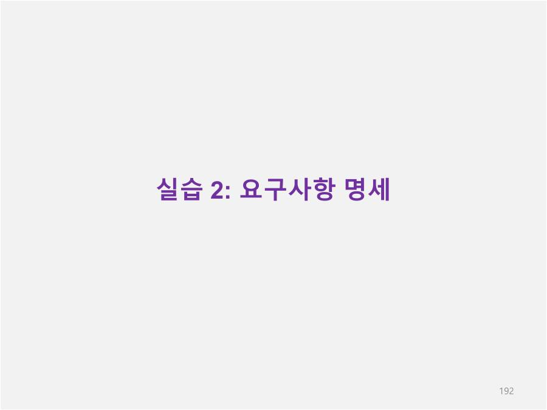
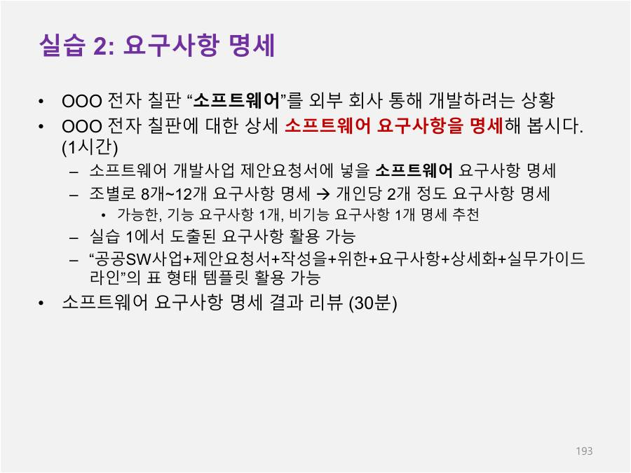

# 실습 2: 요구사항 명세

> 요구사항 분석 (Requirement Analysis) · 슬라이드 192–193 · 원본: [PDF](../../original/삼성전자AA_요구사항분석_강의_20261124-1125_지은경.pdf)

[← 이전: 7. 유스 케이스 분석](07_유스케이스_분석.md) · [← 목차](README.md) · [다음: 8-1. 품질 속성 →](08-1_품질속성.md)

## 슬라이드 목록

- [192. 실습 2: 요구사항 명세](#s192)
- [193. 실습 2: 요구사항 명세](#s193)

---

## 192. 실습 2: 요구사항 명세

---

## 193. 실습 2: 요구사항 명세

- OOO 전자 칠판 “소프트웨어”를 외부 회사 통해 개발하려는 상황
- OOO 전자 칠판에 대한 상세 소프트웨어 요구사항을 명세해 봅시다. (1시간)
  - 소프트웨어 개발사업 제안요청서에 넣을 소프트웨어 요구사항 명세
  - 조별로 8개~12개 요구사항 명세 → 개인당 2개 정도 요구사항 명세
    - 가능한, 기능 요구사항 1개, 비기능 요구사항 1개 명세 추천
  - 실습 1에서 도출된 요구사항 활용 가능
  - “공공SW사업+제안요청서+작성을+위한+요구사항+상세화+실무가이드 라인”의 표 형태 템플릿 활용 가능
- 소프트웨어 요구사항 명세 결과 리뷰 (30분)

---

[← 이전: 7. 유스 케이스 분석](07_유스케이스_분석.md) · [← 목차](README.md) · [다음: 8-1. 품질 속성 →](08-1_품질속성.md)
