# 8-3. 품질 속성 워크샵

> 요구사항 분석 (Requirement Analysis) · 슬라이드 297–316 · 원본: [PDF](../../original/삼성전자AA_요구사항분석_강의_20261124-1125_지은경.pdf)

[← 이전: 8-2. 품질 속성 시나리오](08-2_품질속성_시나리오.md) · [← 목차](README.md) · [다음: 실습 3: Mini-QAW →](08x_실습3_Mini-QAW.md)

## 슬라이드 목록

- [297. 8-3. 품질 속성 워크샵](#s297)
- [298. Quality Attribute Workshop (QAW)](#s298)
- [299. QAW의 동기(Motivations)](#s299)
- [300. QAW 절차](#s300)
- [301. QAW 절차 상세](#s301)
- [302. QAW 절차 상세 (계속)](#s302)
- [303. Mini-QAW](#s303)
- [304. 1\. Mini-QAW Introduction](#s304)
- [305. 2\. Introduction to Quality Attributes, Quality](#s305)
- [306. System Properties Web](#s306)
- [307. 3\. Scenario Brainstorming](#s307)
- [308. Raw Quality Attribute Scenario](#s308)
- [309. (이미지 슬라이드)](#s309)
- [310. “Walk the System Properties Web” Activity](#s310)
- [311. (이미지 슬라이드)](#s311)
- [312. 4\. Raw Scenario Prioritization](#s312)
- [313. (이미지 슬라이드)](#s313)
- [314. 5\. Scenario Refinement](#s314)
- [315. Refined Scenario: In the event of hardware failure, search service is](#s315)
- [316. Mini-QAW vs. Traditional QAW](#s316)

---

## 297. 8-3. 품질 속성 워크샵

---

## 298. Quality Attribute Workshop (QAW)

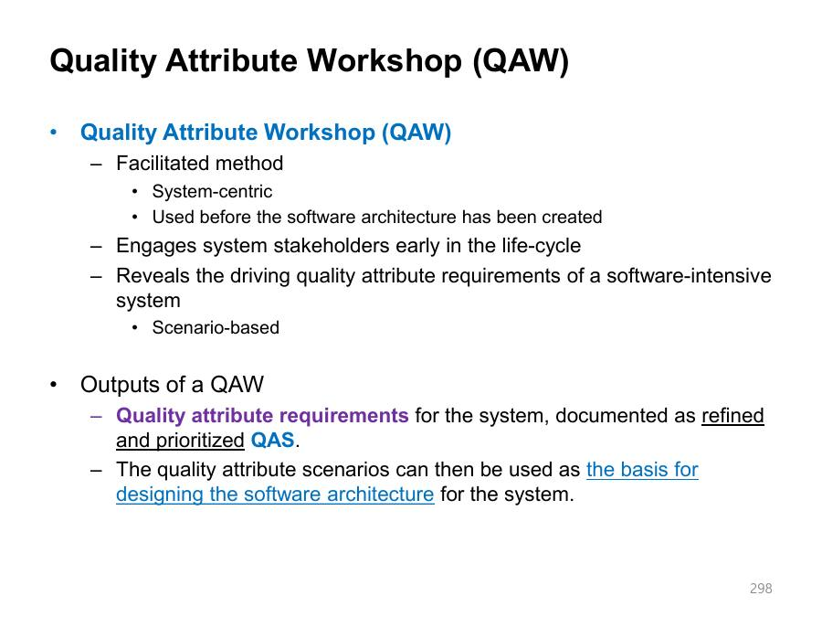

- Quality Attribute Workshop (QAW)
  - Facilitated method
    - System-centric
    - Used before the software architecture has been created
  - Engages system stakeholders early in the life-cycle
  - Reveals the driving quality attribute requirements of a software-intensive system
    - Scenario-based

- Outputs of a QAW
  - Quality attribute requirements for the system, documented as refined and prioritized QAS.
  - The quality attribute scenarios can then be used as the basis for designing the software architecture for the system.

---

## 299. QAW의 동기(Motivations)

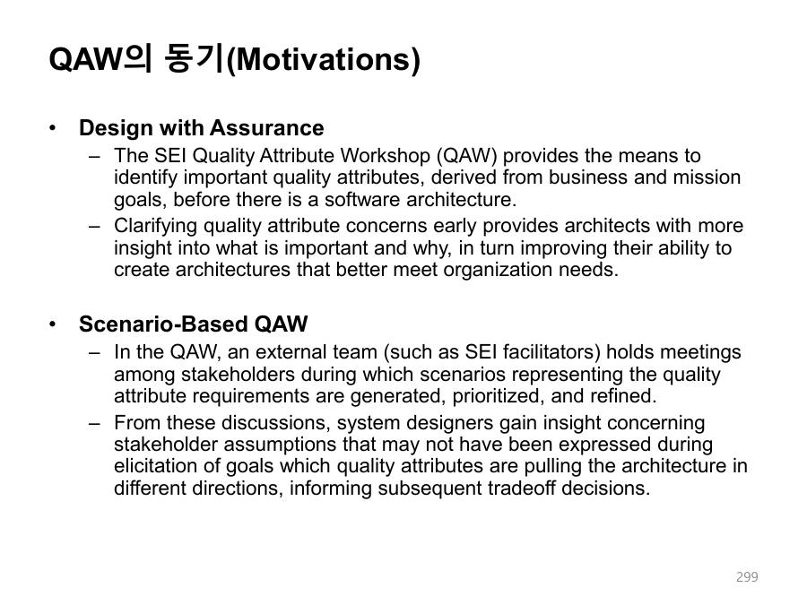

- Design with Assurance
  - The SEI Quality Attribute Workshop (QAW) provides the means to identify important quality attributes, derived from business and mission goals, before there is a software architecture.
  - Clarifying quality attribute concerns early provides architects with more insight into what is important and why, in turn improving their ability to create architectures that better meet organization needs.

- Scenario-Based QAW
  - In the QAW, an external team (such as SEI facilitators) holds meetings among stakeholders during which scenarios representing the quality attribute requirements are generated, prioritized, and refined.
  - From these discussions, system designers gain insight concerning stakeholder assumptions that may not have been expressed during elicitation of goals which quality attributes are pulling the architecture in different directions, informing subsequent tradeoff decisions.

---

## 300. QAW 절차

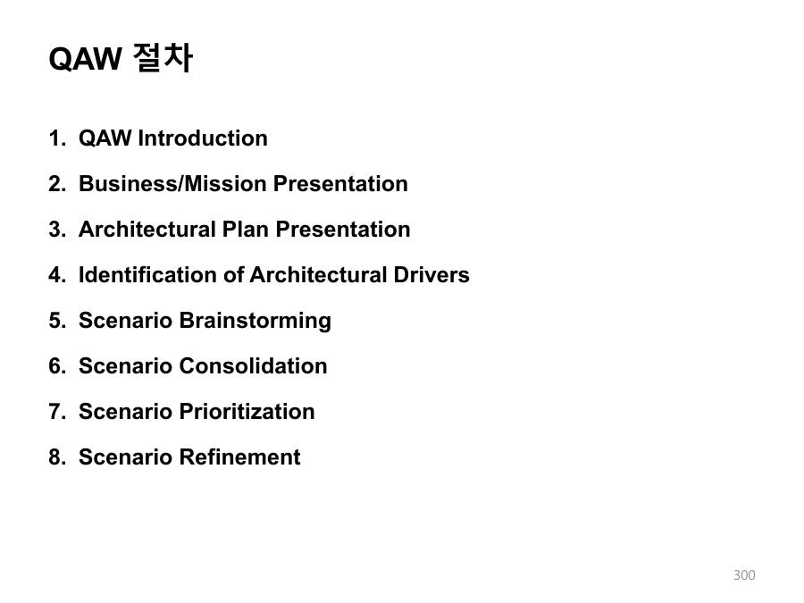

1\. QAW Introduction  

2\. Business/Mission Presentation  

3\. Architectural Plan Presentation  

4\. Identification of Architectural Drivers  

5\. Scenario Brainstorming  

6\. Scenario Consolidation  

7\. Scenario Prioritization  

8\. Scenario Refinement  

---

## 301. QAW 절차 상세

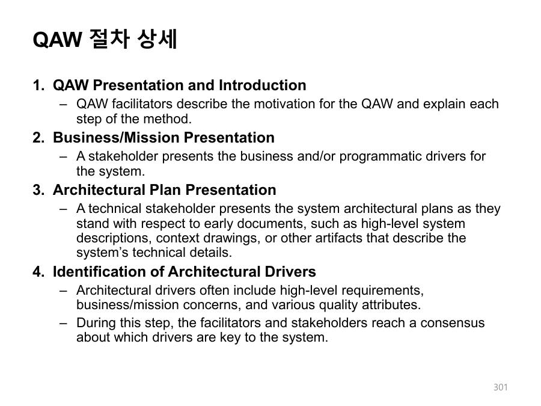

1\. QAW Presentation and Introduction  
- QAW facilitators describe the motivation for the QAW and explain each step of the method.

2\. Business/Mission Presentation  
- A stakeholder presents the business and/or programmatic drivers for the system.

3\. Architectural Plan Presentation  
- A technical stakeholder presents the system architectural plans as they stand with respect to early documents, such as high-level system descriptions, context drawings, or other artifacts that describe the system’s technical details.

4\. Identification of Architectural Drivers  
- Architectural drivers often include high-level requirements, business/mission concerns, and various quality attributes.
- During this step, the facilitators and stakeholders reach a consensus about which drivers are key to the system.

---

## 302. QAW 절차 상세 (계속)

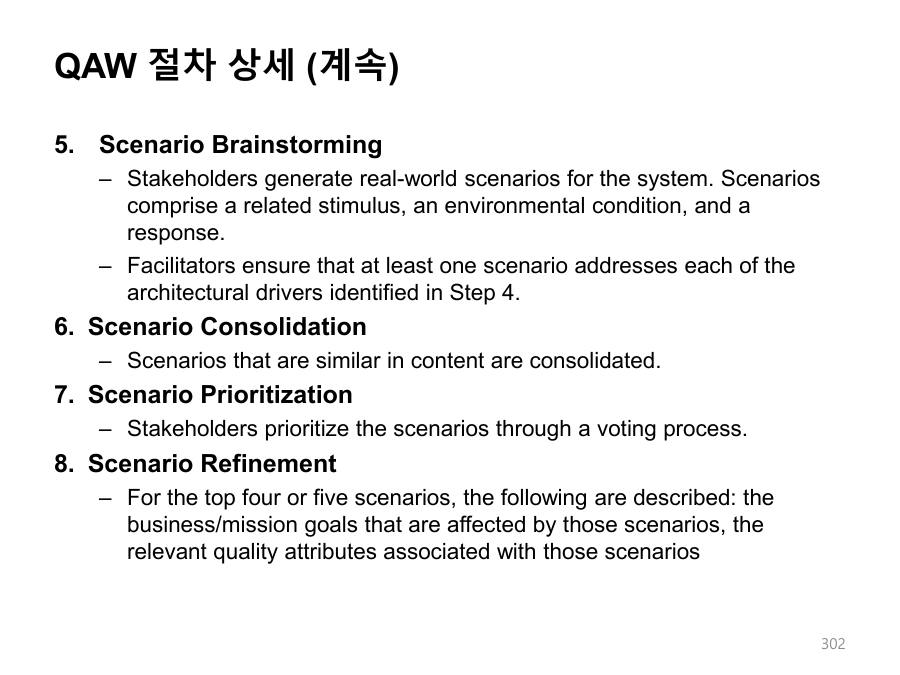

5\. Scenario Brainstorming  
- Stakeholders generate real-world scenarios for the system. Scenarios comprise a related stimulus, an environmental condition, and a response.
- Facilitators ensure that at least one scenario addresses each of the architectural drivers identified in Step 4.

6\. Scenario Consolidation  
- Scenarios that are similar in content are consolidated.

7\. Scenario Prioritization  
- Stakeholders prioritize the scenarios through a voting process.

8\. Scenario Refinement  
- For the top four or five scenarios, the following are described: the business/mission goals that are affected by those scenarios, the relevant quality attributes associated with those scenarios

---

## 303. Mini-QAW

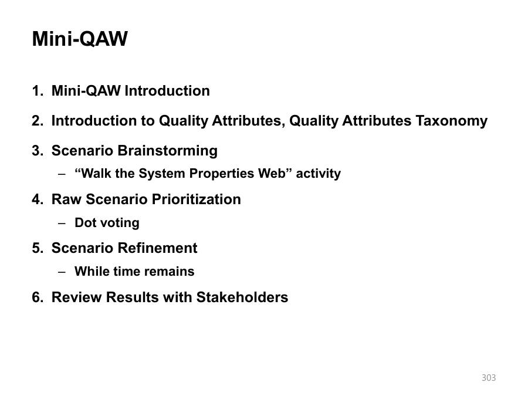

1\. Mini-QAW Introduction  

2\. Introduction to Quality Attributes, Quality Attributes Taxonomy  

3\. Scenario Brainstorming  
- “Walk the System Properties Web” activity

4\. Raw Scenario Prioritization  
- Dot voting

5\. Scenario Refinement  
- While time remains

6\. Review Results with Stakeholders  

---

## 304. 1\. Mini-QAW Introduction

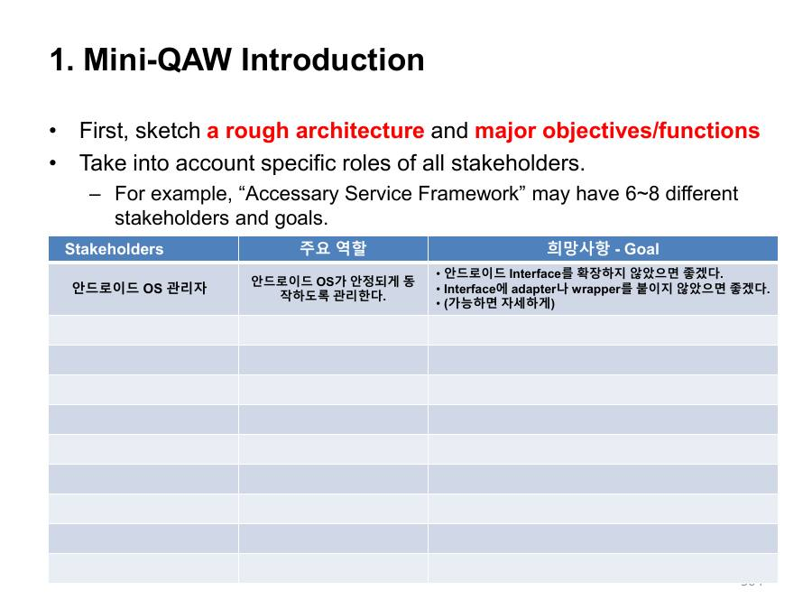

- First, sketch a rough architecture and major objectives/functions
- Take into account specific roles of all stakeholders.
  - For example, “Accessary Service Framework” may have 6~8 different stakeholders and goals.

Stakeholders · 주요 역할 · 희망사항 - Goal  
  - 안드로이드 Interface를 확장하지 않았으면 좋겠다.

안드로이드 OS가 안정되게 동  
안드로이드 OS 관리자 · • Interface에 adapter나 wrapper를 붙이지 않았으면 좋겠다.  
작하도록 관리한다.  
  - (가능하면 자세하게)

---

## 305. 2\. Introduction to Quality Attributes, Quality

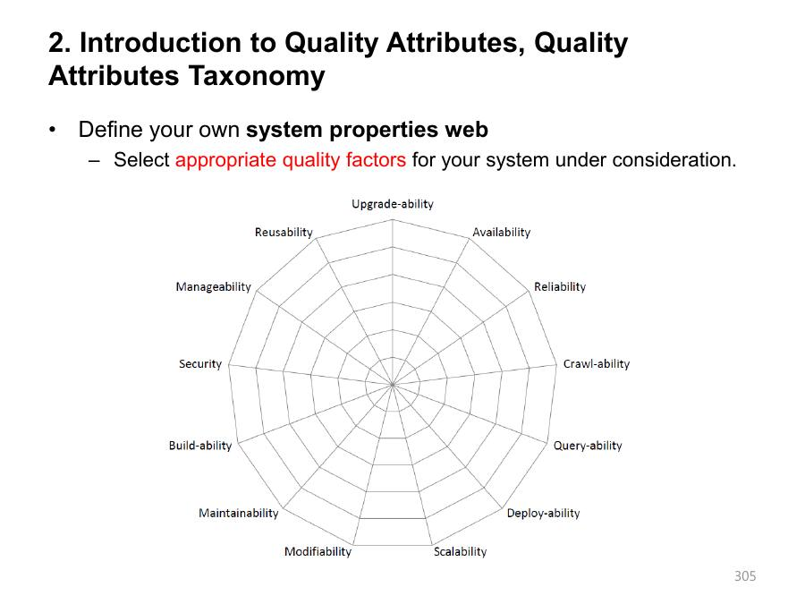

Attributes Taxonomy  
- Define your own system properties web
  - Select appropriate quality factors for your system under consideration.

---

## 306. System Properties Web

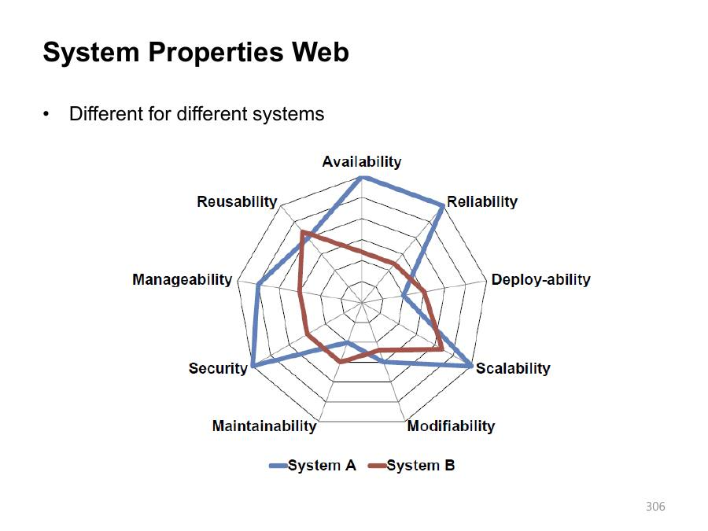

- Different for different systems

---

## 307. 3\. Scenario Brainstorming

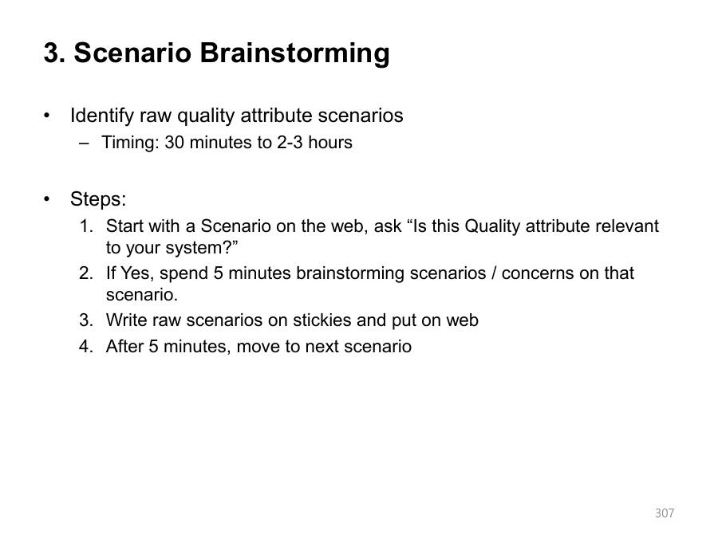

- Identify raw quality attribute scenarios
  - Timing: 30 minutes to 2-3 hours

- Steps: 1. Start with a Scenario on the web, ask “Is this Quality attribute relevant to your system?” 2. If Yes, spend 5 minutes brainstorming scenarios / concerns on that scenario. 3. Write raw scenarios on stickies and put on web 4. After 5 minutes, move to next scenario

---

## 308. Raw Quality Attribute Scenario

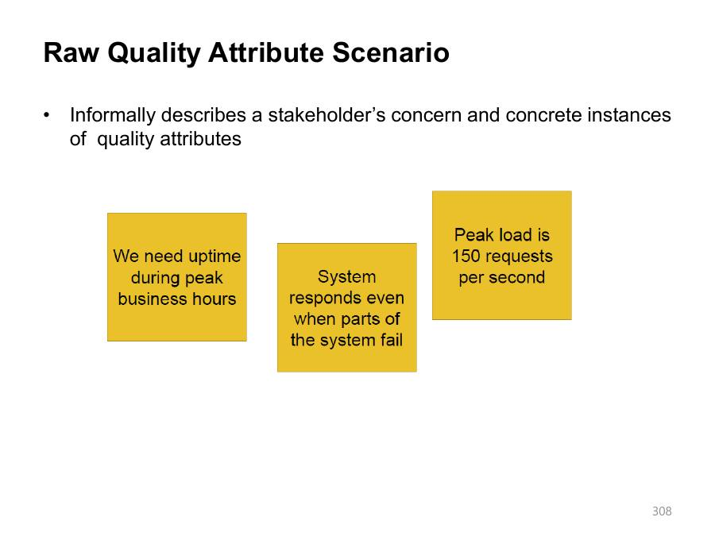

- Informally describes a stakeholder’s concern and concrete instances of quality attributes

---

## 309. (이미지 슬라이드)

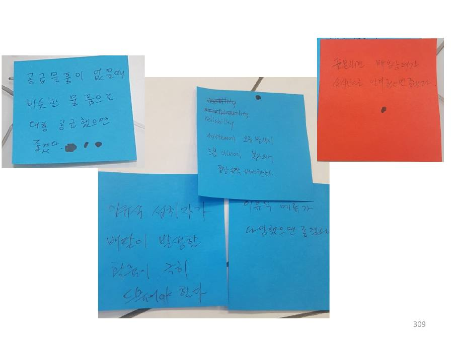

---

## 310. “Walk the System Properties Web” Activity

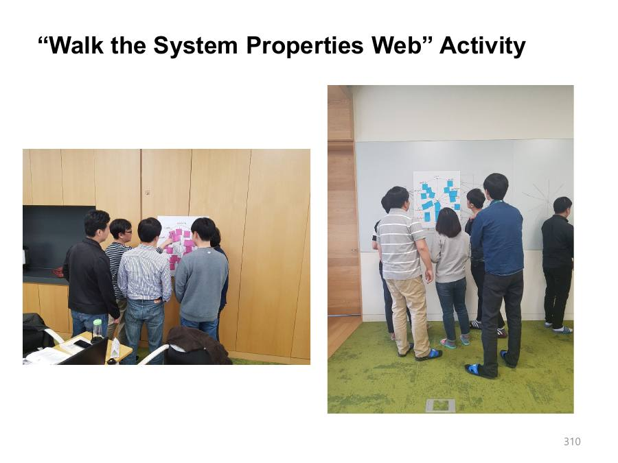

---

## 311. (이미지 슬라이드)

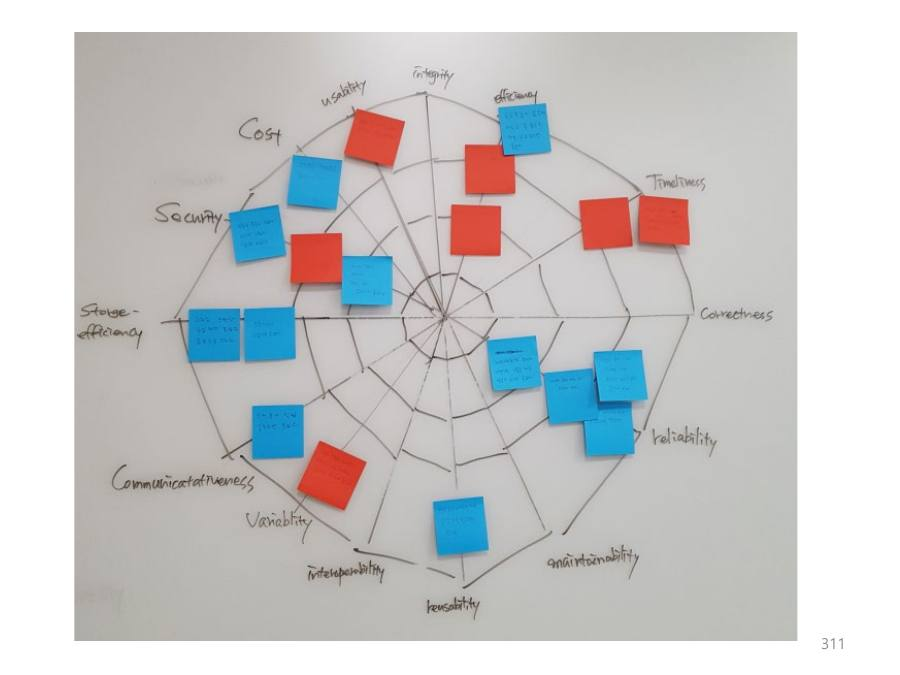

---

## 312. 4\. Raw Scenario Prioritization

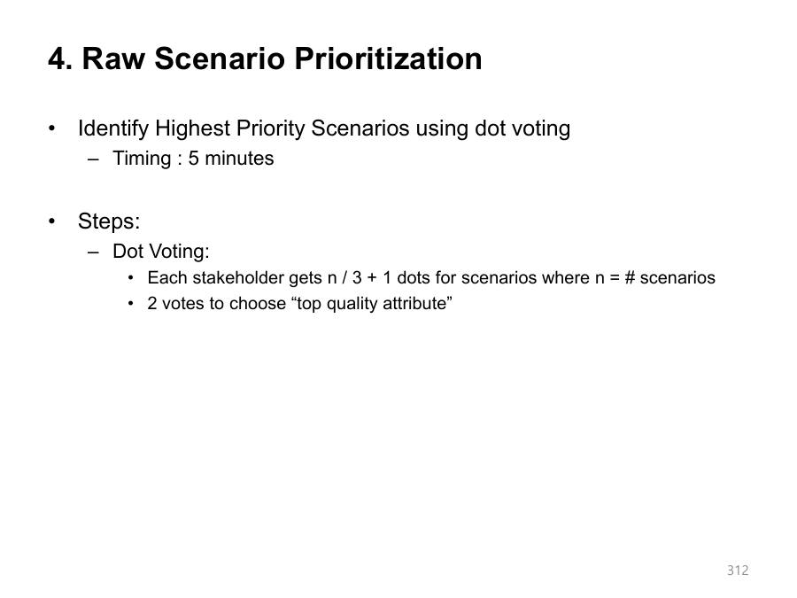

- Identify Highest Priority Scenarios using dot voting
  - Timing : 5 minutes

- Steps:
  - Dot Voting:
    - Each stakeholder gets n / 3 + 1 dots for scenarios where n = # scenarios
    - 2 votes to choose “top quality attribute”

---

## 313. (이미지 슬라이드)

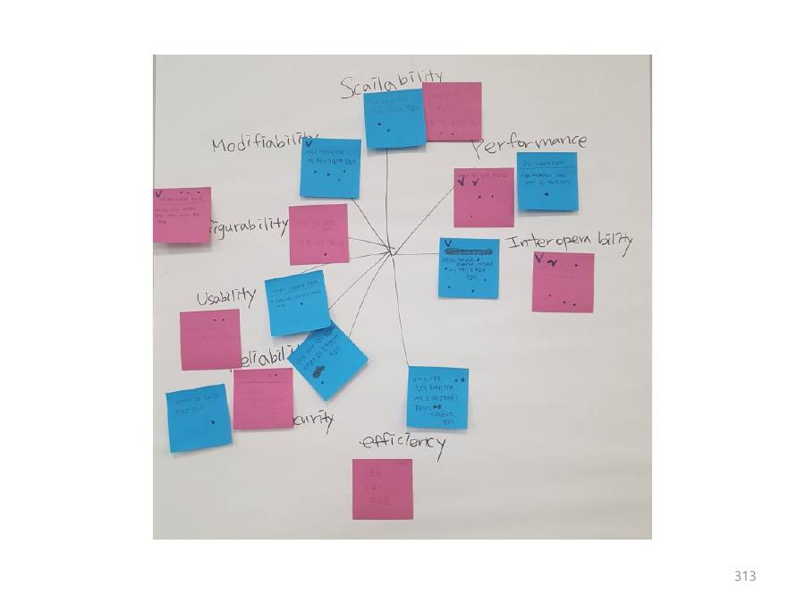

---

## 314. 5\. Scenario Refinement

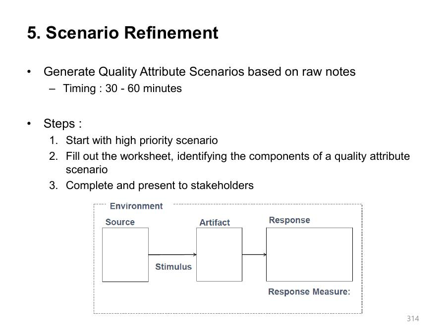

- Generate Quality Attribute Scenarios based on raw notes
  - Timing : 30 - 60 minutes

- Steps : 1. Start with high priority scenario 2. Fill out the worksheet, identifying the components of a quality attribute scenario 3. Complete and present to stakeholders

---

## 315. Refined Scenario: In the event of hardware failure, search service is

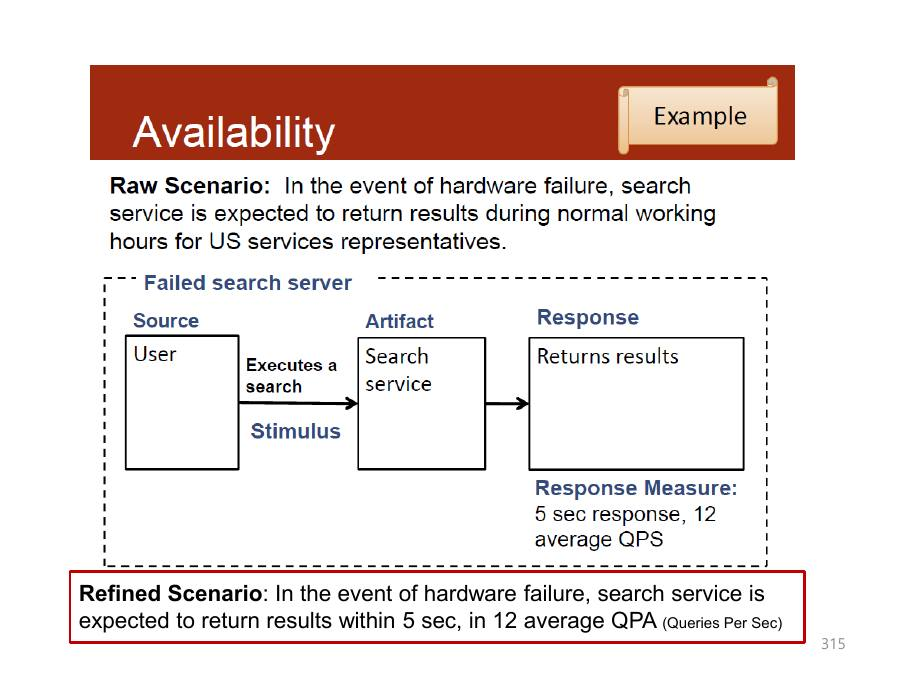

expected to return results within 5 sec, in 12 average QPA (Queries Per Sec)  

---

## 316. Mini-QAW vs. Traditional QAW

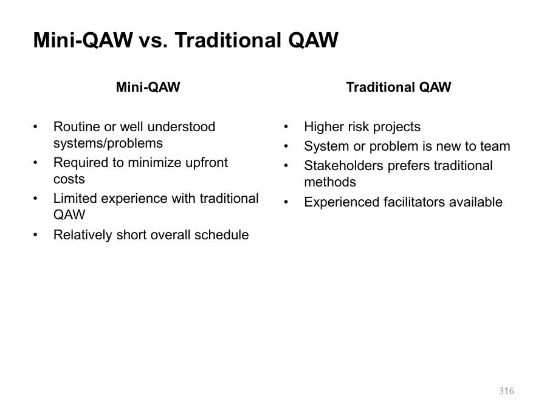

Mini-QAW · Traditional QAW  

- Routine or well understood · • · Higher risk projects

systems/problems · • · System or problem is new to team  
- Required to minimize upfront · • · Stakeholders prefers traditional

costs · methods  
- Limited experience with traditional · • · Experienced facilitators available QAW
- Relatively short overall schedule

---

[← 이전: 8-2. 품질 속성 시나리오](08-2_품질속성_시나리오.md) · [← 목차](README.md) · [다음: 실습 3: Mini-QAW →](08x_실습3_Mini-QAW.md)
