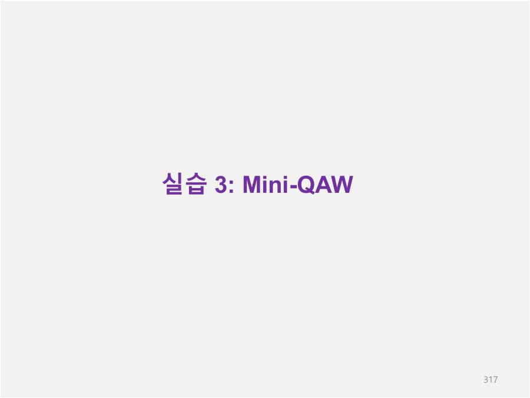
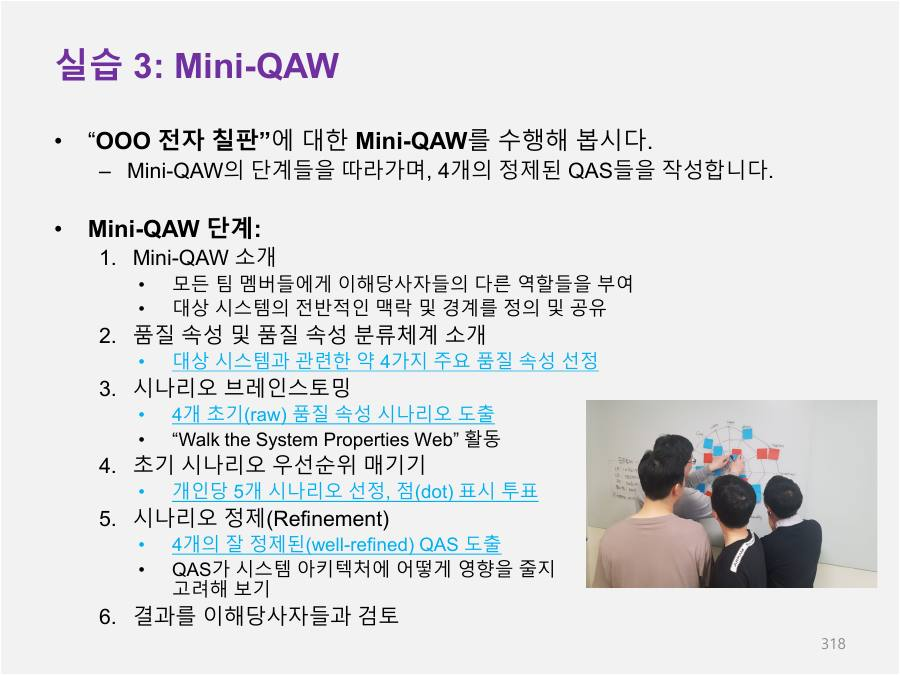
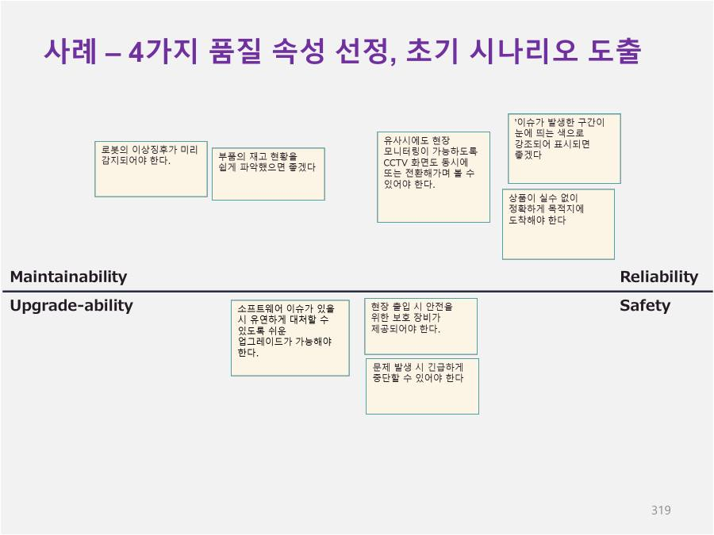
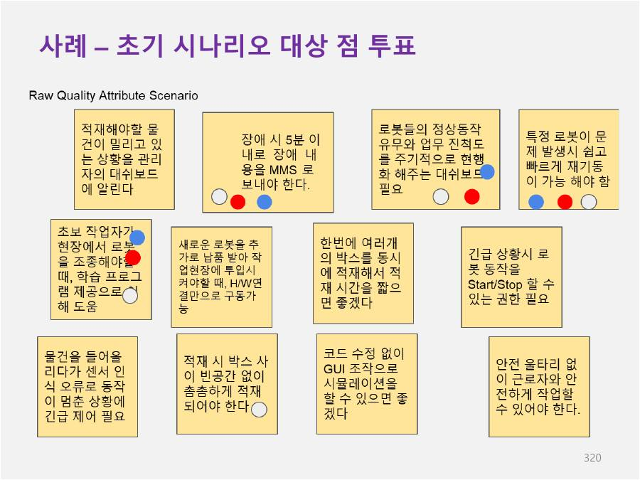

# 실습 3: Mini-QAW

> 요구사항 분석 (Requirement Analysis) · 슬라이드 317–320 · 원본: [PDF](../../original/삼성전자AA_요구사항분석_강의_20261124-1125_지은경.pdf)

[← 이전: 8-3. 품질 속성 워크샵](08-3_품질속성_워크샵.md) · [← 목차](README.md) · [다음: 9. 요구사항 확인 →](09_요구사항_확인.md)

## 슬라이드 목록

- [317. 실습 3: Mini-QAW](#s317)
- [318. 실습 3: Mini-QAW](#s318)
- [319. 사례 – 4가지 품질 속성 선정, 초기 시나리오 도출](#s319)
- [320. 사례 – 초기 시나리오 대상 점 투표](#s320)

---

## 317. 실습 3: Mini-QAW

---

## 318. 실습 3: Mini-QAW

- “OOO 전자 칠판”에 대한 Mini-QAW를 수행해 봅시다.
  - Mini-QAW의 단계들을 따라가며, 4개의 정제된 QAS들을 작성합니다.

- Mini-QAW 단계: 1. Mini-QAW 소개
  - 모든 팀 멤버들에게 이해당사자들의 다른 역할들을 부여
  - 대상 시스템의 전반적인 맥락 및 경계를 정의 및 공유

2\. 품질 속성 및 품질 속성 분류체계 소개  
  - 대상 시스템과 관련한 약 4가지 주요 품질 속성 선정

3\. 시나리오 브레인스토밍  
  - 4개 초기(raw) 품질 속성 시나리오 도출
  - “Walk the System Properties Web” 활동

4\. 초기 시나리오 우선순위 매기기  
  - 개인당 5개 시나리오 선정, 점(dot) 표시 투표

5\. 시나리오 정제(Refinement)  
  - 4개의 잘 정제된(well-refined) QAS 도출
  - QAS가 시스템 아키텍처에 어떻게 영향을 줄지 고려해 보기

6\. 결과를 이해당사자들과 검토  

---

## 319. 사례 – 4가지 품질 속성 선정, 초기 시나리오 도출

---

## 320. 사례 – 초기 시나리오 대상 점 투표

---

[← 이전: 8-3. 품질 속성 워크샵](08-3_품질속성_워크샵.md) · [← 목차](README.md) · [다음: 9. 요구사항 확인 →](09_요구사항_확인.md)
