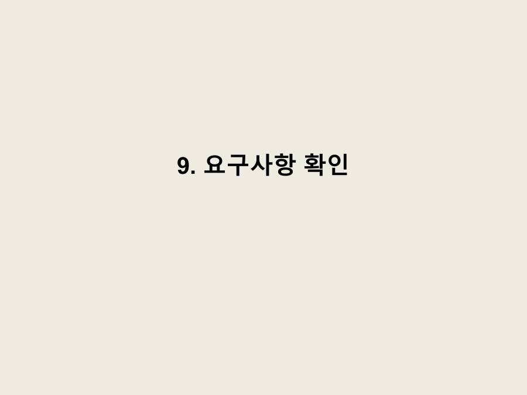
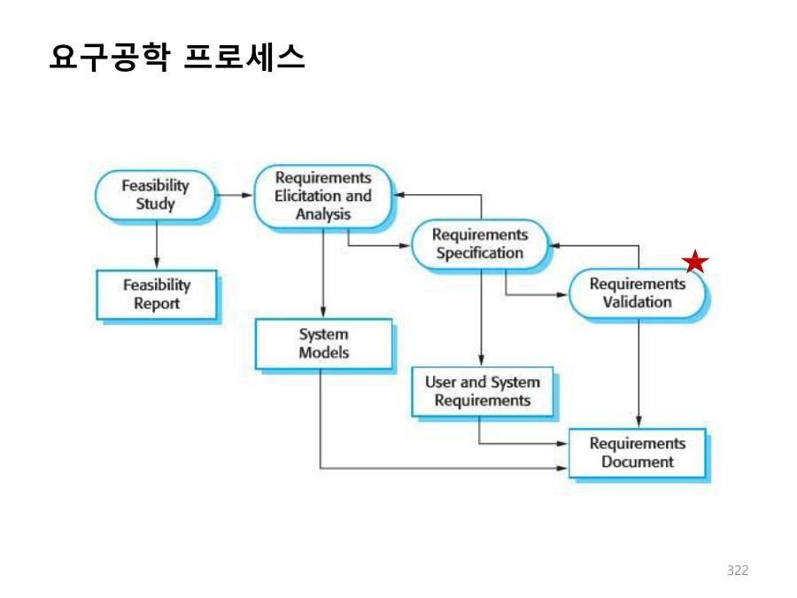
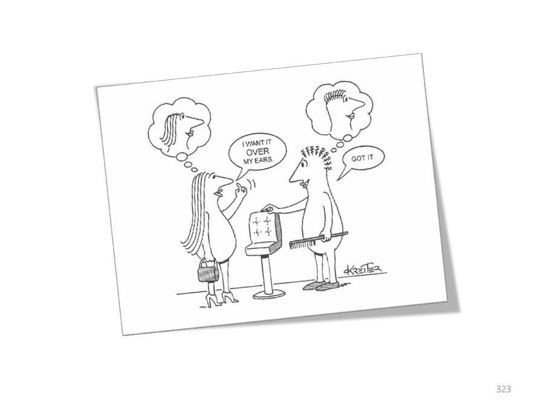
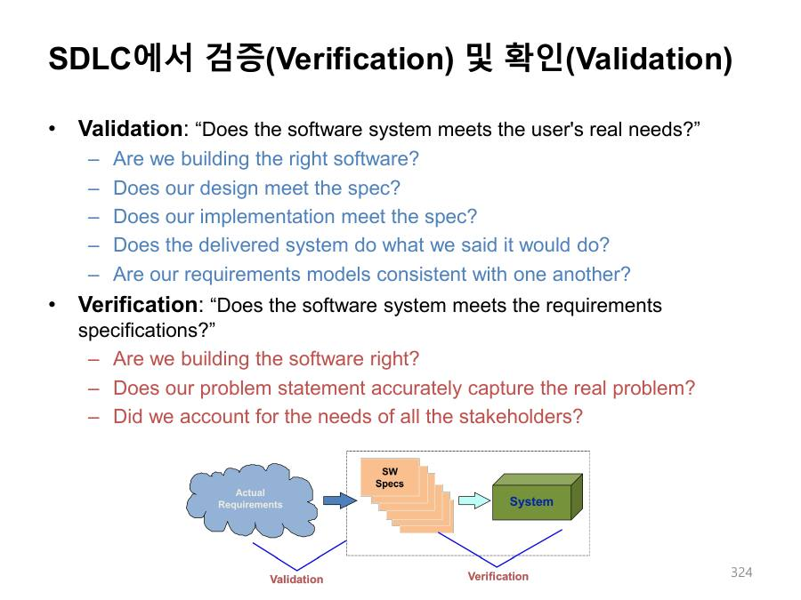
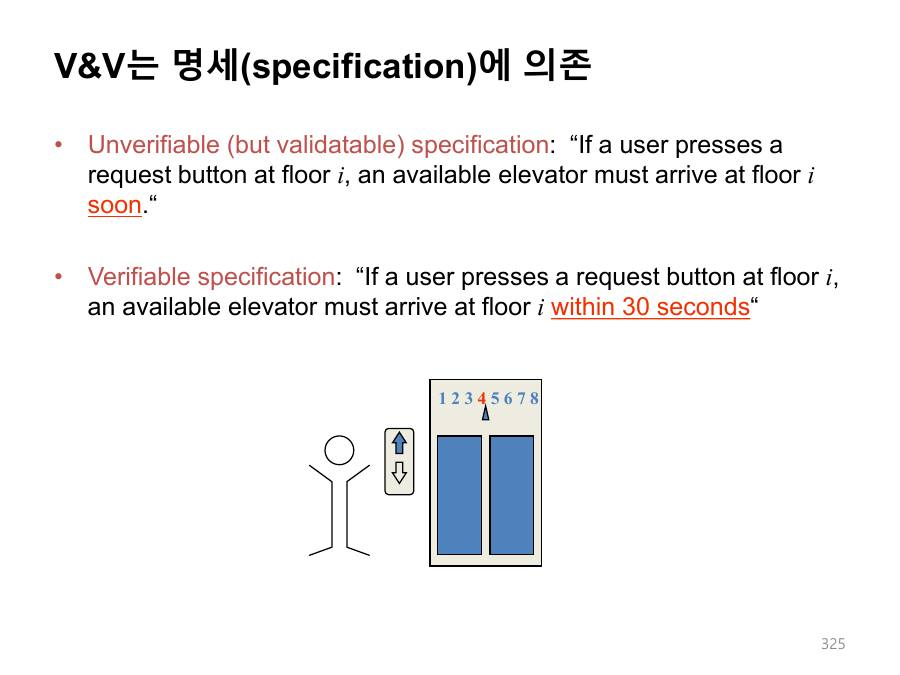
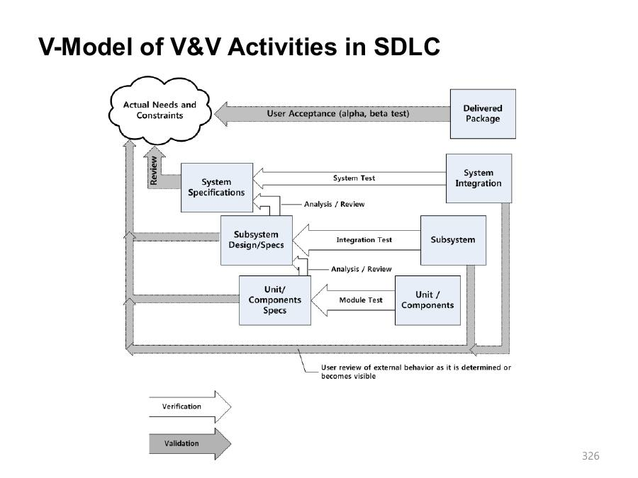
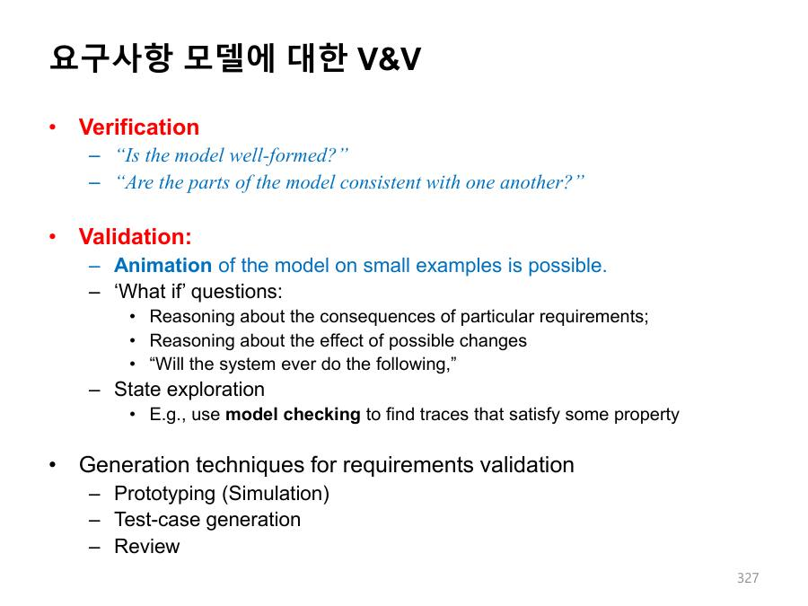
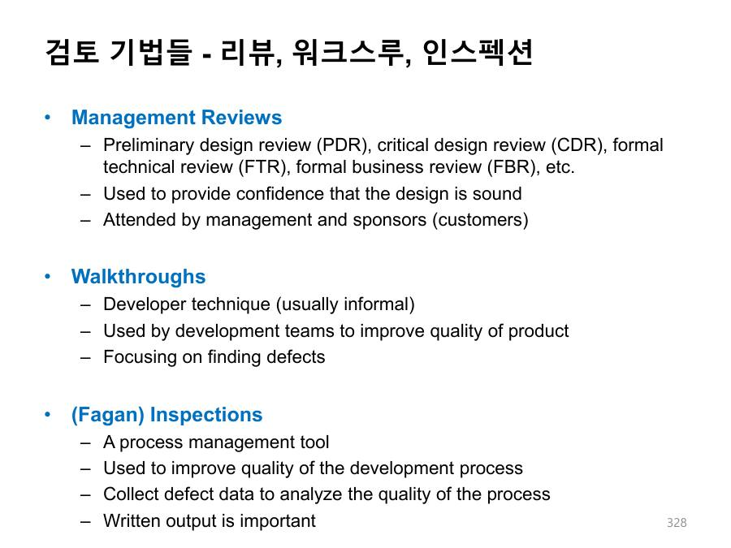

# 9. 요구사항 확인

> 요구사항 분석 (Requirement Analysis) · 슬라이드 321–328 · 원본: [PDF](../../original/삼성전자AA_요구사항분석_강의_20261124-1125_지은경.pdf)

[← 이전: 실습 3: Mini-QAW](08x_실습3_Mini-QAW.md) · [← 목차](README.md) · [다음: 10. 요구사항 변경 관리 →](10_요구사항_변경관리.md)

## 슬라이드 목록

- [321. 9\. 요구사항 확인](#s321)
- [322. 요구공학 프로세스](#s322)
- [323. (이미지 슬라이드)](#s323)
- [324. SDLC에서 검증(Verification) 및 확인(Validation)](#s324)
- [325. V&amp;V는 명세(specification)에 의존](#s325)
- [326. V-Model of V&amp;V Activities in SDLC](#s326)
- [327. 요구사항 모델에 대한 V&amp;V](#s327)
- [328. 검토 기법들 - 리뷰, 워크스루, 인스펙션](#s328)

---

## 321. 9\. 요구사항 확인

---

## 322. 요구공학 프로세스

---

## 323. (이미지 슬라이드)

---

## 324. SDLC에서 검증(Verification) 및 확인(Validation)

- Validation: “Does the software system meets the user's real needs?”
  - Are we building the right software?
  - Does our design meet the spec?
  - Does our implementation meet the spec?
  - Does the delivered system do what we said it would do?
  - Are our requirements models consistent with one another?
- Verification: “Does the software system meets the requirements specifications?”
  - Are we building the software right?
  - Does our problem statement accurately capture the real problem?
  - Did we account for the needs of all the stakeholders?

---

## 325. V&amp;V는 명세(specification)에 의존

- Unverifiable (but validatable) specification: “If a user presses a request button at floor i, an available elevator must arrive at floor i soon.“

- Verifiable specification: “If a user presses a request button at floor i, an available elevator must arrive at floor i within 30 seconds“

12345678  

---

## 326. V-Model of V&amp;V Activities in SDLC

---

## 327. 요구사항 모델에 대한 V&amp;V

- Verification
  - “Is the model well-formed?”
  - “Are the parts of the model consistent with one another?”

- Validation:
  - Animation of the model on small examples is possible.
  - ‘What if’ questions:
    - Reasoning about the consequences of particular requirements;
    - Reasoning about the effect of possible changes
    - “Will the system ever do the following,”
  - State exploration
    - E.g., use model checking to find traces that satisfy some property

- Generation techniques for requirements validation
  - Prototyping (Simulation)
  - Test-case generation
  - Review

---

## 328. 검토 기법들 - 리뷰, 워크스루, 인스펙션

- Management Reviews
  - Preliminary design review (PDR), critical design review (CDR), formal technical review (FTR), formal business review (FBR), etc.
  - Used to provide confidence that the design is sound
  - Attended by management and sponsors (customers)

- Walkthroughs
  - Developer technique (usually informal)
  - Used by development teams to improve quality of product
  - Focusing on finding defects

- (Fagan) Inspections
  - A process management tool
  - Used to improve quality of the development process
  - Collect defect data to analyze the quality of the process
  - Written output is important

---

[← 이전: 실습 3: Mini-QAW](08x_실습3_Mini-QAW.md) · [← 목차](README.md) · [다음: 10. 요구사항 변경 관리 →](10_요구사항_변경관리.md)
