# 10. 요구사항 변경 관리

> 요구사항 분석 (Requirement Analysis) · 슬라이드 329–352 · 원본: [PDF](../../original/삼성전자AA_요구사항분석_강의_20261124-1125_지은경.pdf)

[← 이전: 9. 요구사항 확인](09_요구사항_확인.md) · [← 목차](README.md)

## 슬라이드 목록

- [329. 10\. 요구사항 변경 관리](#s329)
- [330. 요구공학 프로세스](#s330)
- [331. 소프트웨어 노화(Aging)](#s331)
- [332. 소프트웨어 유지보수(Maintenance)](#s332)
- [333. 요구사항 변경 관리](#s333)
- [334. 변경 관리](#s334)
- [335. 변경 관리 프로세스](#s335)
- [336. 요구사항 추적성 (Traceability)](#s336)
- [337. 추적성의 중요성](#s337)
- [338. 추적성의 중요성 (계속)](#s338)
- [339. 추적성의 어려움](#s339)
- [340. 실무에서의 추적성](#s340)
- [341. 요구사항 추적성 사례](#s341)
- [342. 추적성 링크 사례: An ATM System](#s342)
- [343. 추적성 링크 사례: An ATM System (계속)](#s343)
- [344. 추적성 링크 사례: An ATM System (계속)](#s344)
- [345. 추적성 링크 사례: An ATM System (계속)](#s345)
- [346. 추적성 링크 사례: An ATM System (계속)](#s346)
- [347. 추적성 링크 사례: An ATM System (계속)](#s347)
- [348. 추적성 링크 사례: An ATM System (계속)](#s348)
- [349. 추적성 링크 사례: An ATM System (계속)](#s349)
- [350. 추적성 링크 사례: An ATM System (계속)](#s350)
- [351. 추적성 링크 사례: An ATM System (계속)](#s351)
- [352. 요구공학 프로세스](#s352)

---

## 329. 10\. 요구사항 변경 관리

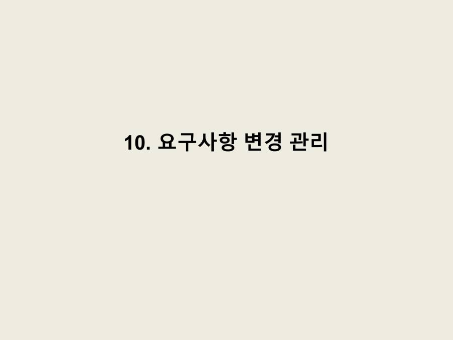

---

## 330. 요구공학 프로세스

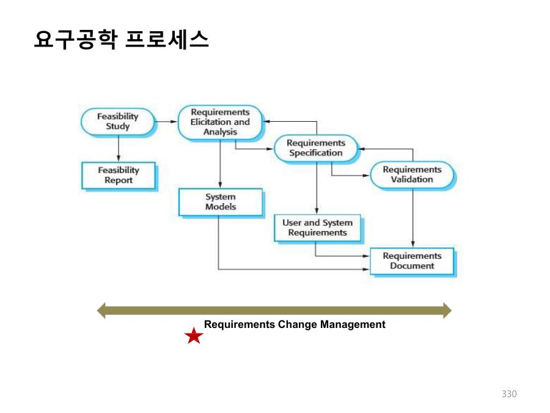

Requirements Change Management  

---

## 331. 소프트웨어 노화(Aging)

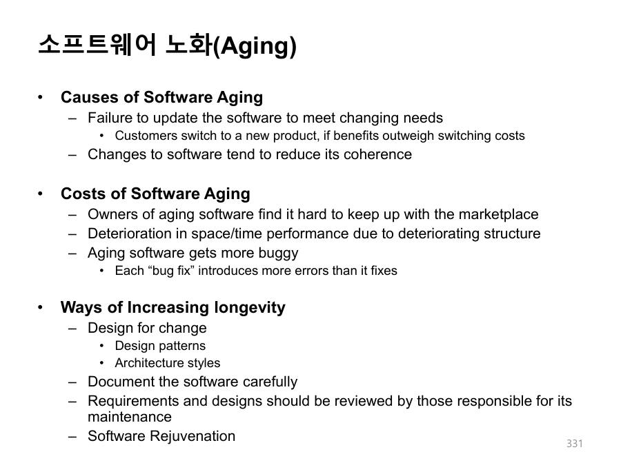

- Causes of Software Aging
  - Failure to update the software to meet changing needs
    - Customers switch to a new product, if benefits outweigh switching costs
  - Changes to software tend to reduce its coherence

- Costs of Software Aging
  - Owners of aging software find it hard to keep up with the marketplace
  - Deterioration in space/time performance due to deteriorating structure
  - Aging software gets more buggy
    - Each “bug fix” introduces more errors than it fixes

- Ways of Increasing longevity
  - Design for change
    - Design patterns
    - Architecture styles
  - Document the software carefully
  - Requirements and designs should be reviewed by those responsible for its maintenance
  - Software Rejuvenation

---

## 332. 소프트웨어 유지보수(Maintenance)

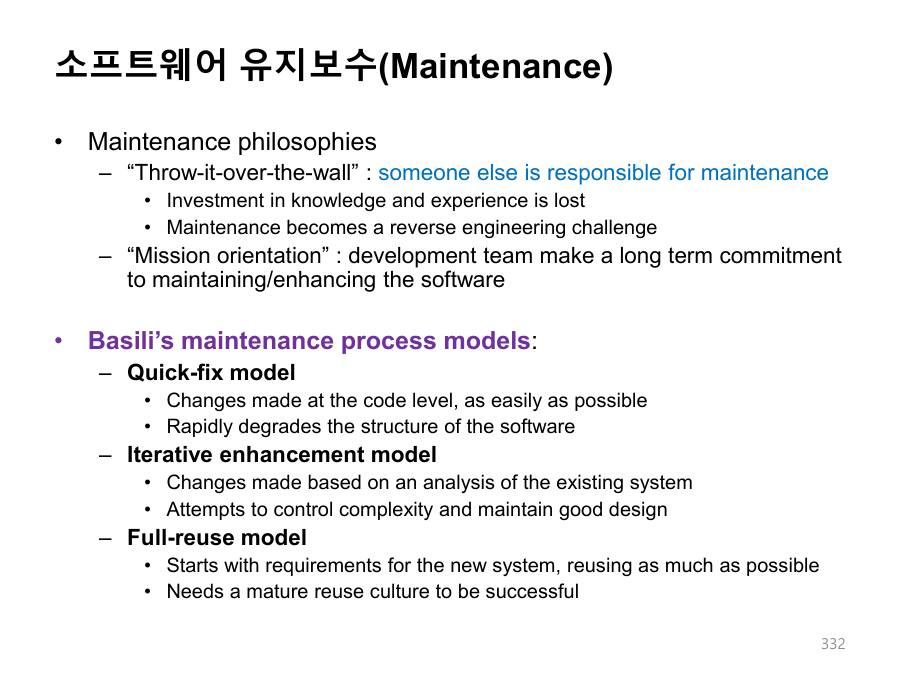

- Maintenance philosophies
  - “Throw-it-over-the-wall” : someone else is responsible for maintenance
    - Investment in knowledge and experience is lost
    - Maintenance becomes a reverse engineering challenge
  - “Mission orientation” : development team make a long term commitment to maintaining/enhancing the software

- Basili’s maintenance process models:
  - Quick-fix model
    - Changes made at the code level, as easily as possible
    - Rapidly degrades the structure of the software
  - Iterative enhancement model
    - Changes made based on an analysis of the existing system
    - Attempts to control complexity and maintain good design
  - Full-reuse model
    - Starts with requirements for the new system, reusing as much as possible
    - Needs a mature reuse culture to be successful

---

## 333. 요구사항 변경 관리

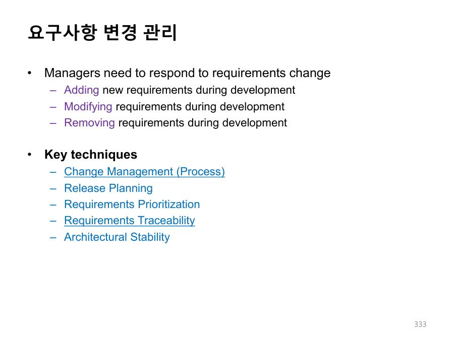

- Managers need to respond to requirements change
  - Adding new requirements during development
  - Modifying requirements during development
  - Removing requirements during development

- Key techniques
  - Change Management (Process)
  - Release Planning
  - Requirements Prioritization
  - Requirements Traceability
  - Architectural Stability

---

## 334. 변경 관리

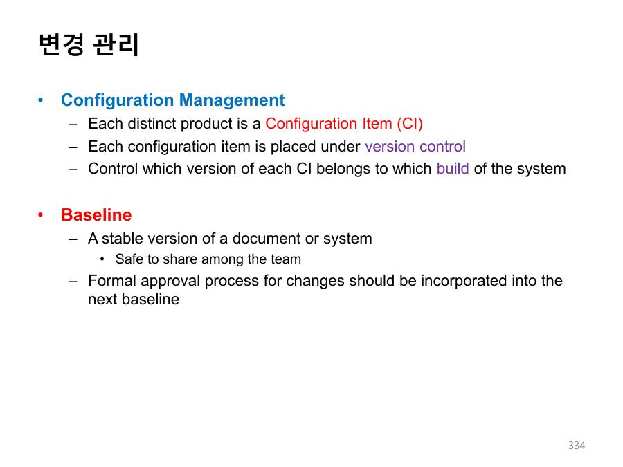

- Configuration Management
  - Each distinct product is a Configuration Item (CI)
  - Each configuration item is placed under version control
  - Control which version of each CI belongs to which build of the system

- Baseline
  - A stable version of a document or system
    - Safe to share among the team
  - Formal approval process for changes should be incorporated into the next baseline

---

## 335. 변경 관리 프로세스

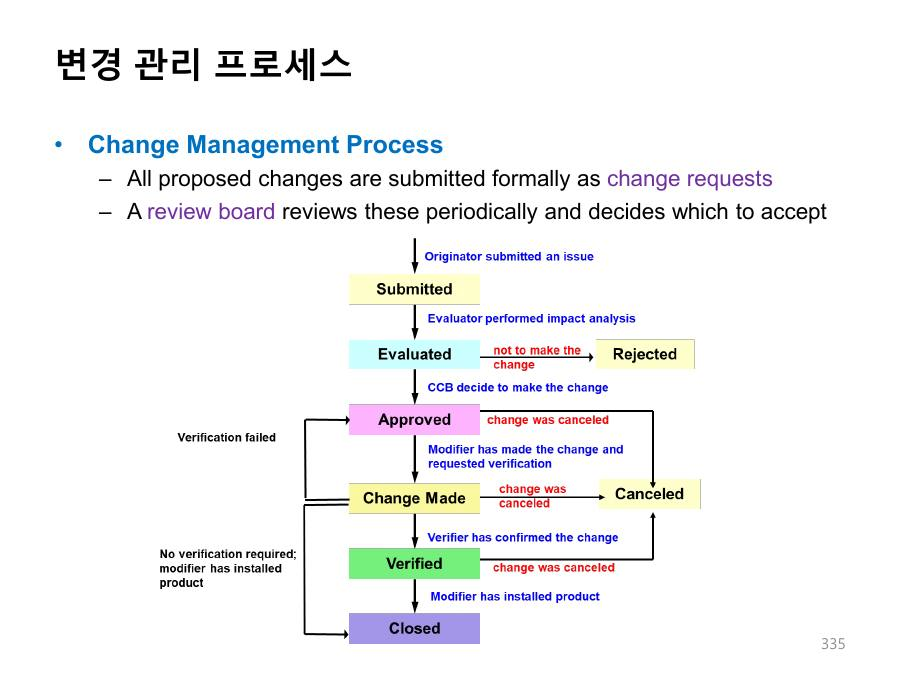

- Change Management Process
  - All proposed changes are submitted formally as change requests
  - A review board reviews these periodically and decides which to accept

---

## 336. 요구사항 추적성 (Traceability)

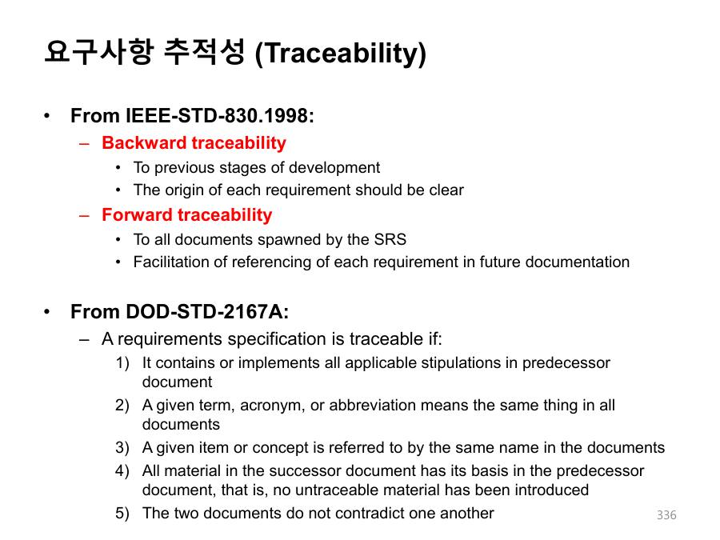

- From IEEE-STD-830.1998:
  - Backward traceability
    - To previous stages of development
    - The origin of each requirement should be clear
  - Forward traceability
    - To all documents spawned by the SRS
    - Facilitation of referencing of each requirement in future documentation

- From DOD-STD-2167A:
  - A requirements specification is traceable if: 1) It contains or implements all applicable stipulations in predecessor document 2) A given term, acronym, or abbreviation means the same thing in all documents 3) A given item or concept is referred to by the same name in the documents 4) All material in the successor document has its basis in the predecessor document, that is, no untraceable material has been introduced 5) The two documents do not contradict one another

---

## 337. 추적성의 중요성

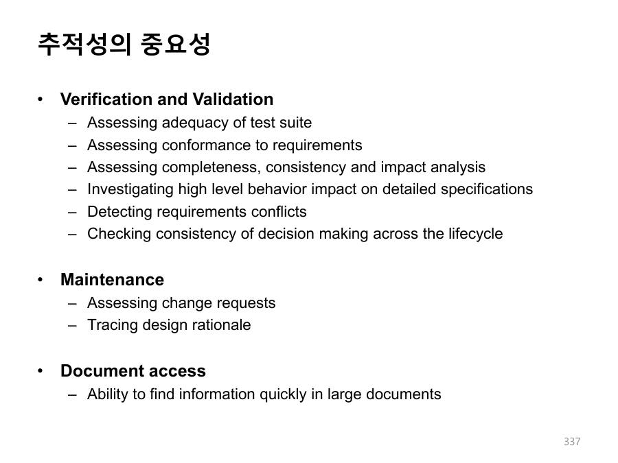

- Verification and Validation
  - Assessing adequacy of test suite
  - Assessing conformance to requirements
  - Assessing completeness, consistency and impact analysis
  - Investigating high level behavior impact on detailed specifications
  - Detecting requirements conflicts
  - Checking consistency of decision making across the lifecycle

- Maintenance
  - Assessing change requests
  - Tracing design rationale

- Document access
  - Ability to find information quickly in large documents

---

## 338. 추적성의 중요성 (계속)

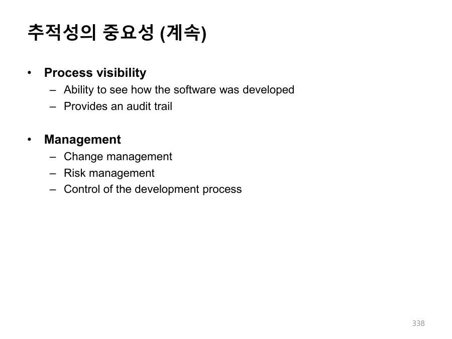

- Process visibility
  - Ability to see how the software was developed
  - Provides an audit trail

- Management
  - Change management
  - Risk management
  - Control of the development process

---

## 339. 추적성의 어려움

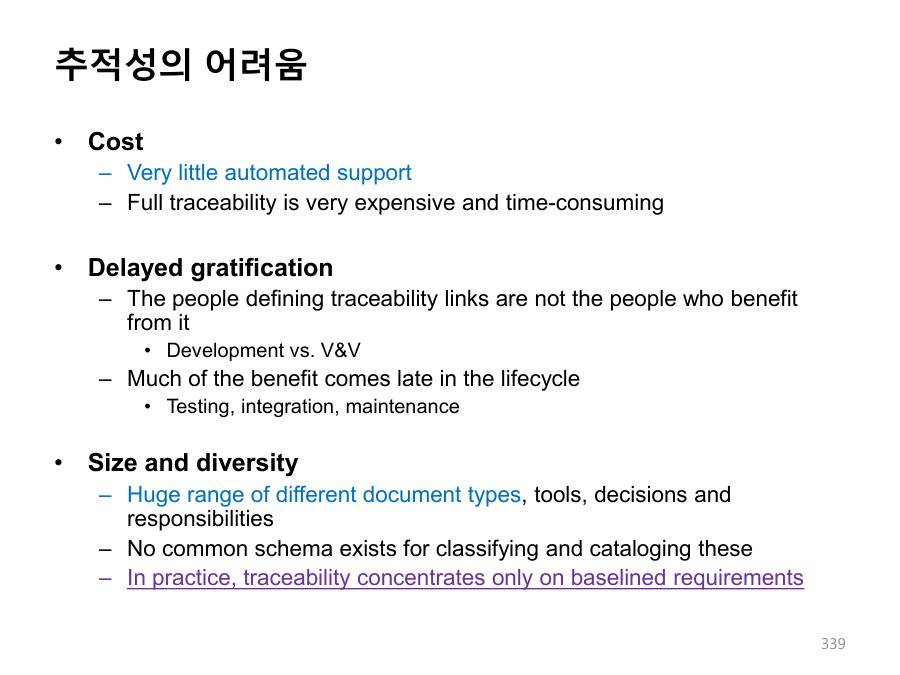

- Cost
  - Very little automated support
  - Full traceability is very expensive and time-consuming

- Delayed gratification
  - The people defining traceability links are not the people who benefit from it
    - Development vs. V&amp;V
  - Much of the benefit comes late in the lifecycle
    - Testing, integration, maintenance

- Size and diversity
  - Huge range of different document types, tools, decisions and responsibilities
  - No common schema exists for classifying and cataloging these
  - In practice, traceability concentrates only on baselined requirements

---

## 340. 실무에서의 추적성

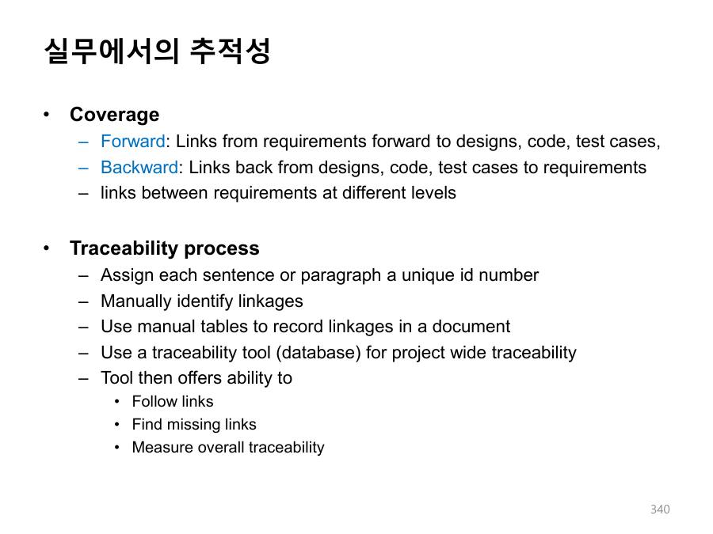

- Coverage
  - Forward: Links from requirements forward to designs, code, test cases,
  - Backward: Links back from designs, code, test cases to requirements
  - links between requirements at different levels

- Traceability process
  - Assign each sentence or paragraph a unique id number
  - Manually identify linkages
  - Use manual tables to record linkages in a document
  - Use a traceability tool (database) for project wide traceability
  - Tool then offers ability to
    - Follow links
    - Find missing links
    - Measure overall traceability

---

## 341. 요구사항 추적성 사례

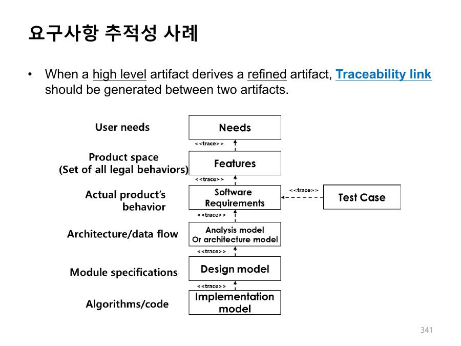

- When a high level artifact derives a refined artifact, Traceability link should be generated between two artifacts.

---

## 342. 추적성 링크 사례: An ATM System

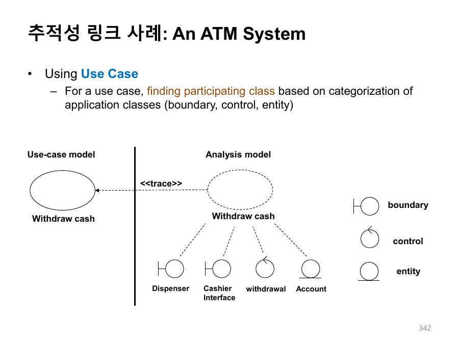

- Using Use Case
  - For a use case, finding participating class based on categorization of application classes (boundary, control, entity)

Use-case model · Analysis model  

&lt;&lt;trace&gt;&gt;  

boundary  
Withdraw cash · Withdraw cash  

control  

entity  
Dispenser · Cashier · withdrawal · Account  
Interface  

---

## 343. 추적성 링크 사례: An ATM System (계속)

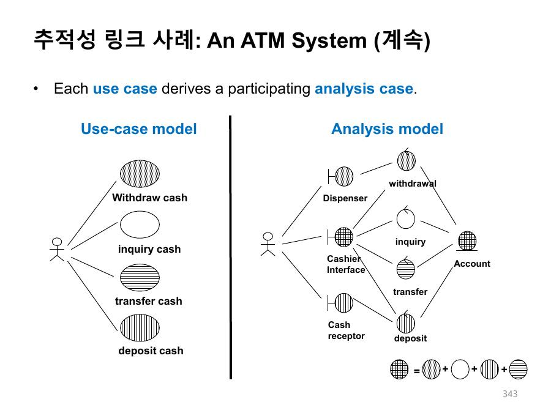

- Each use case derives a participating analysis case.

Use-case model · Analysis model  

withdrawal  
Withdraw cash · Dispenser  

inquiry  
inquiry cash  
Cashier · Account  
Interface  

transfer  
transfer cash  

Cash  
receptor · deposit  
deposit cash  
\= · + · + · +  

---

## 344. 추적성 링크 사례: An ATM System (계속)

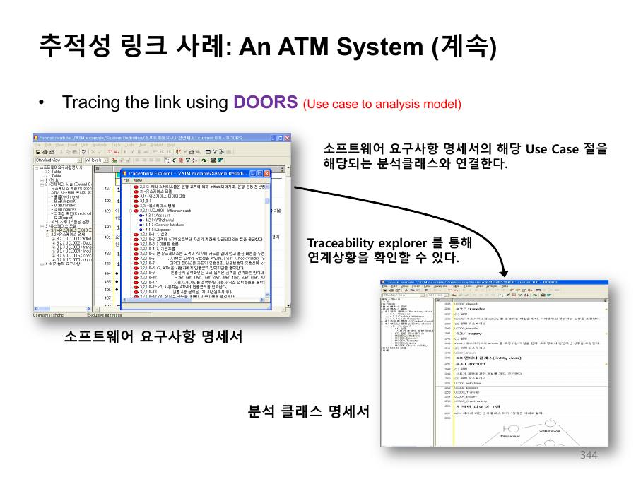

- Tracing the link using DOORS (Use case to analysis model)

소프트웨어 요구사항 명세서의 해당 Use Case 절을  
해당되는 분석클래스와 연결한다.  

Traceability explorer 를 통해  
연계상황을 확인할 수 있다.  

소프트웨어 요구사항 명세서  

분석 클래스 명세서  

---

## 345. 추적성 링크 사례: An ATM System (계속)

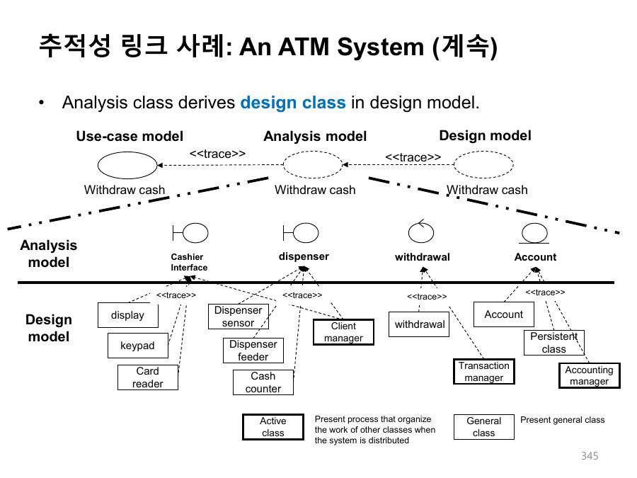

- Analysis class derives design class in design model.

Use-case model · Analysis model · Design model  
&lt;&lt;trace&gt;&gt; · &lt;&lt;trace&gt;&gt;  

Withdraw cash · Withdraw cash · Withdraw cash  

Analysis  
Cashier · dispenser · withdrawal · Account  
model · Interface  

&lt;&lt;trace&gt;&gt; · &lt;&lt;trace&gt;&gt; · &lt;&lt;trace&gt;&gt;  
&lt;&lt;trace&gt;&gt;  

display · Dispenser · Account  
Design · sensor · Client · withdrawal  
model · Dispenser  
manager · Persistent  
keypad · class  
feeder  
Transaction · Accounting  
Card · Cash · manager · manager  
reader · counter  

Active · Present process that organize · General · Present general class  
class · the work of other classes when · class  
the system is distributed  

---

## 346. 추적성 링크 사례: An ATM System (계속)

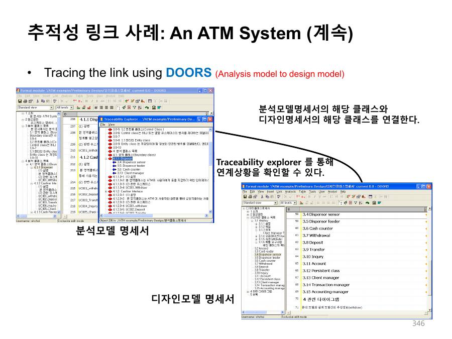

- Tracing the link using DOORS (Analysis model to design model)

분석모델명세서의 해당 클래스와  
디자인명세서의 해당 클래스를 연결한다.  

Traceability explorer 를 통해  
연계상황을 확인할 수 있다.  

분석모델 명세서  

디자인모델 명세서  

---

## 347. 추적성 링크 사례: An ATM System (계속)

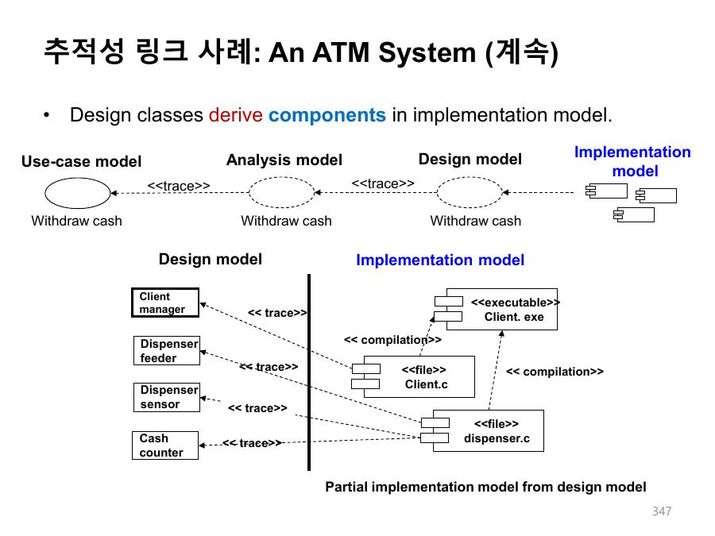

- Design classes derive components in implementation model.

Design model · Implementation  
Use-case model · Analysis model  
model  
&lt;&lt;trace&gt;&gt; · &lt;&lt;trace&gt;&gt;  

Withdraw cash · Withdraw cash · Withdraw cash  

Design model · Implementation model  

Client  
&lt;&lt;executable&gt;&gt;  
manager · &lt;&lt; trace&gt;&gt; · Client. exe  

Dispenser · &lt;&lt; compilation&gt;&gt;  
feeder  
&lt;&lt; trace&gt;&gt; · &lt;&lt;file&gt;&gt; · &lt;&lt; compilation&gt;&gt;  
Client.c  
Dispenser  
sensor · &lt;&lt; trace&gt;&gt;  
&lt;&lt;file&gt;&gt;  
Cash · &lt;&lt; trace&gt;&gt; · dispenser.c  
counter  

Partial implementation model from design model  

---

## 348. 추적성 링크 사례: An ATM System (계속)

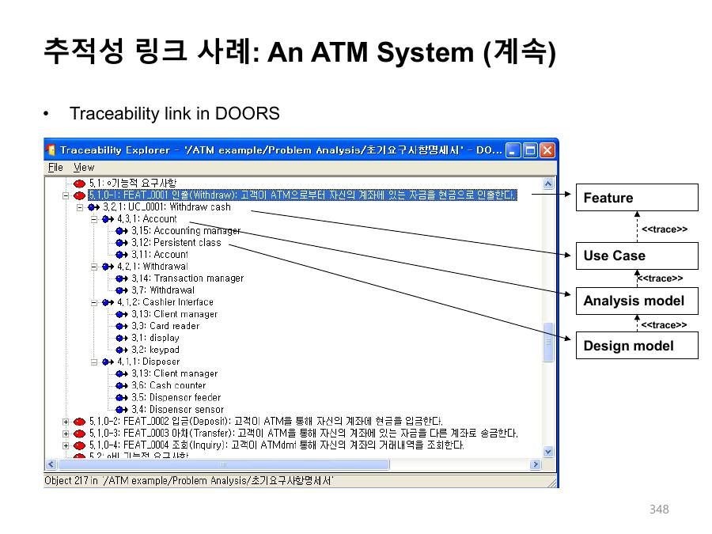

- Traceability link in DOORS

Feature  

&lt;&lt;trace&gt;&gt;  

Use Case  
&lt;&lt;trace&gt;&gt;  

Analysis model  
&lt;&lt;trace&gt;&gt;  

Design model  

---

## 349. 추적성 링크 사례: An ATM System (계속)

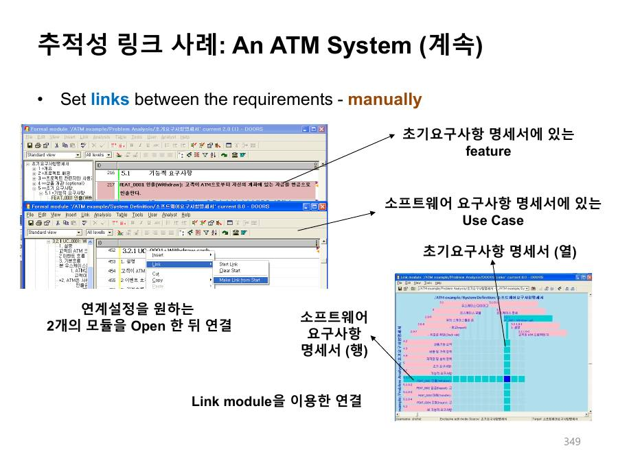

- Set links between the requirements - manually 초기요구사항 명세서에 있는 feature

소프트웨어 요구사항 명세서에 있는  
Use Case  

초기요구사항 명세서 (열)  

연계설정을 원하는  
소프트웨어  
2개의 모듈을 Open 한 뒤 연결  
요구사항  
명세서 (행)  

Link module을 이용한 연결  

---

## 350. 추적성 링크 사례: An ATM System (계속)

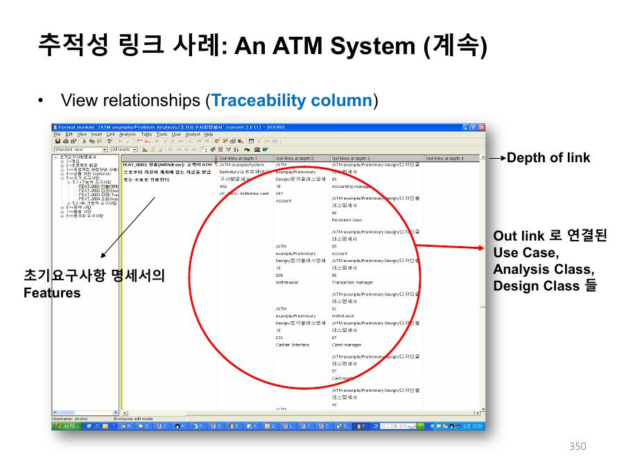

- View relationships (Traceability column)

Depth of link  

Out link 로 연결된  
Use Case,  
Analysis Class,  
초기요구사항 명세서의  
Design Class 들  
Features  

---

## 351. 추적성 링크 사례: An ATM System (계속)

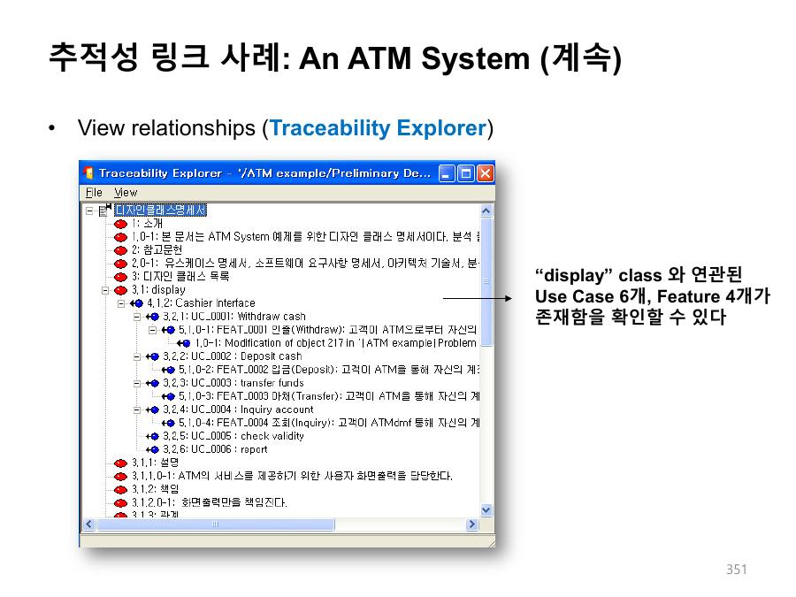

- View relationships (Traceability Explorer)

“display” class 와 연관된  
Use Case 6개, Feature 4개가  
존재함을 확인할 수 있다  

---

## 352. 요구공학 프로세스

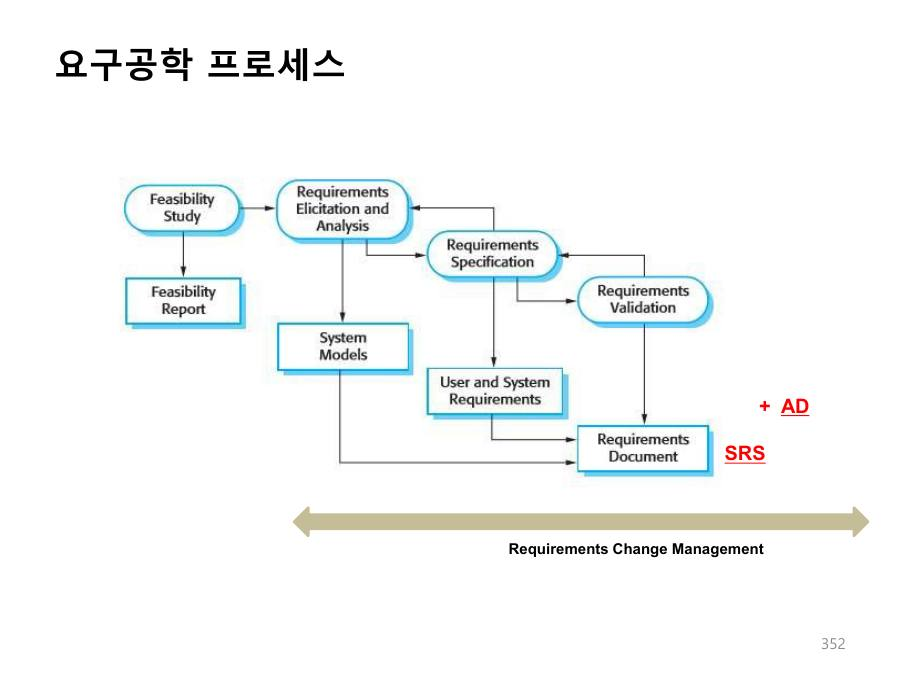

\+ AD  

SRS  

Requirements Change Management  

---

[← 이전: 9. 요구사항 확인](09_요구사항_확인.md) · [← 목차](README.md)
